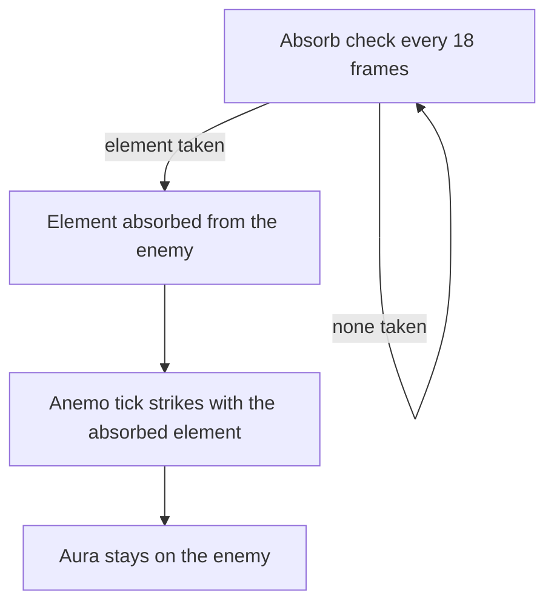

# Sucrose

Sucrose's kit is its record and one behaviour module, `createSucroseKitBehaviour`, on avatar 10000043 (`packages/genshin-world/src/services/kit/characters/sucroseKit.ts`): four strikes, a charged attack, a collision and two plunges, Astable Anemohypostasis Creation-6308 with its Swirl, and Forbidden Creation-Isomer 75 / Type II with its Anemo field, which absorbs whichever of Pyro, Hydro, Electro and Cryo an enemy within reach holds first, in gcsim's priority, and strikes it on each tick. Her multipliers are read from proud skill groups 4331, 4332 and 4339 (`{data-root}/genshin-dump-backup-6.6/ExcelBinOutput/ProudSkillExcelConfigData.json`; group 4331's index 0 is 0.33464 at level 1, and group 4332's index 1 gives Astable's 15 seconds, `{data-root}/cache/gcsim-v2.47.2/internal/characters/sucrose/skill.go:62`). Her Swirl's Elemental Mastery share at Ascension 1 (gcsim `{data-root}/cache/gcsim-v2.47.2/internal/characters/sucrose/asc.go`, `a1`: 50 Elemental Mastery for 8 seconds on each matching Swirl), the team's share of her Elemental Mastery on each skill and burst hit at Ascension 4 (`{data-root}/cache/gcsim-v2.47.2/internal/characters/sucrose/asc.go`, `a4`: 20% of her Elemental Mastery for 8 seconds), and Constellations 1, 2, 4 and 6 are built (`{data-root}/cache/gcsim-v2.47.2/internal/characters/sucrose/sucrose.go` line 33 for 1, `{data-root}/cache/gcsim-v2.47.2/internal/characters/sucrose/burst.go` line 28 for 2, `{data-root}/cache/gcsim-v2.47.2/internal/characters/sucrose/cons.go` for 4 and 6, the last called at `{data-root}/cache/gcsim-v2.47.2/internal/characters/sucrose/burst.go` line 111). Constellation 4 cuts Astable's cooldown on each seventh normal or charged attack of hers (`{data-root}/cache/gcsim-v2.47.2/internal/characters/sucrose/cons.go:12`). The skill's pull is not built, and her Hexerei team bonus is not built.

## How it works

## Decisions

- **Sucrose's field runs its absorb check on a schedule of its own, and its tick reads the enemies it is given.** gcsim checks for the absorbed element every 18 frames from 136 until one is taken (`{data-root}/cache/gcsim-v2.47.2/internal/characters/sucrose/burst.go:89`, `{data-root}/cache/gcsim-v2.47.2/internal/characters/sucrose/burst.go:117`), while the Anemo tick lands at 137 frames and then every 113 (`{data-root}/cache/gcsim-v2.47.2/internal/characters/sucrose/burst.go:77`). Each is its own field, and the absorb check reads the enemies through the field's tick, which is given them on the world's context (`KitContext.enemyMap`). The absorbed element strikes on each Anemo tick after it is taken, and the aura stays on the enemy, as gcsim's absorb check only reads it (`{data-root}/cache/gcsim-v2.47.2/internal/characters/sucrose/burst.go:108`, `{data-root}/cache/gcsim-v2.47.2/pkg/core/combat/absorb.go:17`). (`packages/genshin-world/src/services/kit/characters/sucroseKit.ts`)
- **Constellation 1's extra charge is a skill charge.** Constellation 1 adds one charge to Astable Anemohypostasis Creation, as the [kits README](../README.md#framework-decisions) gives. (`packages/genshin-world/src/services/kit/characters/sucroseKit.ts`)
- **Constellation 4's count is a status that does not run out.** Alchemania counts each normal or charged attack at the first hit's hitmark, which `NormalAttackLanded` and `ChargedAttackLanded` name, and each seventh cuts Astable's cooldown through `changeKitSkillCooldown` by a random 1 to 7 seconds drawn from the world's seeded source. Two places differ from gcsim: the kit counts an attack whether or not it struck anything, where gcsim counts only one that strikes an enemy (`{data-root}/cache/gcsim-v2.47.2/internal/characters/sucrose/cons.go:19` to `:25`), and gcsim draws whole seconds from 1 to 6 (`{data-root}/cache/gcsim-v2.47.2/internal/characters/sucrose/cons.go:35`, `60 * int(Rand * 6 + 1)`), where the kit draws its 1-to-7-second range in fractions of a second. The cached wiki page gives no range text to check that range against (see Open). (`packages/genshin-world/src/services/kit/characters/sucroseKit.ts`)

## Key files

| File                                                               | Role                                                                                                                                                                          |
| :----------------------------------------------------------------- | :---------------------------------------------------------------------------------------------------------------------------------------------------------------------------- |
| `packages/genshin-world/src/services/kit/characters/sucroseKit.ts` | `createSucroseKitBehaviour`, Sucrose's kit with Astable Anemohypostasis Creation-6308 and its Swirl, and Forbidden Creation's Anemo field, its absorb check and absorbed hits |

## Sources

- [gcsim v2.47.2](https://github.com/genshinsim/gcsim/tree/v2.47.2/internal/characters/sucrose), MIT: Sucrose's strikes' hitmarks, cancels and circles, the charged attack's box, Astable Anemohypostasis Creation-6308's circle, its frames and cooldown, Forbidden Creation's frames, ticks, absorb check and Constellations 2 and 6, Constellation 4's count and cut in `{data-root}/cache/gcsim-v2.47.2/internal/characters/sucrose/cons.go`, and her Ascension 1 and 4 passives.
- [Forbidden Creation - Isomer 75 / Type II](https://genshin-impact.fandom.com/wiki/Forbidden_Creation_-_Isomer_75_/_Type_II), Genshin Impact Wiki: the burst's tick poise. Cached with her other talents at `{data-root}/cache/genshin-wiki/Category_Sucrose_Talents.json`, which also gives Mollis Favonius's 20% Elemental Mastery share for 8 seconds and Alchemania's cut.
- **Scenario "Absorbed element strikes on each Anemo tick"** (requirement _Forbidden Creation's absorbing field_): the aura is left in place, as the [combat page](../../combat/design.md#auras) gives for a same-element strike.
- **Scenario "Ascension 4 shares Elemental Mastery"** (requirement _Ascension 1, Ascension 4 and Constellations 1, 2 and 6_): `{data-root}/cache/gcsim-v2.47.2/internal/characters/sucrose/asc.go`, lines 72 to 83, called from `{data-root}/cache/gcsim-v2.47.2/internal/characters/sucrose/skill.go` line 49 and `{data-root}/cache/gcsim-v2.47.2/internal/characters/sucrose/burst.go` line 74.

## Open

- [ ] **The wiki's Alchemania range is kept as a fraction of a second** — no source yet: `{data-root}/cache/genshin-wiki/Category_Sucrose_Talents.json` names Alchemania only in the Talent Note template of Astable and of Wind Spirit Creation, with no range text in it; the wiki's Alchemania text, or a cached page that gives the range, would settle it.
