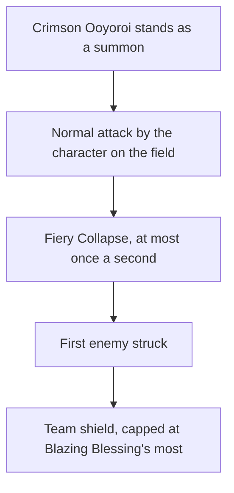

# Thoma

Thoma's kit is its record and one behaviour module, `createThomaKitBehaviour`, on avatar 10000050 (`~/Esposter.noindex/genshin-dump-backup-6.6/ExcelBinOutput/AvatarExcelConfigData.json`): four strikes (`~/Esposter/cache/gcsim-v2.47.2/internal/characters/thoma/attack.go:16`), a charged attack (`~/Esposter/cache/gcsim-v2.47.2/internal/characters/thoma/charge.go`), a collision and two plunges (the wiki's Plunging Attack rows in `~/Esposter/cache/genshin-wiki/Category_Thoma_Talents.json`), Blazing Blessing's hit with its shield and Pyro infusion, and Crimson Ooyoroi's initial hit with its Fiery Collapses. His multipliers are read from proud skill groups 5031, 5032 and 5039 (`~/Esposter.noindex/genshin-dump-backup-6.6/ExcelBinOutput/ProudSkillExcelConfigData.json`); Blazing Blessing's shield seconds, most shield and cooldown, Fiery Collapse's shield, its seconds and the seconds between collapses, the burst's seconds, cooldown and energy cost, and the charged attack's stamina are read from the same groups. The shield is set from his Max HP and the table's share and flat HP (`~/Esposter/cache/gcsim-v2.47.2/internal/characters/thoma/skill.go:47`), and his Pyro infusion lasts the 30 frames gcsim gives it (`~/Esposter/cache/gcsim-v2.47.2/internal/characters/thoma/skill.go:66`). Constellation 6 is a six-second status (`~/Esposter/cache/gcsim-v2.47.2/internal/characters/thoma/shield.go:41` to `~/Esposter/cache/gcsim-v2.47.2/internal/characters/thoma/shield.go:44`) that each Blazing Blessing restarts, which the self and party strike hooks read for normal, charged and plunging attacks.

For the burst's 15 seconds, or 18 from Constellation 2 (`~/Esposter/cache/gcsim-v2.47.2/internal/characters/thoma/burst.go:51`), the Ooyoroi stands as a summon, and a normal attack the character on the field starts sets off a Fiery Collapse from its body, at most once a second (`~/Esposter/cache/gcsim-v2.47.2/internal/characters/thoma/thoma.go:44`, `~/Esposter/cache/gcsim-v2.47.2/internal/characters/thoma/burst.go:109`): a box 4.5 metres wide and 8 long, 1U of Pyro at 11 frames (`~/Esposter/cache/gcsim-v2.47.2/internal/characters/thoma/burst.go:103`, `~/Esposter/cache/gcsim-v2.47.2/internal/characters/thoma/burst.go:105`). The first enemy a collapse strikes gives the team Thoma's shield, its share of his Max HP and its flat HP added to his shield already standing, up to the most Blazing Blessing's shield may hold, for 8 seconds (`~/Esposter/cache/gcsim-v2.47.2/internal/characters/thoma/burst.go:98`, `~/Esposter/cache/gcsim-v2.47.2/internal/characters/thoma/shield.go:37`). From Ascension 4, Flaming Assault adds 2.2% of Thoma's Max HP to each Fiery Collapse's DMG. His Ascension 1 passive, Imbricated Armor, is not built, as a shield's absorption reads the struck character's attributes without its buffs, so a Shield Strength bonus would reach no shield; Constellations 2 and 4 are built, the Ooyoroi's three seconds (`~/Esposter/cache/gcsim-v2.47.2/internal/characters/thoma/burst.go:51`) and Constellation 4's 15 energy, delayed 8 frames into the burst as gcsim gives it (`~/Esposter/cache/gcsim-v2.47.2/internal/characters/thoma/burst.go:57` to `~/Esposter/cache/gcsim-v2.47.2/internal/characters/thoma/burst.go:60`); Constellation 6 is built as above, and his other constellations are not built. Constellation 1 stays open, as its wiki Constellation page is not cached, so no source settles it. The plunges' timing, the charged attack's stamina and the burst's energy cost are provisional.

## How it works

## Decisions

- **Thoma's Fiery Collapse fires on a shielded character's damage, which no kit event reaches yet.** gcsim triggers it on each hit a shielded character takes, behind a one-second internal cooldown (`~/Esposter/cache/gcsim-v2.47.2/internal/characters/thoma/thoma.go:44`), and it sets off a shield of its own. The kit fires it from normal attacks instead, as the bullet below says.
- **Thoma's plunges land 0.4 seconds in.** gcsim gives his plunges no timing (its thoma folder has no plunge file), so his reaches and landing are Ganyu's.
- **Fiery Collapse answers the normal attacks of whoever is on the field, as Xingqiu's Raincutter does.** gcsim sets it off through the same watcher as Raincutter (`~/Esposter/cache/gcsim-v2.47.2/internal/characters/thoma/thoma.go:44`), on the normal attacks the character on the field starts, behind its one-second interval, so the Ooyoroi is a summon that coordinates with them. Its shield stacks onto the one Thoma holds, as gcsim's does (`~/Esposter/cache/gcsim-v2.47.2/internal/characters/thoma/burst.go:98`, `~/Esposter/cache/gcsim-v2.47.2/internal/characters/thoma/shield.go:20`), capped at Blazing Blessing's most (`~/Esposter/cache/gcsim-v2.47.2/internal/characters/thoma/shield.go:25`).
- **Flaming Assault takes effect from Ascension 4.** The cached wiki's `~/Esposter/cache/genshin-wiki/Category_Thoma_Talents.json` calls it Thoma's 4th Ascension Passive, so the kit gates it at Ascension 4. gcsim's `~/Esposter/cache/gcsim-v2.47.2/internal/characters/thoma/asc.go:31` gates it at Ascension 1 (its share is `~/Esposter/cache/gcsim-v2.47.2/internal/characters/thoma/asc.go:34`); the gap is the open item below.
- **Blazing Blessing's shield on a recast is capped at its most.** gcsim's `genShield` takes the larger of the new shield and the standing one, and caps it at the most without a stack (`~/Esposter/cache/gcsim-v2.47.2/internal/characters/thoma/shield.go:19` to `~/Esposter/cache/gcsim-v2.47.2/internal/characters/thoma/shield.go:25`). The kit's own recast is not read against that here, so it is open.

## Key files

| File                                                             | Role                                                                                                                                                                                                      |
| :--------------------------------------------------------------- | :-------------------------------------------------------------------------------------------------------------------------------------------------------------------------------------------------------- |
| `packages/genshin-world/src/services/kit/characters/thomaKit.ts` | `createThomaKitBehaviour`, Thoma's kit with Blazing Blessing's hit, shield and Pyro infusion, Crimson Ooyoroi's initial hit with its Fiery Collapses and their shield, his charged attack and his plunges |

## Sources

- [gcsim](https://github.com/genshinsim/gcsim/tree/v2.47.2/internal/characters/thoma), MIT: the kit's hitmarks, cancel frames and areas, the charged attack's frames, Blazing Blessing's hit, animation and shield, Crimson Ooyoroi's initial hit and animation, and Fiery Collapse's trigger, interval, box, hitmark and gauge, its shield's stacking and cap, and Flaming Assault's share of Max HP.

## Open

- [ ] **Thoma's plunges land 0.4 seconds in, with Ganyu's reaches** — no source yet: gcsim's thoma folder has no plunge file.
- [ ] **Flaming Assault's gate in gcsim is Ascension 1, not the wiki's Ascension 4** — contradicted by `~/Esposter/cache/gcsim-v2.47.2/internal/characters/thoma/asc.go:31`: its gate is Ascension 1, against the wiki's 4th Ascension Passive.
- [ ] **The kit's Blazing Blessing recast is capped at its most** — no source yet: the kit's own recast is not read against the cap gcsim gives at `~/Esposter/cache/gcsim-v2.47.2/internal/characters/thoma/shield.go` line 25.
