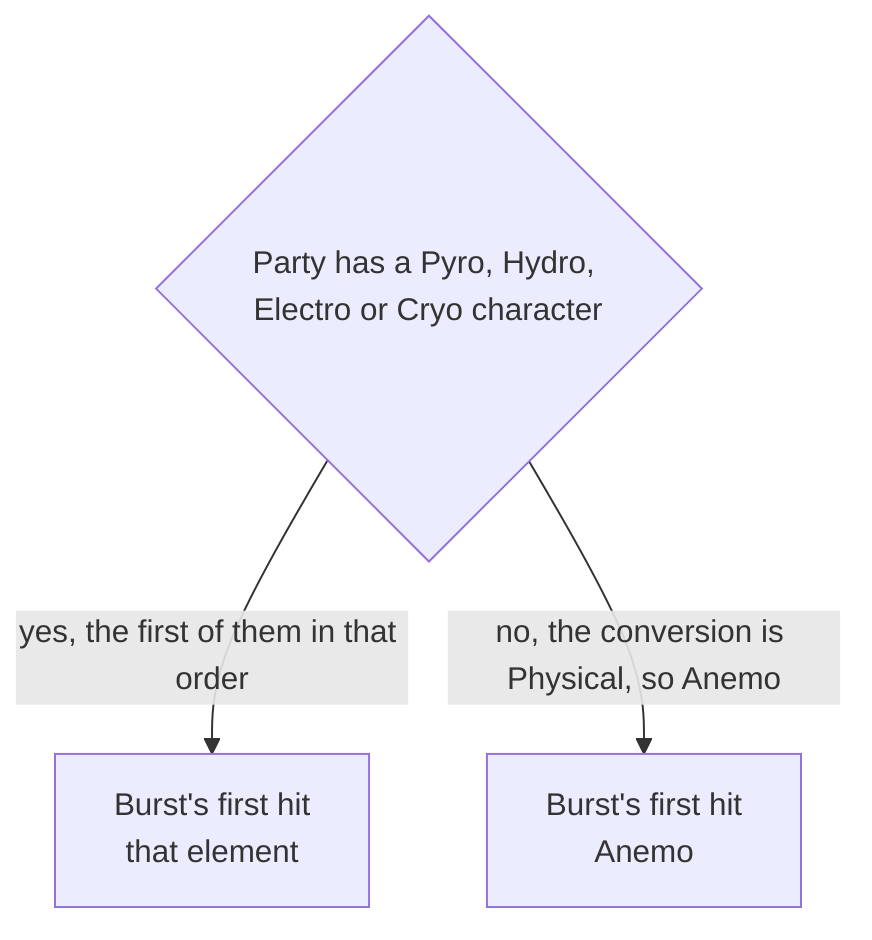

# Varka

Varka's kit is its record and one behaviour module, `createVarkaKitBehaviour`, avatar 10000128 (`{data-root}/genshin-dump-backup-6.6/ExcelBinOutput/AvatarExcelConfigData.json`): five normal attacks, a charged attack of two hits (`{data-root}/cache/gcsim-v2.47.2/internal/characters/varka/charge.go`, line 14), a collision and two plunges, his skill's hit, and the burst's two hits. Every skill hit is Anemo, and the burst's second hit is Anemo, its first by gcsim's default for a party with no Pyro, Hydro, Electro or Cryo character (see Open), and his strikes are physical (`{data-root}/cache/gcsim-v2.47.2/internal/characters/varka/attack.go`, line 72).

Proud skill groups 12832 (his skill) and 12839 (his burst) give their talent multipliers (`{data-root}/genshin-dump-backup-6.6/ExcelBinOutput/ProudSkillExcelConfigData.json`); the table reads his cooldowns as 16 and 15 seconds (skills 11282 and 11285 in `{data-root}/genshin-dump-backup-6.6/ExcelBinOutput/AvatarSkillExcelConfigData.json`, matching gcsim's `{data-root}/cache/gcsim-v2.47.2/internal/characters/varka/skill.go`, line 28, and `burst.go`, line 60), his energy cost as 60 (11285's `costElemVal`) and his charged stamina as 50 (group 12831, index 11, which also holds his attacks' multipliers).

gcsim sources: the folder `{data-root}/cache/gcsim-v2.47.2/internal/characters/varka/`, with `attack.go`, `charge.go`, `skill.go` and `burst.go`, the talent names in its `config.yml` and the multiplier tables in its generated "zz_varka.dm.go".

## Decisions

- **The burst's second hit is Anemo, and its first is Anemo in a party with no Pyro, Hydro, Electro or Cryo character.** gcsim sets his conversion element once, at Init, from the party: the first of Pyro, Hydro, Electro and Cryo it holds, else Physical (`{data-root}/cache/gcsim-v2.47.2/internal/characters/varka/varka.go` line 47, and `skill.go` lines 72 to 80). The burst's first hit takes that element, and only a Physical conversion becomes Anemo (`burst.go` lines 30 to 32), so the record's Anemo for it is that one case. The second hit is Anemo (`burst.go` line 30).
- **The skill and burst areas are the circles gcsim gives round his body.** The skill is a circle of 5 metres (`{data-root}/cache/gcsim-v2.47.2/internal/characters/varka/skill.go`, line 103), and the burst is the circle of 7 metres offset 2 metres ahead, priced at 9 metres as the area holds no offset. Both hits' areas are cited to `{data-root}/cache/gcsim-v2.47.2/internal/characters/varka/burst.go:51`, the queue call's circle, which its hit's loop iteration reads. The second hit's Wind is cited to `burst.go:30`, the entry its loop reads from `ele` by index. The first hit's Wind is `Unsourced`: it holds only for the Physical conversion that `burst.go` lines 31 and 32 turn into Anemo, as the first Decision above sets out.

- **His plunges are borrowed.** gcsim has no plunge file for Varka, so his collision and two plunges take the borrowed plunge of [how a kit is read](../README.md#how-a-kit-is-read), and the roadmap's manual verification has the question.

## Not built

- **Four Winds waits on the conversion hook.** A second press converts his skill into Four Winds (`skill.go`, lines 84-86 and 105-125). The burst's first hit takes the element set once at Init from the party, not any Four Winds state (`burst.go`, lines 30-32), so the press changes none of his hits here. The kit keeps no record of the conversion, so each hit stays at the element its record gives.
- **His passives wait on their hooks.** Each one reads his Four Winds or the party's Elemental Resonance (`asc.go` and `cons.go`), so none is built.

## Key files

| File                                                             | Role                                                                                                             |
| :--------------------------------------------------------------- | :--------------------------------------------------------------------------------------------------------------- |
| `packages/genshin-world/src/services/kit/characters/varkaKit.ts` | `createVarkaKitBehaviour`, Varka's module, built on his record and with no behaviour yet                         |
| `packages/genshin-world/src/data/kits/varka.json`                | Varka's overlay: the burst's areas, the second hit's element cited to gcsim, and the first hit's default element |

## Sources

- [gcsim](https://github.com/genshinsim/gcsim/tree/v2.47.2/internal/characters/varka), MIT: the timings of his strikes, his charged attack, skill, burst and elements, and his table data file.

## Open

- [ ] **The burst's first hit is Anemo** — contradicted by `{data-root}/cache/gcsim-v2.47.2/internal/characters/varka/varka.go` line 47 with `skill.go` lines 72 to 80: the conversion element is set once at Init from the party, the first of Pyro, Hydro, Electro and Cryo it holds, else Physical, and the burst's first hit takes that element (`burst.go` line 30). It is Anemo only for a party with none of the four (`burst.go` lines 31 and 32). The record holds Anemo for every party (`packages/genshin-world/src/data/kits/varka.json` line 8). The burst reads the conversion element, not a Four Winds state, so the state the item names is not what gcsim checks.
