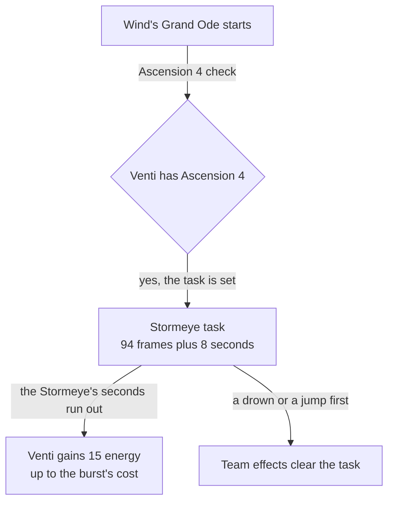

# Venti

Venti's kit is its record and one behaviour module, `createVentiKitBehaviour`, on avatar 10000022 (`~/Esposter.noindex/genshin-dump-backup-6.6/ExcelBinOutput/AvatarExcelConfigData.json`): six shots (`attack.go` line 16), the first and fourth of two arrows each, a fully charged aimed shot, a collision and two plunges, Skyward Sonnet's press and its hold, and Wind's Grand Ode's Stormeye. His multipliers are read from proud skill groups 2231, 2232 and 2239 (`~/Esposter.noindex/genshin-dump-backup-6.6/ExcelBinOutput/ProudSkillExcelConfigData.json`), and match the cached wiki's Divine Marksmanship, Skyward Sonnet and Wind's Grand Ode values (`~/Esposter/cache/genshin-wiki/Category_Venti_Talents.json`) to the wiki's precision at level 1; the hold's 15-second cooldown is group 2232's index 3 and the press's 6 seconds is its skill row's cooldown (10224, `~/Esposter.noindex/genshin-dump-backup-6.6/ExcelBinOutput/AvatarSkillExcelConfigData.json`), the Stormeye's 8 seconds is group 2239's index 2, and the burst's 15-second cooldown and 60 energy are its skill row's (10225) and group 2239's indexes 3 and 4. The press's Wind Domain and the Stormeye are summons, built over the kit framework's shared effects, with the Stormeye passive's energy from Ascension 4, Splitting Gales' arrows from one constellation, Breeze of Reminiscence's and Storm of Defiance's Anemo RES from two and six, and Hurricane of Freedom's Anemo DMG Bonus from four. Elemental Absorption, the Stormeye's pull, the hold's rise and Embrace of Winds' upcurrent, his other constellations and his Hexerei kit are not built.

## Decisions

- **Venti's arrows, shots and Wind Domain are priced round his body.** gcsim lands each arrow and shot at the primary target through a box a metre long and a tenth wide (`attack.go`, lines 53-57; `aimed.go`, lines 72-76), and the press's circle of 3 metres on it (`skill.go`, line 56), which an area does not hold, so each is priced round his body, as Amber's arrows and Mona's strikes are. gcsim's 10 frames of an arrow's flight are not added, as Amber's are not.
- **Skyward Sonnet's press ends at its earliest cancel, and its Wind Domain lands past it.** gcsim queues the press's hit 51 frames on (`skill.go`, line 55), apart from its animation, which every next action cancels at 22 frames (lines 20-25 and 49), so the press plays 22 frames and its hit, queued past the press's end, lands from where Venti stood as a skill hit. The hold's hit lands within its action at 74 frames (line 62), and the hold ends at gcsim's earliest cancel, its high plunge at 116 frames (lines 29 and 71): the rise into the air is the controller's and is not built, so the full 289 frames (line 28) would hold him still through a flight he does not take.
- **The Stormeye is a summon 5 metres ahead of where Venti faces.** gcsim places it there as the burst starts (`burst.go`, line 26) and lands its 20 ticks every 24 frames from 106 (lines 60-64), each 1U of Anemo with the wiki's 4 poise (Wind's Grand Ode's DoT row in `~/Esposter/cache/genshin-wiki/Category_Venti_Talents.json`), reaching 4 metres round it (line 41). Its ticks and the fully charged shot are priced under the standard internal cooldown, though the wiki gives each a cooldown of 1 second over 3 hits, and gcsim tags the ticks `ElementalBurstAnemo` (`burst.go`, line 34), as the standard group is the only one a kit's hit is priced under. The Stormeye's pull of the enemies within 15 metres is not built, and the 15 metres is not in the cached Venti pages, so it is open.
- **The Stormeye passive gives its energy as the Stormeye's seconds end.** From Ascension 4, a task runs 94 frames plus the burst group's 8 seconds after the burst starts, gcsim's 574 (`burst.go`, lines 14 and 69-70), and gives Venti 15 energy (`asc.go`, line 13, and the cached Stormeye page in `~/Esposter/cache/genshin-wiki/Category_Venti_Talents.json`) up to his burst's cost. The cap is the kit's own: gcsim's passive adds the 15 with no cap, and the cached page states none, so the cap is open. A drown or a jump before then clears it with the team's effects.
- **Splitting Gales' arrows land with the shot from a summon.** From one constellation, the fully charged shot's start casts two more arrows from where Venti stands, each a third of the shot's multiplier, as gcsim's `ai.Mult /= 3.0` gives it (`cons.go`, line 17), as 1U of Anemo under the Charged Attack internal cooldown, landing at the shot's hitmark (lines 18-30). The wiki's 33% and the 2 poise are open: the cached Venti pages name Splitting Gales but give no values for it.
- **Breeze of Reminiscence and Storm of Defiance are enemy statuses on RES.** From two constellations each Skyward Sonnet hit takes 12% off the Anemo and Physical RES of each enemy it strikes for 10 seconds, and from six each Stormeye tick takes 20% for gcsim's 10 seconds (`cons.go`, lines 38-57 and 83-105), the two adding up. A physical hit reads the enemy's Physical RES less each status's `physicalResistanceReduction`, as `getEnemyResistance` gives it, so the cut reaches it. Constellation 2's further cut while an enemy is airborne waits on Skyward Sonnet's hits being marked `isLaunching`, its impulse type 7 on the wiki, and the kit reading the launched status they leave.
- **Hurricane of Freedom is Venti's own buff, restarted by each pickup on the field.** From four constellations, a particle or orb the party collects while Venti is on the field gives him 25% Anemo DMG Bonus for 10 seconds, as gcsim's `OnParticleReceived` hook gives it (`cons.go`, lines 60-78), which checks only that he is the active character. The buff is keyed by its source, so a pickup restarts it rather than stacking, and a swap does not end it, as gcsim's modifier runs its 10 seconds whoever is on the field.

## Provisional constants

- **Skyward Sonnet's hold is reached at half a second, provisionally.** No table or wiki page gives a press's hold seconds, so the index's half second stands until the roadmap's References sought list's `venti-skyward-sonnet.mkv` measures it.
- **Venti's plunges are provisional.** gcsim models only the high plunge after a held Skyward Sonnet and counts its 58 frames from its start in the air (`plunge.go`, lines 17 and 48), where this kit starts a plunge's action as it lands, so each plunge lands as its action starts and ends at 0.4 seconds. The high plunge reaches gcsim's 3.5 metres (line 47), and the collision and the low plunge Amber's 1 and 3. Their poise is the wiki's Divine Marksmanship.

## Not built

- **Elemental Absorption is not built.** The Stormeye absorbs the element of what it touches, as gcsim's absorb check finds an aura within its box, and then deals the burst group's Additional Elemental DMG as that element. A summon's step reads no enemy, a hit's callbacks see no aura, and the strike loop that sees a Swirl's element is the character component's, so nothing tells the Stormeye what it touched. The Stormeye passive's energy for the party members of the absorbed element and Storm of Defiance's cut to that element's RES wait on it.
- **Ascension 1 is not built.** Holding Skyward Sonnet creates an upcurrent for 20 seconds (gcsim's own note at `asc.go`, lines 5-6, says it is not implemented), which is the controller's movement, not combat, and no kit hook moves a body, so there is no combat effect to build.
- **Venti's other passives, his other constellations and his Hexerei kit are not built.** Windrider's gliding stamina is the controller's movement, not combat. Ode to Thousand Winds and Concerto dal Cielo raise talent levels, which the [talents](../../talents/design.md) page holds. His Hexerei kit, its Windsunder Arrows and the Hexerei halves of his constellations, are not built.

## Key files

| File                                                             | Role                                                                                                                                 |
| :--------------------------------------------------------------- | :----------------------------------------------------------------------------------------------------------------------------------- |
| `packages/genshin-world/src/services/kit/characters/ventiKit.ts` | `createVentiKitBehaviour`, Venti's kit with Skyward Sonnet's Wind Domain, the Stormeye and its passive's energy, and Splitting Gales |

## Sources

- [Divine Marksmanship](https://genshin-impact.fandom.com/wiki/Divine_Marksmanship), [Skyward Sonnet](https://genshin-impact.fandom.com/wiki/Skyward_Sonnet) and [Wind's Grand Ode](https://genshin-impact.fandom.com/wiki/Wind%27s_Grand_Ode), Genshin Impact Wiki: Venti's shots', aimed shots' and plunges' gauges, their internal cooldown tags and poise, the press's and hold's gauges and poise, and the Stormeye's ticks, their gauge, tag and poise, its 20 ticks within 8 seconds, its pull and its Elemental Absorption.
- [Embrace of Winds](https://genshin-impact.fandom.com/wiki/Embrace_of_Winds), [Stormeye](https://genshin-impact.fandom.com/wiki/Stormeye), [Windrider](https://genshin-impact.fandom.com/wiki/Windrider), [Splitting Gales](https://genshin-impact.fandom.com/wiki/Splitting_Gales), [Breeze of Reminiscence](https://genshin-impact.fandom.com/wiki/Breeze_of_Reminiscence), [Ode to Thousand Winds](https://genshin-impact.fandom.com/wiki/Ode_to_Thousand_Winds), [Hurricane of Freedom](https://genshin-impact.fandom.com/wiki/Hurricane_of_Freedom), [Concerto dal Cielo](https://genshin-impact.fandom.com/wiki/Concerto_dal_Cielo) and [Storm of Defiance](https://genshin-impact.fandom.com/wiki/Storm_of_Defiance), Genshin Impact Wiki: Venti's passives and constellations, and Splitting Gales' arrows' share, gauge, tag and poise.
- [gcsim v2.47.2](https://github.com/genshinsim/gcsim/tree/v2.47.2/internal/characters/venti), MIT: the kit's hitmarks, cancel frames and areas, the high plunge's reach and frames, the Stormeye's place, ticks and absorb check, the Stormeye passive's frame, and Splitting Gales', Breeze of Reminiscence's and Storm of Defiance's effects.
- `~/Esposter.noindex/cache/gcsim-v2.47.2/internal/characters/venti/attack.go` line 16: the six shots, grounding "Venti's shots".
- `~/Esposter.noindex/cache/gcsim-v2.47.2/internal/characters/venti/attack.go` lines 53-59: the box each arrow lands through, grounding "Venti's shots".
- `~/Esposter.noindex/cache/gcsim-v2.47.2/internal/characters/venti/aimed.go` lines 72-78: the fully charged shot's box, grounding "Venti's fully charged aimed shot".
- `~/Esposter.noindex/cache/gcsim-v2.47.2/internal/characters/venti/skill.go` lines 20 and 49: the press's 22 frames, grounding "Skyward Sonnet's press and Wind Domain".
- `~/Esposter.noindex/cache/gcsim-v2.47.2/internal/characters/venti/skill.go` line 55: the Wind Domain landing after the press ends, grounding "Skyward Sonnet's press and Wind Domain".
- `~/Esposter.noindex/cache/gcsim-v2.47.2/internal/characters/venti/skill.go` line 62: the hold's hit at 74 frames, grounding "Skyward Sonnet's hold".
- `~/Esposter.noindex/cache/gcsim-v2.47.2/internal/characters/venti/skill.go` line 29: the hold ending at 116 frames, grounding "Skyward Sonnet's hold".
- `~/Esposter.noindex/cache/gcsim-v2.47.2/internal/characters/venti/burst.go` line 26: the Stormeye 5 metres ahead of Venti when the burst starts, grounding "Stormeye".
- `~/Esposter.noindex/cache/gcsim-v2.47.2/internal/characters/venti/burst.go` lines 60 to 64: the 20 Anemo ticks every 24 frames from 106 frames, grounding "Stormeye".
- `~/Esposter.noindex/cache/gcsim-v2.47.2/internal/characters/venti/burst.go` line 41: each tick reaching 4 metres round the Stormeye, grounding "Stormeye".
- `~/Esposter.noindex/cache/gcsim-v2.47.2/internal/characters/venti/cons.go` lines 17 and 18: the two extra arrows at the shot's hitmark, grounding "Splitting Gales from Constellation 1".
- `~/Esposter.noindex/cache/gcsim-v2.47.2/internal/characters/venti/cons.go` lines 38 to 57: the 12% Anemo and Physical RES cut from Constellation 2, grounding "Breeze of Reminiscence from Constellation 2".
- `~/Esposter.noindex/cache/gcsim-v2.47.2/internal/characters/venti/cons.go` lines 83 to 95: the further 20% cut from each Stormeye tick at Constellation 6, grounding "Storm of Defiance from Constellation 6".
- `~/Esposter.noindex/cache/gcsim-v2.47.2/internal/characters/venti/cons.go` lines 60 and 71: the 25% Anemo DMG Bonus on a pickup on the field, grounding "Hurricane of Freedom from Constellation 4".
