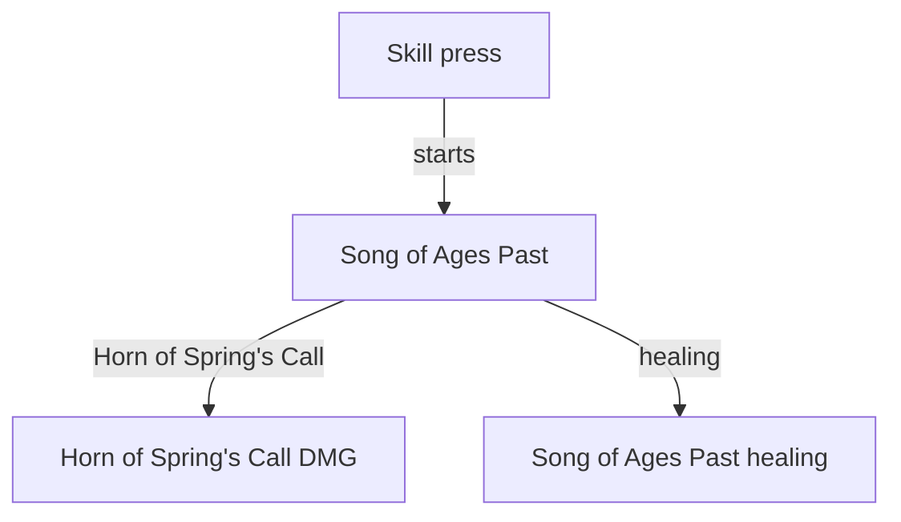

# Vodyanitsa

Vodyanitsa's kit is its record and one behaviour module, `createVodyanitsaKitBehaviour`, avatar 10000140 (`{data-root}/genshin-parity/text/ExcelBinOutput/AvatarExcelConfigData.json`; the 6.6 backup holds no entry for it). gcsim has no folder for Vodyanitsa at v2.47.2 (its `{data-root}/cache/gcsim-v2.47.2/internal/characters/` holds none at that tag), so Vodyanitsa's record follows [the kits index](../README.md).

## Decisions

- **Vodyanitsa borrows Barbara's strikes and charged attack (10000014), Columbina's skill (10000125) and Mona's burst (10000041), provisional.** Her four Hydro strikes take Barbara's four, each one hit (`{data-root}/cache/gcsim-v2.47.2/internal/characters/barbara/attack.go` line 16), and her charged attack takes Barbara's single hit's area and element. Her charged attack's hitmark is not Barbara's 55 frames (`{data-root}/cache/gcsim-v2.47.2/internal/characters/barbara/charge.go` line 14; [Barbara's kit](../barbara/design.md) cites the file): it is 41, which no source gives, so it names `NoGcsimUnit`. Her skill takes Columbina's single Hydro hit, and her burst takes Mona's (`{data-root}/cache/genshin-wiki/Category_Vodyanitsa_Talents.json`, Koda's AoE Hydro DMG), both borrowed from those donors in the record (`packages/genshin-world/src/data/kits/vodyanitsa.json`).
- **Her plunges and collision borrow Bennett's hitmarks and areas, as `NoActionFile`: her low and high plunges' hitmarks are Bennett's 36 and 38 (`{data-root}/cache/gcsim-v2.47.2/internal/characters/bennett/plunge.go` lines 21 to 22), and Bennett's plunge radii are 3 and 5 metres (the same file, lines 28 and 33), which the record holds as its low and high areas' 4 and 6 metres once the metre ahead gcsim places the low plunge at (line 93) is added.** Her high plunge's impact is Hydro, as the cached Psyshkhwe Arietta page on the wiki gives it ("AoE Hydro DMG upon impact", `{data-root}/cache/genshin-wiki/Category_Vodyanitsa_Talents.json`), so that hit is Water; her low plunge is Physical. Her plunges' frames are read from her own clips. Their poise is the wiki's 100 high and 50 low (the same page's Advanced Properties). Her plunges' hitmarks and areas are the record's `NoActionFile` values, open until her clips are measured.
- **Her skill scales with Max HP.** The wiki gives Rechitativ: Sonorous Dawn as 3.27% of Max HP at level 1 (the cached Rechitativ page's Skill DMG row, `skilldmg_1`, `{data-root}/cache/genshin-wiki/Category_Vodyanitsa_Talents.json`), which is the talent multiplier of its proud group 14032, index 0 at 0.03272 (`{data-root}/genshin-parity/text/ExcelBinOutput/ProudSkillExcelConfigData.json`; the 6.6 backup holds no group 14032), so its hit reads `FIGHT_PROP_HP`.
- **Her frames are open until her clips are measured.** They are her clips' durations, as the [kits README](../README.md) gives: the record holds them `NoGcsimUnit`, since no source gives them, so they stay open. Her strikes run from `Attack_01` to `Attack_04`, her charged attack is ExtraAttack, her skill ElementalArt_Strike, her burst `ElementalBurst`, and her plunges FallingAttack_Strike and FallingAttack_Strike_AS.
- **Her strikes and charged attack are Hydro** (`{data-root}/cache/genshin-wiki/Category_Vodyanitsa_Talents.json`, Psyshkhwe Arietta's Normal Attack text).
- **The values no source gives are `NoGcsimUnit`.** Vodyanitsa has no gcsim folder, so the values her overlay holds with no source read `NoGcsimUnit` as the [kits README](../README.md#framework-decisions) gives: her frames, her charged attack's hitmark, her skill's and burst's multipliers and her skill's scaling attribute. The wiki states the high plunge's Hydro impact and Rechitativ's Max HP scaling, but the wiki and table readers join a hit to its row by the label its gcsim candidate gives, and a kit with no folder has none, so the high plunge's element reads `NoGcsimUnit` though the wiki gives it.

## Not built

- **The Song of Ages Past effect is waiting on its module.** Her press starts it (the cached Rechitativ page's info text), and its Horn of Spring's Call and healing (the page's Horn of Spring's Call DMG and Song of Ages Past healing rows) are not built, so her skill deals its press alone.
- **Her burst's Song of Ages Past bonus is not built.** The cached Koda page gives a Song of Ages Past DMG Bonus column, and Koda: Sink With Thee deals its hit alone.

## Key files

| File                                                                  | Role                                                                           |
| :-------------------------------------------------------------------- | :----------------------------------------------------------------------------- |
| `packages/genshin-world/src/services/kit/characters/vodyanitsaKit.ts` | `createVodyanitsaKitBehaviour`, with no behaviour of Vodyanitsa's own yet      |
| `packages/genshin-world/src/data/kits/vodyanitsa.json`                | Vodyanitsa's overlay: frames, hitmarks, areas, elements and the Max HP scaling |

## Sources

- [Vodyanitsa](https://genshin-impact.fandom.com/wiki/Vodyanitsa) and [Category:Vodyanitsa Talents](https://genshin-impact.fandom.com/wiki/Category:Vodyanitsa_Talents), Genshin Impact Wiki: her multipliers, energy, cooldowns and costs, Psyshkhwe Arietta's four strikes, Rechitativ: Sonorous Dawn's Max HP scaling and Koda: Sink With Thee.
- Vodyanitsa's clips, `Ani_Avatar_Girl_Catalyst_Vodyanitsa_*`, read as [Vesna's kit](../vesna/design.md#sources) reads hers.
- [gcsim](https://github.com/genshinsim/gcsim/tree/v2.47.2/internal/characters/barbara) at v2.47.2, MIT: Barbara's hitmarks and areas for Vodyanitsa's strikes and charged attack; [Columbina](https://github.com/genshinsim/gcsim/tree/v2.47.2/internal/characters/columbina)'s for her skill; [Mona](https://github.com/genshinsim/gcsim/tree/v2.47.2/internal/characters/mona)'s for the burst; and [Bennett](https://github.com/genshinsim/gcsim/tree/v2.47.2/internal/characters/bennett)'s for her plunges and collision.

## Open

- [ ] **Her actions run as `Attack_01` to `Attack_04`, `ExtraAttack`, `ElementalArt_Strike`, `ElementalBurst`, `FallingAttack_Strike` and `FallingAttack_Strike_AS`** — no source yet: no clip or animation file for Vodyanitsa is under `{data-root}/genshin-parity` or `{data-root}/content`, or under `{data-root}/cache/animestudio-db860e1f`, so the clips read as [Vesna's kit](../vesna/design.md#sources) reads hers were not found.
- [ ] **Her skill's hit is one hit of Columbina's, and her collision's 2-metre area is Bennett's** — no source yet beyond the record's borrowed paths (`packages/genshin-world/src/data/kits/vodyanitsa.json`): Columbina's skill and Bennett's collision (`{data-root}/cache/gcsim-v2.47.2/internal/characters/bennett/plunge.go`, `plungeCollision`) were not read against the record's values.
