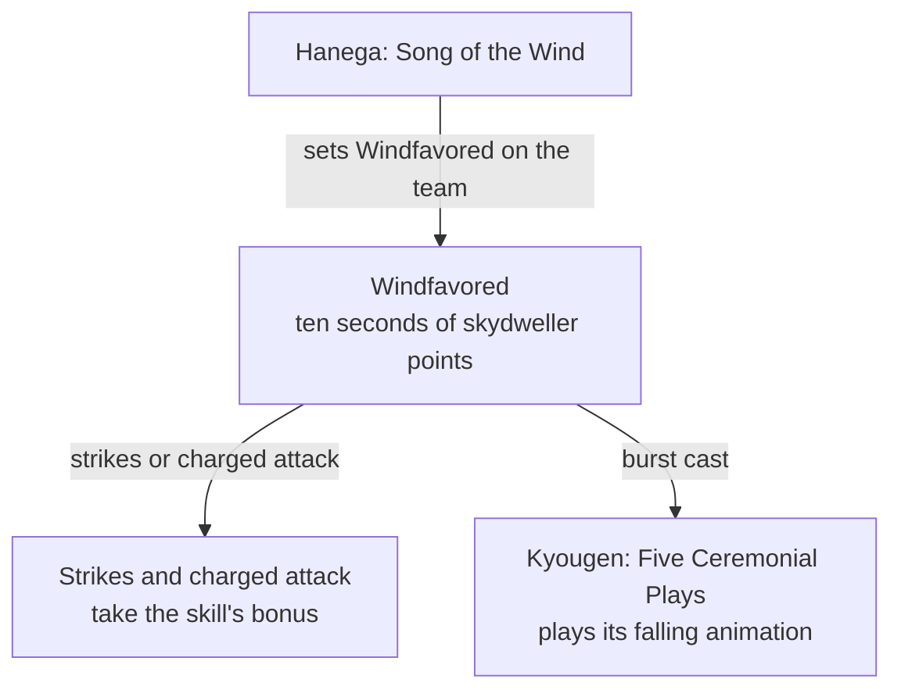

# Wanderer

Wanderer's kit is its record and one behaviour module, `createWandererKitBehaviour`, on avatar 10000075: three strikes, a charged attack, a collision and two plunges, Hanega: Song of the Wind with its Anemo circle, which sets Windfavored on the team for ten seconds, and Kyougen: Five Ceremonial Plays, five strikes on the target from 92 frames (`~/Esposter/cache/gcsim-v2.47.2/internal/characters/wanderer/burst.go`, lines 36 and 66-67). His multipliers are read from proud skill groups 7531, 7532 and 7539 (`~/Esposter/genshin-parity/text/ExcelBinOutput/ProudSkillExcelConfigData.json`); the charged attack's 50 stamina (group 7531, index 5), the skill's 6-second cooldown (group 7532, index 4, and gcsim's `~/Esposter/cache/gcsim-v2.47.2/internal/characters/wanderer/skill.go`, line 109), and the burst's 15-second cooldown and 60 energy (group 7539, indexes 1 and 2) are read from the same groups. While Windfavored holds, his strikes and charged attack take the skill's bonus, and his burst plays its falling animation. Windfavored's ten seconds are the skydweller points' hundred at six frames each (`~/Esposter/cache/gcsim-v2.47.2/internal/characters/wanderer/skill.go`, lines 33-38 and 130-133), which the kit takes as the state's full length, with no drain for his Dash and Jump. Those and the swap lock on his skill are not played yet, and his constellation passives are not built. His Ascension 1 passive waits on Kuugoryoku points, which the kit does not track: its Hydro part raises the Kuugoryoku cap (`~/Esposter/cache/gcsim-v2.47.2/internal/characters/wanderer/asc.go`, lines 142-143), and the contact that absorbs up to two enemy auras within five metres (`asc.go`, lines 103-106) is not in the kit yet. His Ascension 4 Descent waits on the same points and on the mid-air acceleration of Dash and Jump, which the kit does not build. His high plunge takes Bennett's timings and the wiki's poise, as gcsim gives Wanderer no high plunge; this is provisional.

## Decisions

- **Wanderer's high plunge takes Bennett's timing and the wiki's poise.** gcsim gives him a low plunge and its collision but no high plunge (`~/Esposter/cache/gcsim-v2.47.2/internal/characters/wanderer/plunge.go`, lines 18-19 for the low plunge at 41 frames and its collision at 36), so the record lands his high plunge at Bennett's 38 frames (`~/Esposter/cache/gcsim-v2.47.2/internal/characters/bennett/plunge.go`, line 22), with his own multiplier and the cached Yuuban Meigen page's High Plunge poise of 100 (`~/Esposter/cache/genshin-wiki/Category_Wanderer_Talents.json`); his animation showing otherwise would move it.

## Framework pieces built, not yet played

The kit layer has the three pieces Wanderer's Dash, Jump and swap lock wait on, and his kit does not play them yet.

- **A stance's own dash and jump.** `KitStanceRecord` holds a `dash` and a `jump` slot, which a stance plays in place of its kit's own.
- **A stance resource spent by its dash and jump.** The record's `resource` holds a starting count and a drain per action. `consumeKitResource` spends it as each starts, and a spend to none ends the stance.
- **A skill's swap lock.** `addKitSwapLock` starts a lock on a character, and `checkIsKitSwapBlocked` reads it where a party switch is refused.

Wanderer's kit still lacks:

- His Dash and Jump while Windfavored, which spend the skydweller points.
- The swap lock on his skill, started from the skill's `onStart`.
- Constellation 2, which reads the skydweller points that the kit does not spend.

## Key files

| File                                                                | Role                                                                                                                                                                         |
| :------------------------------------------------------------------ | :--------------------------------------------------------------------------------------------------------------------------------------------------------------------------- |
| `packages/genshin-world/src/services/kit/characters/wandererKit.ts` | `createWandererKitBehaviour`, Wanderer's kit with his strikes, charged attack and plunges, Hanega: Song of the Wind's Windfavored stance, and Kyougen: Five Ceremonial Plays |

## Sources

- [gcsim](https://github.com/genshinsim/gcsim/tree/v2.47.2/internal/characters/wanderer), MIT: Wanderer's strikes' hitmarks, cancel frames and reaches, the charged attack, the low plunge with its collision, Hanega: Song of the Wind and Windfavored's strikes, charged attack and burst, Kyougen: Five Ceremonial Plays' hitmarks, and the skydweller points.
- [gcsim](https://github.com/genshinsim/gcsim/blob/v2.47.2/internal/characters/bennett/plunge.go), MIT: the high plunge's timings, borrowed as gcsim gives Wanderer none.
