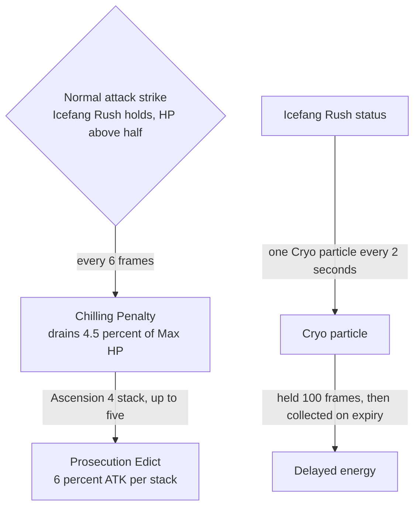

# Wriothesley

Wriothesley's kit is its record and one behaviour module, `createWriothesleyKitBehaviour`, on avatar 10000086 (`{data-root}/genshin-parity/text/ExcelBinOutput/AvatarExcelConfigData.json`): five cryo strikes, a charged attack, a collision and two plunges (`{data-root}/cache/genshin-wiki/Category_Wriothesley_Talents.json`, Forceful Fists of Frost), and Darkgold Wolfbite, five cryo strikes on the target from 99 frames (`{data-root}/cache/gcsim-v2.47.2/internal/characters/wriothesley/burst.go`, lines 14 and 43-44). His multipliers are read from proud skill groups 8631, 8632 and 8639, in the table [Wanderer's kit](../wanderer/design.md) cites; the charged attack's 50 stamina (group 8631, index 7), the skill's 16-second cooldown (group 8632, index 3, and the skill row's 16), and the burst's 15-second cooldown and 60 energy (group 8639, indexes 2 and 3) are read from the same groups, with the wiki's Icefang Rush CD of 16s and Darkgold Wolfbite CD of 15s and energy cost of 60 (`{data-root}/cache/genshin-wiki/Category_Wriothesley_Talents.json`). Each of his strikes is a box on the target (`{data-root}/cache/gcsim-v2.47.2/internal/characters/wriothesley/attack.go`, lines 19 and 86), which the kit prices as a circle of the box's length, and this is provisional.

Icefang Rush deals no damage of its own, so its action has no hits and the kit holds its animation and cooldown. The skill also starts its ten-second status (`{data-root}/cache/gcsim-v2.47.2/internal/characters/wriothesley/skill.go`, line 44; the wiki's duration of 10s, `{data-root}/cache/genshin-wiki/Category_Wriothesley_Talents.json`), which ends on a swap through `KitStatus`'s `isEndedOnSwap`. While the status holds and his HP is above half of his Max HP (`{data-root}/cache/gcsim-v2.47.2/internal/characters/wriothesley/skill.go`, lines 56-57; the party's health share, read through `getPartyMember`), each strike of his five normal attacks drains him 4.5% of his Max HP as Chilling Penalty (`{data-root}/cache/gcsim-v2.47.2/internal/characters/wriothesley/skill.go`, lines 17 and 75-82), once every 6 frames, and gives one Cryo particle every 2 seconds (`{data-root}/cache/gcsim-v2.47.2/internal/characters/wriothesley/skill.go`, lines 18-19 and 60-67). The particle is held as a delayed energy for 100 frames (the delay gcsim's "QueueParticle" takes as `ParticleDelay`, `{data-root}/cache/gcsim-v2.47.2/internal/characters/wriothesley/skill.go`, line 68; that default is not in the checkout this pass read, so the 100 frames are the framework's and open) and collected on its expiry, through `delayKitEnergy` and `collectDelayedKitEnergy`.

From Ascension 4, Prosecution Edict stacks on each self-drain of his HP and each heal that restores some of it, while the status holds and he is on the field, at most five (`{data-root}/cache/gcsim-v2.47.2/internal/characters/wriothesley/asc.go`, lines 71-72, 89 and 113). Each stack is a buff of 6% on his AttackPercent (`{data-root}/cache/gcsim-v2.47.2/internal/characters/wriothesley/asc.go`, line 129) from the edict's own source, restarted with each change so it lasts as long as the skill; recasting resets the stacks. The ATK buff is not ended by a swap, as gcsim's stat mod is not removed on exit.

From Constellation 2, each Prosecution Edict stack raises Darkgold Wolfbite's DMG by 40% while Icefang Rush holds, as gcsim's `{data-root}/cache/gcsim-v2.47.2/internal/characters/wriothesley/cons.go` gives it at the burst's snapshot (lines 114-127). The kit reads the stacks from the edict's status and the status of Icefang Rush through `getStrikeDamageBonus`, which is handed the team's effects, so the bonus is one hook of the burst's own strikes.

Not built, and why each is out of reach of the kit now:

- The enhanced strikes' damage and hitboxes wait on the publish and on the stance's behaviour. The builder emits Chilling Penalty's normal attacks at `stances.chillingPenalty.normalAttacks`: each strike's box from gcsim's enhanced attack state (2.4 by 3.4 and 2.8 by 3.4 among them, `{data-root}/cache/gcsim-v2.47.2/internal/characters/wriothesley/attack.go`, line 19) at forward offset 0, the normal attack's frames and hitmarks, its multiplier, and a `multiplierFactor` the Enhanced Repelling Fist table at the skill's level, which gcsim's `Snapshot` multiplies in. The published record does not carry the stance until publish, and the behaviour reads it through `readStance` once it does. A kit's hit takes its area from the record, not from a behaviour.
- Darkgold Wolfbite's Surging Blade, which hits at 160 frames inside a 10 by 16 box with a 10-second internal cooldown (`{data-root}/cache/gcsim-v2.47.2/internal/characters/wriothesley/burst.go`, lines 17-18, 48-51 and 69). Its multiplier is not in the record, and the kit has no timed hit to land it on.
- Ascension 1's Gracious Rebuke. It turns the charged attack into Rebuke: Vaulting Fist, which needs a charged attack variant (only burst and skill holds have one) and a +50% damage bonus that reads the Rebuke status.
- Constellations 1, 4 and 6. C1 extends Icefang Rush and needs Gracious Rebuke; C4 and C6 need Rebuke's heal and CRIT and icicle.
- The charged attack's ascension and constellation boxes.

Its `skill.hits.length`, zero, is `Unsourced`, since `{data-root}/cache/gcsim-v2.47.2/internal/characters/wriothesley/skill.go` has no `QueueAttack` call for Icefang Rush, and no line gives a count. The five burst areas are a circle set by the overlay. The converter folds a forward offset into the radius for every kit, so changing it would republish them all; the Wolfbite's offset is therefore set in its own overlay, which is where a kit's measured values are kept. gcsim's 8 by 16 box from `{data-root}/cache/gcsim-v2.47.2/internal/characters/wriothesley/burst.go`, line 38, spans from the body to 16 metres ahead and is 8 wide (gcsim's "NewRectangle" runs its corners from the spawn point to the height, as [Chiori's kit](../chiori/design.md) cites), and that circle circumscribes it: its four corners lie on the circle, so the circle covers the whole box and some ground beside and behind it. It approximates the box rather than matching its shape, which the area format cannot hold.

## Key files

| File                                                                              | Role                                                                                                                                                              |
| :-------------------------------------------------------------------------------- | :---------------------------------------------------------------------------------------------------------------------------------------------------------------- |
| `packages/genshin-world/src/services/kit/characters/wriothesleyKit.ts`            | `createWriothesleyKitBehaviour`, Wriothesley's kit with his strikes, charged attack, plunges, Icefang Rush's enhancement, Prosecution Edict and Darkgold Wolfbite |
| `packages/genshin-world/src/models/kit/KitStatus.ts`                              | `KitStatus`, which extends `KitSwapEndable` so a status such as Icefang Rush ends when its character leaves the field                                             |
| `packages/genshin-world/src/data/kits/wriothesley.json`                           | The five Darkgold Wolfbite areas as a circle 8 metres ahead, with a radius of 8.94, approximating gcsim's 8 by 16 box                                             |
| `scripts/src/services/genshinAssets/kits/gcsim/addGcsimNormalAttackCandidates.ts` | The stance pass that emits Chilling Penalty's normal attacks, with the enhanced boxes and the factor                                                              |

## Sources

- [gcsim `skill.go`](https://github.com/genshinsim/gcsim/blob/v2.47.2/internal/characters/wriothesley/skill.go), MIT: Icefang Rush's status (ten seconds and a frame), `skillBuffActive` (HP above half), `particleCB` and `particleICD` (one Cryo particle every 2 seconds), `chillingPenalty` with `skillLoseHPICD` (6 frames) and its drain of 0.045 of Max HP, and `onExit` ending the status on a swap.
- [gcsim `attack.go`](https://github.com/genshinsim/gcsim/blob/v2.47.2/internal/characters/wriothesley/attack.go), MIT: the enhanced normal attacks' boxes and callbacks, which the kit reads for the Chilling Penalty and particle timing and does not read for the box.
- [gcsim `wriothesley.go`](https://github.com/genshinsim/gcsim/blob/v2.47.2/internal/characters/wriothesley/wriothesley.go), MIT: `Snapshot`, which multiplies only `AttackTagNormal` strikes by the skill's table while the status holds.
- [gcsim zz_wriothesley.dm.go](https://github.com/genshinsim/gcsim/blob/v2.47.2/internal/characters/wriothesley/zz_wriothesley.dm.go), MIT: the `skill` multiplier table, not built.
- [gcsim `asc.go`](https://github.com/genshinsim/gcsim/blob/v2.47.2/internal/characters/wriothesley/asc.go), MIT: `a4` (stacks on a self-drain above zero and on a non-overheal heal, while on the field and the skill holds, up to five), applyA4 (6% ATK per stack for the skill's duration) and `resetA4` on cast. `a1` (Gracious Rebuke) is not built.
- [gcsim `burst.go`](https://github.com/genshinsim/gcsim/blob/v2.47.2/internal/characters/wriothesley/burst.go), MIT: Darkgold Wolfbite's hitmarks, which the record holds, and its 8 by 16 box, which the record does not hold as a box.
- [gcsim `cons.go`](https://github.com/genshinsim/gcsim/blob/v2.47.2/internal/characters/wriothesley/cons.go), MIT: Constellation 2's damage bonus, built, and Constellations 1, 4 and 6, not built.
- [gcsim `wriothesley.go`](https://github.com/genshinsim/gcsim/blob/v2.47.2/internal/characters/wriothesley/wriothesley.go), MIT: the strikes' multipliers, the charged attack, plunges and their collision, Icefang Rush's animation and Darkgold Wolfbite's hitmarks and animation, as the record already reads them.

## Open

- [ ] **The particle's 100-frame delay** — no source yet: gcsim's `ParticleDelay` default is not in the cached checkout, so the framework's 100 frames stand unsourced.
