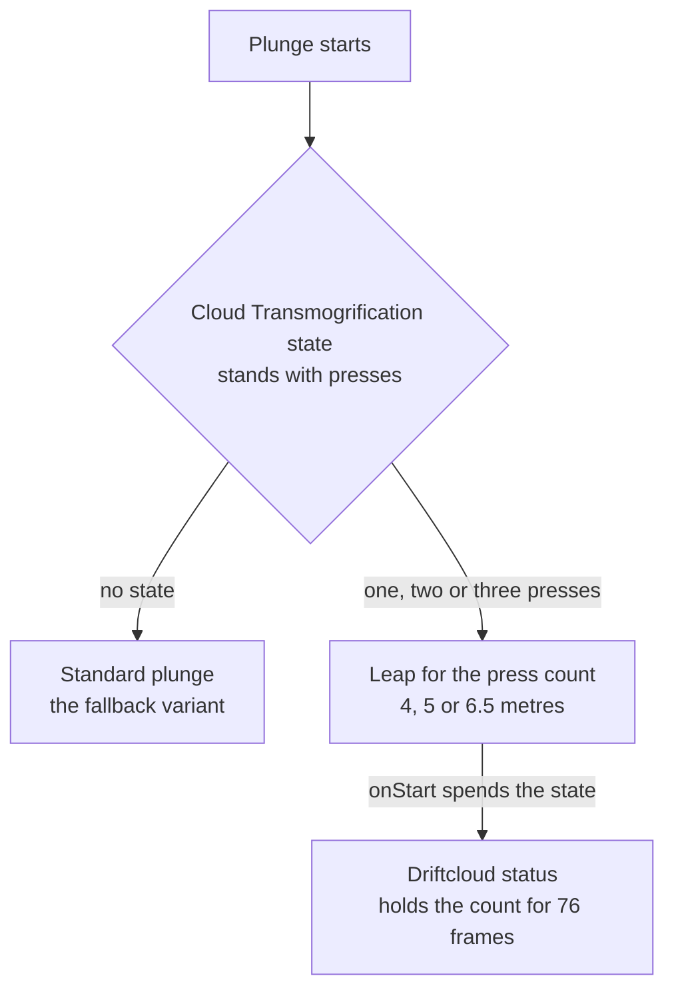

# Xianyun

Xianyun's kit is its record and one behaviour module, `createXianyunKitBehaviour` (`packages/genshin-world/src/services/kit/characters/xianyunKit.ts`), on avatar 10000093 (`{data-root}/genshin-dump-backup-6.6/ExcelBinOutput/AvatarExcelConfigData.json`): four strikes (`{data-root}/cache/gcsim-v2.47.2/internal/characters/xianyun/attack.go` line 20), a charged attack, a collision and two plunges, Stars Gather at Dusk's hit, and Skyladder's three presses in one state. Her multipliers are read from proud skill groups 9331, 9332 and 9339 (`{data-root}/genshin-dump-backup-6.6/ExcelBinOutput/ProudSkillExcelConfigData.json`), and match gcsim's `{data-root}/cache/gcsim-v2.47.2/internal/characters/xianyun/zz_xianyun.dm.go` tables at level 1: the strikes and charged attack from 9331, the skill and leaps from 9332, and the burst from 9339. Her skill's 12-second cooldown is group 9332's index 4, and her burst's 18-second cooldown and 70 energy are group 9339's indexes 9 and 10; gcsim's `{data-root}/cache/gcsim-v2.47.2/internal/characters/xianyun/skill.go` line 78 and `{data-root}/cache/gcsim-v2.47.2/internal/characters/xianyun/burst.go` line 47 give the two cooldowns. Driftcloud Wave is built as a plunge variant per press count, with Constellations 1, 2, 4 and 6 on top; Constellation 2's ATK buff is built below. Starwicker, her burst's heals, the airborne buff the burst gives the party, and her passives are not built. Her strikes take the wiki's 7.6, 7.3, 9.2 and 12.2, her charged attack the wiki's 90, her collision the wiki's 5, her plunges the wiki's 100 high and 50 low and her Skyladder press the wiki's 30; gcsim gives no poise to any of her hits, so each takes the wiki's row (`{data-root}/cache/genshin-wiki/Category_Xianyun_Talents.json`), her follow-up presses take the wiki's 30 too, and her Driftcloud Wave leaps take the wiki's 75, 75 and 150 by level, which the overlay does not yet carry.

## Decisions

- **Constellation 1's extra charge is a skill charge.** Constellation 1 adds one through `getSkillChargeBonus` to White Clouds at Dawn, as the [kits README](../README.md#framework-decisions) gives. gcsim's `c1()` sets the skill's charges to two (`{data-root}/cache/gcsim-v2.47.2/internal/characters/xianyun/cons.go`, lines 30-36), the same one extra charge.
- **The Cloud Transmogrification state's length is provisional.** The cached White Clouds at Dawn note (`{data-root}/cache/genshin-wiki/Category_Xianyun_Talents.json`) gives three seconds, which is 180 frames, against gcsim's 220 for the first press (`{data-root}/cache/gcsim-v2.47.2/internal/characters/xianyun/skill.go` line 16), and the kit keeps gcsim's value. The roadmap's manual verification has the question.
- **The follow-ups' element is provisional.** gcsim sets `attributes.Anemo` at `{data-root}/cache/gcsim-v2.47.2/internal/characters/xianyun/skill.go` line 95, a Go constant this reader does not evaluate, so the record keeps the element `Unsourced`. The roadmap's manual verification has the question.
- **Constellation 4's ratio per press count is provisional.** The cached pages do not hold its text, so whether the game gives a ratio per press count is open; gcsim indexes its first ratio, and the kit reads the leap's own count. The roadmap's manual verification has the question.
- **The leap's hitmarks and radii are recorded `Unsourced`.** gcsim gives them at `{data-root}/cache/gcsim-v2.47.2/internal/characters/xianyun/plunge.go` lines 17 and 18, and the [kits README](../README.md#framework-decisions) refuses `Unsourced` at a path a source gives, so the overlay's entries are wrong as they stand.

## Skyladder's presses

Skyladder's first press sets the Cloud Transmogrification state for 220 frames, as gcsim's "skillStateDur" does (`{data-root}/cache/gcsim-v2.47.2/internal/characters/xianyun/skill.go`, line 16), and holds one press in it as the state's stacks. The state's second and third presses are `skillChain` follow-ups, which play their own animations (243 and 178 frames) and set the state for 238 and 179 frames. Each follow-up's frames are cited to gcsim's `{data-root}/cache/gcsim-v2.47.2/internal/characters/xianyun/skill.go` (lines 46 and 56), its state's length to line 16, and its hitmark to line 20. Its element is `Unsourced`, as gcsim sets `attributes.Anemo` at line 95, a Go constant this reader does not evaluate (open above). A chained press starts no cooldown, which matches gcsim: it sets the cooldown only when the chain starts, and a chain's presses are its own (`{data-root}/cache/gcsim-v2.47.2/internal/characters/xianyun/skill.go`, lines 69-81).

The engine has one chain window, `windowSeconds`, where gcsim closes each press's window at its own state's end. The window here is 238 frames, the second press's, so a second press up to 18 frames past the first state's end still plays as a follow-up. That is the approximation.

## Driftcloud Wave

While the state stands, a plunge plays a leap for the press count the state holds: one press plays the leap at 4 metres, two at 5 and three at 6.5 (`{data-root}/cache/gcsim-v2.47.2/internal/characters/xianyun/plunge.go`, line 18), each with its own frames cited to gcsim's `{data-root}/cache/gcsim-v2.47.2/internal/characters/xianyun/plunge.go` (lines 40, 49 and 58) and its multiplier read from proud skill group 9332's index one to three (`{data-root}/genshin-dump-backup-6.6/ExcelBinOutput/ProudSkillExcelConfigData.json`), which gcsim's `leap` table matches (`{data-root}/cache/gcsim-v2.47.2/internal/characters/xianyun/zz_xianyun.dm.go`, line 198). Its hitmarks, 35, 40 and 46 frames, and its radii are gcsim's "plungeHitmarks" and "plungeRadius" arrays (`{data-root}/cache/gcsim-v2.47.2/internal/characters/xianyun/plunge.go`, lines 17 and 18), which the overlay still records as `Unsourced`; its element is gcsim's `{data-root}/cache/gcsim-v2.47.2/internal/characters/xianyun/plunge.go` line 115, Anemo, and its gauge is the wiki's 1, which each `Driftcloud Wave DMG Lv.1` to `Lv.3` row gives (`{data-root}/cache/genshin-wiki/Category_Xianyun_Talents.json`). Its poise is the wiki row its level names, `Lv.1` to `Lv.3`, which the label finder reads as the leap's place: 75, 75 and 150 (`{data-root}/cache/genshin-wiki/Category_Xianyun_Talents.json`). The overlay does not yet carry those values, so the record's poise waits on the overlay's entries. Each leap's `checkIsActive` reads the state's stacks, and its `onStart` spends the state and leaves the count on a Driftcloud status for 76 frames, the longest of the three leaps (`{data-root}/cache/gcsim-v2.47.2/internal/characters/xianyun/plunge.go`, line 58), which covers every hit. The engine's landing picks the variant, the standard plunge is the fallback, as a plunge variant is built.

## Constellation 4 and 6

Constellation 4's heal reads the press count the leap's status holds, so the heal is one of 50%, 80% or 150% of Xianyun's ATK for one, two or three presses (`{data-root}/cache/gcsim-v2.47.2/internal/characters/xianyun/cons.go`, line 25). It heals the active character, which is Xianyun, the one who makes the leap, and it has a five-second ICD (`{data-root}/cache/gcsim-v2.47.2/internal/characters/xianyun/cons.go`, lines 20 and 63-88). gcsim's C4 closure reads the press counter after the leap's attack is queued and its hit resets the counter (`{data-root}/cache/gcsim-v2.47.2/internal/characters/xianyun/plunge.go`, lines 122-126), so gcsim's heal indexes the first ratio's 0. The cached pages do not hold Constellation 4's text, so whether the game gives a ratio per press count is open; this kit reads the leap's own press count instead, and the difference is named here.

Constellation 6's burst gives eight presses that cost no cooldown for 16 seconds, as gcsim's `c6()` does (`{data-root}/cache/gcsim-v2.47.2/internal/characters/xianyun/cons.go`, lines 21 and 89-94). A press spends one through `consumeKitResource`, and its cooldown multiplier is zero while any remain (gcsim's `{data-root}/cache/gcsim-v2.47.2/internal/characters/xianyun/skill.go` skips the press's cooldown while the tag holds, lines 71-75). `checkIsSkillCooldownWaived` lets such a press start while its cooldown runs, which the kit's readiness check reads before the cooldown. Constellation 6's CRIT DMG applies to the Driftcloud Wave's hit by the count the status holds, one to three presses at 15%, 35% and 70%, as gcsim's `c6mod` does with skillCounter (`{data-root}/cache/gcsim-v2.47.2/internal/characters/xianyun/cons.go`, lines 26 and 97-102; `{data-root}/cache/gcsim-v2.47.2/internal/characters/xianyun/plunge.go`, line 120).

## Not built

- **Skyladder's once-per-enemy-per-state limit** — gcsim strikes each enemy once per state, and a press here strikes every enemy in its reach again. It waits on a hit that strikes each enemy once per state. gcsim's "skillEnemiesHit" does that (`{data-root}/cache/gcsim-v2.47.2/internal/characters/xianyun/skill.go`, lines 81 and 102-112), and the wiki's note gives one Skyladder DMG per opponent.
- **The wiki's White Clouds at Dawn cooldown cut** — the wiki says that with no Driftcloud Wave in the state, the next White Clouds at Dawn cooldown drops by 3 seconds. gcsim models it as "cooldownReduce" (`{data-root}/cache/gcsim-v2.47.2/internal/characters/xianyun/skill.go`, lines 116 and 129-137), which this kit does not yet.
- **Starwicker** — the burst's plunge hook. While the burst's airborne buff stands on the active character, a plunge of any party member deals Starwicker at 4.8 metres, up to 8 times (`{data-root}/cache/gcsim-v2.47.2/internal/characters/xianyun/burst.go`, lines 26, 94 and 141), and heals the party on its own timer every 2.5 seconds (`{data-root}/cache/gcsim-v2.47.2/internal/characters/xianyun/burst.go`, lines 97-99; the wiki's Stars Gather at Dusk page gives the same interval). It waits on a reaction to a party member's plunge landing, which `KitEventKind` does not yet carry.
- **The burst's heals** — the instant heal at the burst's hitmark (`{data-root}/cache/gcsim-v2.47.2/internal/characters/xianyun/burst.go`, lines 76 and 103), and the continuous heals every 2.5 seconds for 16 seconds (`{data-root}/cache/gcsim-v2.47.2/internal/characters/xianyun/burst.go`, lines 20, 24 and 97-99). `KitPartyHeal` rides a hit only as the hit strikes an enemy, so a heal with no enemy struck waits on a party heal the kit's own timer can give.
- **The airborne buff** — the higher jumps it gives the party (`{data-root}/cache/gcsim-v2.47.2/internal/characters/xianyun/burst.go`, lines 84-91). It waits on a party buff the controller's jump reads.
- **Passives** — not built.

## Constellation 2

From Constellation 2, each White Clouds at Dawn press gives Xianyun 20% ATK for 15 seconds, as gcsim's `c2buff` does from its skill function (`{data-root}/cache/gcsim-v2.47.2/internal/characters/xianyun/cons.go` line 19, `{data-root}/cache/gcsim-v2.47.2/internal/characters/xianyun/cons.go` line 43, [gcsim's constellation file](https://github.com/genshinsim/gcsim/blob/v2.47.2/internal/characters/xianyun/cons.go), MIT). The buff is a `buffKitMember` on her own `AttackPercent`, keyed by attribute and source, so a press restarts the 15 seconds rather than stacking a second buff, as gcsim's AddStatMod under its one key does.

## Key files

| File                                                                          | Role                                                                                                                                                        |
| :---------------------------------------------------------------------------- | :---------------------------------------------------------------------------------------------------------------------------------------------------------- |
| `packages/genshin-world/src/services/kit/characters/xianyunKit.ts`            | `createXianyunKitBehaviour`, Xianyun's kit: Skyladder's presses, Driftcloud Wave, Constellations 1, 2, 4 and 6                                              |
| `packages/genshin-world/src/services/kit/characters/xianyunSkyladder.test.ts` | The Skyladder count, the leap variants, the Constellation 4 heal and the Constellation 6 presses and CRIT DMG                                               |
| `packages/genshin-world/src/services/kit/effects/consumeKitResource.ts`       | Spends an amount of a resource a character holds, for Constellation 6's presses                                                                             |
| `packages/genshin-world/src/services/kit/startNextKitAction.ts`               | The skill's readiness, which `checkIsSkillCooldownWaived` can waive                                                                                         |
| `packages/genshin-world/src/data/kits/xianyun.json`                           | The overlay: the follow-up presses, the leaps and the chain window, cited to gcsim where the reader can evaluate the line, and `Unsourced` values elsewhere |

## Sources

- [gcsim](https://github.com/genshinsim/gcsim/tree/v2.47.2/internal/characters/xianyun), MIT: the strikes' hitmarks, cancel frames and circles, the charged attack's frames and circle, the plunges' frames and circles, Skyladder's press and Stars Gather at Dusk's hit, and the travel each strike takes.
- The game's proud skill groups 9331, 9332 and 9339, read through the hosted talent multipliers: each multiplier and cooldown matches gcsim's `{data-root}/cache/gcsim-v2.47.2/internal/characters/xianyun/zz_xianyun.dm.go` tables at talent level 1.
- [gcsim's constellation file](https://github.com/genshinsim/gcsim/blob/v2.47.2/internal/characters/xianyun/cons.go), MIT: Constellation 1's charges, Constellation 2's buff, Constellation 4's ratios and ICD, and Constellation 6's CRIT DMG and presses. The `{data-root}/cache/gcsim-v2.47.2/internal/characters/xianyun/skill.go` lines cited in the overlay are the state durations at line 16, the press hitmark at 20, and the leaps at 46 and 56.
- [Word of Wind and Flower](https://genshin-impact.fandom.com/wiki/Word_of_Wind_and_Flower) and [White Clouds at Dawn](https://genshin-impact.fandom.com/wiki/White_Clouds_at_Dawn), Genshin Impact Wiki: the poise of her strikes, charged attack, collision, plunges and Skyladder presses, and on [White Clouds at Dawn](https://genshin-impact.fandom.com/wiki/White_Clouds_at_Dawn) the Driftcloud Wave gauge and poise, and the state's note and cooldown cut; and [Stars Gather at Dusk](https://genshin-impact.fandom.com/wiki/Stars_Gather_at_Dusk) for Starwicker's 2.5-second interval.
