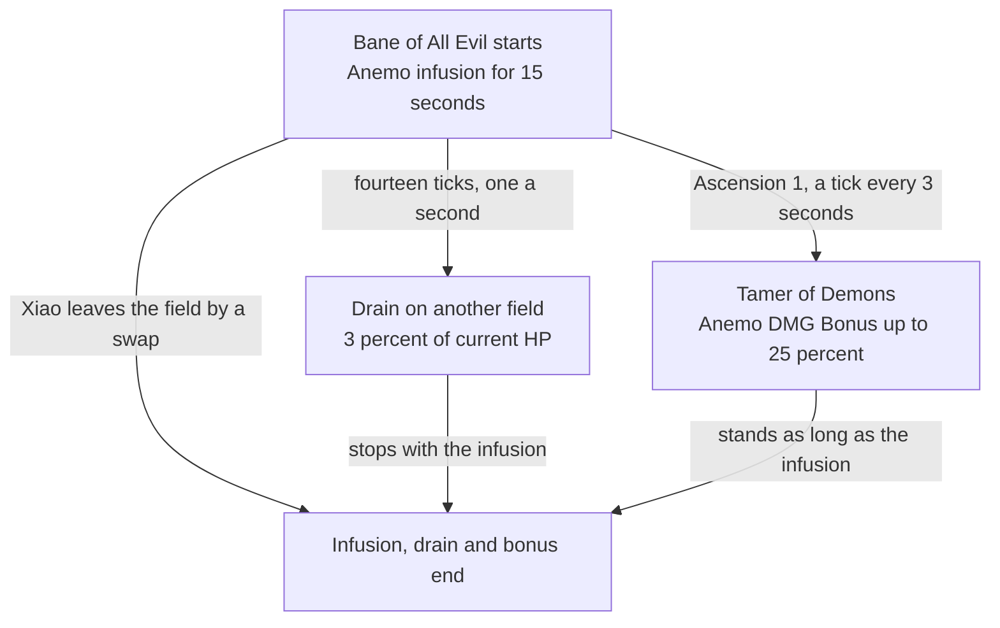

# Xiao

Xiao's kit is its record and one behaviour module, `createXiaoKitBehaviour`, on avatar 10000026 (the record is cited in [Ganyu's kit](../ganyu/design.md)): six strikes (`{data-root}/cache/gcsim-v2.47.2/internal/characters/xiao/attack.go:16`), the first and fourth of two hits each, a charged attack (`{data-root}/cache/gcsim-v2.47.2/internal/characters/xiao/charge.go:14`), a collision and two plunges (`{data-root}/cache/gcsim-v2.47.2/internal/characters/xiao/plunge.go`), Lemniscatic Wind Cycling's dash (`{data-root}/cache/gcsim-v2.47.2/internal/characters/xiao/skill.go:18`), and Bane of All Evil (`{data-root}/cache/gcsim-v2.47.2/internal/characters/xiao/burst.go:31`). His multipliers are read from proud skill groups 2631, 2632 and 2639 (`{data-root}/genshin-dump-backup-6.6/ExcelBinOutput/ProudSkillExcelConfigData.json`) at talent level 1, and match the wiki's Whirlwind Thrust and Lemniscatic Wind Cycling values to two decimal places and its Bane of All Evil value to the wiki's one (`{data-root}/cache/genshin-wiki/Category_Xiao_Talents.json`: 58.5 is its rounding of the table's 58.45); the charged attack's stamina, the skill's cooldown, and the burst's DMG Bonus, drain, duration, cooldown and cost are read from the same groups. The dash lands from a summon, and Bane of All Evil is an infusion that converts his attacks to Anemo, each carrying the burst's DMG Bonus at its converted poise and reach, beside fields that drain his current HP each second and end the burst as he leaves the field, built over the kit framework's shared effects, with Tamer of Demons' Anemo DMG Bonus from Ascension 1 and Heaven Fall's stacking dash bonus from Ascension 4, on the skill's two charges. The burst's jump, interruption resistance and priority over another infusion, the dash's particles, Gravity Defier and his Constellation 6 is not built, while Constellations 1, 2 and 4 are built (`{data-root}/cache/gcsim-v2.47.2/internal/characters/xiao/xiao.go:37`, `{data-root}/cache/gcsim-v2.47.2/internal/characters/xiao/cons.go:21`, `{data-root}/cache/gcsim-v2.47.2/internal/characters/xiao/cons.go:40`).

## Decisions

- **Bane of All Evil is an infusion that converts Xiao's attacks and carries its DMG Bonus.** The burst's action has no hits: as it starts, an Anemo infusion that converts his attacks stands for the burst group's 15 seconds past gcsim's 57-frame start, and each hit it infuses carries the group's 58.45% as its own DMG Bonus (`{data-root}/genshin-dump-backup-6.6/ExcelBinOutput/ProudSkillExcelConfigData.json`, group 2639 at level 1, which rises to 117.95% at level 15; gcsim reads the burst's bonus by level at `{data-root}/cache/gcsim-v2.47.2/internal/characters/xiao/xiao.go` line 84). The bonus is the Normal, Charged and Plunging Attacks' alone, so a buff to his Anemo DMG Bonus would raise his dash too. gcsim converts the attacks' element as it snapshots them (`{data-root}/cache/gcsim-v2.47.2/internal/characters/xiao/xiao.go` lines 66 to 83) rather than through a weapon infusion; the wiki names the effect one no other infusion overrides. Each converted hit takes the wiki's converted poise, half as much again (the wiki's Whirlwind Thrust and Bane of All Evil pages in `{data-root}/cache/genshin-wiki/Category_Xiao_Talents.json`), and gcsim's reach under the burst (`{data-root}/cache/gcsim-v2.47.2/internal/characters/xiao/attack.go` lines 28 to 43), up to 0.4 metres further on a strike (the sixth, 2.0 against 2.4 metres). The burst's 15 seconds, 18-second cooldown and 70 energy are the group's (indices 2 to 4 of the same row).
- **Bane of All Evil ends as Xiao leaves the field, and drains his current HP while it stands.** The infusion and Tamer of Demons' bonus end with the swap that takes him off the field, as gcsim's `{data-root}/cache/gcsim-v2.47.2/internal/characters/xiao/burst.go` lines 62 to 68 delete the burst's status on a swap, and the drain stops with the infusion. Another field takes the group's 3% of his current HP every second from 60 frames past the burst's start, fourteen times, the last a second before the burst ends, as gcsim's `{data-root}/cache/gcsim-v2.47.2/internal/characters/xiao/burst.go` lines 37 to 49 do. 3% is the share at talent levels 1 to 3; the row steps down to 2.5% and then 2%, and gcsim's line 45 reads the share by level. A share of his current HP always leaves him above zero, so the drain never downs him (`damagePartyMember` keeps the remaining share above zero). The drain and the bonus each act only while the infusion stands, so neither outlasts a swap within the step it happens.
- **Tamer of Demons is an Anemo DMG Bonus.** From Ascension 1, a field ticks every 3 seconds from the burst's start and restarts a buff of 5% for each tick so far, up to 25% at 12 seconds, standing as long as the infusion, as gcsim's `{data-root}/cache/gcsim-v2.47.2/internal/characters/xiao/asc.go` line 25 counts it. The passive raises all of Xiao's DMG, all of which is Anemo under the burst, so the buff is on his Anemo DMG Bonus.
- **Lemniscatic Wind Cycling's dash lands from a summon.** The skill's action has no hits: its start casts a summon where Xiao stands, which lands the dash at gcsim's 4 frames (`{data-root}/cache/gcsim-v2.47.2/internal/characters/xiao/skill.go` line 59) as 1U of Anemo with 100 poise (the wiki's Lemniscatic Wind Cycling Advanced Properties in `{data-root}/cache/genshin-wiki/Category_Xiao_Talents.json`), and the skill plays gcsim's 37 frames (`{data-root}/cache/gcsim-v2.47.2/internal/characters/xiao/skill.go` line 18). gcsim lands the dash (`{data-root}/cache/gcsim-v2.47.2/internal/characters/xiao/skill.go` lines 52 to 57) as a circle of 0.8 metres on the primary target, a shape an area does not hold, so it reaches 5 metres round him, provisionally (see Provisional constants), and the dash's own movement is the controller's, which a kit does not move. The wiki's internal cooldown of 0.1 seconds never holds a dash back, so it carries none.
- **Heaven Fall's stacks are the dashes standing.** From Ascension 4, a dash's summon stands for gcsim's 15 frames and 420 more (`{data-root}/cache/gcsim-v2.47.2/internal/characters/xiao/skill.go` line 65, `{data-root}/cache/gcsim-v2.47.2/internal/characters/xiao/asc.go` line 48), the life of the stack it gives, and each dash reads its stacks off those standing, up to 3, carrying 15% for each as its own DMG Bonus (`{data-root}/cache/gcsim-v2.47.2/internal/characters/xiao/asc.go` line 46), and restarts them, as a new stack restarts the effect. gcsim gains a stack a quarter of a second after its dash (`{data-root}/cache/gcsim-v2.47.2/internal/characters/xiao/skill.go` line 65), where this kit restarts the standing ones as the dash starts, so a stack lapsing within that quarter second lives on here. On the skill's two charges a second dash may fall within the first's 7 seconds, and reads the first's stack as it starts.
- **Xiao's charged attack carries no internal cooldown.** The wiki tags it Charged Attack with a 0.5-second timer, which never holds back a thrust that follows a strike and plays 45 frames, so it carries none; gcsim's count of a converted thrust under the Normal Attack cooldown (`{data-root}/cache/gcsim-v2.47.2/internal/characters/xiao/xiao.go` lines 75 to 78) is not followed. It is gcsim's fan of 200 degrees and 3 metres round the body at 16 frames, 3.2 metres converted (`{data-root}/cache/gcsim-v2.47.2/internal/characters/xiao/charge.go` lines 14 and 45 to 52), and its 25 stamina (the wiki's "chargedStamina" in `{data-root}/cache/genshin-wiki/Category_Xiao_Talents.json`) is spent as it starts.
- **Xiao's areas are priced with their offsets, at gcsim's fan angles.** gcsim centres each strike's circle up to 1.1 metres ahead of the body or 0.1 behind it and opens it to a fan of 150 to 360 degrees (`{data-root}/cache/gcsim-v2.47.2/internal/characters/xiao/attack.go` lines 45 to 53), so each reach is its offset plus its radius at that angle, 1.7 to 3.1 metres and 1.9 to 3.5 converted (the 1.7 is the fourth strike's 1.6 at 0.1 behind, `{data-root}/cache/gcsim-v2.47.2/internal/characters/xiao/attack.go` lines 32 and 49; the 3.5 the sixth's 2.4 at 1.1 ahead, lines 42 and 51), and spawns the first strike's second hit and the fifth strike as boxes on their near edge at the body (lines 108 to 115), each priced as the circle to its far corner. His plunges are gcsim's under the burst, the only ones it models, both landing at 46 frames (`{data-root}/cache/gcsim-v2.47.2/internal/characters/xiao/plunge.go` lines 32 and 148) and ending at 62 and 66 (lines 50 and 56), counted from the plunge's action, and reaching 4 and 6 metres converted (lines 147 and 230).
- **Constellation 2's Energy Recharge is off-field, read from the deployed team.** gcsim's `{data-root}/cache/gcsim-v2.47.2/internal/characters/xiao/cons.go` lines 14 to 27 give Xiao 25% Energy Recharge while `c.Core.Player.Active() != c.Index()` (line 21), so `getPassiveBonuses` reads his entry's `isOnField` from the deployed team, as Collei's Constellation 1 does.
- **Constellation 4's DEF Bonus is a passive bonus read from his HP share.** `getPassiveBonuses` receives the health share the step gives, as Bennett's Constellation 2 does, so the 100% DEF Bonus holds while his HP is under half and lapses above it (`{data-root}/cache/gcsim-v2.47.2/internal/characters/xiao/cons.go` lines 31 to 46, which also holds it at exactly half; see Provisional constants).

- **Constellation 1's extra charge is a skill charge.** Dissolution Eon: Destroyer of Worlds gives Lemniscatic Wind Cycling a charge beyond its two (`{data-root}/cache/gcsim-v2.47.2/internal/characters/xiao/xiao.go` lines 36 to 38), a charge count, so Constellation 1 adds one through `getSkillChargeBonus`, as Ganyu's Constellation 2 does.

## Provisional constants

- **The dash's 5-metre reach is provisional.** gcsim's dash is a 0.8-metre circle on the primary target (`{data-root}/cache/gcsim-v2.47.2/internal/characters/xiao/skill.go` lines 52 to 57), and the wiki's Lemniscatic Wind Cycling page gives no reach, so the 5 metres round Xiao stand in until a source gives one.
- **The Constellation 4 boundary is open.** gcsim holds the 100% DEF Bonus at exactly half HP (`{data-root}/cache/gcsim-v2.47.2/internal/characters/xiao/cons.go` line 40 tests `<= 0.5`), and the kit tests `healthShare < 0.5`, which does not; the wiki's Transcension: Extinction of Suffering page is not in the cache to settle it.
- **The high plunge's 2.4-metre drop is open.** `HIGH_PLUNGE_MIN_HEIGHT` in `packages/genshin-world/src/services/kit/constants.ts` gives it as the wiki's, but the wiki's plunging attack page is not in the cache, and gcsim's `{data-root}/cache/gcsim-v2.47.2/internal/characters/xiao/plunge.go` has no height.

## Not built

- **Xiao's jump and his Constellation 6 is not built.** Lemniscatic Wind Cycling holds its 2 charges, as the skill set, the wiki and gcsim's `{data-root}/cache/gcsim-v2.47.2/internal/characters/xiao/xiao.go` lines 36 to 38 give them, before Constellation 1 adds the third. Bane of All Evil's higher jump is the controller's, which reads no kit, so a high plunge still needs a drop over 2.4 metres (see Provisional constants); its interruption resistance has nothing to act on, and its infusion is the first on him in the team's list rather than one no other overrides, so Fire Ventures With Me's Pyro, cast before it, would win. The dash's 3 particles are not built, his plunges' immunity to fall damage has nothing to spare him from, as the controller deals none, and Transcension: Gravity Defier's climbing stamina is not combat. Annihilation Eon: Blossom of Kaleidos waits on a drop's energy reading a bonus, Transcension: Extinction of Suffering on a DEF Bonus the pricing derives DEF from again, as a passive bonus now reads his HP but `getBuffedCombatant` adds a DEF Bonus to its attribute total alone, and Conqueror of Evil: Guardian Yaksha on a hit telling the kit how many enemies a plunge struck. Conqueror of Evil: Wrath Deity and Evolution Eon: Origin of Ignorance raise talent levels, which the [talents](../../talents/design.md) page holds.

## Key files

| File                                                            | Role                                                                                                                   |
| :-------------------------------------------------------------- | :--------------------------------------------------------------------------------------------------------------------- |
| `packages/genshin-world/src/services/kit/characters/xiaoKit.ts` | `createXiaoKitBehaviour`, Xiao's kit with the dash and Heaven Fall's stacks, and Bane of All Evil's infusion and drain |

## Sources

- [Whirlwind Thrust](https://genshin-impact.fandom.com/wiki/Whirlwind_Thrust), [Lemniscatic Wind Cycling](https://genshin-impact.fandom.com/wiki/Lemniscatic_Wind_Cycling) and [Bane of All Evil](https://genshin-impact.fandom.com/wiki/Bane_of_All_Evil), Genshin Impact Wiki: Xiao's strikes', charged attack's and plunges' gauges, internal cooldown tags and poise, and their converted poise under the burst, the dash's gauge, internal cooldown and poise, its charges and its particles, and the burst's conversion that no other infusion overrides, its jump, its drain and its end as Xiao leaves the field.
- [Conqueror of Evil: Tamer of Demons](https://genshin-impact.fandom.com/wiki/Conqueror_of_Evil:_Tamer_of_Demons), [Dissolution Eon: Heaven Fall](https://genshin-impact.fandom.com/wiki/Dissolution_Eon:_Heaven_Fall), [Transcension: Gravity Defier](https://genshin-impact.fandom.com/wiki/Transcension:_Gravity_Defier), [Dissolution Eon: Destroyer of Worlds](https://genshin-impact.fandom.com/wiki/Dissolution_Eon:_Destroyer_of_Worlds), [Annihilation Eon: Blossom of Kaleidos](https://genshin-impact.fandom.com/wiki/Annihilation_Eon:_Blossom_of_Kaleidos), [Conqueror of Evil: Wrath Deity](https://genshin-impact.fandom.com/wiki/Conqueror_of_Evil:_Wrath_Deity), [Transcension: Extinction of Suffering](https://genshin-impact.fandom.com/wiki/Transcension:_Extinction_of_Suffering), [Evolution Eon: Origin of Ignorance](https://genshin-impact.fandom.com/wiki/Evolution_Eon:_Origin_of_Ignorance) and [Conqueror of Evil: Guardian Yaksha](https://genshin-impact.fandom.com/wiki/Conqueror_of_Evil:_Guardian_Yaksha), Genshin Impact Wiki: Xiao's passives and constellations, and Tamer of Demons' first 5% as the burst is cast.
- [gcsim v2.47.2](https://github.com/genshinsim/gcsim/tree/v2.47.2/internal/characters/xiao), MIT: the kit's hitmarks, cancel frames and areas, each wider under the burst, the burst's start, length, drain and end on a swap, its conversion of the attacks as they snapshot, the charged attack's internal cooldown under it, Tamer of Demons' count and Heaven Fall's stack timing, and the skill's two charges. The line numbers above are its `xiao` package's files'.
- Game data: the game's proud skill table (`{data-root}/genshin-dump-backup-6.6/ExcelBinOutput/ProudSkillExcelConfigData.json`), groups 2631, 2632 and 2639 read by level, which give the multipliers, the charges' 10-second cooldown, the charged attack's 25 stamina (its wiki figure) and the burst's 58.45%, 3% share, 15 seconds, 18-second cooldown and 70 energy at level 1. The wiki's constellation pages (Destroyer of Worlds, Extinction of Suffering, Guardian Yaksha, Wrath Deity, Blossom of Kaleidos, Origin of Ignorance) are not in the cache; their claims rest on gcsim's `{data-root}/cache/gcsim-v2.47.2/internal/characters/xiao/xiao.go`, `{data-root}/cache/gcsim-v2.47.2/internal/characters/xiao/cons.go` and `{data-root}/cache/gcsim-v2.47.2/internal/characters/xiao/plunge.go` or stay open.
