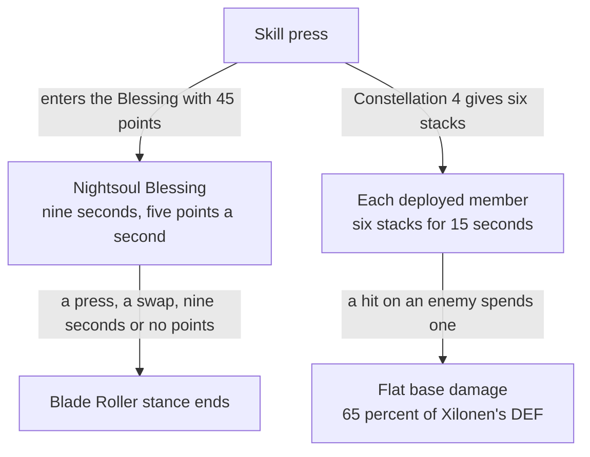

# Xilonen

Xilonen's kit is its record and one behaviour module, `createXilonenKitBehaviour`, on avatar 10000103 (`{data-root}/genshin-parity/text/ExcelBinOutput/AvatarExcelConfigData.json`): three strikes with the second of two hits, a charged attack, a collision and two plunges, and Yohual's Scratch's hit. Her multipliers are read from proud skill groups 10331, 10332 and 10339, and match gcsim's values, which `{data-root}/cache/gcsim-v2.47.2/internal/characters/xilonen/zz_xilonen.dm.go` carries to six decimal places, to four. Her plunges' and Yohual's Scratch's damage is her share of Defense (`UseDef`: `{data-root}/cache/gcsim-v2.47.2/internal/characters/xilonen/plunge.go` lines 107, 160 and 214, `{data-root}/cache/gcsim-v2.47.2/internal/characters/xilonen/skill.go` line 183), added as flat damage to each hit's base damage as it is priced, as Chiori's Defense shares are.

## Decisions

- **Her skill's press enters the Nightsoul Blessing with 45 points.** The points drain five a second, and the Blessing lasts nine seconds and ends when they run out, as gcsim's `enterNightsoul` and `nightsoulPointReduceTask` do (`{data-root}/cache/gcsim-v2.47.2/internal/characters/xilonen/skill.go` lines 58 to 71 and 89 to 98, where half a point every six frames is five a second). The wiki's Yohual's Scratch page gives the 9-second limit and 7-second cooldown (`{data-root}/cache/genshin-wiki/Category_Xilonen_Talents.json`), and the file's point limit is 90, so the kit's cap at 45 is the open item below. A sprint in it drains five more points, timed as [Chasca's kit](../chasca/design.md) records (`{data-root}/cache/gcsim-v2.47.2/internal/characters/xilonen/dash.go` line 9). Its Blade Roller stance ends with the Blessing however the Blessing ends, a press, a swap, its seconds or its points draining to none. A press in the Blessing leaves it; the strike that press still lands is recorded under Not built.
- **Her strikes and charged attack are the kit outside the Nightsoul Blessing.** The first strike is a circle of radius 2.1 one metre ahead, the second a fan of 150 degrees and the third one of 160, each priced the way [Ayaka's reaches](../kamisato-ayaka/design.md) are (`{data-root}/cache/gcsim-v2.47.2/internal/characters/xilonen/attack.go` lines 18 to 20; the second's two hits have radii 2.5 and 2.7, and the third's 3.2 sits half a metre behind). The charged attack is a box 1.8 metres behind her, 2 wide and 4.5 long, priced to its far corner, with Poise 120 (`{data-root}/cache/gcsim-v2.47.2/internal/characters/xilonen/charge.go` lines 33 and 41 to 46; the wiki's Charged Attack poise is 120, `{data-root}/cache/genshin-wiki/Category_Xilonen_Talents.json`).
- **Yohual's Scratch hits at 6 frames of its 20-frame animation.** It is a circle of radius 0.8 one metre ahead, priced as its offset plus its radius (`{data-root}/cache/gcsim-v2.47.2/internal/characters/xilonen/skill.go` lines 19, 29 and 187 to 191), and it deals her Defense share (`{data-root}/cache/gcsim-v2.47.2/internal/characters/xilonen/skill.go` line 183), its Geo gauge at 1 (the wiki's Yohual's Scratch Skill DMG, 1U).
- **The skill's cooldown is the table's seven seconds, run from the press. A press inside it is refused by gcsim's action check (`{data-root}/cache/gcsim-v2.47.2/pkg/core/player/exec.go`, lines 40 to 46).** The seven seconds are `10332` index 5 and the wiki's cd, 7s. In gcsim the Blessing's end sets it (`{data-root}/cache/gcsim-v2.47.2/internal/characters/xilonen/skill.go` line 82), and that end's cooldown is not built, so the cooldown starts the moment of the press here; see Provisional constants.
- **Ocelotlicue Point is not built, so the burst has no hit.** It keeps gcsim's 101-frame animation (`{data-root}/cache/gcsim-v2.47.2/internal/characters/xilonen/burst.go` line 20), the table's 60 energy (`10339` index 6, `{data-root}/cache/gcsim-v2.47.2/internal/characters/xilonen/xilonen.go` line 35) and 15-second cooldown (`{data-root}/cache/gcsim-v2.47.2/internal/characters/xilonen/burst.go` line 52). Its damage is read only with fewer than two Samplers in the party, and its heal with two or more, as gcsim picks them (`{data-root}/cache/gcsim-v2.47.2/internal/characters/xilonen/burst.go` line 45). The kit step cannot count the team's elements yet, so neither branch is chosen.
- **Her plunges are gcsim's, with their Defense shares.** The collision is at 41 frames, a circle of radius 1 one metre ahead, the low plunge at 47 frames of 75 with radius 3 and Poise 100, and the high at 50 frames with radius 5 and Poise 150 (`{data-root}/cache/gcsim-v2.47.2/internal/characters/xilonen/plunge.go` lines 22 to 39 and 44 to 46, the collision at line 223).
- **Constellation 1 lengthens the Blessing and cuts its drain.** gcsim (MIT) `{data-root}/cache/gcsim-v2.47.2/internal/characters/xilonen/cons.go` (lines 41 to 53) multiplies the Blessing's duration by 1.45, so it lasts 13.05 seconds, and its points' consumption by 0.7, so the drain falls from 5 to 3.5 a second and a sprint's 5 points to 3.5 ("nightsoulConsumptionMul" and "nightsoulDurationMul", read at `{data-root}/cache/gcsim-v2.47.2/internal/characters/xilonen/skill.go` 41 and 64). Its stance lasts as long as the Blessing does.
- **Constellation 4's stacks are read where the party strikes.** At the skill's press, each deployed member gets six stacks for 15 seconds (`{data-root}/cache/gcsim-v2.47.2/internal/characters/xilonen/cons.go` `c4`, lines 116 to 124, which gcsim calls from `{data-root}/cache/gcsim-v2.47.2/internal/characters/xilonen/skill.go` 203). Each Normal Attack, Charged Attack or Plunge that hits an enemy adds 65% of Xilonen's DEF as flat base damage while its striker holds a stack, and spends one (`{data-root}/cache/gcsim-v2.47.2/internal/characters/xilonen/cons.go` lines 130 to 156, the 65% at line 146). Her own strikes take it through `getStrikeAdditiveBaseDamageBonus`, a teammate's through `getPartyStrikeBonus`, both priced from her buffed DEF, and the spend is read on each `DamageTaken`, so a hit spends one per enemy it lands on as gcsim's `OnEnemyHit` does.

## Provisional constants

- **The Blessing's point maximum is open.** gcsim sets it at 90 (`{data-root}/cache/gcsim-v2.47.2/internal/characters/xilonen/xilonen.go` line 42, where the wiki's nightsoul point limit is also 90), and the kit caps the Blessing at the 45 it starts with (`xilonenKit.ts`, `maximum: NIGHTSOUL_POINTS`). No points are gained yet, since the Samplers are not built, so no press shows the difference.
- **Where the skill's cooldown starts is open.** The wiki gives a 7-second cooldown and no start, and gcsim starts it at the Blessing's end (`{data-root}/cache/gcsim-v2.47.2/internal/characters/xilonen/skill.go` line 82), where this kit starts it at the press.

## Not built

- **The Blessing's exit strike is not built.** gcsim gives the press that leaves the Blessing no strike, and the kit plays one action per press, so Yohual's Scratch still strikes on that press, which Chasca's kit avoids through the skill's state-ending check.
- **The Blade Roller's four strikes are not built.** They stand in for her strikes while the Blessing lasts, which needs a normal attack variant the kit does not have.
- **The Samplers and their Sampler RES shred are not built.** A Blessing's Samplers shred an enemy's RES to the elements the party's other members carry, by the table's 0.09 each (`10332` index 1), with Geo standing in for any element outside Pyro, Hydro, Cryo and Electro (`{data-root}/cache/gcsim-v2.47.2/internal/characters/xilonen/xilonen.go` lines 59 to 64). The Samplers wait on the Blessing, and their count on a kit step that reads the deployed team's elements, which the step context does not yet carry.
- **Ocelotlicue Point's heal is not built.** With two or more Samplers in the party, the burst heals the active member on a schedule, through eight ticks at each 1.5 seconds (`{data-root}/cache/gcsim-v2.47.2/internal/characters/xilonen/burst.go` line 16, hitmarks at 185 to 805 frames), instead of its damage. The heal waits on the kit step reading the team's elements, and on a timed heal to the active member.
- **Her skill high plunge is not built.** A plunge that follows her Yohual's Scratch lands at 39 frames (`{data-root}/cache/gcsim-v2.47.2/internal/characters/xilonen/plunge.go` line 28), a skill-only variant that waits on a plunge gate that reads the last action, as the [Chiori](../chiori/design.md) page's low plunge does.
- **Her Ascension bonuses and Constellations 2 and 6 are not built.** The [constellations](../../../../changes/genshin-constellations/design.md) page holds the second and the [character kits proposal](../../../../changes/genshin-character-kits/design.md) the first.

## Key files

| File                                                               | Role                                                                                                                                        |
| :----------------------------------------------------------------- | :------------------------------------------------------------------------------------------------------------------------------------------ |
| `packages/genshin-world/src/services/kit/characters/xilonenKit.ts` | `createXilonenKitBehaviour`, Xilonen's kit with her strikes, charged attack, plunges, Yohual's Scratch and the Nightsoul Blessing it enters |

## Sources

- [gcsim](https://github.com/genshinsim/gcsim/tree/v2.47.2/internal/characters/xilonen), MIT: the kit's hitmarks, animations, reach, the charged attack's box and the plunges' radii and poise, and the indices of the proud groups for each multiplier.
- [gcsim's skill and dash files](https://github.com/genshinsim/gcsim/tree/v2.47.2/internal/characters/xilonen), MIT: the Blessing's 45 points, its five-a-second drain, its nine-second length and its sprint drain.
- [Hosted game data](../../hosted-game-data/design.md): the avatar's talent groups 10331, 10332 and 10339 and her skill depot, from the talent and skill kit tables.
- Local copies: `{data-root}/genshin-parity/text/ExcelBinOutput/ProudSkillExcelConfigData.json` (groups 10331, 10332 and 10339, read by level), `{data-root}/cache/gcsim-v2.47.2/internal/characters/xilonen/` (gcsim v2.47.2 on disk, the line numbers above are its files'), and `{data-root}/cache/genshin-wiki/Category_Xilonen_Talents.json` (the Yohual's Scratch, Ocelotlicue Point and Netotiliztli's Echoes pages). The wiki's constellation pages are not in the cache, as [Xiao's kit](../xiao/design.md) notes; the constellation claims are gcsim's, cited in the decisions above.

## Open

- [ ] **The kit caps the Blessing's points at the 45 it starts with** — contradicted by `{data-root}/cache/genshin-wiki/Category_Xilonen_Talents.json`: its Nightsoul Point Limit is 90.
