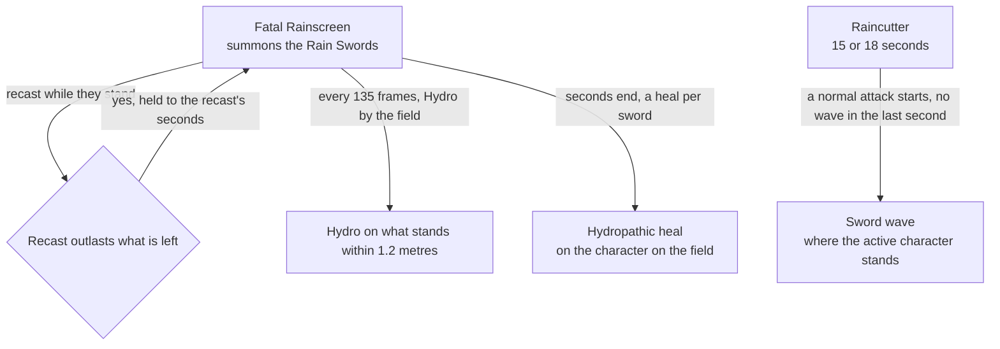

# Xingqiu

Xingqiu's kit is its record and one behaviour module, `createXingqiuKitBehaviour`, on avatar 10000025 (`genshin-dump-backup-6.6/ExcelBinOutput/AvatarExcelConfigData.json`, named Xingqiu in `genshin-dump-backup-6.6/TextMap/TextMap_MediumEN.json`): five strikes, the third and fifth of two hits each, a charged attack of two hits, a collision and two plunges, Guhua Sword: Fatal Rainscreen's two hits with its Rain Swords, and Guhua Sword: Raincutter's sword rain (`cache/genshin-wiki/Category_Xingqiu_Talents.json`). His multipliers are read from proud skill groups 2531, 2532 and 2539 (`genshin-dump-backup-6.6/ExcelBinOutput/ProudSkillExcelConfigData.json`), and match the wiki's Guhua Style, Guhua Sword: Fatal Rainscreen and Guhua Sword: Raincutter values to two decimal places (the cached wiki's scaling table, `cache/genshin-wiki/Category_Xingqiu_Talents.json`, gives 46.61%, 47.64% and 28.55% for the first three strikes, as the table does); the charged attack's stamina, the Rain Swords' seconds, the skill's cooldown, Raincutter's seconds and the burst's cooldown and cost are read from the same groups. The Rain Swords are a summon that follows the body on the field, putting Hydro on what touches it, and Raincutter a summon that the normal attacks of whoever is on the field set off, through the kit framework's coordinated summons, with Hydropathic's heal from Ascension 1 and Blades Amidst Raindrops' Hydro DMG Bonus from Ascension 4, and The Scent Remained's fourth sword (open, see Provisional constants), Rainbow Upon the Azure Sky's longer Raincutter and Hydro RES cut, Evilsoother's stronger Fatal Rainscreen and Hence, Call Them My Own Verses' five-sword wave and energy from one, two, four and six constellations are built. The Rain Swords' DMG reduction, interruption resistance and shattering, the skill's Wet on Xingqiu and its particles, the burst's activation knockback, and Raincutter's end as Xingqiu falls are not built.

## Decisions

- **Xingqiu's areas are priced with their offsets, and his box's far corner.** gcsim centres his first and second strikes' circles of 1.5 metres 0.8 metres ahead, his third's 0.6 ahead and his fifth's second circle of 2 metres 0.8 ahead (`attack.go` lines 18 to 19, read at 60 to 65), so each reach is its offset plus its radius, 2.3, 2.1 and 2.8 metres, and Fatal Rainscreen's first circle of 3 metres 0.8 ahead reaches 3.8 (`skill.go` lines 17 to 18 and 59 to 63). It spawns his fourth strike's box and his fifth's first, 1 wide and 2 long, on their near edge at the body (`attack.go` lines 65 to 70, and `{data-root}/cache/gcsim-v2.47.2/pkg/core/info/rectangle.go` lines 32 to 36), so each is priced as the circle to its far corner, 2.06 metres, and Fatal Rainscreen's second box, 3.5 wide and 4.5 long from 1.5 metres behind, as the circle to its far corner 3 metres ahead, 3.47 metres. His charged attack's two slashes are gcsim's circles of 2.2 metres round his body at 8 and 20 frames after a strike (`charge.go` lines 14 and 42 to 44), which every charged attack here follows, and its 20 stamina (the table's `2531` index 9, `genshin-dump-backup-6.6/ExcelBinOutput/ProudSkillExcelConfigData.json`, and the wiki's "chargedStamina", `cache/genshin-wiki/Category_Xingqiu_Talents.json`) is spent as it starts (the timing is open, see Open).
- **Fatal Rainscreen's hits land from a summon.** The skill's action has no hits of its own: its start casts a summon where Xingqiu stands, which lands the two hits at gcsim's 12 and 31 frames (`skill.go` lines 16 and 72 to 74), each 1U of Hydro with no internal cooldown (`skill.go` line 39) and 120 poise, the wiki's on the base hits (its Skill DMG poise, `cache/genshin-wiki/Category_Xingqiu_Talents.json`), so the start can choose their multipliers. From four constellations, Evilsoother multiplies both by 1.5 while his Raincutter stands as the skill starts, the Base DMG Multiplier that gcsim's skill.go applies (`skill.go` lines 53 to 57), which a DMG Bonus buff would not equal. gcsim queues both hits as the skill starts, so they land whatever cancels it, as the summon's do.
- **The Rain Swords are a summon that follows the body on the field.** They put 1U of Hydro, with no damage, internal cooldown or poise, on what stands within 1.2 metres of whoever is on the field every 135 frames, the wiki's 2.25 seconds (`cache/genshin-wiki/Category_Xingqiu_Talents.json`), from 44 frames past the skill or 19 past the burst, which are gcsim's 43 and 18 plus the frame an orbital takes to apply, as skill.go's comment says (`skill.go` line 78, `burst.go` lines 17 and 55), for the skill group's 15 seconds (`2532` index 3, `genshin-dump-backup-6.6/ExcelBinOutput/ProudSkillExcelConfigData.json`) or for Raincutter's. A recast stands them longer only when its seconds outlast what they have left, and their ticks keep the schedule they started on: the wiki's Fatal Rainscreen passive note says that with cooldown reduction or reset effects a recast prolongs existing Rain Swords back to 15 seconds, and its Raincutter page says the swords are held to the burst's end. gcsim's status would cut them back to a recast's 15 seconds inside an 18-second Raincutter (`orbital.go` line 34 adds the status with the new seconds), and the kit follows the wiki.
- **The Rain Swords deal no kind of attack.** The wiki says they apply Wet and reduce the damage taken, and names no kind for them, as gcsim tags them none, so their summon names no kind as it casts (`orbital.go` line 59, `AttackTagNone`).
- **Hydropathic heals as the Rain Swords end.** From Ascension 1, a task runs as the Rain Swords' seconds end and heals the character on the field by the share of Xingqiu's Max HP that `HYDROPATHIC_MAX_HEALTH_SHARE` holds, for each sword that `RAIN_SWORD_COUNT` holds, plus one from The Scent Remained, read as he cast them (`xingqiuKit.ts` lines 38 to 39 and 156). The share and the heal on a shatter or an expiry are the wiki's Hydropathic page (`cache/genshin-wiki/Category_Xingqiu_Talents.json`), and the count is the wiki's initial maximum on Fatal Rainscreen's page (its text: "The initial maximum number of Rain Swords is 3", `cache/genshin-wiki/Category_Xingqiu_Talents.json`); gcsim's `asc.go` lines 9 and 10 mark A1 not implemented. The extra sword is open, see Provisional constants. No strike shatters a sword here, so every sword heals at the end: in the game each heals once, as it shatters or as its seconds end, so the heal is the same and only its timing differs. A recast that stands them longer adds a task at the new end, and the old one heals nothing, as the wiki's note gives a prolonged sword no heal, since it neither shattered nor expired.
- **Raincutter is a summon of no hits.** It stands for the burst group's 15 seconds, 18 from Rainbow Upon the Azure Sky, and gcsim's 33 frames more (`burst.go` line 54), with no hits of its own, and the burst stands the Rain Swords for those 15 or 18 seconds. As a normal attack of whoever is on the field starts, it casts a wave of swords where that character stands, unless a wave was cast within the second, the wiki's cooldown (gcsim's watcher ticker is 60 frames, `xingqiu.go` line 39): a string's first strike casts its wave 7 frames on, as gcsim's xingqiu.go delays that strike's animation (lines 49 to 58), and a later strike's wave is cast as it starts, its swords landing 20 frames after the cast (`burst.go` line 135). The waves run 2, 3, 2, 3 swords (`burst.go` lines 144 to 158), or 2, 3, 5 from Hence, Call Them My Own Verses (`burst.go` lines 149 to 151; the cached wiki names the constellation at `cache/genshin-wiki/Category_Xingqiu_Talents.json` without its text), each wave counting those standing since Raincutter began, as each stands until it ends. gcsim's watcher casts at the start of the normal attack state (`{data-root}/cache/gcsim-v2.47.2/internal/template/minazuki/minazuki.go` line 45), delayed 7 frames on Xingqiu's own strikes, and casts again every second the state goes on (its ticker, in the watcher template [Fischl's design](../fischl/design.md) cites). The kit sees each strike start and not that its string is still playing, so the watcher's every-second casts are not built: a long string casts only as its strikes start, where gcsim's watcher would cast again on each second it runs on. The charged attack and the plunges cast none, as gcsim watches the normal attack state alone, and Raincutter does not end as Xingqiu falls, as no effect reads a downed member.
- **Rainbow Upon the Azure Sky and Hence, Call Them My Own Verses act on the swords.** From two constellations each sword takes 15% off the Hydro RES of each enemy it strikes for 4 seconds (`burst.go` lines 101 to 121), and from six a wave of five swords gives Xingqiu 3 energy up to his burst's cost through a one-tick field as its swords land, struck or not, as Razor's Electro Sigils are, since no hit writes the team's effects as it strikes. gcsim gives that energy on the first enemy a wave's first sword hits (`burst.go` lines 89 to 99), so the kit's form is open, see Provisional constants.

## Provisional constants

- **Xingqiu's plunges are provisional.** His plunges take the index's no-file rule, as gcsim's Xingqiu directory has no `plunge.go`. The plunges' poise and blunt are the wiki's Guhua Style.
- **The fourth Rain Sword from The Scent Remained is open.** The wiki's Hydropathic page the kit cites gives 6% and no count, and the Scent Remained page is not in the cache; gcsim keeps no sword count on the orbit. So the 4 in `xingqiuKit.ts` (line 156) waits on that page.
- **The energy from Hence, Call Them My Own Verses is open in its form.** gcsim gives it on the first enemy hit of a wave's first sword (`burst.go` lines 89 to 99), and the kit gives it as the swords land, struck or not. The Hence page is not in the cache to settle which.
- **Each sword reaches 5 metres round where its wave was cast, provisionally.** gcsim drops each sword as a circle of 0.5 metres on the primary target (`burst.go` lines 127 to 134), which an area does not hold, so a sword reaches the 5 metres an attack targets within, as Ayaka's charged attack does, and strikes each enemy there rather than the one the wiki's notes aim it at. The record holds the 5 as `DiffersFromSource`, since the rule prices gcsim's circle on the primary target as the burst's 15-metre targeting plus 0.5, which a summon cast where the wave began would reach as its own 15.5. Each is 1U of Hydro under the Elemental Burst internal cooldown (`burst.go` lines 78 to 82) at the wiki's 25 poise ("Category_Xingqiu_Talents.json", Raincutter's sword rain rows), priced as it lands rather than as the burst snapshots it, as the wiki's notes give it.

## Not built

- **The Rain Swords' DMG reduction, interruption resistance and shattering are not built.** An enemy's strike reads the member on the field's DMG Reduction, so the skill group's 20% and its share of Xingqiu's Hydro DMG Bonus wait on the kit buffing that member with `Attribute.DamageReduction` while the swords stand, and nothing tells the kit a strike landed to shatter a sword. The interruption resistance has nothing to act on, and the skill's Wet on Xingqiu has no place to sit.
- **Xingqiu's particles, his other constellations, his utility passive and the burst's knockback are not built.** The skill's 5 particles are not built. Weaver of Verses and Embrace of Rain raise talent levels, which the [talents](../../talents/design.md) page holds, and Flash of Genius is crafting, not combat. Raincutter's activation knockback, 400 poise with no damage (the wiki's Raincutter poise row, `cache/genshin-wiki/Category_Xingqiu_Talents.json`), is not built, as gcsim does not implement it and no source gives its frame.

## Key files

| File                                                               | Role                                                                                                                               |
| :----------------------------------------------------------------- | :--------------------------------------------------------------------------------------------------------------------------------- |
| `packages/genshin-world/src/services/kit/characters/xingqiuKit.ts` | `createXingqiuKitBehaviour`, Xingqiu's kit with Fatal Rainscreen's Rain Swords and Hydropathic's heal, and Raincutter's sword rain |

## Sources

- [Guhua Style](https://genshin-impact.fandom.com/wiki/Guhua_Style), [Guhua Sword: Fatal Rainscreen](https://genshin-impact.fandom.com/wiki/Guhua_Sword:_Fatal_Rainscreen) and [Guhua Sword: Raincutter](https://genshin-impact.fandom.com/wiki/Guhua_Sword:_Raincutter), Genshin Impact Wiki: Xingqiu's strikes', charged attack's and plunges' gauges, internal cooldown tags and poise, Fatal Rainscreen's gauges and poise, the Rain Swords' DMG reduction, Wet, 2.25 seconds, shattering and prolonging, and its particles, and the swords' gauge, tag and poise, their one-second cooldown, their target, their snapshot, Rain Swords held to the burst's end and its activation knockback.
- [Hydropathic](https://genshin-impact.fandom.com/wiki/Hydropathic), [Blades Amidst Raindrops](https://genshin-impact.fandom.com/wiki/Blades_Amidst_Raindrops) and [Flash of Genius](https://genshin-impact.fandom.com/wiki/Flash_of_Genius_%28Xingqiu%29), Genshin Impact Wiki: Xingqiu's passives, all three held in `cache/genshin-wiki/Category_Xingqiu_Talents.json`. The constellation pages (The Scent Remained, Rainbow Upon the Azure Sky, Weaver of Verses, Evilsoother, Embrace of Rain, Hence, Call Them My Own Verses) are not on disk, so their claims rest on gcsim or stay open.
- Local copies: the proud skill table (groups 2531, 2532 and 2539, read by level, from the file [Xilonen's design](../xilonen/design.md) cites), `{data-root}/cache/gcsim-v2.47.2/internal/characters/xingqiu/` (on disk; its `asc.go` lines 9 and 10 mark A1 not implemented), and `{data-root}/cache/genshin-wiki/Category_Xingqiu_Talents.json` (Guhua Style, Fatal Rainscreen, Raincutter, Hydropathic and Blades Amidst Raindrops; the constellation pages are not cached, so their claims rest on gcsim or stay open).
- [gcsim v2.47.2](https://github.com/genshinsim/gcsim/tree/v2.47.2/internal/characters/xingqiu), MIT: the kit's hitmarks, cancel frames and areas, the Rain Swords' ticks, reach and lengthening, Raincutter's length, the swords' frame, area and waves, and Blades Amidst Raindrops', Rainbow Upon the Azure Sky's, Evilsoother's and Hence, Call Them My Own Verses' effects; and gcsim's [minazuki watcher](https://github.com/genshinsim/gcsim/blob/v2.47.2/internal/template/minazuki/minazuki.go), which sets the sword rain off on the normal attack state with its one-second cooldown and ticker.

## Open

- [ ] **The charged attack's 20 stamina is spent as the charge starts** — no source yet: see the [kits' Open](../README.md#open) for the spend; the 20 is the table's and the wiki's "chargedStamina".
- [ ] **Weaver of Verses and Embrace of Rain raise talent levels** — no source yet: the cached wiki names both only as constellations in its Talent Notes (`cache/genshin-wiki/Category_Xingqiu_Talents.json`), and their constellation pages are not in the cache.
