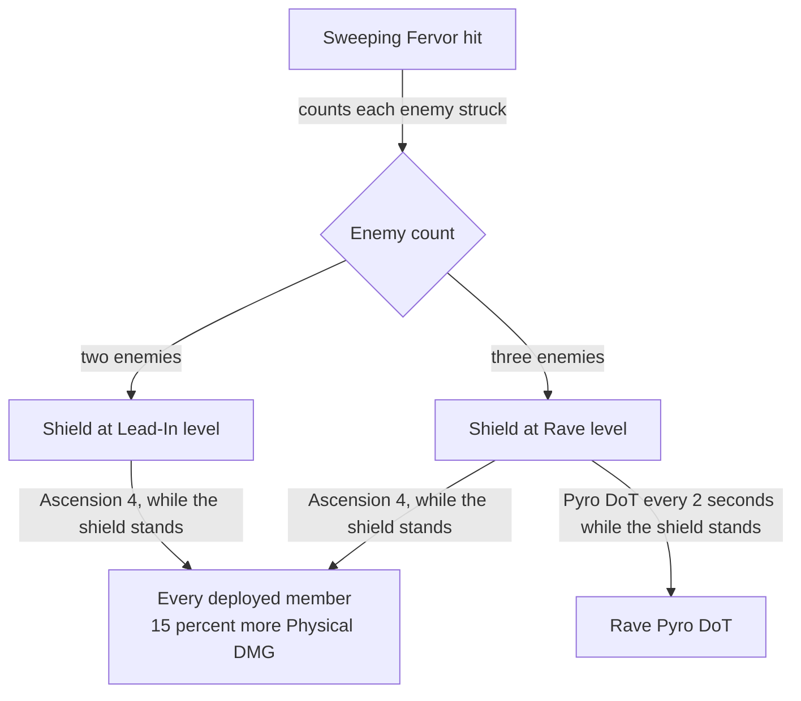

# Xinyan

Xinyan's kit is its record and one behaviour module, `createXinyanKitBehaviour`, on avatar 10000044: four blunt strikes (`~/Esposter/cache/gcsim-v2.47.2/internal/characters/xinyan/attack.go` line 16 and the wiki's four Normal Attack rows in `~/Esposter/cache/genshin-wiki/Category_Xinyan_Talents.json`), a charged attack of two hits (the wiki's Charged Attack Cyclic and Final Slash rows), a collision and two plunges, Sweeping Fervor with its shield, which steps up to Lead-In and Rave by the enemies it strikes and Rave's Pyro DoT, and Riff Revolution with its Physical hit and seven Pyro DoT hits. Her multipliers are read from proud skill groups 4431, 4432 and 4439 (`~/Esposter/genshin-parity/text/ExcelBinOutput/ProudSkillExcelConfigData.json`); the charged attack's stamina, the shield's seconds and its DEF and flat shares at each level, the skill's cooldown and the burst's cooldown and energy cost are read from the same groups. Ascension 1, Ascension 4 and Constellations 2 and 4 are built (`~/Esposter/cache/gcsim-v2.47.2/internal/characters/xinyan/asc.go`, and `~/Esposter/cache/gcsim-v2.47.2/internal/characters/xinyan/cons.go` lines 52 to 68 for Constellation 2 and 70 to 85 for Constellation 4's Physical RES cut): from Ascension 4 every deployed member deals 15% more Physical DMG while her shield stands, the bonus ending when the shield breaks unless one of hers was set over it. Constellation 1 is not built, as the kit's normal attack speed reads only an infusion's (gcsim's crit-driven ATK SPD is `~/Esposter/cache/gcsim-v2.47.2/internal/characters/xinyan/cons.go` lines 15 to 47), and Constellation 6 is not, as gcsim has none (`~/Esposter/cache/gcsim-v2.47.2/internal/characters/xinyan/cons.go` line 88 is a commented-out stub). The charged attack has no gcsim source (gcsim's Xinyan directory, `~/Esposter/cache/gcsim-v2.47.2/internal/characters/xinyan/`, has no charged-attack file), so its reach and hitmark frames stand in as the fourth strike's, and its animation length is the 72 frames a claymore's charged attack with no gcsim file ends at; both are open, see Provisional constants.

## Decisions

- **Riff Revolution's Pyro DoT is seven hits, and the impromptu list adds Constellation 2's two pulses.** gcsim's DoT lands seven times, at 57 frames and every 17 after (`~/Esposter/cache/gcsim-v2.47.2/internal/characters/xinyan/burst.go` line 20 and lines 76 to 85: the first at 57, then six at 17-frame steps from 74), and Constellation 2 queues two pulses of the shield's DoT inside its own block (`~/Esposter/cache/gcsim-v2.47.2/internal/characters/xinyan/burst.go` lines 88 to 107, hitmarks 65 and 83 at line 14), which the impromptu list holds after the seven. The wiki's Riff Revolution page gives the Pyro DoT's poise as 50 (`~/Esposter/cache/genshin-wiki/Category_Xinyan_Talents.json`). The impromptu list's DoT hitmarks are gcsim's: the record cites them to `~/Esposter/cache/gcsim-v2.47.2/internal/characters/xinyan/burst.go` line 86, the line that starts the chain, though the first lands at line 20's 57 and the rest at the 17-frame steps of lines 80 and 85; the builder takes no call by its place for a list whose hits join two keys.
- **Ascension 4's Physical DMG Bonus is given to every deployed member, where gcsim raises the character on the field's (`~/Esposter/cache/gcsim-v2.47.2/internal/characters/xinyan/asc.go` lines 24 to 44, which check `Player.Active()`).** Only the character on the field strikes in the world, so the two differ only for a member's off-field summon.
- **Sweeping Fervor's shield steps up on a count its hit keeps, and its level lives beside the shield.** The hit counts each enemy it strikes on a status that carries `KitStatus.stacks` for the hit's window, and each count raises the shield to the level it reaches, Lead-In at 2 and Rave at 3 (`~/Esposter/cache/gcsim-v2.47.2/internal/characters/xinyan/xinyan.go` lines 29 to 30), Ascension 1 lowering each by one (`~/Esposter/cache/gcsim-v2.47.2/internal/characters/xinyan/asc.go` lines 16 to 22). The level is a status that lasts as long as the shield, so a shield that breaks takes it with it. Rave's Pyro DoT is a field that strikes every 2 seconds while the shield stands at level 3 (`~/Esposter/cache/gcsim-v2.47.2/internal/characters/xinyan/skill.go` lines 99 to 121). The shield is set at the press when none stands (the timing is open, see Provisional constants). gcsim queues each level 13 frames after the hit (`~/Esposter/cache/gcsim-v2.47.2/internal/characters/xinyan/skill.go` lines 52 to 59), and here the level is decided at the strike.

## Provisional constants

- **The charged attack's stand-in is open.** Its reach and hitmark frames are the fourth strike's (`~/Esposter/cache/gcsim-v2.47.2/internal/characters/xinyan/attack.go` lines 16, 19 and 21, hitmark 35, fan 270). The wiki's Dance on Fire page gives the charged attack's poise as 60 and 120 (`~/Esposter/cache/genshin-wiki/Category_Xinyan_Talents.json`), where the record takes the fourth strike's, so its poise waits on the wiki's figures. Its 72-frame animation has no cached source for Xinyan.
- **The first shield's timing is open.** gcsim sets the level-1 shield 28 frames after the press (`~/Esposter/cache/gcsim-v2.47.2/internal/characters/xinyan/skill.go` lines 62 to 65), and this kit sets it at the press, which the Open entry records as contradicted by that source.

## Key files

| File                                                              | Role                                                                                                                                                |
| :---------------------------------------------------------------- | :-------------------------------------------------------------------------------------------------------------------------------------------------- |
| `packages/genshin-world/src/services/kit/characters/xinyanKit.ts` | `createXinyanKitBehaviour`, Xinyan's kit with Sweeping Fervor's shield and its Pyro DoT, and Riff Revolution's Physical hit and seven Pyro DoT hits |

## Sources

- [gcsim v2.47.2](https://github.com/genshinsim/gcsim/tree/v2.47.2/internal/characters/xinyan), MIT: Xinyan's strikes' hitmarks, cancels, reaches and poise, Sweeping Fervor's hit and shield levels, Rave's DoT, Riff Revolution's hit, DoT and Constellation 2's pulses, and her Ascension 1, Ascension 4 and Constellations 2 and 4.
- [Riff Revolution](https://genshin-impact.fandom.com/wiki/Riff_Revolution), Genshin Impact Wiki: the poise of the Pyro DoT hits, 50 on the first and each later one. The cached copy is `~/Esposter/cache/genshin-wiki/Category_Xinyan_Talents.json`, with its Dance on Fire, Sweeping Fervor and Riff Revolution pages.
- Local copies: `~/Esposter/genshin-parity/text/ExcelBinOutput/ProudSkillExcelConfigData.json` (groups 4431, 4432 and 4439, read by level) and `~/Esposter/cache/gcsim-v2.47.2/internal/characters/xinyan/` (on disk; the line numbers above are its files').

## Open

- [ ] **The shield is set at the press when none stands** — contradicted by `~/Esposter/cache/gcsim-v2.47.2/internal/characters/xinyan/skill.go`: sets the level-1 shield 28 frames after the press.
- [ ] **The shield's level ends when the shield breaks** — no source yet: a wiki or game source for the level's end on a break; the cached Sweeping Fervor text in `~/Esposter/cache/genshin-wiki/Category_Xinyan_Talents.json` ends only the DoT on a break.
