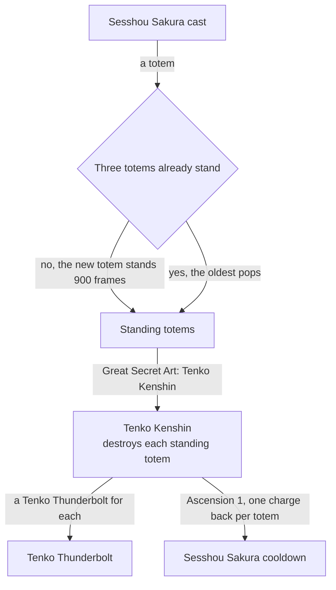

# Yae Miko

Yae Miko's kit is its record and one behaviour module, `createYaeMikoKitBehaviour`, on avatar 10000058 (`{data-root}/genshin-dump-backup-6.6/ExcelBinOutput/AvatarExcelConfigData.json`): three strikes, a charged attack, a collision and two plunges, Sesshou Sakura's totems and Great Secret Art: Tenko Kenshin (`{data-root}/cache/genshin-wiki/Category_Yae_Miko_Talents.json`). Her multipliers are read from proud skill groups 5831, 5832 and 5839 (`{data-root}/genshin-dump-backup-6.6/ExcelBinOutput/ProudSkillExcelConfigData.json`); the charged attack's stamina, and the skill's and burst's cooldowns with the burst's energy cost, come from the same groups (the wiki's 50 stamina, 4 and 22 second cooldowns and 90 energy agree). A totem stands for 900 frames (`{data-root}/cache/gcsim-v2.47.2/internal/characters/yaemiko/kitsune.go` line 13) and strikes a circle of radius 0.5 round itself at 120 frames and then every 176 (`{data-root}/cache/gcsim-v2.47.2/internal/characters/yaemiko/kitsune.go` lines 30, 144 and 166), at the multiplier of the level its cast gives, one to three by the totems standing then, and a fourth totem pops the oldest (`{data-root}/cache/gcsim-v2.47.2/internal/characters/yaemiko/kitsune.go` lines 45 to 47). Great Secret Art: Tenko Kenshin hits a circle of radius 7 on its target at 100 frames (`{data-root}/cache/gcsim-v2.47.2/internal/characters/yaemiko/burst.go` lines 15 and 42 to 44), which the record prices as 15 metres of targeting plus that radius, 22, the 15 being unsourced (see Provisional constants), and destroys every standing totem for a Tenko Thunderbolt each, at 154 frames and then every 24 (`{data-root}/cache/gcsim-v2.47.2/internal/characters/yaemiko/burst.go` line 16, `{data-root}/cache/gcsim-v2.47.2/internal/characters/yaemiko/kitsune.go` line 87). The charged attack strikes once in the record, where gcsim fires five boxes (see Provisional constants). A totem's strikes are Elemental Skill DMG (`{data-root}/cache/gcsim-v2.47.2/internal/characters/yaemiko/kitsune.go` line 131). Ascension 1's cooldown reset and Ascension 4's Enlightened Blessing are built: from Ascension 1, The Shrine's Sacred Shade gives back one charge of Sesshou Sakura's cooldown for each totem the burst destroys, taken off her own skill cooldown (`{data-root}/cache/gcsim-v2.47.2/internal/characters/yaemiko/asc.go` lines 15 to 21, and `{data-root}/cache/gcsim-v2.47.2/internal/characters/yaemiko/kitsune.go` line 93, which calls it once per totem), and from Ascension 4, Enlightened Blessing raises each totem strike's DMG by 0.15% per point of her Elemental Mastery (`{data-root}/cache/gcsim-v2.47.2/internal/characters/yaemiko/asc.go` lines 58 to 73). Constellation 6's DEF ignored is built, 60% on each totem strike, as gcsim's `c6DefIgnore` gives it (`{data-root}/cache/gcsim-v2.47.2/internal/characters/yaemiko/cons.go` lines 239 to 244). Constellation 4 is built as her Elemental Burst DMG's 100% and each totem lightning's 20% team Electro DMG Bonus for 5 seconds (gcsim (MIT) `{data-root}/cache/gcsim-v2.47.2/internal/characters/yaemiko/cons.go` lines 144 to 167 and 191 to 201), but not its 8 Energy per 5 seconds (`{data-root}/cache/gcsim-v2.47.2/internal/characters/yaemiko/cons.go` lines 208 to 212), which the kit has no way to grant at once. Constellations 1 and 2 are not built, nor Constellation 6's CRIT DMG, which needs the Radiance Stellar-Conduct hit the kit does not build.

## Decisions

- **Constellation 6's DEF ignored is 60%, the value gcsim's `c6DefIgnore` returns, not the 45% its kitsune.go comment gives (`{data-root}/cache/gcsim-v2.47.2/internal/characters/yaemiko/kitsune.go` line 115).** The code is what the kit reads, and the comment is stale.
- **A totem's strikes are fixed as it is cast.** gcsim reads the totems standing at each strike, but a kit's hits are fixed when their action starts, so a totem's strikes take the level its cast gives, and a later cast does not raise them. Each strike lands on the enemies within its circle round the totem. gcsim instead picks one enemy at random within a detection radius of 12.5 metres, or 20 from Constellation 2 (`{data-root}/cache/gcsim-v2.47.2/internal/characters/yaemiko/cons.go` lines 106 and 110, `{data-root}/cache/gcsim-v2.47.2/internal/characters/yaemiko/kitsune.go` lines 153 to 163), and strikes there, so that radius is not built. The burst's thunderbolts take the same cap of three, as gcsim's `kitsuneBurst` loops once per standing totem (`{data-root}/cache/gcsim-v2.47.2/internal/characters/yaemiko/kitsune.go` lines 85 to 97).
- **A totem lasts gcsim's 900 frames, not the table's 14 at index 4.** The two differ (`5832` index 4 is 14 in `{data-root}/genshin-dump-backup-6.6/ExcelBinOutput/ProudSkillExcelConfigData.json`, and `{data-root}/cache/gcsim-v2.47.2/internal/characters/yaemiko/kitsune.go` line 13 holds 900), and the table's value is not read until one is checked.

## Provisional constants

- **The burst's 22-metre area is provisional.** gcsim's Tenko Kenshin circle is 7 metres on the primary target (`{data-root}/cache/gcsim-v2.47.2/internal/characters/yaemiko/burst.go` lines 42 to 49), and the 15 metres of targeting the record adds are in no cached source, so the 22 stands in until one gives it.
- **The charged attack's single strike is open.** gcsim fires five boxes 9 frames apart from 90 frames (`{data-root}/cache/gcsim-v2.47.2/internal/characters/yaemiko/charge.go` lines 48 to 56), gated by the charged attack's 0.5-second internal cooldown in the wiki (`{data-root}/cache/genshin-wiki/Category_Yae_Miko_Talents.json`). The record's one hit has no source for its count.

## Not built

- **The Shrine's Sacred Shade's extra lightning is not built.** With three totems standing, unleashing Sesshou Sakura adds a lightning strike of 40% of her ATK, which the wiki's The Shrine's Sacred Shade page gives and gcsim builds (`{data-root}/cache/gcsim-v2.47.2/internal/characters/yaemiko/asc.go` lines 22 to 54, called from `{data-root}/cache/gcsim-v2.47.2/internal/characters/yaemiko/kitsune.go` line 47). The kit has no such hit.

## Key files

| File                                                               | Role                                                                                                 |
| :----------------------------------------------------------------- | :--------------------------------------------------------------------------------------------------- |
| `packages/genshin-world/src/services/kit/characters/yaeMikoKit.ts` | `createYaeMikoKitBehaviour`, Yae Miko's module with her totems, their cap of three and Tenko Kenshin |
| `packages/genshin-world/src/data/kits/yae-miko.json`               | Her overlay: the values her record cannot give, each with its cause                                  |

## Sources

- [gcsim v2.47.2](https://github.com/genshinsim/gcsim/tree/v2.47.2/internal/characters/yaemiko), MIT: the totems' strikes and frames, their 900-frame lifetime, the cap of three standing totems, and Tenko Kenshin's strike and the totems it destroys. The source is on disk at `{data-root}/cache/gcsim-v2.47.2/internal/characters/yaemiko/`, and the line numbers above are its files'.
- Local copies: `{data-root}/genshin-parity/text/ExcelBinOutput/ProudSkillExcelConfigData.json` (groups 5831, 5832 and 5839, read by level) and `{data-root}/cache/genshin-wiki/Category_Yae_Miko_Talents.json` (Great Secret Art: Tenko Kenshin, Yakan Evocation: Sesshou Sakura, The Shrine's Sacred Shade and Enlightened Blessing pages).
