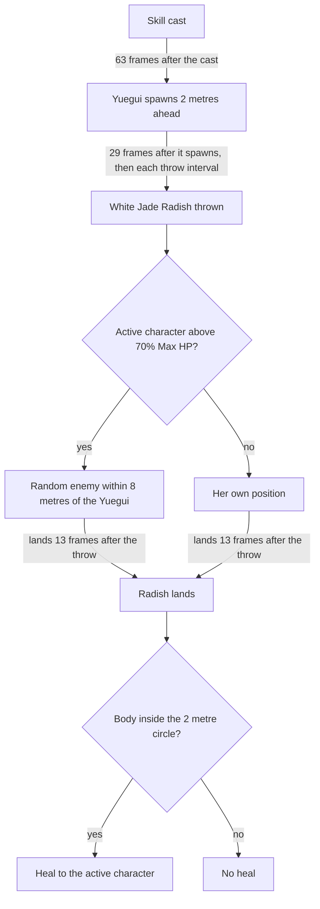

# Yaoyao

Yaoyao's kit is its record and one behaviour module, `createYaoyaoKitBehaviour` (`packages/genshin-world/src/services/kit/characters/yaoyaoKit.ts`), on avatar 10000077 (`~/Esposter.noindex/genshin-dump-backup-6.6/ExcelBinOutput/AvatarExcelConfigData.json`): four strikes, the third of two hits, a charged attack, then a collision and two plunges after it, her skill's cast and Moonjade Descent's initial hit (`~/Esposter/cache/gcsim-v2.47.2/internal/characters/yaoyao/burst.go` lines 17 and 49; `~/Esposter/cache/genshin-wiki/Category_Yaoyao_Talents.json`, the Toss 'N' Turn Spear page's advanced properties, for the strikes, the charged attack, the collision and the plunges). Her multipliers are read from proud skill groups 7731, 7732 and 7739 (`~/Esposter.noindex/genshin-dump-backup-6.6/ExcelBinOutput/ProudSkillExcelConfigData.json`); the charged attack's stamina, the skill's cooldown, and its cooldown and energy cost come from the same groups (the stamina is the Toss 'N' Turn Spear page's `chargedStamina`, `~/Esposter/cache/genshin-wiki/Category_Yaoyao_Talents.json`, and the cooldowns and energy cost match rows 10772 and 10775 of `~/Esposter.noindex/genshin-dump-backup-6.6/ExcelBinOutput/AvatarSkillExcelConfigData.json`). The first strike is a box of 1.2 by 3 metres, the second and third fans of 270 degrees, and the fourth a circle of radius 2.2 (`~/Esposter/cache/gcsim-v2.47.2/internal/characters/yaoyao/attack.go` lines 16 to 21 and 63 to 76). Her skill's cast takes 52 frames and cools down for 15 seconds (`~/Esposter/cache/gcsim-v2.47.2/internal/characters/yaoyao/skill.go` lines 18 and 33), and Moonjade Descent costs 80 energy with a 20-second cooldown (`~/Esposter/cache/gcsim-v2.47.2/internal/characters/yaoyao/burst.go` line 32, and row 10775 of `~/Esposter.noindex/genshin-dump-backup-6.6/ExcelBinOutput/AvatarSkillExcelConfigData.json`, `costElemVal` 80 and `cdTime` 20).

Her skill spawns a Yuegui two metres ahead of her, 63 frames after the cast (`~/Esposter/cache/gcsim-v2.47.2/internal/characters/yaoyao/skill.go` lines 13 to 14 and 28 to 31, 15 plus 48 frames; `~/Esposter/cache/gcsim-v2.47.2/internal/characters/yaoyao/yuegui.go` line 36), which throws a White Jade Radish 29 frames after it spawns (`~/Esposter/cache/gcsim-v2.47.2/internal/characters/yaoyao/yuegui.go` line 43) and then on its throw interval (`~/Esposter/cache/gcsim-v2.47.2/internal/characters/yaoyao/yuegui.go` line 123). Each radish lands 13 frames after its throw (`~/Esposter/cache/gcsim-v2.47.2/internal/characters/yaoyao/yuegui.go` lines 15, 135 to 139 and 148), where the throw picks its target: a random enemy within 8 metres of the Yuegui (`skillTargetingRad`, `~/Esposter/cache/gcsim-v2.47.2/internal/characters/yaoyao/yuegui.go` lines 13 and 51) while the active character stands above 70% of her Max HP (`~/Esposter/cache/gcsim-v2.47.2/internal/characters/yaoyao/yuegui.go` lines 124 and 128), and her own position otherwise (`~/Esposter/cache/gcsim-v2.47.2/internal/characters/yaoyao/yuegui.go` line 132), as gcsim's yuegui.go picks it. The radish's heal goes to the active character (`~/Esposter/cache/gcsim-v2.47.2/internal/characters/yaoyao/yuegui.go` lines 92 to 94) from her Max HP (`~/Esposter/cache/gcsim-v2.47.2/internal/characters/yaoyao/skill.go` lines 47 to 49) as thrown, and reaches her only while the body stands in the radish's two-metre circle (`~/Esposter/cache/gcsim-v2.47.2/internal/characters/yaoyao/yuegui.go` lines 14, 89 to 91 and 134) as it lands, so the radish is a summon of its hit and a one-tick field of its heal. Moonjade Descent spawns its Yuegui behind her (`~/Esposter/cache/gcsim-v2.47.2/internal/characters/yaoyao/yuegui.go` lines 66 and 72) at 104, 162 and 221 frames, while the burst lasts (`~/Esposter/cache/gcsim-v2.47.2/internal/characters/yaoyao/burst.go` lines 51 to 54, a six-second burst at line 18), and each one's radishes heal the whole team (`~/Esposter/cache/gcsim-v2.47.2/internal/characters/yaoyao/burst.go` line 77) from her Max HP (`~/Esposter/cache/gcsim-v2.47.2/internal/characters/yaoyao/burst.go` line 73) as thrown. Each radish heal also applies Constellation 1's Dendro DMG Bonus (`~/Esposter/cache/gcsim-v2.47.2/internal/characters/yaoyao/cons.go` lines 21 and 24, through `~/Esposter/cache/gcsim-v2.47.2/internal/characters/yaoyao/radish.go` lines 11 to 13) and Ascension 4's heal chain (`~/Esposter/cache/gcsim-v2.47.2/internal/characters/yaoyao/radish.go` lines 15 to 19; `~/Esposter/cache/gcsim-v2.47.2/internal/characters/yaoyao/asc.go` lines 63 to 84). A radish's strike gives Constellation 2's energy while Moonjade Descent lasts (`~/Esposter/cache/gcsim-v2.47.2/internal/characters/yaoyao/cons.go` lines 41, 52 and 53), her casts give Constellation 4's Elemental Mastery (`~/Esposter/cache/gcsim-v2.47.2/internal/characters/yaoyao/skill.go` lines 35 to 37; `~/Esposter/cache/gcsim-v2.47.2/internal/characters/yaoyao/burst.go` lines 57 to 59), and the skill Yuegui's third and sixth radishes throw Constellation 6's Mega Radish (`~/Esposter/cache/gcsim-v2.47.2/internal/characters/yaoyao/yuegui.go` line 149), whose heal is 7.5% of her Max HP (`~/Esposter/cache/gcsim-v2.47.2/internal/characters/yaoyao/cons.go` line 90). Her Ascension 1 passive is built, its ticker reading the locomotion state each step's input gives the context, as the Decisions below record (`~/Esposter/cache/gcsim-v2.47.2/internal/characters/yaoyao/asc.go` lines 13 to 44, with the eight-metre reach at `~/Esposter/cache/gcsim-v2.47.2/internal/characters/yaoyao/yuegui.go` line 13). Her plunge timings are provisional, as gcsim's Yaoyao directory (`~/Esposter/cache/gcsim-v2.47.2/internal/characters/yaoyao/`) has no plunge file.

## Decisions

- **Constellation 2 reads Moonjade Descent when a radish strikes, where gcsim reads it when the radish is thrown.** gcsim attaches the energy to a radish only when it is thrown during the burst (`~/Esposter/cache/gcsim-v2.47.2/internal/characters/yaoyao/cons.go` lines 36 to 56, whose callback `~/Esposter/cache/gcsim-v2.47.2/internal/characters/yaoyao/yuegui.go` lines 128 to 146 builds at the throw), and the kit gives it at the strike while the burst lasts, so the two differ for a radish thrown and struck across the burst's edges.
- **Constellation 4's Elemental Mastery is one buff that each cast restarts.** gcsim gives 0.3% of her Max HP as Elemental Mastery, capped at 120 (`~/Esposter/cache/gcsim-v2.47.2/internal/characters/yaoyao/cons.go` lines 56 to 70, with the 8.8-second status at line 64). It is the buff a cast's restart rule already merges by attribute and source, as gcsim's status is refreshed by the next cast, so a second cast does not stack a second buff.
- **The Mega Radish heals only while its four-metre circle (`~/Esposter/cache/gcsim-v2.47.2/internal/characters/yaoyao/cons.go` line 15) reaches the body as it lands (`~/Esposter/cache/gcsim-v2.47.2/internal/characters/yaoyao/yuegui.go` lines 89 to 91).** Its heal sits on the circle at the target, as gcsim's heal does, so it follows the radish heal's rule rather than healing from anywhere.
- **The Mega Radish deals no kind of attack.** (`~/Esposter/cache/gcsim-v2.47.2/internal/characters/yaoyao/cons.go` line 77) gcsim gives its explosion Dendro DMG at 75% of Yaoyao's ATK (`~/Esposter/cache/gcsim-v2.47.2/internal/characters/yaoyao/cons.go` lines 81 and 83), and the wiki names no kind, which the [kits index](../README.md#how-a-kit-is-read) reads as no kind of attack, so its hit is dealt as none.
- **Constellation 1's stamina restore takes the party's pool, behind its own cooldown.** gcsim restores 15 stamina on each radish heal (`~/Esposter/cache/gcsim-v2.47.2/internal/characters/yaoyao/cons.go` lines 26 to 34), on a five-second cooldown of Yaoyao's, which the kit keeps as a status on her, so the restore adds to the one pool the team's actions spend from through `restore`, as the kit context carries it.
- **Ascension 1 reads her locomotion from the kit context, on a chain of tasks.** gcsim reads the player's state at each 0.6-second tick of the burst (`~/Esposter/cache/gcsim-v2.47.2/internal/characters/yaoyao/burst.go` line 62, `~/Esposter/cache/gcsim-v2.47.2/internal/characters/yaoyao/asc.go` line 23), and the kit reads the locomotion state the step's input gives the context before its effects run, so a tick reads the state of its own step. Each tick queues the next while the burst lasts, so a swap, which ends the burst's seconds, ends the chain with it.
- **A swap off Yaoyao ends the Yuegui her burst spawned with the burst.** Her burst's status ends on the swap (`~/Esposter/cache/gcsim-v2.47.2/internal/characters/yaoyao/burst.go` lines 84 to 90, which call `removeBurst` at lines 92 to 101), so the kit removes the Yuegui it spawned with it, rather than letting it run out its own seconds with no radish to throw.
- **A radish's heal is priced from Yaoyao's Max HP when the radish is thrown, and reaches the active character.** gcsim snapshots her stats when a radish is thrown or jumps (`~/Esposter.noindex/cache/gcsim-v2.47.2/internal/characters/yaoyao/yuegui.go` lines 32 and 62), and its heal reads the snapshot's Max HP (`~/Esposter.noindex/cache/gcsim-v2.47.2/internal/characters/yaoyao/skill.go` line 48). The kit prices a summon's heal at its cast, as Bake-Kurage's heal is priced from its cast's Max HP in Kokomi's kit.
- **Yaoyao's fourth strike reaches 2.7 metres ahead of the body.** gcsim's code gives the strike a circle of radius 2.2 at an offset of 0.5 (`~/Esposter/cache/gcsim-v2.47.2/internal/characters/yaoyao/attack.go` lines 19 and 20, 63 to 67), which the kit prices as 2.7; its config's 1.5 offset (`~/Esposter/cache/gcsim-v2.47.2/internal/characters/yaoyao/config.yml` line 79) would reach 3.7.
- **Yaoyao's plunges land 0.4 seconds after they start.** her plunges take Ganyu's reaches and landing, as gcsim gives her plunges none.

## Key files

| File                                                                     | Role                                                                                                                                                                                |
| :----------------------------------------------------------------------- | :---------------------------------------------------------------------------------------------------------------------------------------------------------------------------------- |
| `packages/genshin-world/src/services/kit/characters/yaoyaoKit.ts`        | `createYaoyaoKitBehaviour`, Yaoyao's kit with her strikes, charged attack and plunges, her skill's Yuegui and radishes, and Moonjade Descent's Yuegui, whole-team radishes and swap |
| `packages/genshin-world/src/services/kit/selectRandomKitEnemy.ts`        | Picks a random living enemy within a radius of a point, by the world's random source, for a Yuegui's throw                                                                          |
| `packages/genshin-world/src/services/kit/effects/changeKitTeamHealth.ts` | Heals each member of the deployed team by the same amount, as gcsim's heal of every character (Target -1) does                                                                      |

## Sources

- [gcsim](https://github.com/genshinsim/gcsim/tree/v2.47.2/internal/characters/yaoyao), MIT: Yaoyao's strikes' hitmarks, reaches and cancel frames, the charged attack's circle and frames, the skill's cast animation, and Moonjade Descent's circle, animation and frames. The source is on disk at `~/Esposter/cache/gcsim-v2.47.2/internal/characters/yaoyao/`, and the line numbers above are its files'; the proud skill groups 7731, 7732 and 7739 are in `~/Esposter.noindex/genshin-dump-backup-6.6/ExcelBinOutput/ProudSkillExcelConfigData.json`.
- `~/Esposter/cache/gcsim-v2.47.2/internal/characters/yaoyao/cons.go` lines 26 to 34, which restore 15 stamina on each radish heal behind a five-second cooldown, grounding the requirement "Constellation 1's stamina restore".
