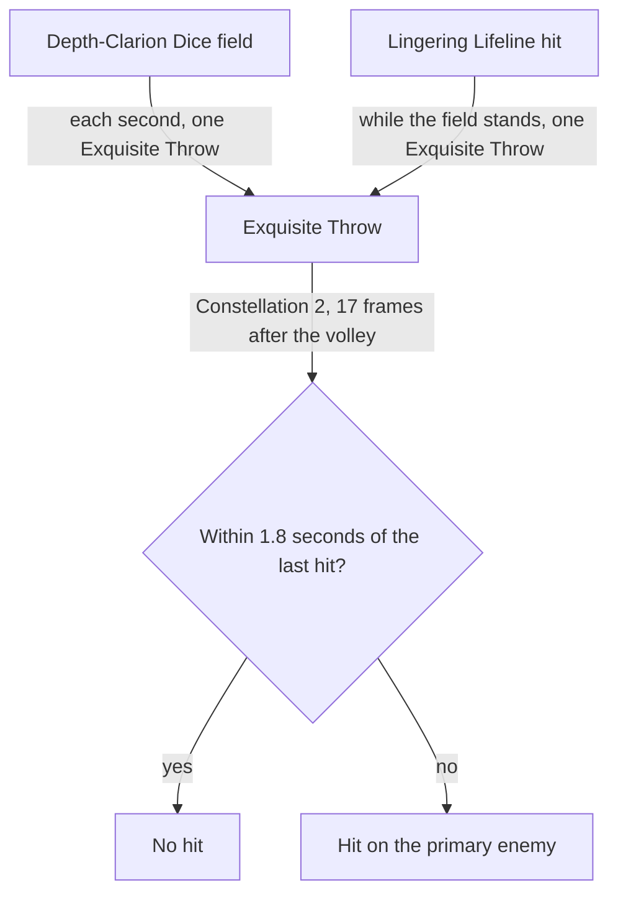

# Yelan

Yelan's kit is its record and one behaviour module, `createYelanKitBehaviour`, on avatar 10000060: four strikes, a fully charged shot with its arrow, a collision and two plunges (`{data-root}/cache/genshin-wiki/Category_Yelan_Talents.json`), Lingering Lifeline's hit, and Depth-Clarion Dice's field, which waves an Exquisite Throw each second and throws one on each Lingering Lifeline hit while it stands. Her multipliers are read from proud skill groups 6031, 6032 and 6039 (`{data-root}/genshin-dump-backup-6.6/ExcelBinOutput/ProudSkillExcelConfigData.json`), and the Lifeline's cooldown, and the burst's cooldown and energy cost, from the same groups (`{data-root}/cache/gcsim-v2.47.2/internal/characters/yelan/skill.go` line 151, `{data-root}/cache/gcsim-v2.47.2/internal/characters/yelan/burst.go` line 76, and the 70 at group 6039 index 4, `{data-root}/genshin-dump-backup-6.6/ExcelBinOutput/ProudSkillExcelConfigData.json`); each hit's share of her Max HP is priced as flat damage on the caster's Max HP. Breakthrough Barb, the 34% roll each Lifeline hit takes for it (group 6032 index 1), is not built, and her Constellations 4 and 6 are not built (`{data-root}/cache/gcsim-v2.47.2/internal/characters/yelan/skill.go` lines 86 and 131, `{data-root}/cache/gcsim-v2.47.2/internal/characters/yelan/burst.go` lines 69 to 71). Constellation 2 is built as each volley's hit on the primary enemy, 14% of her Max HP 17 frames after the volley and at most once each 1.8 seconds, as gcsim (MIT) `{data-root}/cache/gcsim-v2.47.2/internal/characters/yelan/burst.go` gives it (lines 120 to 136, the 17 frames at line 21). Her Ascension 1 passive is built: it raises Max HP by 6% for each Elemental Type the team holds, herself included, and 30% with four, not 24%, as gcsim v2.47.2 `{data-root}/cache/gcsim-v2.47.2/internal/characters/yelan/asc.go` gives it (lines 10 and 22 to 25), and `getBuffedCombatant` prices it into the Max HP that Lingering Lifeline's share reads. Her Ascension 4 passive is built. Her strikes take the wiki's poise, 7.56 to 18 a hit, and her plunges the wiki's 100 high and 50 low (`{data-root}/cache/genshin-wiki/Category_Yelan_Talents.json`, Stealthy Bowshot); the plunges' seconds and the wave's phase are provisional, as gcsim's Yelan directory has no plunge file.

## Decisions

- **Depth-Clarion Dice's first wave comes a second after the initial hit, and its throws land 20, 26 and 32 frames after their wave.** `packages/genshin-world/src/services/kit/characters/yelanKit.ts` starts the wave a second after the hit, as gcsim's ticker does (`{data-root}/cache/gcsim-v2.47.2/internal/characters/yelan/yelan.go` lines 61 to 63, a 60-frame ticker, and `{data-root}/cache/gcsim-v2.47.2/internal/characters/yelan/burst.go` lines 87 to 89).
- **Ascension 4's damage bonus follows the active character from the burst's hit.** A 15-second status starts at the burst's hitmark, as gcsim's `{data-root}/cache/gcsim-v2.47.2/internal/characters/yelan/burst.go` starts its status (lines 65 to 68, the hitmark at line 20), and while it runs the active character deals 1% more DMG, rising 3.5% each whole second up to 50%, as gcsim's `{data-root}/cache/gcsim-v2.47.2/internal/characters/yelan/asc.go` gives it (lines 43 to 58). Each step sets the bonus on whoever is active, so a swap moves it, and a recast of the burst restarts the status. The description's "in play" is read as that window.
- Constellation 1 adds one through `getSkillChargeBonus` to Lingering Lifeline, as the [kits README](../README.md#framework-decisions) gives, which is gcsim's two charges at Constellation 1 (`{data-root}/cache/gcsim-v2.47.2/internal/characters/yelan/yelan.go` lines 48 to 49).

## Key files

| File                                                             | Role                                                                                                                                                           |
| :--------------------------------------------------------------- | :------------------------------------------------------------------------------------------------------------------------------------------------------------- |
| `packages/genshin-world/src/services/kit/characters/yelanKit.ts` | `createYelanKitBehaviour`, Yelan's kit with Lingering Lifeline, Depth-Clarion Dice's field and its Exquisite Throws, and her strikes, charged shot and plunges |

## Sources

- [gcsim](https://github.com/genshinsim/gcsim/tree/v2.47.2/internal/characters/yelan), MIT: the kit's hitmarks, cancel frames and areas, the shot's frames, Lingering Lifeline's frames and hit, Depth-Clarion Dice's initial hit, its Exquisite Throws' travel and interval, and the wave's ticker.
- [Stealthy Bowshot](https://genshin-impact.fandom.com/wiki/Stealthy_Bowshot), Genshin Impact Wiki: the poise of her strikes, fully charged shot, collision and plunges. The cached copy is `{data-root}/cache/genshin-wiki/Category_Yelan_Talents.json`, with its Stealthy Bowshot, Lingering Lifeline and Depth-Clarion Dice pages; the local gcsim source is `{data-root}/cache/gcsim-v2.47.2/internal/characters/yelan/`, and the proud groups are in `{data-root}/genshin-parity/text/ExcelBinOutput/ProudSkillExcelConfigData.json`.
