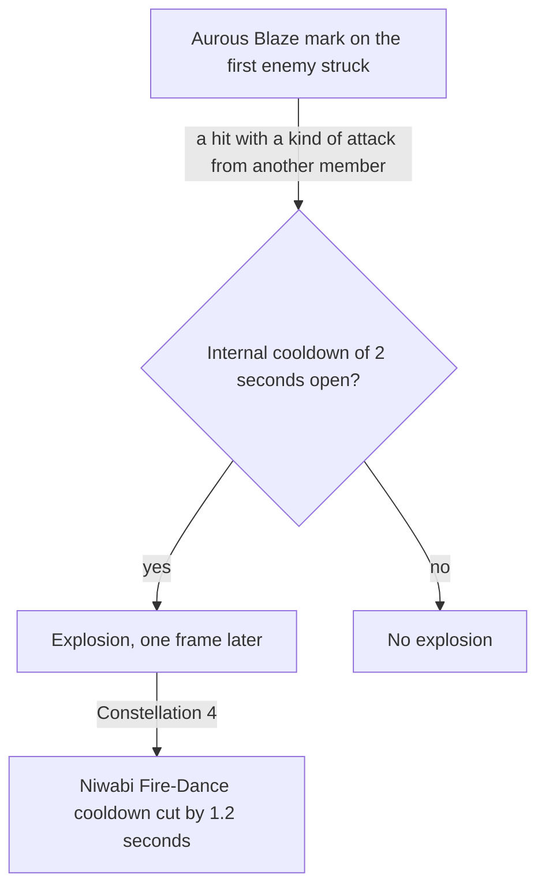

# Yoimiya

Yoimiya's kit is its record and one behaviour module, `createYoimiyaKitBehaviour`, on avatar 10000049: five strikes, a fully charged shot, a collision and two plunges, Niwabi Fire-Dance's Blazing Arrows, and Ryuukin Saxifrage's initial hit with Aurous Blaze. Her multipliers are read from proud skill groups 4931, 4932 and 4939 (`{data-root}/genshin-parity/text/ExcelBinOutput/ProudSkillExcelConfigData.json`); Niwabi Fire-Dance's seconds, cooldown and Normal Attack multiplier (group 4932's 10, 18 and 1.37909, `skill.go` line 34 for the 18 seconds), Aurous Blaze's seconds and its explosion's multiplier and internal cooldown (group 4939's 10, 1.22 and 2, against `burst.go` lines 90 and 145), and the burst's cooldown and energy cost (group 4939's 15 and 60, `burst.go` line 59, and the wiki's energy cost of 60 in `{data-root}/cache/genshin-wiki/Category_Yoimiya_Talents.json`) are read from the same groups. The plunges' timing is provisional, as gcsim's Yoimiya directory has no `plunge.go`.

Niwabi Fire-Dance is a stance for the table's 10 seconds whose strikes deal Pyro, 1U under the Normal Attack internal cooldown (`attack.go` lines 45 and 48 to 50), each hit's multiplier raised by the skill's 137.9% (`yoimiya.go` lines 47 to 50); it ends as she leaves the field (`skill.go` lines 28 to 29 and 55 to 62). The burst's hit marks the first enemy it strikes with Aurous Blaze for 10 seconds (`burst.go` lines 49 to 54, 73 to 94, and the reset at line 63). While the mark stands, a hit another member deals the enemy as a kind of attack sets off an explosion round it a frame later, 1U of Pyro priced by Yoimiya and dealt as Elemental Burst DMG, then not again on that enemy for 2 seconds (`burst.go` lines 100 to 145: the attack tags at lines 123 to 127, the 3-metre circle and one-frame hit at line 143, the 120-frame internal cooldown at line 145). Ascension 1 is built as a passive: each Blazing Arrow that strikes an enemy while Niwabi Fire-Dance stands and Yoimiya is on the field raises a count to 10, giving 2% Pyro DMG Bonus per count for 3 seconds (`asc.go` lines 15 to 43: the Yoimiya-on-field check at line 23, the cap at lines 33 to 35, 2% at line 42, 3 seconds at line 39). Her Ascension 4 ATK share is not built. gcsim v2.47.2 calls it at the burst's hitmark from Ascension 4 (`burst.go` lines 45 to 47), giving each other member 10% ATK plus 1% per Tricks stack for 15 seconds (`asc.go` lines 54 to 66), so the share is a real effect the kit lacks. The comment at `yoimiyaKit.ts` lines 30 to 32, which says gcsim never calls it, is an open item (see Open). Constellation 4 is built as each explosion's cut of 1.2 seconds from Niwabi Fire-Dance's cooldown, which gcsim's `burst.go` makes 72 frames (line 149), and Constellation 6 is not built.

## Decisions

- **Yoimiya's plunges land 0.4 seconds after they start.** gcsim gives her plunges no timing, so her reaches and landing are Ganyu's.
- **Niwabi Fire-Dance is a stance, not an infusion.** gcsim scales each Normal Attack's multiplier by the skill's 137.9% and makes it Pyro, and leaves her aimed shots and plunges alone (`yoimiya.go` lines 47 to 50, which condition the change on `AttackTagNormal`). An infusion only sets the element, and on her charged attack and plunges too, so the skill is a stance whose normal attacks are the Blazing Arrows, each hit its strike's at the raised multiplier.
- **Aurous Blaze answers the damage the team deals, not every hit gcsim sees.** The mark is an enemy status, and the explosion answers the damage taken that the kit events report. A hit that carries a kind of attack, a normal or charged attack, a plunge, a skill or a burst, sets it off, as gcsim's six attack tags do (`burst.go` lines 123 to 127, where a charged attack is `AttackTagExtra`), whether an action or a summon deals it. The explosion is Yoimiya's own, so it sets off no other.
- **Constellation 1's ATK is a buff from a defeat's damage event.** A damage event that defeats an enemy still carrying Aurous Blaze gives Yoimiya 20% ATK for 20 seconds, under the constellation's own source, so a second defeat restarts that buff rather than adding one (`cons.go` lines 12 to 29: the defeat at line 15, 20% at line 14, 1200 frames at line 27). The extra 4 seconds lengthen the mark itself (`burst.go` lines 90 to 93, 840 frames with Constellation 1), and the explosion is read as the base's.
- **Constellation 2 reads a CRIT on her own Pyro hit.** A damage event carries whether the hit was a CRIT, so her Constellation 2 gives her 25% Pyro DMG Bonus for 6 seconds when a hit she strikes with Pyro is one (`cons.go` lines 46 for the CRIT, 49 for the element, 56 for 360 frames). A hit with no element field counts as her Pyro, a rule with no gcsim counterpart (see Provisional constants). The buff is read from any kit's event, so it holds whether she is active or not, as gcsim's comment says (`cons.go` lines 36 to 37).

## Provisional constants

- **Her plunges land 0.4 seconds after they start.** No cached source gives Yoimiya's plunge timing, and her directory in gcsim has no `plunge.go`, so the value stays open until a source gives it.
- **A hit with no element field counts as Pyro for Constellation 2.** gcsim's check reads the element field alone (`cons.go` line 49) and has no fallback, so the kit's `??` in `yoimiyaKit.ts` line 124 is the kit's own reading.

## Key files

| File                                                               | Role                                                                                                                                                                                |
| :----------------------------------------------------------------- | :---------------------------------------------------------------------------------------------------------------------------------------------------------------------------------- |
| `packages/genshin-world/src/services/kit/characters/yoimiyaKit.ts` | `createYoimiyaKitBehaviour`, Yoimiya's kit with Niwabi Fire-Dance's Blazing Arrows, her fully charged shot, and Ryuukin Saxifrage's initial hit with Aurous Blaze and its explosion |

## Sources

- [gcsim](https://github.com/genshinsim/gcsim/tree/v2.47.2/internal/characters/yoimiya), MIT: the kit's hitmarks, cancel frames and areas, the fully charged shot's frames, Niwabi Fire-Dance's animation, the Normal Attacks alone it makes Pyro and multiplies, and its end as she leaves the field, Ryuukin Saxifrage's initial hit and animation, and Aurous Blaze's mark on the first enemy struck, the attacks that set it off, and its explosion's delay, circle, gauge and poise. The source is on disk at `{data-root}/cache/gcsim-v2.47.2/internal/characters/yoimiya/`, and the line numbers above are its files'; the proud groups are in `{data-root}/genshin-parity/text/ExcelBinOutput/ProudSkillExcelConfigData.json`.
- [Aurous Blaze](https://genshin-impact.fandom.com/wiki/Aurous_Blaze), Genshin Impact Wiki: the poise of her burst (220) and its explosion (60) and her burst's energy cost (60). The cached copy is `{data-root}/cache/genshin-wiki/Category_Yoimiya_Talents.json`.

## Open

- [ ] **The comment at `yoimiyaKit.ts` lines 30 to 32 says gcsim never calls Ascension 4's ATK share** — `openspec/changes/genshin-roadmap/tasks.md` does not list the share yet. The gcsim reading that it calls the share at `burst.go` lines 45 to 47 is not re-read on this machine, so the comment stays open until gcsim confirms the call.
