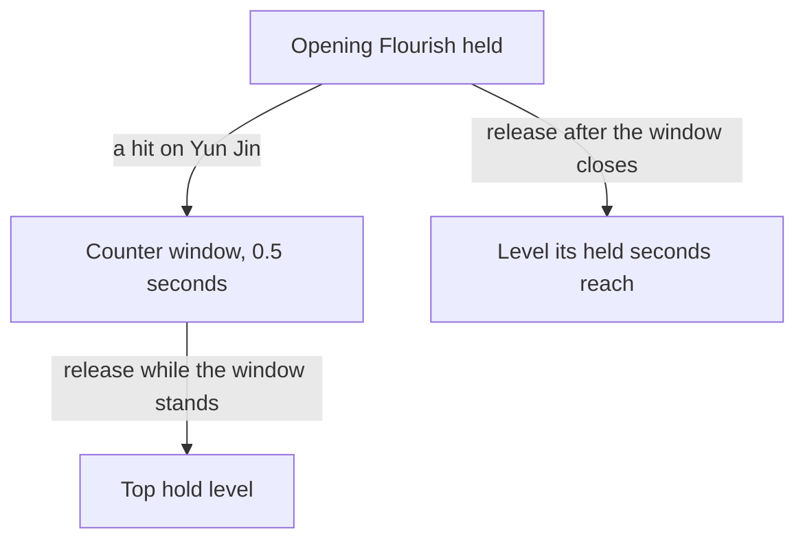

# Yun Jin

Yun Jin's kit is its record and one behaviour module, `createYunjinKitBehaviour`, on avatar 10000064 (`{data-root}/genshin-parity/text/ExcelBinOutput/AvatarExcelConfigData.json`): five strikes, a charged attack, a collision and two plunges (`{data-root}/cache/genshin-wiki/Category_Yun_Jin_Talents.json`), and Opening Flourish's tap and its two charge levels, each with a shield of a share of her Max HP and a flat share, and Cliffbreaker's Banner's initial hit. Her multipliers are read from proud skill groups 6431, 6432 and 6439 (`{data-root}/genshin-parity/text/ExcelBinOutput/ProudSkillExcelConfigData.json`); the skill's cooldown (group 6432's 9 seconds, `{data-root}/cache/gcsim-v2.47.2/internal/characters/yunjin/skill.go` line 122; the wiki's Opening Flourish CD of 9s, `{data-root}/cache/genshin-wiki/Category_Yun_Jin_Talents.json`), and the burst's cooldown and energy cost (group 6439's 15 seconds and 60, `{data-root}/cache/gcsim-v2.47.2/internal/characters/yunjin/burst.go` line 62; the wiki's CD of 15s and energy cost of 60, the same file) are read from the same groups; the charged attack's stamina is open (see Provisional constants). The tap and both charges scale with her DEF (`{data-root}/cache/gcsim-v2.47.2/internal/characters/yunjin/skill.go` line 68 sets "UseDef"), which the kit prices as their flat base damage, and each shield lasts until its hit, as gcsim expires it (`{data-root}/cache/gcsim-v2.47.2/internal/characters/yunjin/skill.go` lines 106 to 113). Cliffbreaker's Banner's DMG Increase is party-wide, as gcsim gives it: the burst sets the banner for 12 seconds from its hit (the wiki's Cliffbreaker's Banner duration of 12s, `{data-root}/cache/genshin-wiki/Category_Yun_Jin_Talents.json`) with 30 stacks (group 6439's index 5, `{data-root}/genshin-parity/text/ExcelBinOutput/ProudSkillExcelConfigData.json`), each enemy a normal attack of any member damages spends one, and while it stands each normal attack of a deployed member adds 0.3216 of Yun Jin's DEF as flat base damage (group 6439's index 1, `{data-root}/genshin-parity/text/ExcelBinOutput/ProudSkillExcelConfigData.json`), with Ascension 4's share of the team's Elemental Types on top. Her own normal attacks take it through her strike hook, and a teammate's through the party strike hook. Her Ascension 1 counter window is built, a hit taken during her hold opening a window that its release reads, her Ascension 4 passive is built on the banner, Constellation 1's Opening Flourish cooldown cut and Constellation 4's DEF are built, and Constellation 2's party Normal Attack DMG Bonus is built from the banner's hit, as a party-wide buff for 12 seconds (gcsim (MIT) "yunjin/cons.go" lines 18 to 35, whose hook `{data-root}/cache/gcsim-v2.47.2/internal/characters/yunjin/burst.go` line 57 calls at the banner's hit). Constellation 1 is a factor of 0.82 on the skill's cooldown, which gcsim's 443 frames round up to (`{data-root}/cache/gcsim-v2.47.2/internal/characters/yunjin/skill.go` lines 118 to 120). Constellation 6 is not built: gcsim (MIT) "yunjin/cons.go" lines 79 to 95 gates its Normal ATK SPD on each member's own banner stacks (line 91), which the kit's single pool of stacks cannot tell apart. The charge levels' thresholds are provisional.

## Decisions

- **Yun Jin's plunges, strikes, charged attack and Opening Flourish all take the wiki's poise (`{data-root}/cache/genshin-wiki/Category_Yun_Jin_Talents.json`).** gcsim gives the plunges none, as its directory has no "plunge.go" (`{data-root}/cache/gcsim-v2.47.2/internal/characters/yunjin/`), so the high and low plunges take the wiki's 150 and 100 (`{data-root}/cache/genshin-wiki/Category_Yun_Jin_Talents.json`, rows 9 to 11); the strikes take 23.46 to 62.66 a hit, the charged attack 120, and Opening Flourish 100, 200 and 300, since gcsim's `{data-root}/cache/gcsim-v2.47.2/internal/characters/yunjin/skill.go` has no poise for it; her plunges' reaches and 0.4 seconds are provisional, the other kits' stand-ins.
- **Opening Flourish's tap and Yun Jin's Geo burst give 1U of Geo gauge each.** Provisional, and gcsim contradicts it: its tap and its burst carry a Durability of 50 (`{data-root}/cache/gcsim-v2.47.2/internal/characters/yunjin/skill.go` line 66, `{data-root}/cache/gcsim-v2.47.2/internal/characters/yunjin/burst.go` line 40), and its level 2 tap 100 (`{data-root}/cache/gcsim-v2.47.2/internal/characters/yunjin/skill.go` line 92), where gcsim's 1U Pyro explosion in Yoimiya's kit uses 25 (`{data-root}/cache/gcsim-v2.47.2/internal/characters/yoimiya/burst.go` line 140). The overlay (`packages/genshin-world/src/data/kits/yun-jin.json`) and `packages/genshin-world/src/services/kit/characters/yunjinKit.ts` name no gauge on these hits, so the 1U is the design's own: the builder the repository holds would write 2U from gcsim's Durability of 50 (`scripts/src/services/genshinAssets/kits/gcsim/createGcsimKitCandidateWriter.ts` lines 123 to 125), and the two units gcsim gives stay open (see Provisional constants).
- **Opening Flourish's charge levels start at half a second and a second.** Provisional: gcsim takes the levels from the "hold" input alone, capped at 2 (`{data-root}/cache/gcsim-v2.47.2/internal/characters/yunjin/skill.go` lines 49 to 51), and gives no seconds for them; the cached Yun Jin talents page gives poise by level and no thresholds (`{data-root}/cache/genshin-wiki/Category_Yun_Jin_Talents.json`), so the record takes 1 second for the second level (`packages/genshin-world/src/data/kits/yun-jin.json`, `skillHolds.1.minimumHeldSeconds`, as `packages/genshin-world/src/data/kits/bennett.json` gives Bennett's second level), and the first level's 0.5 is `UNMEASURED_HOLD_SECONDS` (`scripts/src/services/genshinAssets/kits/constants.ts`). A recording or a source with the thresholds settles them.
- **Constellation 4's DEF is her own reaction's buff.** A reaction event whose striker is Yun Jin, and whose reactions include Crystallize or Lunar-Crystallize, gives her 20% DEF for 12 seconds under its own source, so a second reaction restarts it (`{data-root}/cache/gcsim-v2.47.2/internal/characters/yunjin/cons.go` lines 47 to 76, the striker check at line 60). A reaction a party member triggers gives her nothing, as the text names her own reactions.
- **Yun Jin's Ascension 1 is a counter window on her held skill, and her Ascension 4 share is added to the banner.** Ascension 1, True to Oneself, opens at phase 1 (proud skill group 6421, whose "breakLevel" is 1 in `{data-root}/genshin-dump-backup-6.6/ExcelBinOutput/ProudSkillExcelConfigData.json`). gcsim v2.47.2 leaves it unimplemented (`{data-root}/cache/gcsim-v2.47.2/internal/characters/yunjin/asc.go` lines 8 to 9), and its TODO describes a press of Opening Flourish at the moment she is attacked, which plays the Level 2 Charged form. The kit builds the window the owner ruled instead: a hit on her while her skill is held opens a status on her for 0.5 seconds, and a release while it stands plays the top hold level however short the hold was. A release after the window closes plays the level its held seconds reach. The 0.5 seconds are Unsourced and provisional, as gcsim gives the window no length. Two readings differ from gcsim's: its perfect counter plays the tap's 13-frame hitmark at the Level 2 form (`{data-root}/cache/gcsim-v2.47.2/internal/characters/yunjin/skill.go` lines 53 to 56 set the form, and line 15 the hitmarks), where this kit plays the top level's own 93-frame hitmark (line 15 of the same file); and a completed charge, which the Aegis of Crossed Arrows completes (`packages/genshin-world/src/services/kit/characters/candaceKit.ts` lines 80 to 81 and 158 to 160), would also release at the top level, but a charge stays complete until its release, so it cannot end the window, which is why the window is a hook. A release shorter than Level 1's half second inside the window jumps to the top level as well, which a variant on each hold would miss. Confirm the length and both readings with the owner.
- **Cliffbreaker's Banner's increase is party-wide, as gcsim gives it.** gcsim (MIT) `{data-root}/cache/gcsim-v2.47.2/internal/characters/yunjin/burst.go` gives it to every party member's normal attacks, with the DEF share taken from Yun Jin (lines 77 to 91). Her own normal attacks take it through her strike hook, `getStrikeAdditiveBaseDamageBonus`, and a teammate's through her party strike hook, `getPartyStrikeBonus`, which the deployed team reads for each strike of another member, priced from her buffed DEF. The kit keeps one pool of 30 stacks on the banner, spent by each enemy any member's normal attack damages, where gcsim gives each member its own 30 (`{data-root}/cache/gcsim-v2.47.2/internal/characters/yunjin/burst.go` lines 53 to 54, spent per member at line 93); the per-member pools are not built.
- **The banner is set as the burst starts, its seconds counted from the burst's hit.** gcsim sets the banner on the burst's hitmark, 35 frames in, and its status runs 720 frames from there (`{data-root}/cache/gcsim-v2.47.2/internal/characters/yunjin/burst.go` lines 17, 55 and 59). The kit's status carries the hitmark's seconds plus 12, so it ends 12 seconds after the hit, and nothing reads it before that hit, as gcsim's burst gives no normal attack until 57 frames (line 22).
- **Yun Jin's Ascension 4 adds the team's Elemental Types' share to the banner's increase.** Ascension 4, Breaking Conventions, opens at phase 4 (proud skill group 6422, whose "breakLevel" is 4) and adds to the banner's increase a share of Yun Jin's DEF for each Elemental Type the deployed team holds: 2.5%, 5% and 7.5% for one to three types, and 11.5% for four (gcsim (MIT) `{data-root}/cache/gcsim-v2.47.2/internal/characters/yunjin/asc.go` lines 12 to 37, and group 6422's 0.025, 0.05, 0.075 and 0.115 in `{data-root}/genshin-parity/text/ExcelBinOutput/ProudSkillExcelConfigData.json`). It is added to the banner's 0.3216, so it reaches a normal attack only while the banner stands, on the team's members as on hers. The count is each deployed member's element from `getDeployedCombatants`, read through the team's combatants by id that the strike hooks are handed as their last argument, so her own strike hook and the party hook read the same team.

## Provisional constants

- **The Geo gauge of 1U on the tap and the burst is open.** gcsim gives them a Durability of 50, two units at its 25 per unit (`{data-root}/cache/gcsim-v2.47.2/internal/characters/yunjin/skill.go` line 66, `{data-root}/cache/gcsim-v2.47.2/internal/characters/yunjin/burst.go` line 40), and the level 2 tap 100 (`{data-root}/cache/gcsim-v2.47.2/internal/characters/yunjin/skill.go` line 92), so the design's 1U contradicts it. The candidate writer turns a durability into a gauge at 25 per unit (`scripts/src/services/genshinAssets/kits/gcsim/createGcsimKitCandidateWriter.ts` lines 123 to 125), which gives 2U, and the overlay and `yunjinKit.ts` name no gauge on these hits.
- **The charge levels' 0.5-second and 1-second thresholds are open.** No cached source gives them: gcsim's "hold" input gives the levels without seconds (`{data-root}/cache/gcsim-v2.47.2/internal/characters/yunjin/skill.go` lines 49 to 51), and the cached talents page gives poise only.
- **The Ascension 1 window's 0.5 seconds are open.** gcsim leaves Ascension 1 unbuilt (`{data-root}/cache/gcsim-v2.47.2/internal/characters/yunjin/asc.go` lines 8 to 9), so no source gives the window's length.
- **The plunges' reaches and 0.4-second landing are open.** gcsim's directory has no "plunge.go", so these are the other kits' stand-ins.
- [ ] **The charged attack's stamina is read from proud skill group 6431's index 8** — no source yet: the wiki gives "chargedStamina" 25 on Cloud-Grazing Strike (`{data-root}/cache/genshin-wiki/Category_Yun_Jin_Talents.json`), and group 6431 holds 25.0 at index 8 at every level (`{data-root}/genshin-parity/text/ExcelBinOutput/ProudSkillExcelConfigData.json`), but no source names index 8 as the stamina, and neither the overlay nor `yunjinKit.ts` reads a stamina; a gcsim line that reads the charged attack's stamina, or the game's own field naming it, would settle it.

## Key files

| File                                                                      | Role                                                                                                                                                                                                                                                                                                                                                     |
| :------------------------------------------------------------------------ | :------------------------------------------------------------------------------------------------------------------------------------------------------------------------------------------------------------------------------------------------------------------------------------------------------------------------------------------------------- |
| `packages/genshin-world/src/services/kit/characters/yunjinKit.ts`         | `createYunjinKitBehaviour`, Yun Jin's kit with Opening Flourish's tap and charge levels and their shields, Cliffbreaker's Banner's initial hit, her strikes, charged attack and plunges, Constellations 1, 2 and 4, Cliffbreaker's Banner's DMG Increase on normal attacks with Ascension 4's share, and the hold hook of her Ascension 1 counter window |
| `packages/genshin-world/src/services/kit/effects/openKitCounterWindow.ts` | The counter window her Ascension 1 opens on a hit taken while her skill is held, which `jumpsSkillHoldToTop` reads                                                                                                                                                                                                                                       |

## Sources

- The Ascension 1 window's 0.5 seconds are Unsourced: gcsim's "yunjin/asc.go" leaves Ascension 1 unimplemented, so its TODO is the only source, and it names a press the kit does not build.
- [gcsim](https://github.com/genshinsim/gcsim/tree/v2.47.2/internal/characters/yunjin), MIT: the kit's hitmarks, cancel frames and areas, Opening Flourish's hitmarks, circles, shields and animations, Cliffbreaker's Banner's circle, poise and frames, the banner's 720-frame status, its 30 stacks and its DEF share ("yunjin/burst.go" and "yunjin/skill.go"; the multiplier tables are in "yunjin/zz_yunjin.dm.go", whose first attack multiplier, 0.40506 at line 37, is group 6431's index 0), Ascension 4's share ("yunjin/asc.go"), and the shield's expiry at its hit. The source is on disk at `{data-root}/cache/gcsim-v2.47.2/internal/characters/yunjin/`, and the line numbers above are its files'; the proud groups are in `{data-root}/genshin-parity/text/ExcelBinOutput/ProudSkillExcelConfigData.json`.
- [Cloud-Grazing Strike](https://genshin-impact.fandom.com/wiki/Cloud-Grazing_Strike) and [Opening Flourish](https://genshin-impact.fandom.com/wiki/Opening_Flourish), Genshin Impact Wiki: the poise of her strikes, charged attack, collision, plunges and Opening Flourish. The cached copy is `{data-root}/cache/genshin-wiki/Category_Yun_Jin_Talents.json`.
