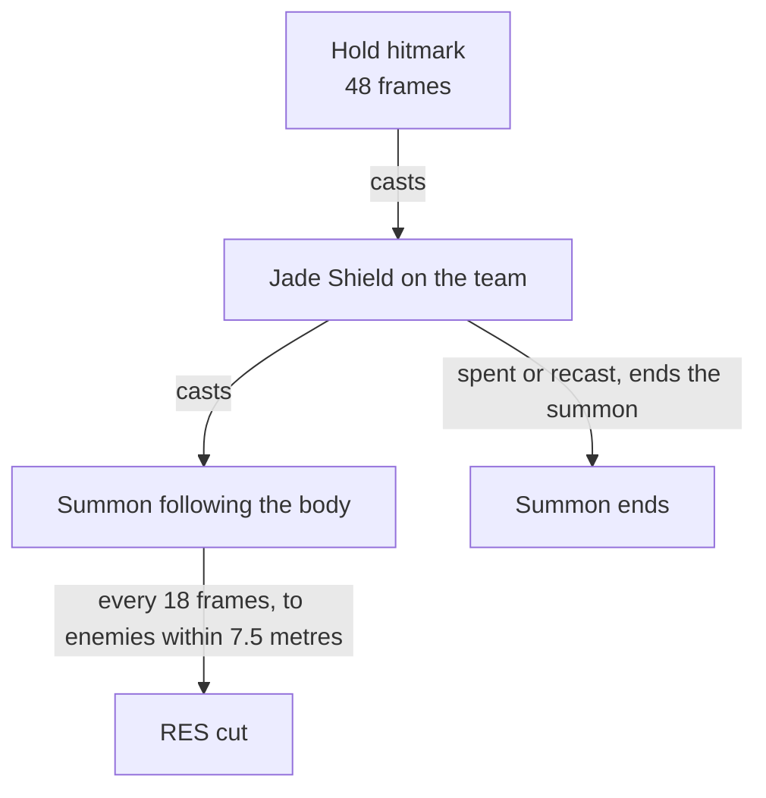

# Zhongli

Zhongli's kit is its record and one behaviour module, `createZhongliKitBehaviour`, on avatar 10000030 (`packages/genshin-world/src/services/kit/characters/zhongliKit.ts`): six strikes, the fifth of four hits, a charged attack, a collision and two plunges, Dominus Lapidis' press and its hold, and Planet Befall's meteor. His multipliers are read from proud skill groups 3031, 3032 and 3039 (`{data-root}/genshin-dump-backup-6.6/ExcelBinOutput/ProudSkillExcelConfigData.json`), and match the wiki's Rain of Stone, Dominus Lapidis and Planet Befall values to two decimal places (spot-checked: 30.77, 42.94 and 401.08 appear in `{data-root}/cache/genshin-wiki/Category_Zhongli_Talents.json`); the press's and hold's cooldowns (group 3032's 4 and 12 seconds, `{data-root}/cache/gcsim-v2.47.2/internal/characters/zhongli/skill.go` lines 51 and 90), and the charged attack's stamina, the Jade Shield's flat health, share of Max HP and seconds (group 3032's 1232.4, 0.128 and 20, `{data-root}/cache/gcsim-v2.47.2/internal/characters/zhongli/shield.go` lines 14 and 16), and the burst's cooldown and cost are read from the same groups. A Stone Stele is a summon standing 3 metres ahead of him (`{data-root}/cache/gcsim-v2.47.2/internal/characters/zhongli/stele.go` line 31), landing as it rises and resonating every 2 seconds; one stands at a time, two from Constellation 1 (`{data-root}/cache/gcsim-v2.47.2/internal/characters/zhongli/zhongli.go` lines 27 to 29), a press replacing the newest, and a hold casting one only while fewer than the most stand (`{data-root}/cache/gcsim-v2.47.2/internal/characters/zhongli/skill.go` line 79). The hold casts the Jade Shield, a Geo shield on the team whose cut of 20% to every Elemental RES and the Physical RES lands on the enemies round the body on the field from a following summon until the shield ends, and the meteor lands from a summon 5 metres ahead. Dominance of Earth's share of his Max HP from Ascension 4 is built, as each hit's additive base damage, and Rock, the Backbone of Earth's second stele, Stone, the Cradle of Jade's shield on the burst and Topaz, Unbreakable and Fearless' wider meteor from one, two and four constellations. Petrification and Topaz's longer one, Resonant Waves, Chrysos, Bounty of Dominator's heal, the stele's resonance with other Geo constructs, its blocking and climbing, the hold's Geo drain and interruption resistance, the skill's particles, Arcanum of Crystal and the constellations that raise talent levels are not built.

## Decisions

- **Zhongli's areas take their offsets and gcsim's fan angles, and his boxes reach their far corners.** His second and fourth strikes are circles of radius 2 and 1.7 centred 0.8 and 1.8 metres ahead, the second a fan of 180 degrees, each priced as its offset plus its radius, and his other strikes boxes from 0, 0.5, -1 and 0.2 metres ahead (`{data-root}/cache/gcsim-v2.47.2/internal/characters/zhongli/attack.go` lines 16 to 23). The charged attack's circle of 0.8 on the primary target (`{data-root}/cache/gcsim-v2.47.2/internal/characters/zhongli/charge.go` lines 44 to 48) is priced round his body at the targeting's radius plus its own, as Klee's bombs are. His plunges are provisional, each landing at 0.4 seconds, reaching 1, 3 and 5 metres, as Xingqiu's do, with the wiki's Rain of Stone poise; gcsim's directory has no `plunge.go`, so they stay open (see Provisional constants). (`packages/genshin-world/src/services/kit/characters/zhongliKit.ts`)
- **A Stone Stele is a summon 3 metres ahead of Zhongli.** It lands its 2U as it rises (`{data-root}/cache/gcsim-v2.47.2/internal/characters/zhongli/stele.go` line 26), 24 frames into the press (`{data-root}/cache/gcsim-v2.47.2/internal/characters/zhongli/skill.go` lines 18 and 46 to 49) and 48 past the hold's release (`{data-root}/cache/gcsim-v2.47.2/internal/characters/zhongli/skill.go` line 19), and resonates 1U every 120 frames from 120 after (`{data-root}/cache/gcsim-v2.47.2/internal/characters/zhongli/stele.go` lines 56, 68, 79 and 135) for gcsim's 1860 frames (`{data-root}/cache/gcsim-v2.47.2/internal/characters/zhongli/skill.go` lines 48 and 81), a second past the wiki's 30, as an 8 by 8 metre box centred 4 metres back along its direction from the stele (`{data-root}/cache/gcsim-v2.47.2/internal/characters/zhongli/stele.go` lines 98 and 127), priced as the circle to its corner. A press with the most steles standing ends the newest of them as its own lands, since gcsim's construct handler replaces the last construct of a kind (`{data-root}/cache/gcsim-v2.47.2/pkg/core/construct/handler.go` lines 36 to 47), and a hold casts one only while fewer stand (`{data-root}/cache/gcsim-v2.47.2/internal/characters/zhongli/skill.go` line 79). The stele's resonance with other Geo constructs, its blocking and its climbing are not built, as no construct stands in the world. (`packages/genshin-world/src/services/kit/characters/zhongliKit.ts`)
- **The Jade Shield is cast at the hold's hitmark, and its RES cut lands from a following summon.** A task run at 48 frames casts the shield, a Geo shield on the team of the group's flat health and share of Zhongli's Max HP for the group's seconds, absorbing every element at the Geo shield's 150% (`{data-root}/cache/gcsim-v2.47.2/pkg/core/player/shield/template.go:64-66`). Its cut lands from a summon following the body on the field: every 18 frames, its loop starting at the cast itself (`{data-root}/cache/gcsim-v2.47.2/internal/characters/zhongli/shield.go` line 23, not a frame past it), a hit of no damage and no poise gives each enemy within 7.5 metres (line 29), a status taking 20% off every Elemental RES and the Physical RES for a second (line 36), as gcsim's shield.go gives it, and a field ticking every step ends the summon once the shield is spent or recast. Being hits, the cuts engage an enemy they reach (`packages/genshin-world/src/services/kit/characters/zhongliKit.ts`); whether the game's cut does too, as the Rain Swords' touch does, and whether Enduring Rock gives its Geo RES cut under it, are open (see Open).
- **Dominance of Earth is each hit's additive base damage.** A hit may carry `additiveBaseDamageBonus`, since the Dominance of Earth page (`{data-root}/cache/genshin-wiki/Category_Zhongli_Talents.json`) counts its Max HP increase as an Additive Base DMG Bonus in the Damage Formula. From Ascension 4 Zhongli's normal, charged and plunging attacks add 1.39% of his Max HP, a stele's hits and the hold's 1.9%, and the meteor 33% (`{data-root}/cache/gcsim-v2.47.2/internal/characters/zhongli/asc.go` lines 22 to 47). (`packages/genshin-world/src/services/kit/characters/zhongliKit.ts`)
- **Planet Befall lands from a summon 5 metres ahead.** Its circle of radius 7.5, 9 from four constellations (`{data-root}/cache/gcsim-v2.47.2/internal/characters/zhongli/burst.go` lines 36 to 44), lands 5 metres ahead at 101 frames (`{data-root}/cache/gcsim-v2.47.2/internal/characters/zhongli/burst.go` lines 14 and 44), and from two constellations the burst casts a Jade Shield as it starts, where gcsim casts it (`{data-root}/cache/gcsim-v2.47.2/internal/characters/zhongli/burst.go` lines 49 to 50), though the wiki's constellation page, which has it as the meteor descends, is not in the cache (see Provisional constants). Petrification, and so Topaz, Unbreakable and Fearless' longer one, is not built, as nothing holds an enemy in place. (`packages/genshin-world/src/services/kit/characters/zhongliKit.ts`)

## Provisional constants

- **The plunges' 0.4-second landing and 1, 3 and 5 metre reaches are open.** gcsim's Zhongli directory has no plunge file, so these are Xingqiu's stand-ins.
- **The hold's half-second threshold is open.** gcsim's hold input gives no seconds (`{data-root}/cache/gcsim-v2.47.2/internal/characters/zhongli/skill.go` line 38), and no cached source gives them.
- **Planet Befall's two-constellation shield timing is open.** gcsim casts it at the burst's start (`{data-root}/cache/gcsim-v2.47.2/internal/characters/zhongli/burst.go` lines 49 to 50), while the wiki's constellation page, which has it as the meteor descends, is not in the cache.

## Not built

- **Resonant Waves, Chrysos, Bounty of Dominator and Zhongli's other constellations are not built.** Both act as the Jade Shield takes damage, and a shield runs nothing as it absorbs a strike, which Beidou's bonus on hits taken waits on too. The hold's drain of Geo from enemies and ores and its interruption resistance are not built, the skill's particles are not built, Jade, Shimmering through Darkness and Lazuli, Herald of the Order raise talent levels, which the [talents](../../talents/design.md) page holds, and Arcanum of Crystal is not combat.

## Key files

| File                                                               | Role                                                                                                                          |
| :----------------------------------------------------------------- | :---------------------------------------------------------------------------------------------------------------------------- |
| `packages/genshin-world/src/services/kit/characters/zhongliKit.ts` | `createZhongliKitBehaviour`, Zhongli's kit with the Stone Steles, the Jade Shield and its RES cut, and Planet Befall's meteor |

## Sources

- [Rain of Stone](https://genshin-impact.fandom.com/wiki/Rain_of_Stone), [Dominus Lapidis](https://genshin-impact.fandom.com/wiki/Dominus_Lapidis) and [Planet Befall](https://genshin-impact.fandom.com/wiki/Planet_Befall), Genshin Impact Wiki: Zhongli's strikes', charged attack's and plunges' gauges, internal cooldown tags and poise, the stele's, the resonance's and the hold's gauges, tags, poise and blunt, the stele's 30 seconds, its one at a time and its resonance every 2 seconds, the Jade Shield's 150% absorption and its cut's 20% in a cylinder 7.5 metres round and 10 high (`{data-root}/cache/genshin-wiki/Category_Zhongli_Talents.json`, Dominus Lapidis Gameplay Notes: "a cylinder with a radius of 7.5 meters and a height of 10 meters"), the hold's Geo drain, and the meteor's gauge, poise and Petrification.
- [Resonant Waves](https://genshin-impact.fandom.com/wiki/Resonant_Waves), [Dominance of Earth](https://genshin-impact.fandom.com/wiki/Dominance_of_Earth), [Arcanum of Crystal](https://genshin-impact.fandom.com/wiki/Arcanum_of_Crystal), [Rock, the Backbone of Earth](https://genshin-impact.fandom.com/wiki/Rock,_the_Backbone_of_Earth), [Stone, the Cradle of Jade](https://genshin-impact.fandom.com/wiki/Stone,_the_Cradle_of_Jade), [Jade, Shimmering through Darkness](https://genshin-impact.fandom.com/wiki/Jade,_Shimmering_through_Darkness), [Topaz, Unbreakable and Fearless](https://genshin-impact.fandom.com/wiki/Topaz,_Unbreakable_and_Fearless), [Lazuli, Herald of the Order](https://genshin-impact.fandom.com/wiki/Lazuli,_Herald_of_the_Order) and [Chrysos, Bounty of Dominator](https://genshin-impact.fandom.com/wiki/Chrysos,_Bounty_of_Dominator), Genshin Impact Wiki: Zhongli's passives and constellations, and Dominance of Earth as Additive Base DMG Bonus.
- [Dominance of Earth](https://genshin-impact.fandom.com/wiki/Dominance_of_Earth), Genshin Impact Wiki, Gameplay Notes: "The DMG increase based on Max HP is considered Additive Base DMG Bonus in the Damage Formula." Cached at `{data-root}/cache/genshin-wiki/Category_Zhongli_Talents.json`.
- [gcsim v2.47.2](https://github.com/genshinsim/gcsim/tree/v2.47.2/internal/characters/zhongli), MIT: the kit's hitmarks, cancel frames and areas, the stele's place, 1860 frames, resonance and snapshot, the hold's stele only below the most, the Jade Shield's cut every 18 frames for 60 within 7.5 metres, the shield on the burst from two constellations and the wider meteor from four, Resonant Waves', Dominance of Earth's and Chrysos' effects, and the construct handler's replacing of the last construct of a kind in [handler.go](https://github.com/genshinsim/gcsim/blob/v2.47.2/pkg/core/construct/handler.go). The source is on disk at `{data-root}/cache/gcsim-v2.47.2/internal/characters/zhongli/` (with `{data-root}/cache/gcsim-v2.47.2/pkg/core/construct/handler.go` beside it), and the line numbers above are its files'; the proud groups are in `{data-root}/genshin-parity/text/ExcelBinOutput/ProudSkillExcelConfigData.json`, and the wiki's multipliers and poise are in `{data-root}/cache/genshin-wiki/Category_Zhongli_Talents.json`.

## Open

- [ ] **a strike's touch engages an enemy as the Rain Swords' touch does, and Enduring Rock's Geo RES cut applies under the shield** — no source yet: gcsim's `zhongli` and `xingqiu` directories and the cached Zhongli and Xingqiu talent pages hold neither interaction, and the Enduring Rock wiki page is not in `{data-root}/cache/genshin-wiki/`.
