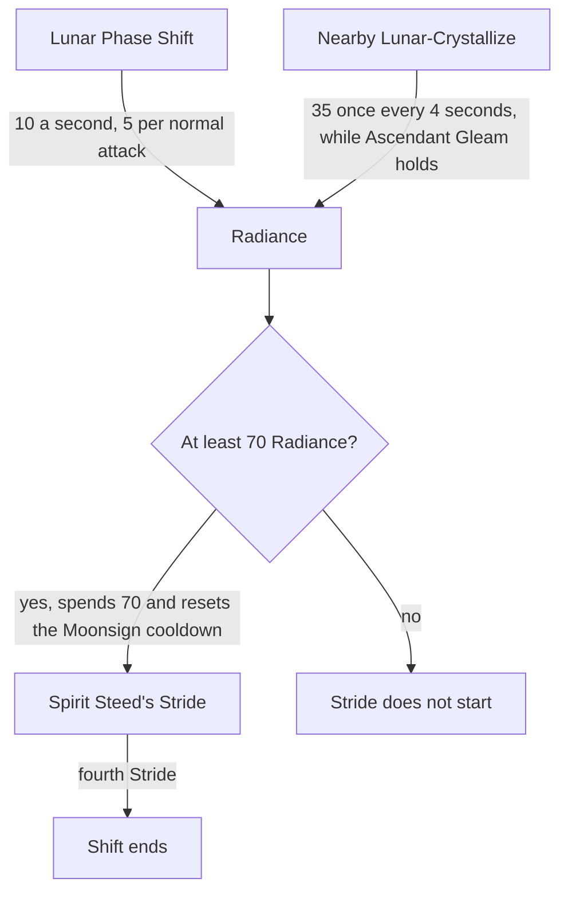

# Zibai

Zibai's kit is its record and one behaviour module, `createZibaiKitBehaviour` (`packages/genshin-world/src/services/kit/characters/zibaiKit.ts`), avatar 10000126 (`{data-root}/genshin-dump-backup-6.6/ExcelBinOutput/AvatarExcelConfigData.json`). gcsim has no folder for Zibai at v2.47.2 (`{data-root}/cache/gcsim-v2.47.2/internal/characters/` holds skirk, bennett and keqing, not zibai), so Zibai's record follows [the kits index](../README.md).

## Decisions

- **Zibai is a one-hand sword user.** Her `weaponType` in the installed game's avatar table is `WEAPON_SWORD_ONE_HAND` (`{data-root}/genshin-dump-backup-6.6/ExcelBinOutput/AvatarExcelConfigData.json`, avatar 10000126).
- **Her Lunar Phase Shift stance's normal and charged attacks borrow their hitmarks and areas from Skirk's sevenPhaseFlash, a one-hand sword stance.** Its first four normal attacks have one, one, two and two hits, as Zibai's do (`{data-root}/cache/gcsim-v2.47.2/internal/characters/skirk/attack.go` line 27, `attackSkillHitmarks`), and its charged attack has three hits, of which Zibai's two take the first two (`{data-root}/cache/gcsim-v2.47.2/internal/characters/skirk/charge.go` line 19). Provisional.
- **Spirit Steed's Stride borrows its two hits from Bennett's sword hold, which has two hits.** No sword stance carries a skill, so the skill takes that hold (10000032, 98 frames from `{data-root}/cache/gcsim-v2.47.2/internal/characters/bennett/skill.go` line 37, and two hits in each of its two levels, lines 16 to 17; its 0.5-second minimum has no gcsim line, see Provisional constants). The hold is a shape match only, since Spirit Steed's Stride is a skill, not a hold. Provisional.
- **The Lunar Phase Shift hits are Geo, as the cached wiki text reads them** (`{data-root}/cache/genshin-wiki/Category_Zibai_Talents.json`, the Heaven and Earth Made Manifest page): normal and charged attacks convert to Geo DMG, and Spirit Steed's Stride deals two instances of Geo DMG, the second Lunar-Crystallize.
- **Zibai's base attacks and charged attack keep Keqing's hitmarks and areas, shape-checked.** Her normal attacks (up to four rapid strikes) and charged attack (two rapid sword strikes) carry Keqing's wording (up to five rapid strikes; two rapid sword strikes), so Keqing's donor holds (`{data-root}/cache/gcsim-v2.47.2/internal/characters/keqing/attack.go` line 16 has five entries, and `{data-root}/cache/gcsim-v2.47.2/internal/characters/keqing/charge.go` line 16 two hits). Her burst is the Jadelight Canopy, two Geo instances, and Keqing's burst is an AoE of several instances, so the form matches; the wiki gives the canopy no geometry, so the burst's 4 paths stay provisional.
- **Her burst's second instance is Lunar-Crystallize, from the cached wiki's Jadelight Canopy text** (`{data-root}/cache/genshin-wiki/Category_Zibai_Talents.json`: two Geo instances, the second Lunar-Crystallize Reaction DMG).
- **Zibai's burst reads its "Skill 1-Hit DMG" and "Skill 2-Hit DMG" labels, one hit each.**
- **Zibai's plunges and collision borrow Bennett's hitmarks and areas, as `NoActionFile`** (`{data-root}/cache/gcsim-v2.47.2/internal/characters/bennett/plunge.go`: low plunge hitmark 36, high 38, collision 30). The plunges' timing is provisional (see Provisional constants).
- **Her shift's entry, Phase Shift Radiance and Spirit Steed's Stride are built.** Heaven and Earth Made Manifest enters the Lunar Phase Shift for her record's seconds, which the cached wiki text gives as at most 15s (`{data-root}/cache/genshin-wiki/Category_Zibai_Talents.json`). The shift gains 10 Radiance a second, 5 for a normal attack once every half second, and 35 for each nearby Lunar-Crystallize while Ascendant Gleam holds, once every four seconds (the same text). Spirit Steed's Stride spends 70 of it, resets that Moonsign cooldown, and the fourth Stride ends the shift. A Stride with less than 70 Radiance does not start, its action's start gate refusing it. Spirit Steed's Stride costs no cooldown in the shift: gcsim v2.47.2 has no Zibai to read one from, so Radiance alone gates it, and the cooldown Heaven and Earth Made Manifest left running on the party does not hold it back.
- **The fourth normal attack's extra instance is built, gated by Ascendant Gleam.** The stance's fourth strike keeps its second hit, the Additional DMG the record and the label map already carry, and that hit lands only while the team is at Ascendant Gleam, through its landing condition, which reads the same Moonsign check as her Radiance. The cached wiki text describes that hit as the extra Geo instance (`{data-root}/cache/genshin-wiki/Category_Zibai_Talents.json`: the fourth attack deals an additional instance of Geo DMG).
- **The second instance of Spirit Steed's Stride is Lunar-Crystallize.** Its hit's `lunarReactionType` is `LunarCrystallize`, from the cached wiki text, which says the second instance is Lunar-Crystallize Reaction DMG (`{data-root}/cache/genshin-wiki/Category_Zibai_Talents.json`, the Heaven and Earth Made Manifest page). The hit keeps its Geo element, and its scaling stat is not read yet.

## Provisional constants

- **Bennett's 0.5-second minimum for the hold borrowed by Spirit Steed's Stride is open.** No gcsim line gives it (`{data-root}/cache/gcsim-v2.47.2/internal/characters/bennett/skill.go` has no hold seconds), and no cached source does.
- **The plunges' timing is open.** The design takes Bennett's plunge timing (`{data-root}/cache/gcsim-v2.47.2/internal/characters/bennett/plunge.go`, low hitmark 36), as the [kits index](../README.md#how-a-kit-is-read) gives a plunge with no gcsim file, and Keqing's (`{data-root}/cache/gcsim-v2.47.2/internal/characters/keqing/plunge.go`, low hitmark 46) is the other reading. Both gcsim files give the same reaches, 3 and 5 metres, so only the timing differs. The record the kit reads is in published game data, not the repo cache, so neither reading is confirmed.
- **The burst's Jadelight Canopy geometry and its four paths are open.** The cached wiki text gives the canopy no geometry, so its paths stay provisional.

## Not built

- **Radiance on a hit on an enemy is not built.** A normal attack's Radiance is read at its first hit's hitmark, since no event tells the two apart.

## Key files

| File                                                             | Role                                                               |
| :--------------------------------------------------------------- | :----------------------------------------------------------------- |
| `packages/genshin-world/src/services/kit/characters/zibaiKit.ts` | `createZibaiKitBehaviour`, her shift's entry, Radiance and Strides |
| `packages/genshin-world/src/data/kits/zibai.json`                | Zibai's overlay                                                    |

## Sources

- [Zibai](https://genshin-impact.fandom.com/wiki/Zibai) and [Category:Zibai Talents](https://genshin-impact.fandom.com/wiki/Category:Zibai_Talents), Genshin Impact Wiki: Zibai's multipliers, energy, cooldowns and costs, and the Lunar Phase Shift and Spirit Steed's Stride text read from the category page.
- Zibai's clips, `Ani_Avatar_Lady_Sword_Zibai_*`, read per the [kits README](../README.md#sources).
- [gcsim](https://github.com/genshinsim/gcsim/tree/v2.47.2/internal/characters/keqing), MIT at v2.47.2: Keqing's hitmarks and areas, which Zibai's base burst, base charged attack and base normal attacks take.
- The built records of Skirk (10000114) and Bennett (10000032), for the stance and hold donors above.
- Local copies: `{data-root}/genshin-parity/text/ExcelBinOutput/AvatarExcelConfigData.json` (avatar 10000126's weapon type), `{data-root}/cache/genshin-wiki/Category_Zibai_Talents.json` (the Heaven and Earth Made Manifest, Tri-Sphere Eminence and Lunar Phase Shift texts), and `{data-root}/cache/gcsim-v2.47.2/internal/characters/` for the Skirk, Bennett and Keqing files the line numbers above name.
