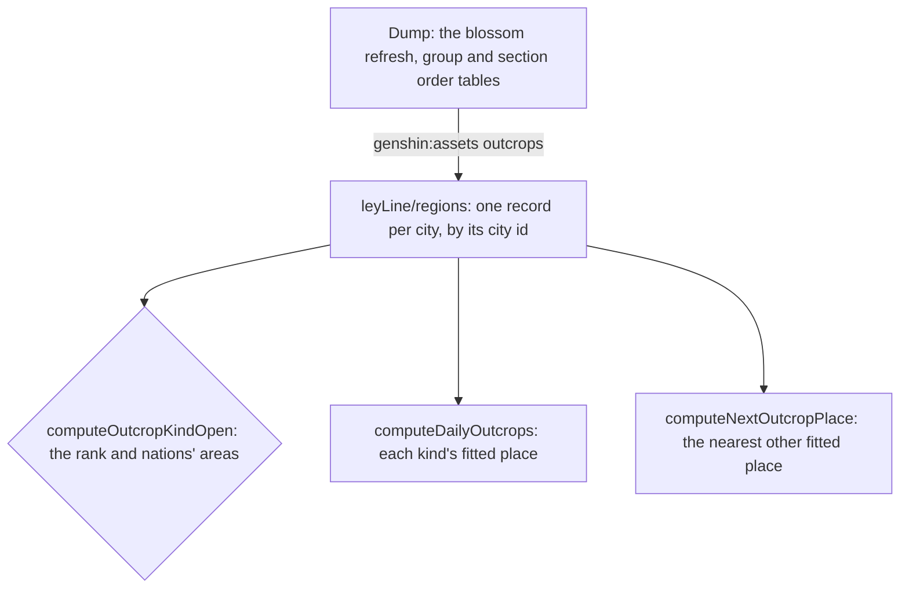

# Ley line outcrops

The rules a region's two ley line blossoms follow, read from the game's tables by `genshin:assets outcrops`: when each kind opens, where it starts after the daily reset, and where a claimed one moves on to. A kind is the Blossom of Revelation, which gives Character EXP materials, or the Blossom of Wealth, which gives Mora. Nothing places them in the world yet, so no outcrop is touched or fought, and no claim is offered: the places wait on [spawned places](../../../changes/genshin-spawned-places/design.md), the enemies on the wiki's table, and the rewards on a table the dump does not hold.

## How it works

## Decisions

- **Two kinds per region, read off the refresh rows.** A ley line kind is a blossom refresh whose type is `BLOSSOM_REFRESH_EXP`, the Revelation, or `BLOSSOM_REFRESH_SCOIN`, the Wealth (`~/Esposter.noindex/genshin-parity/text/ExcelBinOutput/BlossomRefreshExcelConfigData.json`, `scripts/src/services/genshinAssets/leyLine/constants.ts`). The rows name the city ids 1 to 7, Mondstadt to Snezhnaya in the game's order, and each of those regions gets its two kinds. Dragonspine, Blitz Rush and the Blossom Island refreshes are other challenges and read no kind (`~/Esposter.noindex/genshin-parity/text/ExcelBinOutput/BlossomRefreshExcelConfigData.json`, rows 13 to 19).
- **Opened by rank, and by a nation's area, as the table says.** Mondstadt opens Revelation at Adventure Rank 8 and Wealth at 12 (`~/Esposter.noindex/genshin-parity/text/ExcelBinOutput/BlossomRefreshExcelConfigData.json`, rows 2 and 1, `BLOSSOM_REFRESH_COND_PLAYER_LEVEL_EQUAL_GREATER`). Liyue's rows open both at 18 with no area condition, which differs from the wiki's 8 and 12 for Liyue: the table is read (`~/Esposter.noindex/genshin-parity/text/ExcelBinOutput/BlossomRefreshExcelConfigData.json`, rows 3 and 4), and the difference is a [recording owed](../../../changes/genshin-roadmap/tasks.md). Every other region opens both at 18 once a nation's area is unlocked. The table's "UNLOCK_ANY_AREA_IN_CITY" is read as that nation's Statue of The Seven activated, since a statue unlocks its area (`~/Esposter.noindex/genshin-parity/text/ExcelBinOutput/BlossomRefreshExcelConfigData.json`, rows 20 to 51; `scripts/src/services/genshinAssets/leyLine/constants.ts`).
- **Sections kept, read by no rule yet.** A region's sections are kept in the data in their order, so the dump's place chain can be joined to the fitted places by position once the scene-group export lands (`~/Esposter.noindex/genshin-parity/text/ExcelBinOutput/BlossomSectionOrderExcelConfigData.json`, `scripts/src/services/genshinAssets/leyLine/toLeyLineRegions.ts`). No draw reads them yet.
- **Started at a drawn fitted place.** Each kind starts at a fitted place drawn at random from those no kind before it holds, with the day's seeded random. A kind with no place left starts none (`packages/genshin-world/src/services/leyLine/computeDailyOutcrops.ts`, `packages/genshin-world/src/services/leyLine/drawPlaceIds.ts`).
- **Moved on to the nearest place.** A claimed outcrop moves to the nearest fitted place of its region but its own and not the one the other kind stands at, where it waits; where none is free it stays claimed. Provisional until the dump's place chain is joined to the fitted places by position.
- **The daily reset is 04:00.** The refresh rows' `refreshTime` is 04:00 in the game's day, the reset every kind starts over at (`~/Esposter.noindex/genshin-parity/text/ExcelBinOutput/BlossomRefreshExcelConfigData.json`, `refreshTime` on rows 1 to 4). The random stream a reset draws from is the caller's, and nothing wires the reset yet.
- **Settled calls on the rest of the table.** The rank each city's "BlossomOpenExcelConfigData" row gives gates nothing a kind opens by, so it is not read. Each ley kind's "BlossomChestExcelConfigData" resin is 20, the price Original Resin already charges (`~/Esposter.noindex/genshin-parity/text/ExcelBinOutput/BlossomChestExcelConfigData.json`, rows 1 and 2). The groups' refresh type numbers are not read, since the dump holds no enum naming them: a kind's draw ranges over every place of its region's sections.

## Data

- **The tables.** The blossom refresh, group and section order tables come from the community's dump, `BlossomRefreshExcelConfigData`, `BlossomGroupsExcelConfigData` and `BlossomSectionOrderExcelConfigData`, read from the dump's `ExcelBinOutput` folder under `GENSHIN_TEXT_DIRECTORY` (`~/Esposter.noindex/genshin-parity/text/ExcelBinOutput/BlossomRefreshExcelConfigData.json`, `~/Esposter.noindex/genshin-parity/text/ExcelBinOutput/BlossomGroupsExcelConfigData.json`, `~/Esposter.noindex/genshin-parity/text/ExcelBinOutput/BlossomSectionOrderExcelConfigData.json`). The dump at its revision lacked all three; they were taken from the same repository's files and not committed.
- **The regions.** Each city's region is one hosted record under leyLine/regions/<cityId>, published by `genshin:assets outcrops` and read by `readOutcropRegion`, holding its two kinds' rules, its sections in order and every place its groups name. A region's kinds are read once its key is in the lock, and until then the world draws no outcrop (`scripts/src/services/genshinAssets/leyLine/buildLeyLineRegions.ts`, `packages/genshin-world/src/composables/useWorldOutcrops.ts`).

## Not built yet

- **Touching, fighting and claiming in play.** Mondstadt's outcrops stand at the official map's few dozen Ley Line Blossom points, written into its region data as outcrop places, as the [spawned places](../../../changes/genshin-spawned-places/design.md) page sets out. A touch spawns the camp its place holds, and an outcrop with no camp spawns none. No source pairs a wiki location with a map point, so no place has a camp yet. The daily draw still starts over the dump's places, not these, so no outcrop is in play. The enemies per place come from the wiki's table, which is not in the dump, and the claim's F prompt is built but not wired.
- **The claims' rewards.** Not read yet: each refresh row lists its reward previews, one a World Level, which name them, as the [proposal](../../../changes/genshin-ley-line-outcrops/design.md) sets out.
- **Fontaine, Natlan and Snezhnaya.** Their kinds are read, but their sections are not in the dump's section order table, so no outcrop is drawn there.
- **Nod-Krai.** The refresh rows name no kind for it.
- **The states and the reset.** The transitions from waiting through fighting and cleared to claimed, and the reset that starts each kind over, are the proposal's still.

## Key files

| File                                                                         | Role                                                                                |
| :--------------------------------------------------------------------------- | :---------------------------------------------------------------------------------- |
| `scripts/src/services/genshinAssets/leyLine/buildLeyLineRegions.ts`          | builds each city's region record under its key, from the dump's four tables         |
| `scripts/src/services/genshinAssets/leyLine/toLeyLineRegions.ts`             | each city's kinds, places and ordered sections from the tables                      |
| `scripts/src/services/genshinAssets/leyLine/constants.ts`                    | the refresh types and the two conditions the kinds open by                          |
| `packages/genshin-world/src/models/leyLine/OutcropKind.ts`                   | the Revelation and the Wealth                                                       |
| `packages/genshin-world/src/models/leyLine/OutcropKindRule.ts`               | a kind's Adventure Rank and the nations whose areas it needs unlocked               |
| `packages/genshin-world/src/models/leyLine/OutcropRegion.ts`                 | a region's kinds, sections and places, as its slice is written                      |
| `packages/genshin-world/src/services/leyLine/computeOutcropKindOpen.ts`      | whether a kind is open at a rank with the listed areas unlocked                     |
| `scripts/src/services/genshinAssets/fit/fitRegionOutcrops.ts`                | the Ley Line Blossoms of the official map written into each region's outcrop places |
| `packages/genshin-world/src/services/leyLine/createOutcropCamp.ts`           | the camp a touch spawns at an outcrop's place, of provisional size and kinds        |
| `packages/genshin-world/src/services/leyLine/advanceOutcropFight.ts`         | the blossom reveals once every enemy of its place's camp is down                    |
| `packages/genshin-world/src/services/leyLine/computeOutcropInteractables.ts` | the claim prompt at a cleared outcrop's place                                       |
| `packages/genshin-world/src/composables/useWorldOutcrops.ts`                 | the day's outcrops: touched, fought, revealed, and the F claim through its offer    |
| `packages/genshin-world/src/components/Interaction/OfferChoice/Index.vue`    | the choice of claims F offers at a revealed blossom                                 |
| `packages/genshin-world/src/services/leyLine/computeNextOutcropPlace.ts`     | the nearest other fitted place, or none where no place is free                      |

## Sources

- [AnimeGameData](https://github.com/DimbreathBot/AnimeGameData), the community's per-patch dump: the blossom refresh, group and section order tables, and the chest table's resin.
- [Ley Line Outcrop Guide](https://game8.co/games/Genshin-Impact/archives/317049), Game8: Revelation at Adventure Rank 8 and Wealth at 12 in Mondstadt and Liyue, and from version 5.8 Adventure Rank 18 and a statue in the other regions. Its Liyue figures are the ones the table disagrees with.

## Open

- [ ] **The Blossom of Revelation gives Character EXP materials, and the Blossom of Wealth gives Mora** — no source yet: the refresh rows' reward previews do not resolve to item names in the dump.
- [ ] **Liyue's Revelation and Wealth open at Adventure Rank 8 and 12 in the wiki** — no source yet: the Game8 guide is not in the cache.
- [ ] **A Statue of The Seven unlocks its nation's area** — no source yet: the wiki's Statue of The Seven page, which is not in the cache.
- [ ] **Original Resin charges 20 resin** — no source yet: the Original Resin price as a standalone cost; the one text read, key 1691155488 in `~/Esposter.noindex/genshin-parity/text/TextMap/TextMap_MediumEN.json` ("Consume 20 Original Resin to receive the normal amount of rewards"), belongs to a challenge that no dump table holds (its hash appears only in `~/Esposter.noindex/genshin-parity/text/ManualTextMapConfigData.json`).
