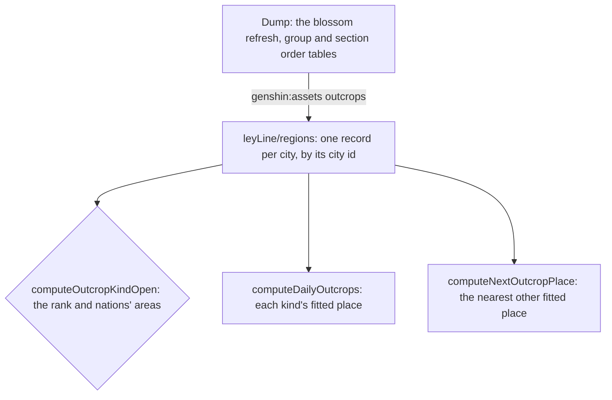

# Ley line outcrops

The rules a region's two ley line blossoms follow, read from the game's tables by `genshin:assets outcrops`: when each kind opens, where it starts after the daily reset, and where a claimed one moves on to. A kind is the Blossom of Revelation, which gives Character EXP materials, or the Blossom of Wealth, which gives Mora. The world draws them each day over the fitted places in each region's data. A touch starts a camp of provisional enemies at a place, and a claim on F is offered once the camp is down.

## How it works

## Decisions

- **Two kinds per region, read off the refresh rows.** A ley line kind is a blossom refresh whose type is `BLOSSOM_REFRESH_EXP`, the Revelation, or `BLOSSOM_REFRESH_SCOIN`, the Wealth (`{data-root}/genshin-parity/text/ExcelBinOutput/BlossomRefreshExcelConfigData.json`, `scripts/src/services/genshinAssets/leyLine/constants.ts`). The rows name the city ids 1 to 8, and each of those cities gets its two kinds. Ids 1 to 7 are Mondstadt to Snezhnaya by `CityIdRegionMap` (`scripts/src/services/genshinAssets/shared/constants.ts`), which places Nod-Krai in no region; which nation city 8 is stays open (see Open). Dragonspine, Blitz Rush and the Blossom Island refreshes are other challenges and read no kind (`{data-root}/genshin-parity/text/ExcelBinOutput/BlossomRefreshExcelConfigData.json`, rows 13 to 19).
- **Opened by rank, and by a nation's area, as the table says.** Mondstadt opens Revelation at Adventure Rank 8 and Wealth at 12 (`{data-root}/genshin-parity/text/ExcelBinOutput/BlossomRefreshExcelConfigData.json`, rows 2 and 1, `BLOSSOM_REFRESH_COND_PLAYER_LEVEL_EQUAL_GREATER`). Liyue's rows open both at 18 with no area condition, which differs from the wiki's 8 and 12 for Liyue (`{data-root}/cache/genshin-wiki/Page_Ley_Line_Outcrop.json`, its introduction: "In Mondstadt and Liyue, Blossoms of Revelation are unlocked at Adventure Rank 8, and Blossoms of Wealth are unlocked at Adventure Rank 12"): the table is read (`{data-root}/genshin-parity/text/ExcelBinOutput/BlossomRefreshExcelConfigData.json`, rows 3 and 4), and the difference is a [recording owed](../../../changes/genshin-roadmap/tasks.md). Every other region opens both at 18 once a nation's area is unlocked. The table's "UNLOCK_ANY_AREA_IN_CITY" is read as that nation's Statue of The Seven activated, since a statue fills in its area (`{data-root}/cache/genshin-wiki/Page_Statue_of_The_Seven.json`, its Overview: "one Statue of The Seven per area"; `{data-root}/cache/genshin-wiki/Page_Ley_Line_Outcrop.json`, its introduction: "after activating at least one Statue of The Seven in the corresponding region"). The rows are `{data-root}/genshin-parity/text/ExcelBinOutput/BlossomRefreshExcelConfigData.json`, rows 20 to 51, read through `scripts/src/services/genshinAssets/leyLine/constants.ts`.
- **Sections kept, read by no rule yet.** A region's sections are kept in the data in their order, so the dump's place chain can be joined to the fitted places by position once the scene-group export lands (`{data-root}/genshin-parity/text/ExcelBinOutput/BlossomSectionOrderExcelConfigData.json`, `scripts/src/services/genshinAssets/leyLine/toLeyLineRegions.ts`). No draw reads them yet.
- **Started at a drawn fitted place.** Each kind starts at a fitted place drawn at random from those no kind before it holds, with the day's seeded random. A kind with no place left starts none (`packages/genshin-world/src/services/leyLine/computeDailyOutcrops.ts`, `packages/genshin-world/src/services/leyLine/drawPlaceIds.ts`).
- **Moved on to the nearest place.** A claimed outcrop moves to the nearest fitted place of its region but its own and not the one the other kind stands at, where it waits; where none is free it stays claimed. Provisional until the dump's place chain is joined to the fitted places by position. The wiki's Ley Line Outcrop page gives the game's rule as the next location in the group, the location after when the other kind holds it (`{data-root}/cache/genshin-wiki/Page_Ley_Line_Outcrop.json`, its locations text).
- **The daily reset is 04:00.** The refresh rows' `refreshTime` is 04:00 in the game's day, the reset every kind starts over at (`{data-root}/genshin-parity/text/ExcelBinOutput/BlossomRefreshExcelConfigData.json`, `refreshTime` on rows 1 to 4). The random stream a reset draws from is the caller's, and `useWorldOutcrops` draws again once the day it last drew is over (`checkIsDailyResetDayCurrent`).
- **Settled calls on the rest of the table.** The rank each city's "BlossomOpenExcelConfigData" row gives gates nothing a kind opens by, so it is not read. Each ley kind's "BlossomChestExcelConfigData" resin is 20, the price Original Resin already charges (`{data-root}/genshin-parity/text/ExcelBinOutput/BlossomChestExcelConfigData.json`, rows 1 and 2), and the wiki's Ley Line Outcrop page gives the same price (`{data-root}/cache/genshin-wiki/Page_Ley_Line_Outcrop.json`, its Overview: "consumes either 20 Original Resin or 1 Condensed Resin"). The groups' refresh type numbers are not read, since the dump holds no enum naming them: a kind's draw ranges over every place of its region's sections.

## Data

- **The tables.** The blossom refresh, group and section order tables come from the community's dump, `BlossomRefreshExcelConfigData`, `BlossomGroupsExcelConfigData` and `BlossomSectionOrderExcelConfigData`, read from the dump's `ExcelBinOutput` folder under `GENSHIN_TEXT_DIRECTORY` (`{data-root}/genshin-parity/text/ExcelBinOutput/BlossomRefreshExcelConfigData.json`, `{data-root}/genshin-parity/text/ExcelBinOutput/BlossomGroupsExcelConfigData.json`, `{data-root}/genshin-parity/text/ExcelBinOutput/BlossomSectionOrderExcelConfigData.json`). The dump on disk holds all three, as does `{data-root}/genshin-dump-backup-6.6/ExcelBinOutput/`, and nothing from them is committed.
- **The regions.** Each city's region is one hosted record under leyLine/regions/<cityId>, published by `genshin:assets outcrops` and read by `readOutcropRegion`, holding its two kinds' rules, its sections in order and every place its groups name. A region's kinds are read once its key is in the lock, and until then the world draws no outcrop (`scripts/src/services/genshinAssets/leyLine/buildLeyLineRegions.ts`, `packages/genshin-world/src/composables/useWorldOutcrops.ts`).

## Not built yet

- **The camps are provisional.** A touch spawns a camp of `OUTCROP_CAMP_SIZE` members, drawn from `OUTCROP_CAMP_ENEMY_KIND_IDS`, at the place (`packages/genshin-world/src/services/leyLine/createOutcropCamp.ts`). The enemies per place come from the wiki's table, which is not in the dump.
- **The claims' items.** A claim pays its World Level's row of the refresh row's reward previews (`packages/genshin-world/src/services/leyLine/computeOutcropClaimRewards.ts`), and the names of those items are open (see Open).
- **Fontaine, Natlan, Nod-Krai and Snezhnaya.** Their kinds are read, but their sections are not in the dump's section order table, so no outcrop is drawn there.

## Key files

| File                                                                         | Role                                                                                                                                                 |
| :--------------------------------------------------------------------------- | :--------------------------------------------------------------------------------------------------------------------------------------------------- |
| `scripts/src/services/genshinAssets/leyLine/buildLeyLineRegions.ts`          | builds each city's region record under its key, from the dump's four tables                                                                          |
| `scripts/src/services/genshinAssets/leyLine/toLeyLineRegions.ts`             | each city's kinds, places and ordered sections from the tables                                                                                       |
| `scripts/src/services/genshinAssets/leyLine/constants.ts`                    | the refresh types and the two conditions the kinds open by                                                                                           |
| `packages/genshin-world/src/models/leyLine/OutcropKind.ts`                   | the Revelation and the Wealth                                                                                                                        |
| `packages/genshin-world/src/models/leyLine/OutcropKindRule.ts`               | a kind's Adventure Rank and the nations whose areas it needs unlocked                                                                                |
| `packages/genshin-world/src/models/leyLine/OutcropRegion.ts`                 | a region's kinds, sections and places, as its slice is written                                                                                       |
| `packages/genshin-world/src/services/leyLine/computeOutcropKindOpen.ts`      | whether a kind is open at a rank with the listed areas unlocked                                                                                      |
| `packages/genshin-world/src/services/leyLine/computeDailyOutcrops.ts`        | the day's draw of each kind's starting place, lines 23 to 27                                                                                         |
| `packages/genshin-world/src/services/leyLine/drawPlaceIds.ts`                | the draw of fitted place ids no kind before holds, each taken once, lines 6 to 14                                                                    |
| `scripts/src/services/genshinAssets/fit/fitRegionOutcrops.ts`                | the Ley Line Blossoms of the official map written into each region's outcrop places                                                                  |
| `packages/genshin-world/src/services/leyLine/createOutcropCamp.ts`           | the camp a touch spawns at an outcrop's place, of provisional size and kinds                                                                         |
| `packages/genshin-world/src/services/leyLine/advanceOutcropFight.ts`         | the blossom reveals once every enemy of its place's camp is down                                                                                     |
| `packages/genshin-world/src/services/leyLine/computeOutcropInteractables.ts` | the claim prompt at a cleared outcrop's place                                                                                                        |
| `packages/genshin-world/src/composables/useWorldOutcrops.ts`                 | the day's outcrops: touched, fought, revealed, and the F claim through its offer                                                                     |
| `packages/genshin-world/src/components/Interaction/OfferChoice/Index.vue`    | the choice of claims F offers at a revealed blossom                                                                                                  |
| `packages/genshin-world/src/services/leyLine/computeNextOutcropPlace.ts`     | the nearest other fitted place, or none where no place is free (lines 15 to 23: line 16 for an unfitted claim, lines 18 to 23 when no place is left) |

## Sources

- [AnimeGameData](https://github.com/DimbreathBot/AnimeGameData), the community's per-patch dump: the blossom refresh, group and section order tables, and the chest table's resin.
- [Ley Line Outcrop Guide](https://game8.co/games/Genshin-Impact/archives/317049), Game8: Revelation at Adventure Rank 8 and Wealth at 12 in Mondstadt and Liyue, and from version 5.8 Adventure Rank 18 and a statue in the other regions. Its Liyue figures are the ones the table disagrees with. The guide is not on disk; the wiki's Ley Line Outcrop page gives the same Liyue figures (`{data-root}/cache/genshin-wiki/Page_Ley_Line_Outcrop.json`), so they are read there.
- `{data-root}/genshin-parity/text/ExcelBinOutput/BlossomRefreshExcelConfigData.json`, its EXP and SCOIN rows for each city, grounding the requirement "Two kinds per region".
- `{data-root}/genshin-dump-backup-6.6/ExcelBinOutput/RewardPreviewExcelConfigData.json`, id 4001 at line 35642 and id 4101 at line 37702, with item 202 named Mora in `{data-root}/genshin-dump-backup-6.6/ExcelBinOutput/MaterialExcelConfigData.json`, grounding the requirement "Two kinds per region".
- `{data-root}/genshin-parity/text/ExcelBinOutput/BlossomRefreshExcelConfigData.json`, the area condition on the rows of cities 3 to 8 only, grounding the requirement "Opening by a nation's area".
- `{data-root}/genshin-parity/text/ExcelBinOutput/BlossomRefreshExcelConfigData.json`, `refreshTime`, grounding the requirement "Daily reset at 04:00".
- `{data-root}/genshin-parity/text/ExcelBinOutput/BlossomRefreshExcelConfigData.json`, rows 13 to 19, grounding scenario "Other challenges read no kind".
- `{data-root}/genshin-parity/text/ExcelBinOutput/BlossomRefreshExcelConfigData.json`, row 2, grounding scenario "Mondstadt's Revelation opens at rank 8".
- `{data-root}/genshin-parity/text/ExcelBinOutput/BlossomRefreshExcelConfigData.json`, row 1, grounding scenario "Mondstadt's Wealth opens at rank 12".
- `{data-root}/genshin-parity/text/ExcelBinOutput/BlossomRefreshExcelConfigData.json`, rows 3 and 4, grounding scenario "Liyue opens both kinds at rank 18".
- `{data-root}/genshin-parity/text/ExcelBinOutput/BlossomRefreshExcelConfigData.json`, rows 20 and 21, grounding scenario "Other regions wait for a nation's area".
- `{data-root}/genshin-parity/text/ExcelBinOutput/BlossomSectionOrderExcelConfigData.json` has no section for Fontaine, Natlan, Nod-Krai or Snezhnaya. The daily draw reads fitted places, not sections, so this grounds no scenario now; scenario "Region without fitted places" is the draw's own rule.

## Open

- [ ] **The rows name the city ids 1 to 8, and city 8's nation is unread** — raised: `{data-root}/genshin-parity/text/ExcelBinOutput/BlossomRefreshExcelConfigData.json` rows 50 and 51 carry `cityId` 8 with both kinds and the area condition, so the table gives eight cities with kinds. City 8's name is not read here, so whether it is Nod-Krai is open. Searched: `{data-root}/genshin-parity/text/ExcelBinOutput/CityConfigData.json` gives city 8 the areas 55 to 59, whose names resolve in neither TextMap file, and `{data-root}/genshin-dump-backup-6.6/ExcelBinOutput/CityConfigData.json` line 279 names city 7 Nod-Krai, where `CityIdRegionMap` maps city 7 to snezhnaya. A city table or a text id naming city 8 would settle it.
