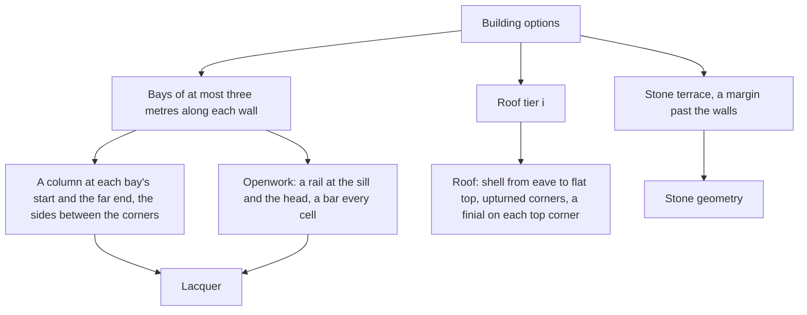

# Liyue building kit

Liyue's towns are built from one kit: a stone terrace, lacquered columns and beams, and roofs stacked one above another with their eaves turned up. The kit is pure geometry in `genshin-world` over the engine's primitives, so a building is generated the same way anywhere and nothing about its placement lives in it.

## How it works

- **A footprint with parameters.** A building is its width along x, its depth along z, the height of its storey and its roof tier count, one to three. Its terrace stands a margin past the walls, and its walls rise from the terrace's top.
- **Bays, not a column count.** Along each wall the bays are the fewest that keep each no wider than a bay width (`packages/genshin-world/src/services/liyue/constants.ts`, line 18, 3 metres), spread evenly. The front and back carry a column at every bay's start and at their far end, and the sides carry columns only between the corners, so no column is placed twice.
- **Openwork.** Each bay between two columns is a lattice panel: a rail at its sill and another at its head, with a bar every cell between them (`packages/genshin-world/src/services/liyue/constants.ts`, lines 27 to 29). The bars stand flat to the wall, so the lattice reads as openwork from the street.
- **Upturned eaves.** A roof tier is a shell of rings stepping inward from its eave to a flat top. The eave's corners lift by the curl over its middle (`packages/genshin-world/src/services/liyue/constants.ts`, line 32), and the shell's rise is steep at the eave and levels toward the top. Each top corner carries a finial.
- **Stacked tiers.** Each tier above the first has its eave scaled by the tier scale of the one below and is raised one tier height (`packages/genshin-world/src/services/liyue/constants.ts`, lines 34 and 35; `packages/genshin-world/src/services/liyue/createLiyueBuildingGeometries.test.ts`, line 6), so a building with three tiers stands three rises above its walls.
- **The kit stands in for Liyue Harbor's houses.** The [witness](../parity/witness/design.md) draws the harbour's buildings family, `Area_Ly_Build_` and `Area_LY_Build_` (`{data-root}/genshin-parity/extracted/maps/index.tsv`), with its terrain tiles as the ground. The harbour's other meshes are claimed undrawn by kind (`LiyueUndrawnMeshRegexMap`), except the unique trees: no kind there or family matches an "Area_Ly_Unique_BigTree_" mesh, so the witness neither draws nor claims them.

## Palette

The palette's hues are the ones the game's Liyue reads as: ochre and grey rock, jade-green water, golden ginkgo and autumn maples, the red lacquer and gold of its architecture, and the stone of its terraces. Each is an sRGB colour in `packages/genshin-world/src/services/liyue/constants.ts`. These values are the named hues' first reading, to be fitted against the reference in the recreation passes.

## Key files

| File                                                                         | Role                                                                           |
| :--------------------------------------------------------------------------- | :----------------------------------------------------------------------------- |
| `packages/genshin-world/src/services/liyue/createLiyueBuildingGeometries.ts` | The building: terrace, columns and beams, lattice and roof tiers               |
| `packages/genshin-world/src/services/liyue/createLiyueRoofTierGeometry.ts`   | One roof tier: the upturned shell and its finials                              |
| `packages/genshin-world/src/services/liyue/getLiyueBays.ts`                  | A wall's bays, none wider than the bay width                                   |
| `packages/genshin-world/src/services/liyue/constants.ts`                     | The kit's proportions in metres, and the palette's hues                        |
| `packages/genshin-world/src/data/regions/liyue.json`                         | Liyue Harbor's building, at a provisional place until it is fit                |
| `packages/genshin-world/src/services/liyue/LiyuePartFamilyMeshRegexMap.ts`   | The game's meshes standing in for Liyue Harbor's ground and buildings families |
| `packages/genshin-world/src/services/liyue/LiyueUndrawnMeshRegexMap.ts`      | The rest of the harbour's export, claimed as not drawn yet, by kind            |

## Open

- [ ] **The palette's hues are the ones the game's Liyue reads as** — no source yet: the hues are the first reading, and none has been measured against `{data-root}/genshin-parity/references/liyue-harbor-location.png`.
- [ ] **The eave corners lift by the curl, and the shell rises steep at the eave and levels toward the top** — no source yet: no roof edge is measured from a Liyue reference, and `packages/genshin-world/src/services/liyue/createLiyueRoofTierGeometry.test.ts` checks only the rise to a flat top.
- [ ] **Each bay's lattice has a rail at its sill and at its head, with bars standing flat to the wall** — no source yet: no test or reference checks the lattice.
- [ ] **The export's buildings family is `Area_Ly_Build_` and `Area_LY_Build_`, with its terrain tiles as the ground** — no source yet: `{data-root}/genshin-parity/extracted/maps/index.tsv` names both families, but holds no `BigWorldTerrain_` mesh, and no row ties a building to a tile.
- [ ] **Whether the harbour's six unique tree meshes belong in the undrawn list** — no source yet: `{data-root}/genshin-parity/extracted/maps/index.tsv` holds six "Area_Ly_Unique_BigTree_" rows (`Bark_Col`, `Leaf_Dither`, `Bark_Lod0` to `Bark_Lod3`), and no kind in `LiyueUndrawnMeshRegexMap` nor family in `LiyuePartFamilyMeshRegexMap` matches them, so the map does not claim them.
- [ ] **the bay width is 3 metres** — no source yet: the Liyue building export in `{data-root}/genshin-parity/extracted/liyue/`, not yet measured for the bay width.
