# Load budget

[Miliastra Wonderland](../../../deferred/genshin/miliastra-wonderland/design.md) meters a stage's load as its author builds it: every placed object takes its share of a fixed budget, and the meter says how much is left. Each screen of the game is held to a budget the same way, for what it loads before it shows. The steps the loading awaits are measured by the browser under `genshin:load:<step>`, so DevTools' Performance panel draws them on its Timings track, and `pnpm -C scripts genshin:parity load <screen>` reads the same entries on the parity page and prints each figure against its budget (`scripts/src/services/genshinParity/commands/loadCommand.ts`, `scripts/src/services/genshinParity/load/ScreenLoadBudgetMap.ts`). The steps it times are the first frame's needs, and each trim that brought them down is a decision below, with its magnitude before and after.

## What is measured

- **Load steps.** `measureLoadStep(name, promise)` times an awaited step from its call to its settling, as the measure `genshin:load:<name>`. The promise's result or rejection passes through unchanged, and a rejected step is measured too, with `detail: { isFailed: true }` (`packages/genshin-world/src/services/loading/measureLoadStep.ts`). The start is a timestamp rather than a mark, since two steps of one name can run at once (each region's read is one `regions` step). A step that runs on the main thread without awaiting anything, the landmark colliders' build, is measured under the same prefix from its call to its return (`packages/genshin-world/src/components/World/Landmarks/Index.vue`).
- **A screen's load steps are named by its `measureLoadStep` calls, not by a `measures` section.** the world's names are `world-gate` (`packages/genshin-world/src/components/World/Screen/Index.vue`), `regions` (`packages/genshin-world/src/composables/useRegionData.ts`), `landmark-colliders` (`packages/genshin-world/src/components/World/Landmarks/Index.vue`, a `performance.measure` under the load-step prefix), `terrain` (`packages/genshin-world/src/components/World/Terrain/Index.vue`) and `compile` (`packages/genshin-world/src/components/World/Windrise/Index.vue`); the opening's is `opening` (`packages/genshin-world/src/components/Game/Opening/Index.vue`); the login's is `scene-exports`, called in its composable (`packages/genshin-world/src/composables/useSceneExports.ts`), not in the login's own component.
- **Time to ready.** The milliseconds from navigation start to the moment the parity page signals the screen ready. Every parity open takes its readings at the ready signal: `openParityPage` opens the page at its load event rather than once its network is idle, and `loadScreen` takes the ready milliseconds and the bench in one read at the ready signal, so a fetch the page issues after ready is not counted (`scripts/src/services/genshinParity/shared/openParityPage.ts`, `scripts/src/services/genshinParity/page/loadScreen.ts`). The request budget in `ScreenLoadBudgetMap` was recorded under the idle reading, so it is re-recorded from production runs on the budget's machine.
- **Requests.** Every request the page made, from resource timing, with its transferred bytes (`packages/genshin-world/parity/benchLoad.ts`). The game data among them is the requests under the hosted game data's base, and their bytes are the game data bytes the budget holds (`packages/genshin-world/parity/benchLoad.ts`, `scripts/src/services/genshinParity/load/ScreenLoadBudgetMap.ts`).
- **Renderer and objects.** The renderer's geometries, textures and programs, and the visible objects by kind, read once at ready the way the scene bench counts them (`packages/genshin-world/parity/benchLoad.ts`, `packages/genshin-world/parity/benchScene.ts`). A screen with no scene at ready draws none, so its counts are zero.
- **A crossing.** A screen with an entry in `ScreenCrossingMap` loads with its `fromProps` and, with `--crossing`, is moved once ready to its `toProps`, then read once the load step its entry names is measured after the move (`scripts/src/services/genshinParity/load/ScreenCrossingMap.ts`, `scripts/src/services/genshinParity/page/crossScreen.ts`): the requests and game data from the move on, the tiles that step rebuilt (its measure's `detail.tileCount`), the milliseconds from the move to that measure's end, and the main thread's time in long animation frames from the move, which the parity page observes from its start (`packages/genshin-world/parity/main.ts`). The world's crossing is into Liyue's reach, which Windrise's start never makes, since Mondstadt lays no ground: the camera held just outside the reach on the line from the oak toward Liyue, then moved 80 m (`scripts/src/services/genshinParity/load/ScreenCrossingMap.ts`, from its `fromProps` to its `toProps`) to just inside it, past the region recheck's 64 m (`packages/genshin-world/src/services/constants.ts`), so Liyue's data and ground arrive and the terrain rebuilds its tiles under the ground. The terrain measures that as `terrain-refresh`, from the ground's arrival until every tile round the eye is settled over it, with the tiles it asked for again while still holding them (`packages/genshin-world/src/components/World/Terrain/Index.vue`).

## Running it

```bash
pnpm -C scripts genshin:parity load WorldScreen        # 1920 by 1080, the default
pnpm -C scripts genshin:parity load LoginScreen 1280 720
pnpm -C scripts genshin:parity load WorldScreen --dev  # the dev server, not a build
pnpm -C scripts genshin:parity load WorldScreen --crossing  # then the move into Liyue's reach
```

The command measures a production build of the parity page by default. It builds the page into the genshin-world package's `parity-build` folder through the root `vite.config.ts`'s `build:parity` task, whose cache replays the build while nothing the page reads has changed, then serves the build with Vite's preview server on a free port and loads the screen there (`scripts/src/services/genshinParity/load/buildParityPage.ts`, `scripts/src/services/genshinParity/load/getParityServerArgs.ts`, the `build:parity` task in `vite.config.ts`). With `--paused` the screen loads paused, as the app loads the world under its opening, drawing only the frames it asks for, so a step that waits on a frame nothing asks for shows as a load that never readies (`scripts/src/services/genshinParity/commands/loadCommand.ts`, where the paused screen takes `isPaused: true`). With `--dev` it skips the build and serves the parity page with Vite's dev server on a free port instead, so the same measures can be read on the dev server (see the decision below) (`scripts/src/services/genshinParity/load/startParityServer.ts`). With `--crossing` it loads the screen from its crossing's props and, once ready, moves it and prints the crossing's block after the load's: its requests, game data and tiles rebuilt against the crossing's budget, the time it took to settle and its long frames, and the measures taken after the move. A paused screen streams nothing past its ready, so `--crossing` refuses `--paused` (`scripts/src/services/genshinParity/commands/loadCommand.ts`). The production build is the default because it is what a reader's browser loads: the dev server serves every module unbundled and transformed as it is asked for, which no reader pays. The screen is a fixture on the parity page, opened cold in a fresh browser, so its cache is empty (`scripts/src/services/genshinParity/shared/openParityPage.ts`). The command prints one meter row per figure: the value, its budget, the share used as a bar, and OVER when past it, then the measures slowest first, then the requests and the objects by kind (`scripts/src/services/genshinParity/shared/formatLoadMeter.ts`). It exits non-zero when a figure checked here is over its budget (`scripts/src/services/genshinParity/commands/loadCommand.ts`, `scripts/src/services/genshinParity/shared/formatLoadMeter.ts`). Time is checked only on the machine the budget names (`os.hostname()`); on any other machine the time is printed beside its row and does not fail (`scripts/src/services/genshinParity/commands/loadCommand.ts`, which passes `hostname()` to the meter). The folder's name has one owner, `PARITY_BUILD_DIRECTORY_NAME` in the scripts, which the root cache exclusion and the world package's `build:parity` restate; a scripts test holds both restatements to it, so a rename on either side fails the suite rather than leaving a stale exclusion (`scripts/src/services/genshinParity/shared/constants.ts`, `scripts/src/services/genshinParity/shared/constants.test.ts`).

## Reading the Timings track

Open the parity page (or the app) in DevTools' Performance panel, record the load, and the `genshin:load:*` measures appear on the Timings track as bars named by their step. A step's bar starts at its call and ends when its promise settles, so a long bar with nothing under it is a step waiting on a fetch or a compile, and a bar that starts late is a step that waited on an earlier one (`packages/genshin-world/src/services/loading/measureLoadStep.ts`).

## Budgets

The budgets are written in `scripts/src/services/genshinParity/load/ScreenLoadBudgetMap.ts`, each at the figure measured on the budget's machine plus a tenth, rounded up. A screen with a crossing holds its crossing's requests, game data and tiles rebuilt the same way, under `crossing` (`WorldScreen.crossing` in `scripts/src/services/genshinParity/load/ScreenLoadBudgetMap.ts`). A trim is measured with `load` on both sides of its change, and lowering a budget is part of the commit that lowers the load, so the meter only tightens; raising one needs its own reason.

The time column is checked on the budget's machine only (`scripts/src/services/genshinParity/shared/formatLoadMeter.ts`). A screen's own load steps are named in its `measures` section when it has any: the world's are `world-gate` with each of its reads, `regions`, `landmark-colliders` once for each sync of the landmarks that arrived, `terrain` from mount to ready, and `compile`; the login has none of its own, its reads belong to the opening, and the opening's are `opening`.

## How it works

```mermaid
flowchart LR
  BUILD["buildParityPage<br/>the build:parity task, replayed from vp's cache"] --> PREVIEW["startParityServer<br/>Vite preview on a free port, or the dev server with --dev"]
  PREVIEW --> STEP["each awaited load step<br/>measureLoadStep → genshin:load:step"]
  STEP --> READY["the screen signals ready"]
  READY --> READ["parity page reads the measures,<br/>resource timing, renderer and scene counts"]
  READ --> METER["genshin:parity load screen<br/>each figure against its budget"]
  READ -->|--crossing| MOVE["setScreenProps toProps<br/>wait for the settle step's measure"]
  MOVE --> CROSS["benchLoad from the move<br/>requests, game data, tiles rebuilt, long frames"]
  CROSS --> METER
  METER -->|a count over, or a time on its machine| FAIL["exit non-zero"]
  METER -->|within| PASS["meter printed"]
```



## Decisions

- **The opening's ready is its mount.** `GameOpening`'s fixture names no ready event, so the page is ready as the opening mounts and its `opening` steps are read as they stand then (`packages/genshin-world/src/components/Game/Opening/Index.vue`, which measures them as `opening`). Its fixture also reads the title logo and the login records at module load, so the game data is fetched before the page is ready and its steps are short.
- **The parity page raises the resource timing buffer.** The browser keeps 250 resource timings by default, and a world's load makes more requests than that, so the buffer is raised before the first request in `openParityPage`; without it the request and game data counts stop at the buffer (`scripts/src/services/genshinParity/shared/openParityPage.ts`).
- **Ready waits on the finest terrain tiles only, over every ground in reach.** The terrain reports ready once every region in reach has arrived or failed and every finest-level tile the view wants is held or given up, and the coarser rings keep streaming after ready without holding it. A start in Liyue's reach read Liyue's ground well into the terrain's load on the production build, paused and on the dev server, and the terrain readied seconds after it, so ready waited on the tiles the ground rebuilt, but only because the ground came first: one arriving after the terrain's first settling let the world ready over tiles built without it. The terrain's ready waits on the regions in reach too (`isGroundSettled` in `packages/genshin-world/src/components/World/Terrain/Index.vue`), and the world's browser test holds Liyue's read past when the view would have settled, which failed without it. `terrain` is the longest step of the world's ready, but most of it is the page's main thread rather than the tiles, as the decision on the terrain worker below gives.
- **The load is measured on a production build.** A production build bundles the worker and the page into a few chunks, as the app ships them, so its figures are the ones a reader's browser pays, where the dev server's are paid for modules served one at a time. The build is served by Vite's preview server with the same game data route as the dev server, so the requests and game data counts match what the page fetches; only the module graph differs.
- **The terrain worker imports only the generators it runs, and `terrain` is mostly the main thread's wait.** The worker reaches the engine through its `terrainWorker` entry (`packages/genshin-engine/src/terrainWorker.ts`) ([terrain](../terrain/design.md); `packages/genshin-engine/package.json`, its `./terrainWorker` export), so on the dev server it loads a few dozen modules where the engine's barrel brought a few hundred, three's renderer and the post passes among them, and starts about half a second sooner. Neither median moved past the runs' spread, three runs each on `WorldScreen` before the first view's compile below: ready and `terrain` are tens of seconds on both modes. Timed inside the worker, each of the two computes its share of the first view's tiles in about half a second over the whole load, a tile in a few milliseconds. The rest of `terrain` waits on the page's main thread, where the tiles are asked for each frame and received, and where a worker's first messages wait to be delivered: a CPU profile of the production load had it held for most of the step by `createLandmarkCollider` building each landmark's octree as its region arrived, the oak's and the statue's, tens of thousands of triangles each, for seconds each, which the decision on the landmark collider below took out.
- **Region data is served by the parity page, not read from its source path.** A fetch of `packages/genshin-world/src/data/regions` is answered only by the unbundled dev server, so the parity page serves the regions itself. `packages/genshin-world/parity/regionDataPlugin.ts` serves `/regions/<id>.json` from `packages/genshin-world/src/data/regions` on the dev server, its bundled mode and the preview, the way the app serves its region data from its public assets (`packages/genshin-world/parity/regionDataPlugin.ts`).
- **Bundled dev reads the world a few seconds sooner, and neither the app nor the parity page takes it.** Bundled dev (`experimental: { bundledDev: true }` on the parity config) saves a few seconds of startup, and terrain, the dominant step, is unchanged. Neither config turns it on (`vite.config.ts` and `packages/genshin-world/parity/vite.config.ts` set no `bundledDev`): the saving is startup and immaterial against the terrain wait, and `--dev` measures the dev server the app runs, which a bundled parity page would not.
- **The world compiles its first view before ready, and no more.** The `compile` step drew every object of the scene once more after the frame's own draw, unseen and unculled, and it was the longest step after the terrain, seconds on the production build. `compileAsync` waits for the next frame's own draw of the view and for the GPU (`packages/genshin-world/src/components/World/Terrain/Index.vue` calls it; `packages/genshin-world/src/components/World/Windrise/Index.vue` measures the `compile` step), and reads in tens of milliseconds, so what ready waits on past the terrain fell from seconds to well under one. On the dev server `compile` fell from seconds to milliseconds. The rest was first compiled after ready, and there the whole-scene draw was one frame of seconds, which `stalls WorldScreen` caught as its cold orbit's slowest. With no draw of the rest, the programs and geometries at ready fell by about a fifth and the textures a little, and `stalls` runs built no program in the cold orbit, the second orbit or the walk, their slowest frame a few milliseconds shorter than with the whole-scene draw. Every landmark shares its kind's material, so the view holds every program a turn or a walk draws, and one it does not show builds as it is first drawn.
- **The gate reads only what the first frame reads.** Each of its reads was followed to its readers. The Frostbearing Tree's levels are read by an offer alone, so `useWorldOfferings` reads them as one is made (`packages/genshin-world/src/components/World/Screen/Index.vue`, `packages/genshin-world/src/composables/useWorldOfferings.ts`) and offers the bag as it stands once they arrive. The three tables an artifact is rolled and enhanced from are read by nothing in the world, so they are not in `StatTables` (`packages/genshin-world/src/models/world/WorldTables.ts`). The rest stays, each read by the first frame: the names and the material table make the save's bag, the stat tables the starting team's combatants, which sum every table left in them, the enemy and Adventure Rank tables the camps and the kits, the HUD's rects the HUD, Windrise's records the ground, the catalogue the regions in reach, and Mondstadt's animals and Frostbearing Trees stand in the world. The game data fell by a few requests and kilobytes, and the page's requests by a few. The gate's reads run at once, so it takes about as long as its slowest: `world-gate` read in tens of milliseconds on both modes, too short against the terrain to move ready.
- **The landmark collider builds a bounding volume hierarchy, and stays on the main thread.** Each landmark's octree was built from a `Triangle` and three `Vector3`s per triangle, then split by testing every triangle against every child's box, and the sync bringing Mondstadt's landmarks held the main thread for seconds, so the terrain workers' first messages waited behind it. Each landmark's meshes are merged into typed arrays in the root's frame and held in `three-mesh-bvh`'s hierarchy ([character controller](../character-controller/design.md); `packages/genshin-engine/src/collision/createLandmarkCollider.ts`). Measured on `WorldScreen` while another session's parity runs shared the machine, the collider builds, which no other load moves, are the figures to weigh most: Mondstadt's landmark sync fell from seconds to milliseconds, and ready and `terrain` more than halved on the production build and paused, and fell less on the dev server.

  What the sync still holds the main thread for is about a hundredth of ready, so no worker builds it and nothing defers it to idle time. The budget's time was recorded when the hierarchy landed, before this median, so the budget is loose by about a second; re-recording it from production runs on the machine it names is an open item on the [Genshin roadmap](../../../changes/genshin-roadmap/tasks.md).

- **A region's ground and palettes arrive with the region.** The gate read the seven grounds laid over Windrise's and every region's palette, though Windrise's first view stands in Mondstadt alone, which lays no ground over Windrise's and builds in Mondstadt's kit alone. Each region reads its ground and the palettes of its buildings' kits with its data as it comes within reach (`readLoadedRegion` in `packages/genshin-world/src/services/world/readLoadedRegion.ts`), and the terrain asks again for every tile a ground arrives under ([terrain](../terrain/design.md); `packages/genshin-world/src/components/World/Terrain/Index.vue`). Measured in both modes, the game data fell by about a dozen requests and half a megabyte, and the page's requests by about a dozen, with the objects, geometries, textures and programs at ready unchanged on the production build. `world-gate` more than halved on the production build. Ready did not move past the runs' spread, measured while the landmark collider was being rebuilt beside it. Every read left at the gate is one the first frame reads.
- **The time's machine is named by the budget.** The counts are the same on every machine and the milliseconds are not, so a budget names the machine it was measured on (`machine` in `scripts/src/services/genshinParity/load/ScreenLoadBudgetMap.ts`).
- **The world's request budget holds the starting team's kit chunks.** Its counts were re-recorded once every trim was built, from three runs in each mode on another machine, the time left as the budget's machine measured it. The production build reads 120 requests: 65 of game data, 39 chunks of the starting team's kits, each kit its own chunk since the kit framework split them from the entry, 9 reads of region data (every region's, which the jump landmarks list, and Mondstadt's again as it comes within reach) and 7 of the page's own files. The budget counts each starting-team kit chunk as its own request, since the kit framework split the kits from the entry (`WorldScreen` in `scripts/src/services/genshinParity/load/ScreenLoadBudgetMap.ts`, `requests: 132`). The other counts stand at each one's figure plus a tenth, as `scripts/src/services/genshinParity/load/ScreenLoadBudgetMap.ts` holds them, the one place the budgets are written. Paused, the page reads one request fewer, and 133 to 145 geometries, 88 to 95 programs and, in two runs of three, more objects than the production build is held to, as the scene at ready differs while only the frames asked for are drawn. On the dev server it reads 2049 requests, its modules served one at a time, and the production build's other counts.
- **A ground rebuilds only the tiles it reaches.** The crossing into Liyue's reach rebuilt every tile the terrain held round the eye, though Liyue's ground stands 500 m and more west of it, past which the ground laid over Windrise's draws Windrise's very heights. The terrain refreshes only the tiles whose sampled rectangle meets the arriving ground's reach ([terrain](../terrain/design.md); `packages/genshin-world/src/components/World/Terrain/Index.vue`). Measured while other sessions' builds shared the machine, the refresh rebuilds about a seventh of the tiles the old one did, and settles in well under two thirds of the time.

  What the crossing still settles over is the move's own new tiles, 80 m on, and the far rings over Liyue. Its long frames are its region's arrival, about a quarter second of them the landmark colliders' build, which the refresh never held. The crossing's budget holds the after figures: 3 requests, 95,524 bytes of game data and 33 tiles rebuilt, each plus a tenth (`WorldScreen.crossing` in `scripts/src/services/genshinParity/load/ScreenLoadBudgetMap.ts`: 4 requests, 105,077 bytes and 37 tiles).

- **Every landmark shares its kind's material** — `packages/genshin-world/src/components/World/Landmarks/Index.vue` makes one material per kind, once: `partMaterial` for a building's, a statue's and a domain entrance's parts, `barkMaterial` and `leafMaterial` for a tree's.

## Key files

| File                                                                     | Role                                                               |
| :----------------------------------------------------------------------- | :----------------------------------------------------------------- |
| `packages/genshin-world/src/services/loading/measureLoadStep.ts`         | Times an awaited load step as `genshin:load:<name>`                |
| `packages/genshin-world/src/services/loading/constants.ts`               | `LOAD_STEP_MEASURE_PREFIX`, the one prefix the measures carry      |
| `packages/genshin-world/src/components/World/Landmarks/Index.vue`        | Times each sync of the landmark colliders as `landmark-colliders`  |
| `packages/genshin-world/parity/benchLoad.ts`                             | The parity page's read at ready: measures, requests, scene counts  |
| `packages/genshin-world/parity/benchScene.ts`                            | The scene bench whose counts the load bench takes at ready         |
| `packages/genshin-world/src/components/World/Screen/Index.vue`           | The world's gate of reads before it shows                          |
| `packages/genshin-world/src/services/world/readLoadedRegion.ts`          | A region's data, ground and palettes, read as it comes in reach    |
| `packages/genshin-engine/src/collision/createLandmarkCollider.ts`        | The landmarks' hierarchies, built on the main thread               |
| `packages/genshin-world/src/components/World/Terrain/Index.vue`          | Measures each ground's refresh as `terrain-refresh`                |
| `scripts/src/services/genshinParity/load/ScreenCrossingMap.ts`           | Each screen's crossing: the props it loads with and moves to       |
| `scripts/src/services/genshinParity/page/crossScreen.ts`                 | Moves a ready screen and reads its crossing once it settles        |
| `scripts/src/services/genshinParity/load/ScreenLoadBudgetMap.ts`         | Each screen's budget, by screen name                               |
| `scripts/src/services/genshinParity/commands/loadCommand.ts`             | The `load` command, beside `bench`                                 |
| `scripts/src/services/genshinParity/load/buildParityPage.ts`             | Builds the parity page for production through `build:parity`       |
| `scripts/src/services/genshinParity/load/startParityServer.ts`           | Serves the production build with Vite's preview, or the dev server |
| `packages/genshin-world/scripts/gameData/mirror/gameDataMirrorPlugin.ts` | The game data route, on the dev server and the preview server      |
| `packages/genshin-world/parity/regionDataPlugin.ts`                      | The region data route, on the dev server and the preview server    |
| `scripts/src/services/genshinParity/shared/formatLoadMeter.ts`           | The meter's rows, the measures and the exit rule                   |
| `scripts/src/services/genshinParity/shared/openParityPage.ts`            | Opens the page cold and raises the resource timing buffer          |

## Sources

- [Performance: mark() and measure()](https://developer.mozilla.org/en-US/docs/Web/API/Performance/measure), MDN: named measures the browser keeps and DevTools draws on its Timings track, which every load step is.
- [PerformanceResourceTiming](https://developer.mozilla.org/en-US/docs/Web/API/PerformanceResourceTiming), MDN: every fetch's transfer size, read for the requests and game data without a counter of our own.
- [PerformanceLongAnimationFrameTiming](https://developer.mozilla.org/en-US/docs/Web/API/PerformanceLongAnimationFrameTiming), MDN: the frames that held the main thread past 50 ms, summed for a crossing's long frames.

## Open

- [ ] **The request budget was recorded under the idle reading** — no source yet: no run record of its requests names the reading it was taken at, so it cannot be re-read. The budget's production figure of 132 is at `scripts/src/services/genshinParity/load/ScreenLoadBudgetMap.ts` (line 34).
- [ ] **A world's load makes more requests than the browser's 250 resource timings** — no source yet: the dev server's 2049-request run record is not kept in the repo or under `~/Esposter.noindex` (the production budget's 132 requests is cited at `scripts/src/services/genshinParity/load/ScreenLoadBudgetMap.ts`, line 34).
- [ ] **The opening's steps are short** — no source yet: no run of the `opening` measures is kept to read their durations against.
- [ ] **The world's browser test fails without the regions' wait** — no source yet: the wait is the terrain's ready gate (`packages/genshin-world/src/components/World/Terrain/Index.vue`, `isGroundSettled`, line 327), but no run of that test with it removed is recorded.
- [ ] **The terrain-worker and Liyue-start figures (ready and `terrain` on both modes, Liyue's ground read into the terrain's load, the CPU profile's collider builds)** — no source yet: the runs' meter output is not kept in the repo or under `~/Esposter.noindex`.
- [ ] **The landmark-collider figures (ready and `terrain` on each mode, the collider builds)** — no source yet: the three runs per side are not kept in the repo or under `~/Esposter.noindex`.
- [ ] **The crossing figures (tiles rebuilt, time to settle from the move)** — no source yet: the three runs per side are not kept in the repo or under `~/Esposter.noindex`.
- [ ] **The compile and gate figures (programs, geometries, `world-gate` and game data requests)** — no source yet: the runs are not kept in the repo or under `~/Esposter.noindex`.
- [ ] **The region-ground figures (game data requests, `world-gate`)** — no source yet: the runs are not kept in the repo or under `~/Esposter.noindex`.
- [ ] **The request split (game data, kit chunks, region reads and page files), the dev server's request count and the paused counts** — no source yet: the request kinds and the paused runs are not recorded in the repo or under `~/Esposter.noindex`.
- [ ] **Bundled dev saves a few seconds of startup, with terrain unchanged** — no source yet: no bundled-dev run is recorded in the repo or under `~/Esposter.noindex`.
