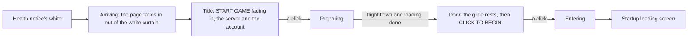
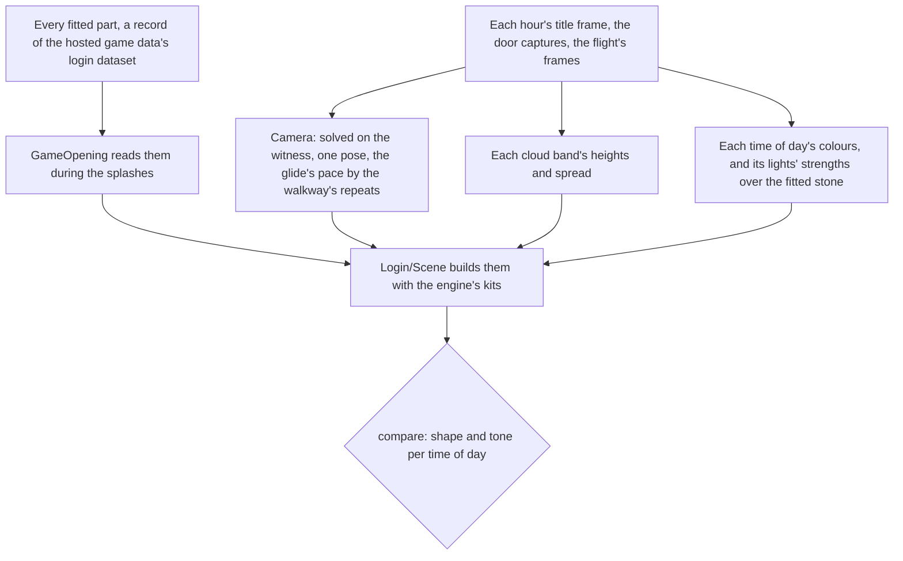

# Login screen

The game opens on its login screen once the health notice has faded (`packages/genshin-world/src/components/Splash/HealthNotice/Index.vue`). The console's opening shows it at the same place, in the same stages and at the game's own timings (`packages/genshin-world/src/services/login/constants.ts`).

The screen is one scene and one interface laid over it (`packages/genshin-world/src/components/Login/Screen/Index.vue`). This page holds what the stages share and how the scene is fitted and judged; each feature has its own page:

| Page                                           | What it holds                                                                                                |
| :--------------------------------------------- | :----------------------------------------------------------------------------------------------------------- |
| [Interface](interface/design.md)               | The stage's corner buttons and prompt, the page's clips, the mainland age rating                             |
| [Camera and glide](camera-and-glide/design.md) | The camera's pose, the glide's pace and its rest at the door, the rows that wrap as it goes                  |
| [Towers](towers/design.md)                     | The towers and their surfaces, the columns and recesses standing out of their walls, the bridges and pillars |
| [Walkway](walkway/design.md)                   | The walkway's paint, its carving as relief, and its pieces assembling ahead of the glide                     |
| [Door](door/design.md)                         | The door's place and rise, its front and its relief, its lighting, and the click that opens it               |
| [Clouds](clouds/design.md)                     | The cloud bands, their cover each hour, and the cloud layer the sky draws                                    |
| [Sky](sky/design.md)                           | Each hour's sky, the colour pipeline its colours are measured through, and the sun and the moon              |
| [Light](light/design.md)                       | The stone's lighting, its haze, the occlusion and the shadows                                                |

## How it plays

- **The stages are the game's current build's** (`~/Esposter.noindex/genshin-parity/captures/login-dawn.mkv`). The user's own recording of the Japanese client times them and shows which corner buttons each stage has. A 1080 high English recording of an older build gives the words and every size. The status reads "Preparing to download resources", "Checking for updates...", "Loading game..." over the ornament's double diamond, then "Preparing to load data" over the progress bar, which folds into its diamond at 100% (`~/Esposter/genshin-parity/text/TextMap/TextMap_MediumEN.json`).
- **The wait mark starts at `LOGIN_SPINNER_START_MS` (1.3 seconds).** It shows while the page arrives, and the title comes in as it goes.
- **The flight is the screen's clock for the door, and the door comes once the game's checks are done.** The flight is the share of the way to the door flown. The bar under it is the game's own checks before it loads the world. On the page those checks have nothing left to wait on, so the opening hands the screen a finished load: the shown share sweeps toward it at no more than one full bar per tenth of a second (`packages/genshin-world/src/services/login/constants.ts`, `LOGIN_PROGRESS_FILL_MS`), the flight covers about two thirds of the way as the English recording's does before its bar is full, no faster than that recording's last stretch, and once the bar is full the flight flies whatever is left in the half second the bar takes to fold into its diamond. The glide then carries the door's copy to the walkway's far end, so the door rises once the glide reaches it, after the bar fills, while the English recording's door is about 5.7 seconds after the bar first reads 100% (`~/Esposter/genshin-parity/captures/yt-rBnfA4pXw6U.mp4`). The world loads after the door, under the startup loading screen.
- **A click is the screen's unless it lands on a button.** The screen asks `checkIsNestedInteraction` before it moves on, so a click on a corner button stays the button's (`packages/genshin-world/src/components/Login/Screen/Index.vue`).
- **A host can pin a stage.** The stage is a `v-model`, so the parity page and a test hold one still; the opening leaves it free (`packages/genshin-world/src/components/Login/Screen/Index.vue`).
- **Its music plays from the start, looping as the game's does.** `LoginMusic` plays the game's login playlist, re-derived, while the screen shows, once the browser allows sound ([music](../music/README.md)) (`packages/genshin-world/src/components/Login/Music/Index.vue`). The scene alone, as a reference shows it with no interface, is silent.
- **The screen draws from the records the opening reads.** The fits publish every part of the login (its interface's rects and clips, its music and sounds, the scene's parts) as records of the hosted game data's `login` dataset, beside its authored age rating. `GameOpening` reads all of them while its splashes play (`readLoginData`), holding the splashes' white if they have not arrived by the time the last splash has faded ([hosted game data](../hosted-game-data/design.md); `packages/genshin-world/src/services/login/readLoginData.ts`, `packages/genshin-world/src/generated/gameDataLock.json`). The screen takes them as one `loginData` prop and hands each part only the records it draws.
- **The opening says when the door is opened.** `GameOpening` emits `begin` as the screen hands on to the startup loading screen, so its host can mount the world then, under the startup loading screen, rather than waiting for the world to load first (`packages/genshin-world/src/components/Game/Opening/Index.vue`).
- **A stalled loading screen says what it waits on.** While the startup loading screen shows, a step still unfinished `LOADING_STALL_WARNING_SECONDS` (twenty) after the page started is logged once with `console.warn`, by name: `save`, `world chunk` or `world ready` (`apps/web/app/components/Genshin/Index.vue`). It is a diagnostic only; nothing is skipped or fallen back to when it fires.
- **The words are the reader's language's.** The title, the account label, the status lines, the door's prompt and the name a player who has not chosen one goes by are the game's own text in the language the host resolved, handed down as the `gameText` prop ([game text](../game-text/design.md); `packages/genshin-world/src/components/Login/Screen/Index.vue`). The account kit's welcome card is not shown until the page has an account to welcome; its greeting is the kit's own in every language, with the name where each language puts it.

## The scene

Every part's shape, place and stone is fitted from the game's own assets ([derived assets](../derived-assets/design.md)), and whatever the blocks cannot hold is read off the captures and expressed over what they can. Each builder takes the record it builds from as its first argument. What a record sets (where the door stands, how long it takes to rise, the camera's height and rest, the rows the glide wraps by) is read or computed from the record where it is used (`getLoginDoorPosition`, `computeLoginDoorLiftMs`, `computeLoginCameraHeight`, `computeLoginCameraZ`, `computeLoginGlideTitleScrolled`), so no fitted value is a constant of the package's (`packages/genshin-world/src/services/login/door/getLoginDoorPosition.ts`, `packages/genshin-world/src/services/login/door/computeLoginDoorLiftMs.ts`, `packages/genshin-world/src/services/login/scene/computeLoginCameraHeight.ts`, `packages/genshin-world/src/services/login/scene/computeLoginCameraZ.ts`, `packages/genshin-world/src/services/login/scene/computeLoginGlideTitleScrolled.ts`).

- **The login is one arrangement of the scene's meshes.** The blocks lay the towers out more than once; the login screen is its own `LoginScene`, whose towers, walkway and door `MonoLoginScene` spawns into the anchors under `SceneObj`, at its tenth, which is the scene's unit ([derived assets](../derived-assets/design.md); `~/Esposter/genshin-parity/extracted/login-layout/11790361/GameObject/LoginScene.json`, `~/Esposter/genshin-parity/extracted/login-behaviours/MonoBehaviour/MonoLoginScene.json`). In the static layout the door's anchor stands far from the walkway; at the flight's end the door stands on the walkway's far end, centred and on its top. The arrangement's unit test holds the cross-ratio of the dais over the walkway along the door's foot, which no camera changes.
- **The references are the judges.** The hour frames are public recordings of the PC client idling on the title with no interface, each held at the loop moment its towers stand at (the screen's `heldScrolled`, `packages/genshin-world/src/components/Login/Screen/Index.vue`; `~/Esposter.noindex/genshin-parity/captures/login-dawn.mkv`, `login-day.mkv`, `login-dusk.mkv`, `login-night.mkv`), and the dusk frame is the door recording. The wiki's four stills fit no single camera centred on them (their near wings, far wings and towers each ask a different field of view or pitch), so they are a crop or another build's camera and judge nothing. The 2021 recordings stand the walkway's far end about 30 rows lower than the current build's, so they are another camera too.
- **Colour and light are measured on the screen, not in the scene.** Each hour's sky, haze and light are solved over the exports and inverted through the game's tone curve, as [sky](sky/design.md) and [light](light/design.md) set out. Each hour's solve is judged by the pixel comparison and by eye: a score comparing pixels prices every cloud standing elsewhere than the recording's, so cloud cover is judged by eye and by the cover it draws ([parity](../parity/README.md)).

## Tests

- `packages/genshin-world/src/components/Game/Opening/Index.browser.test.ts` plays the whole opening with timers and frames faked, through the login's title, flight and door, and checks every handoff and the finish, its records read through the suites' mirror. With every fetch held, it checks the opening holds the splashes' white rather than a title splash with no logo.

## Key files

| File                                                                   | Role                                                                      |
| :--------------------------------------------------------------------- | :------------------------------------------------------------------------ |
| `packages/genshin-world/src/components/Login/Screen/Index.vue`         | The stages and the flight                                                 |
| `packages/genshin-world/src/components/Login/Scene/Index.vue`          | The scene: the camera, the glide, the fitted parts, the clouds, the sky   |
| `packages/genshin-world/src/components/Login/Music/Index.vue`          | The login's music, played while the screen shows                          |
| `packages/genshin-world/src/components/Game/Opening/Index.vue`         | Reads the login records during the splashes and emits `begin`             |
| `packages/genshin-world/src/services/login/constants.ts`               | The words and the timings                                                 |
| `packages/genshin-world/src/services/login/scene/constants.ts`         | The camera's eye and rest, the glide, the haze, the light and the shadows |
| `packages/genshin-world/src/services/login/readLoginData.ts`           | Every fitted part, read from the hosted game data                         |
| `packages/genshin-world/src/components/Login/Scene/Light.reference.ts` | The reference the scene's light is judged against                         |

## Reference

- `login-dawn.mkv` to `login-night.mkv` — the title at each hour on the current build (`~/Esposter.noindex/genshin-parity/captures/login-dawn.mkv`, `login-day.mkv`, `login-dusk.mkv`, `login-night.mkv`), the camera at rest. `login-dawn.mkv` partly found: https://www.youtube.com/watch?v=D-iWDjSOL-s at 0–30 s (`~/Esposter.noindex/genshin-parity/captures/yt-D-iWDjSOL-s-login-dawn.mp4`); still sought: no title text visible in the window; the build and client are not stated on the video; the source is 720p30; `login-day.mkv` partly found: https://www.youtube.com/watch?v=TVYVfIQ-XO4 at 0–30 s (`~/Esposter.noindex/genshin-parity/captures/yt-TVYVfIQ-XO4-login-day.mp4`); still sought: the camera is not at rest, so the title at rest is not shown; the client and build are not stated; `login-dusk.mkv` partly found: https://www.youtube.com/watch?v=mMf727q-0w0 at 0–30 s (`~/Esposter.noindex/genshin-parity/captures/yt-mMf727q-0w0-login-dusk.mp4`); still sought: the camera is not at rest; the title at rest is not shown; `login-night.mkv` found (`~/Esposter.noindex/genshin-parity/captures/login-night.mkv`): the wiki's `File:Moon - Title screen - Night.png`.
- `login-door-rest.mkv` — the door at rest on the current build (`~/Esposter.noindex/genshin-parity/captures/login-door-rest.mkv`).

## Open

- [ ] **The Japanese client's recording times the stages and shows each stage's corner buttons** — no source yet: no captured recording names the Japanese client, and the Reference lists none.
- [ ] **A 1080 high English recording of an older build gives the words and every size** — no source yet: no English recording in `~/Esposter/genshin-parity/captures/` has its build and resolution named.
- [ ] **The flight covers about two thirds of the way** — no source yet: the flight's share is not measured in the captures.
- [ ] **The scene alone, as a reference shows it with no interface, is silent** — no source yet: no scene-only reference with its audio is kept in `~/Esposter/genshin-parity/captures/`.
- [ ] **The arrangement's unit test holds the cross-ratio of the dais over the walkway along the door's foot** — no source yet: `scripts/src/services/genshinAssets/scene/computeCrossRatio.test.ts` does not name the dais, the walkway or the door.
- [ ] **The night title is the wiki's `File:Moon - Title screen - Night.png`** — no source yet: the wiki's still is not in `~/Esposter/cache/genshin-wiki/`. Partly found: https://www.youtube.com/watch?v=D-iWDjSOL-s at 0–30 s (`~/Esposter.noindex/genshin-parity/captures/yt-D-iWDjSOL-s-login-dawn.mp4`); still sought: the build is not stated and the source is 720p30.
- [ ] **The game opens on its login screen once the health notice has faded** — no source yet: a recording of the English client's launch through the health notice, with the openings under `~/Esposter/genshin-parity/captures/` not yet read for it
- [ ] **The console's opening shows the login at the same place, stages and timings** — no source yet: a recording of the console's opening, and no file under `~/Esposter.noindex/genshin-parity/captures/` names a console
- [ ] **Its music plays from the start, looping as the game's does** — no source yet: a recording of the login's music starting as the screen shows; `~/Esposter.noindex/genshin-parity/extracted/login/music/playlist.json` holds the loop (`isLooping`) and the first piece at `playAt` 0, not the moment playback begins
- [ ] **The 2021 recordings stand the walkway's far end about 30 rows lower than the current build's** — no source yet: the 2021 recordings are not measured against the current build's walkway here.
- [ ] **The wiki's four title stills fit no single camera centred on them** — no source yet: the stills are not in `~/Esposter/cache/genshin-wiki/`, so no fit is run on them.
