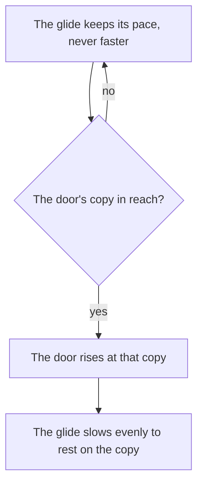

# Camera and glide

The login camera holds one pose, and the world glides toward it. The walkway, its towers and the cloud sea move past the camera at the game's pace, the door comes to rest at the walkway's far end, and the glide's position at each moment is the title's and the flight's clock.

## How it works

- **The camera's pose is the game's.** The eye stands and turns exactly as the game's `ModelCamera` does: straight down the walkway's middle along +z, pitched 5.69 degrees up (`packages/genshin-world/src/services/login/scene/constants.ts`; the game's `ModelCamera` rotation in `{data-root}/genshin-parity/extracted/login/layout/11790361/GameObject/cab-9b66d2e2ca3cefc2caff0b85ba1e0eb1/ModelCamera.json` tilts its forward 5.69 degrees up). Its height is set by the walkway's own lift (`packages/genshin-world/src/services/login/scene/constants.ts`, `WALKWAY_LIFT`). Every block of the walkway rises 5 metres into place on its own animator (`Ani_Login_Lift`, `{data-root}/genshin-parity/extracted/login/clips/16000354/AnimationClip/Ani_Login_Lift.json`) while the camera and the towers keep their laid places, so the towers stand 5 metres under the walkway and `ModelCamera`'s local height is 60.0 (`{data-root}/genshin-parity/extracted/login/layout/11790361/GameObject/cab-9b66d2e2ca3cefc2caff0b85ba1e0eb1/ModelCamera.json`), not yet tied to metres, so the eye's 1 metre over it stays open (see Open). The eye's distance and rest are read from the record (`packages/genshin-world/src/services/login/scene/computeLoginCameraZ.ts`, `packages/genshin-world/src/services/login/scene/computeLoginCameraHeight.ts`).
- **The field of view follows the screen's width.** The vertical field of view is the game's 45 degrees on a screen 18.5:9 or wider (`packages/genshin-world/src/services/login/scene/constants.ts`). On a narrower one it is the field that shows as wide a view across as 18.5:9 does, 51.2 degrees at 16:9 (`getLoginCameraFov`, `packages/genshin-world/src/services/login/scene/getLoginCameraFov.test.ts`). At 21.5:9 the solved eye lands the door within a pixel and a quarter of the recording's door.
- **The glide's frames refine to the same pose from every start.** The pitch, the height and the field of view are the same wherever the glide starts along the walkway, so the camera never moves. What moves is the scene's rows (`packages/genshin-world/src/components/Login/Scene/Index.vue`).
- **The rows wrap by their own lengths.** `MonoLoginScene` lays each row out ahead of its own place and wraps it by its length (the hosted `login/scroll` record, `packages/genshin-world/src/generated/gameDataLock.json`; `packages/genshin-world/src/models/login/LoginScroll.ts`): the walkway's three copies 16 metres apart, its own length; the towers and their bridges three 200 metres apart; and the cloud sea's billows and low clouds by their two 300 metres apart.
- **The glide's pace is the script's, at two constant speeds.** The glide runs at 3.5 metres a second (`LOGIN_GLIDE_TITLE_SPEED`) while the title waits and at 4.5 (`LOGIN_GLIDE_PREPARING_SPEED`) once the game prepares, the two speeds in `packages/genshin-world/src/services/login/scene/constants.ts`. The current build's title reads about 3.5 metres a second, and a repeat already braking toward the door about 4.35. Between the two speeds the glide gathers or loses speed over half a second, the length of MonoLoginScene's curve at 0xa4 and of the recording's speed-up (`packages/genshin-world/src/services/login/scene/constants.ts`). At the door it keeps on to the first copy that both stands the door past the walkway's far end and can be stopped on at that rate, then slows to rest exactly there (`advanceLoginGlide`, `packages/genshin-world/src/services/login/scene/advanceLoginGlide.ts`).
- **The door comes to rest with the towers' row 144 metres along its loop (`packages/genshin-world/src/services/login/scene/constants.ts`, `LOGIN_GLIDE_DOOR_SCROLLED`).** Every door frame shows the big lantern tower close to the door's right and the colonnade low behind it. The recordings idle the title only a few seconds, so the frames' tower phase is set by the recording the glide is judged against: the current build's door frame stands the towers 120 metres along, so that frame is held there (`heldScrolled` 320, on the same walkway phase). A scene mounted at the door stands there. The title opens about 49 metres short of the door, the English recording's glide from the title to the door's rest, on the walkway's phase the dawn frame stands it at (`computeLoginGlideTitleScrolled`).
- **The towers' row stands where the blocks lay it.** The row (its towers, bridges and pillars as one) keeps its laid place while the walkway rises 5 metres, so beside the risen walkway it stands 5 metres lower (`packages/genshin-world/src/services/login/scene/constants.ts`, `LOGIN_TOWERS_ROW_OFFSET`). The bridge whose deck crosses the glide's path passes under the walkway, as the game's glide passes over it however long the title idles (`packages/genshin-world/src/services/login/scene/constants.ts`). Across the path the row stands where the exports lay it: the current build's door frame lands its edges within 0.03 metres of there. Along the glide it stands 8.94 metres nearer, the phase the door frame is judged at (`packages/genshin-world/src/services/login/scene/constants.ts`, `LOGIN_TOWERS_ROW_OFFSET`).

## Tests

- `packages/genshin-world/src/services/login/scene/advanceLoginGlide.test.ts` holds the glide's pace changes to its acceleration, its rest to a whole number of the walkway's copies, and the door to first standing past the walkway's far end.
- `packages/genshin-world/src/services/login/scene/getLoginCameraFov.test.ts` holds the field of view to the width rule above.
- The row's test holds the camera's path, and a metre either side of it, open through the towers and the bridges' hulls from end to end (`packages/genshin-world/src/services/login/hull/createLoginHullsGeometry.test.ts`).

## Key files

| File                                                                                | Role                                                                               |
| :---------------------------------------------------------------------------------- | :--------------------------------------------------------------------------------- |
| `packages/genshin-world/src/components/Login/Scene/Index.vue`                       | The camera, the glide, the rows and their wrap                                     |
| `packages/genshin-world/src/services/login/scene/constants.ts`                      | The camera's eye and rest, the glide's speeds, the haze, the light and the shadows |
| `packages/genshin-world/src/services/login/scene/advanceLoginGlide.ts`              | The glide a frame on, and its rest at the door                                     |
| `packages/genshin-world/src/services/login/scene/computeLoginGlideTitleScrolled.ts` | The moment of the loop the title opens at, on the walkway's row                    |
| `packages/genshin-world/src/services/login/scene/computeLoginCameraHeight.ts`       | The eye's height over the walkway, read from its record                            |
| `packages/genshin-world/src/services/login/scene/computeLoginCameraZ.ts`            | The eye's place along the walkway, read from its record                            |
| `packages/genshin-world/src/services/login/scene/getLoginCameraFov.ts`              | The vertical field of view for a screen's width                                    |
| `packages/genshin-world/src/services/login/door/getLoginDoorPosition.ts`            | Where the door stands on the walkway's far end                                     |

## Open

- [ ] **The eye stands 1 metre over the walkway** — no source yet: the 1 metre is the current build's door frame at 21.5:9 fitting 0.997 metres, not a height read from `ModelCamera`'s 60 units, which `constants.ts` takes as 6 metres.
- [ ] **At 21.5:9 the solved eye lands the door within a pixel and a quarter of the recording's door** — no source yet: no door-position comparison at 21.5:9 is kept in `{data-root}/genshin-parity/comparisons/`.
- [ ] **The rows wrap at 16, 200 and 300 metres** — no source yet: the 300 is `LOGIN_CLOUD_SEA_ROW` in `constants.ts`, the cloud sea's count and length as its comment names MonoLoginScene's third record, and the 16 and 200 are in the hosted `login/scroll` record (its hash in `packages/genshin-world/src/generated/gameDataLock.json`), not on disk.
- [ ] **The current build's title reads about 3.5 metres a second, and a braking repeat about 4.35** — no source yet: no pace report is kept in `{data-root}/genshin-parity/`; `captures/yt-kyXg-Hx3Xlo-glide-compare.mp4` is a clip, and `constants.ts` quotes the glide's measured 3.42 to 3.52 without a report behind it.
- [ ] **The glide's two speeds and MonoLoginScene's curve at 0xa4 are the game's** — no source yet: the `MonoLoginScene` export names its object `LoginScene` and holds no speed or curve.
- [ ] **Every door frame shows the lantern tower close to the door's right and the colonnade low behind it** — no source yet: `{data-root}/genshin-parity/comparisons/login-door.png` is one door frame, with columns standing behind the door, and the lantern tower's place is not measured in it, so the claim is unchecked across frames.
- [ ] **The current build's door frame stands the towers 120 metres along, held at `heldScrolled` 320** — no source yet for the 120: the 320 is in `packages/genshin-world/src/components/Login/Scene/Towers.reference.ts` line 150 (the shape pass held at login-door-session), but no constant or capture records the 120-metre phase.
- [ ] **The title opens about 49 metres short of the door** — no source yet: no measured distance to the door is in `{data-root}/genshin-parity/comparisons/login-dawn-title.png`, which shows the walkway running off toward its far end with no door or distance marker in frame. The comment on `LOGIN_GLIDE_TITLE_WALKWAY_PHASE` in `constants.ts` (lines 44 to 46) gives about 51 metres for the English recording's glide from the title to the door's rest, not 49.
- [ ] **The current build's door frame lands the towers' edges within 0.03 metres of the exports' place** — no source yet: no frame measurement of the door is kept in the captures or comparisons.
- [ ] **The vertical field of view is the game's 45 degrees on a screen 18.5:9 or wider** — no source yet: no field-of-view key is in the login's records under `{data-root}/genshin-parity/extracted/login`, so the 45 is `LOGIN_CAMERA_FOV` in `constants.ts`, not a read of the game.
- **On a narrower screen the field shows as wide a view across as 18.5:9 does, 51.2 degrees at 16:9** — derived, not read from a record: `getLoginCameraFov.test.ts` asserts 51.2 at 16:9 for the 45-degree field at 18.5:9.
- **The camera never moves during the glide, and only the scene's rows move** — `packages/genshin-world/src/components/Login/Scene/Index.vue` lines 416 to 418: the camera holds its one pose while the world glides toward it, and a held glide never moves.
- [ ] **MonoLoginScene lays each row ahead of its own place and wraps it by its length** — no source yet: the `login/scroll` record is hosted, not on disk
- [ ] **At the door the glide keeps on to the first copy that stands the door past the walkway's far end and can be stopped on at that rate, then slows to rest there** — no source yet for "the first copy": `advanceLoginGlide.test.ts` line 39 holds the pace until the door reaches the far end and the rest at speed 0 on a whole copy, but asserts no test of which copy it is.
- [ ] **The door comes to rest with the towers' row 144 metres along its loop** — no source yet: the login layout's `export.log` holds only unknown-class warnings, and the towers' row length is not yet read.
- [ ] **The towers' row keeps its laid place while the walkway rises 5 metres, so it stands 5 metres lower beside it** — no source yet: the login layout's `export.log` holds only unknown-class warnings, and the walkway's rise is not yet read.
- [ ] **The bridge whose deck crosses the glide's path passes under the walkway, as the game's glide passes over it** — no source yet: the login layout's `export.log` holds only unknown-class warnings, and the bridge's deck is not yet read.
- [ ] **Along the glide the towers' row stands 8.94 metres nearer, the phase the door frame is judged at** — no source yet: the login layout's `export.log` holds only unknown-class warnings, and the row's distance along the glide is not yet read; the phase is judged at the door in `{data-root}/genshin-parity/references/login-door-recording.png`.
