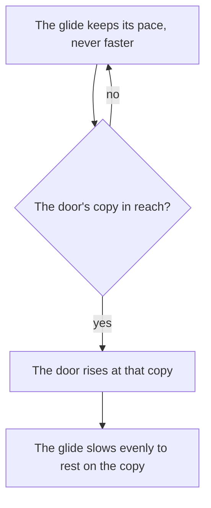

# Camera and glide

The login camera holds one pose, and the world glides toward it. The walkway, its towers and the cloud sea move past the camera at the game's pace, the door comes to rest at the walkway's far end, and the glide's position at each moment is the title's and the flight's clock.

## How it works

- **The camera's pose is the game's.** The eye stands and turns exactly as the game's `ModelCamera` does: straight down the walkway's middle along +z in ours, where `LOGIN_CAMERA_YAW` turns the camera's look round from -z and `LOGIN_CAMERA_PITCH` pitches it up; the export's `ModelCamera` looks along -z, its forward (0, 0.099, -0.995) in Unity's left-handed axes (`packages/genshin-world/src/services/login/scene/constants.ts`; the game's `ModelCamera` rotation in `{data-root}/genshin-parity/extracted/login/layout/11790361/GameObject/cab-9b66d2e2ca3cefc2caff0b85ba1e0eb1/ModelCamera.json` tilts its forward 5.69 degrees up). Its height is set by the walkway's own lift (`packages/genshin-world/src/services/login/scene/constants.ts`, `WALKWAY_LIFT`). Every block of the walkway rises `WALKWAY_LIFT` into place on its own animator (`Ani_Login_Lift`, `{data-root}/genshin-parity/extracted/login/clips/16000354/AnimationClip/Ani_Login_Lift.json`) while the camera and the towers keep their laid places, so the towers stand `WALKWAY_LIFT` under the walkway and `ModelCamera`'s local height is 60.0 (`{data-root}/genshin-parity/extracted/login/layout/11790361/GameObject/cab-9b66d2e2ca3cefc2caff0b85ba1e0eb1/ModelCamera.json`), not yet tied to metres, so the eye's `LOGIN_EYE_HEIGHT` over it stays open (see the [spec's Open](spec.md)). The eye's distance and rest are read from the record (`packages/genshin-world/src/services/login/scene/computeLoginCameraZ.ts`, `packages/genshin-world/src/services/login/scene/computeLoginCameraHeight.ts`).
- **The field of view follows the screen's width.** The vertical field of view is the game's `LOGIN_CAMERA_FOV` on a screen `LOGIN_CAMERA_DESIGN_ASPECT` wide or wider (`packages/genshin-world/src/services/login/scene/constants.ts`). On a narrower one it is the field that shows as wide a view across as `LOGIN_CAMERA_DESIGN_ASPECT` does, 51.2 degrees at 16:9 (`getLoginCameraFov`, `packages/genshin-world/src/services/login/scene/getLoginCameraFov.test.ts`). At 21.5:9 the solved eye lands the door within a pixel and a quarter of the recording's door.
- **The glide's frames refine to the same pose from every start.** The pitch, the height and the field of view are the same wherever the glide starts along the walkway, so the camera never moves. What moves is the scene's rows (`packages/genshin-world/src/components/Login/Scene/Index.vue`).
- **The rows wrap by their own lengths.** `MonoLoginScene` lays each row out ahead of its own place and wraps it by its length (the hosted `login/scroll` record, `packages/genshin-world/src/generated/gameDataLock.json`; `packages/genshin-world/src/models/login/LoginScroll.ts`): the walkway's three copies 16 metres apart, its own length; the towers and their bridges three 200 metres apart; and the cloud sea's billows and low clouds by the count and length `LOGIN_CLOUD_SEA_ROW` gives them.
- **The glide's pace is the script's, at two constant speeds.** The glide runs at `LOGIN_GLIDE_TITLE_SPEED` while the title waits and at `LOGIN_GLIDE_PREPARING_SPEED` once the game prepares, the two speeds in `packages/genshin-world/src/services/login/scene/constants.ts`. The current build's title reads at the title speed, and a repeat already braking toward the door at a pace of its own. Between the two speeds the glide gathers or loses speed over `LOGIN_GLIDE_SPEED_UP_SECONDS`, the length of MonoLoginScene's curve at 0xa4 and of the recording's speed-up (`packages/genshin-world/src/services/login/scene/constants.ts`). At the door it keeps on to the first copy that both stands the door past the walkway's far end and can be stopped on at that rate, then slows to rest exactly there (`advanceLoginGlide` in `packages/genshin-world/src/services/login/scene/advanceLoginGlide.ts`, which takes the first whole copy at least the door's lead ahead).
- **The door comes to rest with the towers' row `LOGIN_GLIDE_DOOR_SCROLLED` metres along its loop (`packages/genshin-world/src/services/login/scene/constants.ts`).** The loop is 200 metres, the hosted `login/scroll` record's `LoginScene_Build_All` (`{data-root}/cache/content/46f5590bf46645619b6a2b2573403b5a0a1ab1b2cf71929456a604a2121db9a2`, pinned at the `login/scroll` key of `packages/genshin-world/src/generated/gameDataLock.json`), and the `onRender` callback in `packages/genshin-world/src/components/Login/Scene/Index.vue` places the row at the glide's metres modulo that length. Every door frame shows the big lantern tower close to the door's right and the colonnade low behind it. The recordings idle the title only a few seconds, so the frames' tower phase is set by the recording the glide is judged against: the current build's door frame stands the towers 120 metres along, so that frame is held there (`heldScrolled` 320, on the same walkway phase). A scene mounted at the door stands there. The title opens `LOGIN_RECORDED_GLIDE_TO_DOOR` metres short of the door, the English recording's glide from the title to the door's rest, on the walkway's phase the dawn frame stands it at (`computeLoginGlideTitleScrolled`).
- **The towers' row stands where the blocks lay it.** The row (its towers, bridges and pillars as one) keeps its laid place while the walkway rises, so beside the risen walkway it stands lower by that rise (`packages/genshin-world/src/services/login/scene/constants.ts`, `LOGIN_TOWERS_ROW_OFFSET`). The lift is the game's: `Ani_Login_Lift` settles at 50 units (`{data-root}/genshin-parity/extracted/login/clips/clips.json`, the last sample of its `y` curve, after overshooting to 52.8), and at the scene's tenth (`{data-root}/genshin-parity/extracted/login/layout/11790361/GameObject/cab-9b66d2e2ca3cefc2caff0b85ba1e0eb1/SceneObj.json`, local scale 0.1) it is the lift the `Bridges` and `Towers` entries of `Login`'s `explainedOffsets` in `scripts/src/services/genshinAssets/scene/DerivedAssetArrangementMap.ts` take. The bridge whose deck crosses the glide's path passes under the walkway, as the game's glide passes over it however long the title idles (`packages/genshin-world/src/services/login/scene/constants.ts`). Across the path the row stands where the exports lay it: the current build's door frame lands its edges within 0.03 metres of there. Along the glide it stands nearer by its depth share, the phase the door frame is judged at (`packages/genshin-world/src/services/login/scene/constants.ts`, `LOGIN_TOWERS_ROW_OFFSET`).

## Tests

- `packages/genshin-world/src/services/login/scene/advanceLoginGlide.test.ts` holds the glide's pace changes to its acceleration, its rest to a whole number of the walkway's copies, and the door to first standing past the walkway's far end.
- `packages/genshin-world/src/services/login/scene/getLoginCameraFov.test.ts` holds the field of view to the width rule above.
- The row's test holds the camera's path, and a metre either side of it, open through the towers and the bridges' hulls from end to end (`packages/genshin-world/src/services/login/hull/createLoginHullsGeometry.test.ts`).

## Key files

| File                                                                                | Role                                                                               |
| :---------------------------------------------------------------------------------- | :--------------------------------------------------------------------------------- |
| `packages/genshin-world/src/components/Login/Scene/Index.vue`                       | The camera, the glide, the rows and their wrap                                     |
| `packages/genshin-world/src/services/login/scene/constants.ts`                      | The camera's eye and rest, the glide's speeds, the haze, the light and the shadows |
| `packages/genshin-world/src/services/login/scene/advanceLoginGlide.ts`              | The glide a frame on, and its rest at the door                                     |
| `packages/genshin-world/src/services/login/scene/computeLoginGlideTitleScrolled.ts` | The moment of the loop the title opens at, on the walkway's row                    |
| `packages/genshin-world/src/services/login/scene/computeLoginCameraHeight.ts`       | The eye's height over the walkway, read from its record                            |
| `packages/genshin-world/src/services/login/scene/computeLoginCameraZ.ts`            | The eye's place along the walkway, read from its record                            |
| `packages/genshin-world/src/services/login/scene/getLoginCameraFov.ts`              | The vertical field of view for a screen's width                                    |
| `packages/genshin-world/src/services/login/door/getLoginDoorPosition.ts`            | Where the door stands on the walkway's far end                                     |

## Open

Items this page shares with the [camera and glide spec](spec.md) are kept there.

- [ ] **At 21.5:9 the solved eye lands the door within a pixel and a quarter of the recording's door** — no source yet: no door-position comparison at 21.5:9 is kept in `{data-root}/genshin-parity/comparisons/`.
- [ ] **Every door frame shows the lantern tower close to the door's right and the colonnade low behind it** — no source yet: `{data-root}/genshin-parity/comparisons/login-door.png` is one door frame, with columns standing behind the door, and the lantern tower's place is not measured in it, so the claim is unchecked across frames.
- [ ] **The current build's door frame stands the towers 120 metres along, held at `heldScrolled` 320** — no source yet for the 120: the 320 is in the investigation of `towersTopic` in `packages/genshin-world/src/components/Login/Scene/Towers.reference.ts` whose method begins "The shape pass at login-door-session held at heldScrolled 320", but no constant or capture records the 120-metre phase.
- [ ] **The current build's door frame lands the towers' edges within 0.03 metres of the exports' place** — no source yet: no frame measurement of the door is kept in the captures or comparisons.
- [ ] **The door comes to rest with the towers' row `LOGIN_GLIDE_DOOR_SCROLLED` metres along its loop** — no source yet: the login layout's `export.log` holds only unknown-class warnings, and the towers' row length is not yet read.
- [ ] **The towers' row keeps its laid place while the walkway rises `WALKWAY_LIFT`, so it stands `WALKWAY_LIFT` lower beside it** — no source yet: the login layout's `export.log` holds only unknown-class warnings, and the walkway's rise is not yet read.
- [ ] **Along the glide the towers' row stands nearer by the depth share `LOGIN_TOWERS_ROW_OFFSET` gives it, the phase the door frame is judged at** — no source yet: the login layout's `export.log` holds only unknown-class warnings, and the row's distance along the glide is not yet read; the phase is judged at the door in `{data-root}/genshin-parity/references/login-door-recording.png`.
