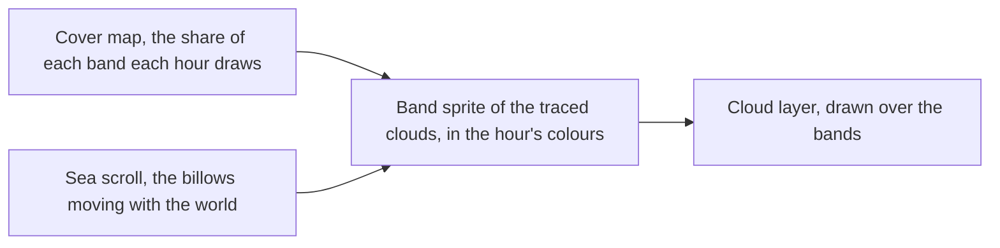

# Login clouds

The clouds over the login's cloud sea and above its towers: three bands of the game's painted clouds, each drawn as billboards, and the cloud layer the sky draws over them. Each hour draws its own share of each band's clouds.

## How it works

- **Each band is one of the game's painted clouds, traced.** The sky's three emitters, the cloud sea's billows and the middle and top cumulus, are each a band of their own atlas's clouds (`scripts/src/services/genshinAssets/fit/fitLoginClouds.ts`). Each cloud is traced as a shape, each loop drawn as a smooth curve through its edges' midpoints with its edge softened. The clouds are drawn as billboards in the sky's cloud colours, so an hour recolours them without repainting. A band is one instanced sprite (`createCloudBandSprite`, `packages/genshin-engine/src/atmosphere/createCloudBandSprite.ts`), whose clouds are laid out farthest along the camera's view first before each draw, as three's sort would lay out sprites of their own. The nearer cloud therefore always blends over the farther however the band scrolls. A cloud's place is uploaded again only once it moves or the order does, so of the three bands only the scrolling sea uploads each frame, and with the camera still it alone writes a frame.
- **Each cloud is coloured as the game's cloud particles are** (`packages/genshin-engine/src/atmosphere/createCloudBandSprite.ts`). Its shade is mixed toward its lit colour where its crown is, each blended from away from the sun to toward it. It brightens toward the sun, fades out over its soft edge and fades below the horizon.
- **The bands stand between one scene's heights for every hour.** The middle cumulus stands as a bank along the horizon behind the towers, and the top cumulus over their crowns, so the sky between them is not left bare. The heights each band stands between are one scene's for all hours (`packages/genshin-world/src/services/login/cloud/LoginCloudBandMap.ts`). They are solved on the dawn's, the day's, the dusk's and the night's frames at once (`genshin:parity cover --heights`), and each hour's shares are solved again under them by turns.
- **The cloud sea scrolls past the glide.** The billows scroll with the world, so none stands where the walkway glides. Each clears it to its side or stays under it (`LoginCloudBandMap` holds each band's heights, spread and widths, `packages/genshin-world/src/services/login/cloud/LoginCloudBandMap.ts`).
- **Each hour draws its own share of each band.** `LoginCloudCoverMap` gives each hour's share of each band's clouds (`packages/genshin-world/src/services/login/cloud/LoginCloudCoverMap.ts`). Each cloud is ranked by its place in its band's scatter, so a thinner sky leaves the rest undrawn. The dawn's and the dusk's shares are solved on their frames by `genshin:parity cover`, under the solved heights. The dusk's cover figure is not yet kept, as the Open list records ([roadmap](../../../../changes/genshin-roadmap/tasks.md)).
- **The day's and the night's cover are not yet solved.** Their clouds are not yet of the recordings' kind: the day's read grey where the recording's are white, and the night's dark where the recording's are pale. More of them scored those frames worse, so each keeps the cover it has until its clouds are of the right kind.
- **The day's and the dusk's colours are measured, and those ship (`packages/genshin-world/src/services/login/scene/LoginSkyStateMap.ts`).** Their colours are the match of their spread solved on their frames. The dusk's shade is a bright pink (its `cloudShadeColor` is `0xd853af`, in `packages/genshin-world/src/services/login/scene/LoginSkyStateMap.ts`), where the colours read by eye stood a dark mauve. An hour's colours can be solved on the atmosphere pass's own readings instead (`genshin:parity layer`), but the night's so solved held one gate more than its shipped colours without beating them on every reading, so it was not taken.
- **The cloud layer is the game's own program over textures of ours.** The cloud layer (`Cloud_LOD0` under `Enviro_Cloud_Layer_Mat`, as `{data-root}/genshin-parity/extracted/login/witness.json` places it) is ported as the game draws it (`createCloudLayerNode`, `packages/genshin-engine/src/nodes/createCloudLayerNode.ts`). Its projections are fitted as profiles by height, its curl and wisps' opacity read off its material. Its density, curl, normal and wisps textures are synthesized from each channel's spectrum and the spread of its values, fitted off the game's, so none of the game's texels ship (`packages/genshin-engine/src/atmosphere/synthesizeCloudLayerTextures.ts`).
- **The layer's textures are written after the scene mounts.** The layer is built over blank textures of their sizes, and each is written in place in an idle moment once the scene mounts (`synthesizeCloudLayerTextures`, `packages/genshin-engine/src/atmosphere/synthesizeCloudLayerTextures.ts`), so the mount never waits on the few tenths of a second they take. Writing into new textures instead drew the layer without its mipmaps. A scene the parity page opens is ready only once they are written, so a failed synthesis is thrown on unhandled and the page fails the tool waiting on it.
- **The layer draws nothing until an hour's settings beat drawing none.** Solved from an opacity near none, every hour's layer stayed thin and traded the clear sky's colour against its clouds' cover or edges. The layer is therefore drawn with no settings until an hour's solve beats none on every reading of the atmosphere pass (`genshin:parity layer`).

## Key files

| File                                                                    | Role                                                |
| :---------------------------------------------------------------------- | :-------------------------------------------------- |
| `packages/genshin-world/src/services/login/cloud/createLoginClouds.ts`  | The cloud bands, each a sprite of its traced clouds |
| `packages/genshin-world/src/services/login/cloud/LoginCloudBandMap.ts`  | Each cloud band's heights, spread and widths        |
| `packages/genshin-world/src/services/login/cloud/LoginCloudCoverMap.ts` | The share of each cloud band each hour draws        |
| `packages/genshin-world/src/services/login/scene/LoginSkyStateMap.ts`   | Each time of day's cloud colours                    |

## Open

- [ ] **The cloud sea's frame upload is unmeasured against the three bands' writes** — no source yet: the write sizes are not measured in the repository or the parity folders.
- [ ] **The dusk's sky is clouded about a seventh of the time the recording's is, from 8 to 15 degrees up** — no source yet: the named source does not hold this value, since the roadmap link (`openspec/changes/genshin-roadmap/tasks.md`) gives its dusk cover as a solve with no figure, and no cover solve of `{data-root}/genshin-parity/captures/yt-mMf727q-0w0-login-dusk.mkv` is kept in `{data-root}/genshin-parity/references`, `plans` or `comparisons`.
- [ ] **The dusk's cloud shade is a bright pink** — no source yet: the shade's value is not read against a colour reference here.
- [ ] **The layer draws no settings until an hour's solve beats none** — no source yet: the gate on the layer's settings was not located in the code checked here.
- [ ] **Each band is one of the game's painted clouds, traced** — no source yet: the cloud textures in `{data-root}/genshin-parity/extracted/login/assets/Texture2D/`, not yet matched to the bands.
- [ ] **Each cloud is coloured as the game's cloud particles are** — no source yet: the particle system's colour over its life, which neither cloud material on disk holds.
- [ ] **The day's and the dusk's colours are measured, and those ship; the day's cloud still is measured** — no source yet: the day and dusk cloud stills, not yet re-measured for the shipped colours; the still the measurement would write is not on disk.
- [ ] **The sky's dome is ported as the game draws it** — no source yet: the `Sky_LOD0` mesh that `{data-root}/genshin-parity/extracted/login/witness.json` places with the `Enviro_Atmosphere_Layer_Mat` material (`{data-root}/genshin-parity/extracted/login/assets/Material/Enviro_Atmosphere_Layer_Mat.json`), not yet compared with the ported dome.

## Sources

- `{data-root}/genshin-parity/captures/login-day.mkv` and `login-night.mkv`, the recordings the day's and the night's clouds are matched against. Grounds Requirement: Unsolved day and night cover, and its scenario Day cover.
