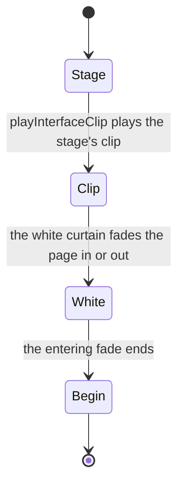

# Login interface

The login page drawn over the scene: the title and its account label, the status row and progress bar, the door's prompt and the four corner buttons, each shown in the stage the [login screen](../README.md) is in. Its pieces are the game's, laid out by [interface layout](../../interface-layout/design.md) and built from [interface library](../../interface-library/design.md) parts.

## How it works

- **The stages set which buttons show.** The title has the notices and exit; the door has settings, repair, notices and exit (packages/genshin-world/src/components/Login/Interface/Index.vue). The door's buttons and prompt show as the [door](../door/design.md) page sets them.
- **The page moves on the game's own clips.** The login page's animation clips are decoded and fitted to keyframes (the login/interfaceClips record, `packages/genshin-world/src/generated/gameDataLock.json`). `createLoginInterfaceClipMap` makes them playable once as the interface mounts, by the name the game plays each by (`packages/genshin-world/src/services/login/interface/createLoginInterfaceClipMap.ts`), and `playInterfaceClip` plays them as each stage begins: the white curtain and the page's fade in on arriving, the title's fade in and its fade out on the click, and the page's fade into white on entering, whose end is the `begin` the opening listens for (`packages/genshin-world/src/components/Game/Opening/Index.vue`).
- **The white is the interface's own.** The white the scene fades up out of and into is therefore the interface's ([interface layout](../../interface-layout/design.md) owns how a clip moves its pieces), so a reference showing the scene alone has none.
- **The mainland client marks its own screen.** A Simplified Chinese reader plays mainland China's build and sees its CADPA age rating (12 and over) in the top right corner at every stage, with its build string under the CNREL prefix (`packages/genshin-world/src/components/Login/Interface/Index.vue`, `packages/genshin-world/src/services/login/GameClientVersionTextMap.ts`). The rating's box and colours are measured off a public recording of an older build's launch (`{data-root}/genshin-parity/captures/bili-av532052219.mp4`, the mainland reference in `scripts/src/services/genshinParity/shared/ParityReferenceMap.ts`). Its age and notice are traced from it (the login/ageRating record, authored in `packages/genshin-world/src/data/login/ageRating.json`, which `genshin:data authored` publishes), and its CADPA is set in a serif (`packages/genshin-world/src/components/Login/Interface/Index.vue`). The build string's revision numbers come from the global build, since no source publishes the mainland's own.

## Tests

`packages/genshin-world/src/components/Login/Interface/` is shot in each stage as fixture variants (`packages/genshin-world/src/components/Login/Interface/Index.fixture.ts`) and held to its approved images (`packages/genshin-world/src/components/Login/Interface/Index.png`). Its references are the English recording's frames, and for its mainland rows the mainland launch recording's (`{data-root}/genshin-parity/captures/bili-av532052219.mp4`), over which it is compared.

## Key files

| File                                                                                 | Role                                                                             |
| :----------------------------------------------------------------------------------- | :------------------------------------------------------------------------------- |
| `packages/genshin-world/src/components/Login/Interface/Index.vue`                    | Each stage's interface, from `genshin-interface`'s pieces, and its clips         |
| `packages/genshin-world/src/services/login/interface/createLoginInterfaceClipMap.ts` | The login page's fitted clips made playable, by the name the game plays each by  |
| `packages/genshin-world/src/data/login/ageRating.json`                               | The age rating's traced paths, authored, which `genshin:data authored` publishes |
| `packages/genshin-world/src/services/login/InterfaceIconGameTextKeyMap.ts`           | Each interface icon's game text key                                              |
| `packages/genshin-world/src/services/login/LoginStatusStepGameTextKeyMap.ts`         | Each status step's game text key                                                 |

## Open

- [ ] **Its references are the English recording's frames** — no source yet: the English recording's frames, which `packages/genshin-world/src/components/Login/Interface/Index.reference.ts`, `packages/genshin-world/src/components/Login/Interface/Layout.reference.ts` and `packages/genshin-world/src/components/Login/Interface/Motion.reference.ts` cite only as "the recording" (none names English).
- [ ] **The title and the door show the buttons their stage sets** — no source yet: the login door reference still `{data-root}/genshin-parity/references/login-interface-door.png`, not yet read for each stage's buttons.
- [ ] **The door's buttons show 0.3 seconds (`LOGIN_DOOR_BUTTONS_DELAY_MS`) after it forms, and its prompt fades in from one second (`LOGIN_DOOR_PROMPT_DELAY_MS`) over 0.3 seconds (`LOGIN_DOOR_PROMPT_FADE_MS`)** — no source yet: the login door recording still `{data-root}/genshin-parity/references/login-door-recording.png`, not yet read for the button and prompt timings.
- [ ] **The login page's animation clips are decoded and fitted to keyframes** — no source yet: a check of the fitted keyframes against the decoded clip JSONs in `{data-root}/genshin-parity/extracted/login/clips/`, not yet made.
- [ ] **The mainland client's rating shows at every stage in the top right corner, with its build string under the CNREL prefix** — no source yet: the mainland login stills `{data-root}/genshin-parity/references/login-interface-door-mainland.png` and `{data-root}/genshin-parity/references/cn-login.png`, not yet read for the rating's corner and build string.
- [ ] **The rating's age and notice are traced from the mainland launch recording** — no source yet: the mainland launch recording (`{data-root}/genshin-parity/captures/bili-av532052219.mp4`, compared at 12.5 seconds for the rating); `{data-root}/genshin-parity/references/login-interface-door-mainland.png`, not yet read for the age and notice.
- [ ] **The rating's CADPA is set in a serif** — no source yet: `{data-root}/genshin-parity/references/login-interface-door-mainland.png`, not yet read for the typeface.
- [ ] **The white is the interface's own** — no source yet: the element the white curtain clip `{data-root}/genshin-parity/extracted/login/clips/16000354/AnimationClip/Ani_LoginMainPage_WhiteCurtain.json` moves, which its curves do not name.
