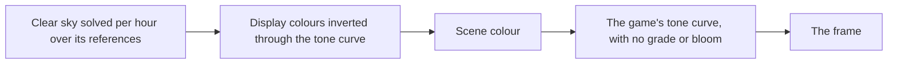

# Login sky

The sky behind the login scene: each hour's clear sky, solved as the game's sky shader draws it, and the sun or the moon that lights the scene in that hour. Every colour is measured on the screen and inverted into the scene through the game's tone curve.

## How it works

- **Each hour's sky is solved over every reference at that hour at once.** The pixels the cloud mask finds no cloud on are the clear sky (`genshin:parity sky`, `scripts/src/services/genshinParity/sky/fitSky.ts`, `scripts/src/services/genshinParity/sky/fitClearSky.ts`). Its top and bottom colours, toward the sun and away, its halos and its own shape are solved together, the night's with the glow round its moon. Solving over all of an hour's references together is what makes the sky one sky: solved on the title alone, the day's sky drew the phone door frame's patch of it worse.
- **Each pixel is weighed by how steeply the tone curve shows it.** The solve is of what the screen shows. In scene colour alone, the curve's inverse takes a pixel near white to many times its neighbours' colour, and the day's horizon came out pure blue (`getToneSlope`, `scripts/src/services/genshinParity/display/getToneSlope.ts`).
- **A cloud is split from the clear sky by Otsu's threshold** (`scripts/src/services/genshinParity/sky/readCloudSky.ts`). A pixel standing over the clear sky fitted under it is a cloud when its ratio to that sky passes Otsu's threshold between the two, wherever that lies past the least ratio a cloud stands at. A fixed ratio alone read the sky's wisps and its glow toward the sun as cloud, and a solve reading them as sky drew a dark red halo across it.
- **No term goes negative.** The terms are solved as a non-negative least-squares system, each over its excess above its floor (`solveNonNegativeSystem`, `scripts/src/services/recreation/solve/solveNonNegativeSystem.ts`), so a halo never comes out below none. Clamping a free solve after the fact left the terms it cancelled too red, and the sky read salmon where the recording's is lavender.
- **The night's colour away from the moon is solved over the curve's black.** The night's red solves under the curve's black at none, the one sky colour that does (`packages/genshin-world/src/services/login/scene/LoginSkyStateMap.ts`). Solved so, the night's sky is lavender away from the sun and rose toward it, as the recording's is.
- **The colours go through the tone curve's inverse.** The display pass measured the game's tone curve ([rendering style](../../rendering-style/design.md)). The sky's, the haze's and the clouds' colours are display colours read off the references, written through the curve's inverse (`toSceneColor`, `packages/genshin-engine/src/post/toSceneColor.ts`). The frame is drawn through the game's own curve alone, with no grade and no bloom (`packages/genshin-world/src/components/Login/Scene/Index.vue` passes `isBloomed: false` and no grade LUT, so `packages/genshin-engine/src/post/createPostPipeline.ts` skips the bloom and the grade, and its display node is `toneMapGenshinNode`), so every colour measured this way inverts exactly. Through a grade or bloom, a solve read back from our own render handed back a sky light a fifth to two times too strong.
- **The night passes through its own white balance before the curve.** The night is cooled to a temperature of minus 9.5 and tinted 16 (`genshin:parity balance` over both its frames; `whiteBalance` in `packages/genshin-world/src/services/login/scene/LoginSkyStateMap.ts`). This takes the stone's red under the curve's black as the game's does, which none of the scene's own colours did before it. The game's bloom is still left out.
- **The sun and the moon are placed where their references show them.** A screen point measured off the reference becomes a direction through the login camera (`getLoginScreenDirection`, `packages/genshin-world/src/services/login/scene/getLoginScreenDirection.ts`). The dawn's and the dusk's suns sit just past the left edge a little over the horizon (`packages/genshin-world/src/services/login/scene/LoginSkyStateMap.ts`); the night's moon stands behind the lantern tower. The light, the sun and the moon all take that direction, the other body opposite (`packages/genshin-world/src/services/login/scene/LoginSkyStateMap.ts`). The day's sun is off its frame, so its direction is measured from the faces it lights.
- **The dusk's sunlight is solved on the door recording.** The dusk's sunlight falls from the direction its shadows solve to on the door recording (`genshin:parity shadows`): 49.7 degrees up and 49.7 degrees off the walkway's +z axis (`DUSK_LIGHT_DIRECTION`). The solve casts the recording's tower shadows within 5.28 pixels of their edges, where the shading never settled a direction. The direction the dusk's stone light uses is open (see Open).
- **The hemisphere lights upward faces from the sky.** The sky colour of the hemisphere is near the bright cloud colour (`0xf2dfc8` against `0xf5efe8` at dawn, `packages/genshin-world/src/services/login/scene/LoginSkyStateMap.ts`) and its ground colour the shade, so a face turned up is lit by the sky as the references show it under a low sun. The haze scatters light toward the sun ([light](../light/design.md)).

## Key files

| File                                                                         | Role                                                                   |
| :--------------------------------------------------------------------------- | :--------------------------------------------------------------------- |
| `packages/genshin-world/src/services/login/scene/LoginSkyStateMap.ts`        | Each time of day's sky, haze and light colours and strengths           |
| `packages/genshin-world/src/services/login/scene/getLoginScreenDirection.ts` | A screen point read off the reference, as the direction it lights from |
| `packages/genshin-world/src/components/Login/Scene/Sky.reference.ts`         | The sky the scene is compared with, per hour                           |
| `packages/genshin-world/src/components/Login/Scene/Light.reference.ts`       | The light the scene is compared with, per hour                         |

## Open

- [ ] **The night's sky is lavender away from the sun and rose toward it, as the recording's is** — no source yet: no colour comparison with the recording is kept.
- [ ] **The night's white balance was solved over both its frames by `genshin:parity balance`** — no source yet: the balance run is not kept.
- [ ] **The night's moon stands behind the lantern tower** — no source yet: the reference point is not annotated against the lantern tower in any kept file.
- [ ] **The day's sun is measured from the faces it lights** — no source yet: the measurement is not kept, and the constant is only in `LoginSkyStateMap.ts`.
- [ ] **The dusk's sunlight falls from the door recording's shadows, 49.7 degrees up and 49.7 degrees off the walkway's +z axis** — no source yet: the shadows' reading from `~/Esposter/genshin-parity/references/login-door-recording.png` is not kept, and the value is `DUSK_LIGHT_DIRECTION` in `packages/genshin-world/src/services/login/scene/LoginSkyStateMap.ts`.
- [ ] **The solve casts the recording's tower shadows within 5.28 pixels of their edges** — no source yet: the figure is only in a code comment, and the shadows solve output is not kept.
- [ ] **The dawn's and the dusk's suns sit just past the left edge, a little over the horizon** — no source yet: the dawn login still `~/Esposter/genshin-parity/references/login-dawn-title.png`, not yet read for the sun's position.
- [ ] **The direction the dusk's stone light uses** — no source yet: `packages/genshin-world/src/services/login/scene/LoginSkyStateMap.ts` was not read for the stone light's direction against `DUSK_LIGHT_DIRECTION`.
