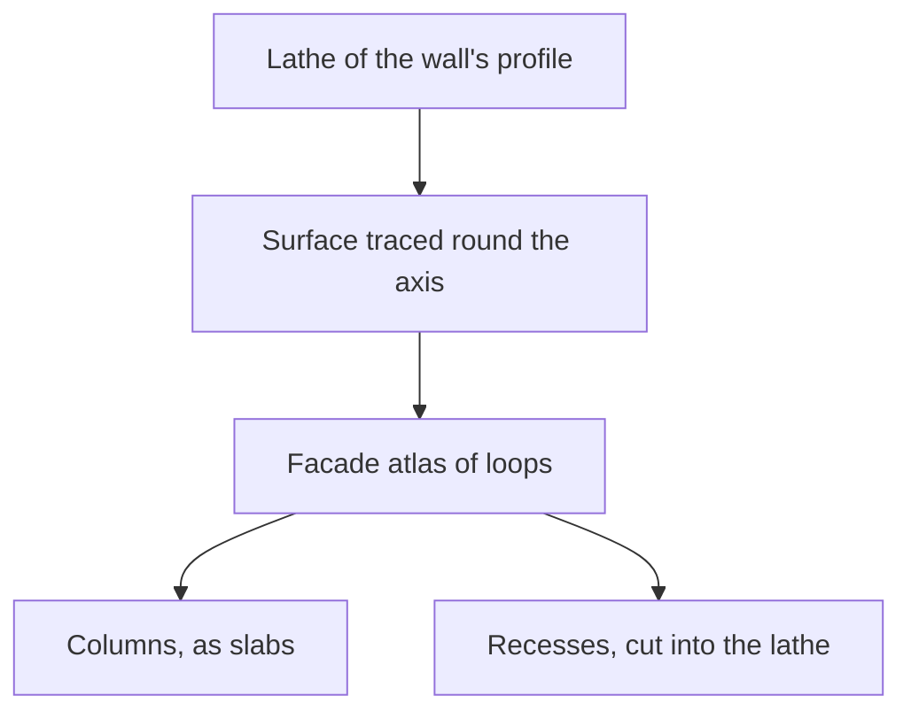

# Login towers

The towers, bridges and pillars the login's walkway runs past. Each tower is a lathe of its wall's profile, its surface traced from the game's own mesh and its columns and recesses built where the wall stands out or sinks. The bridges and pillars are their hulls' boxes (`packages/genshin-world/src/services/login/hull/createLoginHullsGeometry.ts`).

## How it works

- **A tower the game draws only at its coarsest level, painted with the ground's stone alone, is fitted from that level's own mesh, its lathe and its facade both** (`scripts/src/services/genshinAssets/fit/readLevelOfDetailParts.ts` lines 36 to 52, `scripts/src/services/genshinAssets/fit/readTowerProfiles.ts` line 18, `scripts/src/services/genshinAssets/fit/fitLoginTowerFacades.ts` line 56).
- **A tower is a lathe of its wall.** The radius of each tower's wall is read at every two units of height (`TOWER_BAND_HEIGHT` in `scripts/src/services/genshinAssets/shared/constants.ts`, `scripts/src/services/genshinAssets/fit/fitLatheProfile.ts`) and simplified into sloped runs, so a moulding's roll and a cornice's overhang turn as the game's do. A tower is built once and copied to each placement at its exact scale, turned as the game turns it and merged into one geometry (`packages/genshin-world/src/services/login/tower/createLoginTowersGeometry.ts`).
- **The lathe reaches the tips of the columns and cornices, each band's radius being its outermost vertex** (`scripts/src/services/genshinAssets/fit/fitRadialProfile.ts:44`). The facade lies on the face it was read off, so the surface pass and the lathe agree (`scripts/src/services/genshinAssets/fit/fitLoginTowerFacades.ts`).
- **The surface is the game's own, traced.** Each tower's finest mesh is unrolled round its axis the way its lathe turns, on cells an eighth of a unit wide (about a centimetre, `TOWER_FACADE_CELL_SIZE` in `scripts/src/services/genshinAssets/shared/constants.ts`), so its carving's edges land within a pixel of the game's where the towers stand nearest. The paint is read again on half units (`TOWER_FACADE_PAINT_CELL_SIZE` in `scripts/src/services/genshinAssets/shared/constants.ts`), and every cell keeps the face standing farthest out, with its material's colour and metal and how far it stands from the wall (`fitLoginTowerFacades`, `scripts/src/services/genshinAssets/fit/fitLoginTowerFacades.ts`).
- **What a lathe cannot carve is traced as loops.** The loops are the tone of each run of the tower's height, the paint darker and lighter than its band, what stands out from its wall, its recesses at two depths (the fluting, the windows and the arches), its gilding, and where it stands open between its columns. They are drawn once into an atlas of every tower's facade (`createLoginTowerFacade`, `packages/genshin-world/src/services/login/tower/createLoginTowerFacade.ts`), each tile clipped to itself and run on into a gutter either side by the surface carried round its axis, so filtering and the first mipmaps never read a neighbour's facade. Each vertex reads the atlas where it stands round its tower and up it, giving the shade over the stone and the open colonnades that let the sky through (`computeLoginTowerAtlas`, `packages/genshin-world/src/services/login/tower/computeLoginTowerAtlas.ts`).
- **The shade is measured from the shared stone.** Every shade stands as far from the stone all the towers share as its texels' colour does (`packages/genshin-world/src/services/login/tower/createLoginTowerFacade.ts`), so a tower the texture paints darker than the rest stands darker, and a recess is painted as its texture paints it with no light kept out of it. Shading each tower over its own mean made every tower stand at the shared stone's tone, which lost the contrast the exports show.
- **The gilding is the stone's colour, and no bump tilts the light at a recess's edge.** (`packages/genshin-world/src/services/login/tower/createLoginTowerFacade.ts`). With no reflection of the sky to show it, metal read dark against the exports at every hour, and a bump over the atlas changed no frame.
- **What stands out from a tower's wall is built as columns.** The ribs, pilasters, colonnade columns, emblems and balconies are the cells a unit or more out from the wall the lathe draws at their row (`TOWER_FACADE_SHALLOW_RECESS` in `scripts/src/services/genshinAssets/shared/constants.ts`, `scripts/src/services/genshinAssets/fit/classifyFacadeCells.ts`). They are joined round the tower's seam into runs, and each run covering ten square units or more is split row by row into rectangles, while a row spans the same columns at about the same depth (`findCellComponents`, `scripts/src/services/genshinAssets/fit/findCellComponents.ts`; `findCellRectangles`, `scripts/src/services/genshinAssets/fit/findCellRectangles.ts`; `TOWER_FACADE_MIN_AREA` in `scripts/src/services/genshinAssets/fit/fitLoginTowerFacades.ts`). Each rectangle is a slab from just inside the wall out to how far its cells stand, over the turns and the height it covers, flat-shaded so its edges stay sharp (`createLoginTowerSlabGeometry`, `packages/genshin-world/src/services/login/tower/createLoginTowerSlabGeometry.ts`). It reads the facade where it stands, as the lathe does.
- **What sinks four units or more into the wall is built as recesses (`TOWER_FACADE_DEEP_RECESS` in `scripts/src/services/genshinAssets/shared/constants.ts`, `scripts/src/services/genshinAssets/fit/classifyFacadeCells.ts`).** A window or a bay is a recess: the lathe is cut open over it through the facade's mask, which a slab never reads (`packages/genshin-world/src/services/login/tower/createLoginTowersGeometry.ts`), and a box stands behind it, its back turned out and its sides into the opening (`packages/genshin-world/src/services/login/tower/createLoginTowerSlabGeometry.ts`, lines 16, 33 to 36 and 53 to 67). Shallower panels and flutes, sunk in under four units, stay painted: built as recesses they scored every frame worse. Columns and recesses together bring every frame's towers nearer the exports than the lathe alone.
- **The towers are judged against the exports, not the recordings.** A recording is too soft, and the scene's light too far off, for a score to see the carving. Drawn beside the exports, the towers are judged by their structure and colour.

## Key files

| File                                                                              | Role                                                                      |
| :-------------------------------------------------------------------------------- | :------------------------------------------------------------------------ |
| `packages/genshin-world/src/services/login/tower/createLoginTowersGeometry.ts`    | Every fitted tower, built as a lathe and stood where the game stands it   |
| `packages/genshin-world/src/services/login/tower/createLoginTowerFacade.ts`       | The towers' traced surfaces drawn into one atlas and read as their stone  |
| `packages/genshin-world/src/services/login/tower/computeLoginTowerAtlas.ts`       | The atlas's layout: each tower's tile and its gutters                     |
| `packages/genshin-world/src/services/login/tower/createLoginTowerSlabGeometry.ts` | The columns standing out of a wall, each a slab over its turns and height |
| `packages/genshin-world/src/services/login/tower/constants.ts`                    | The towers' lathe, columns and recess thresholds                          |
| `packages/genshin-world/src/services/login/hull/createLoginHullsGeometry.ts`      | Every bridge and pillar, its hull's boxes stood where the game stands it  |
| `scripts/src/services/genshinAssets/fit/fitLoginTowerFacades.ts`                  | Each tower unrolled round its axis and its surface traced as loops        |

## Open

- [ ] **The towers' mouldings and cornices turn as the game's do** — no source yet: no profile comparison with the game is kept.
- [ ] **The carving's edges land within a pixel of the game's where the towers stand nearest** — no source yet: no edge measurement is kept.
- [ ] **No bump tilts the light at a recess's edge, and a bump over the atlas changed no frame** — no source yet: no frame comparison of a bump over the atlas is kept in `~/Esposter/genshin-parity/comparisons/`, which holds no tower snapshot, and `packages/genshin-world/src/components/Login/Scene/Towers.reference.ts` records the result without one.
- [ ] **Columns and recesses together bring every frame's towers nearer the exports than the lathe alone** — no source yet: no per-frame score is kept.
- [ ] **A tower the game draws only at its coarsest level is fitted from that level's own mesh, its lathe and its facade both** — no source yet: the game's record of the level of detail each tower is drawn at.
