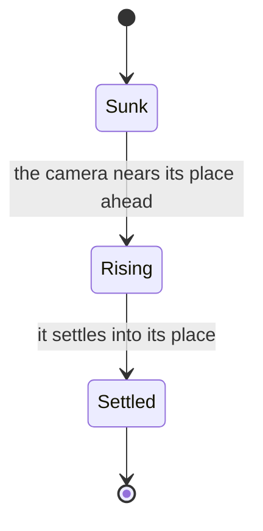

# Login walkway

The walkway the camera looks down: its pieces, each its fitted outline extruded from the walkway's underside to its stone, painted in the game's own tones and carved as the game's normal map carves it. Its pieces assemble ahead of the glide, so the walkway's far end is always being built as the camera nears it.

## How it works

- **The walkway is 23 pieces, each one outline**, though the count is unconfirmed (see Open). Each piece is its fitted outline extruded from the walkway's underside up to its stone, at the height most of its tops stand at, seen from above (`packages/genshin-world/src/services/login/walkway/createLoginWalkwayPieces.ts`). Its curbs (3 centimetres high) and its lanes' borders (9 millimetres) are traced from above and extruded over the piece to their own heights, so near the camera the curbs widen its outline and stand their inner faces as the game's do. Every copy of a piece is an instance of one batch, and each piece rises on its own.
- **The paint is a plan read from the game's own textures.** Each piece's tops are drawn into a plan of one copy of the walkway through their own texture coordinates and the textures their materials hold (`fitLoginPaving`, `scripts/src/services/genshinAssets/fit/fitLoginPaving.ts`). The pattern repeats twice a copy, as the wings stand, so the plan is folded onto that 8 metre repeat, each cell the mean of its repeats over two centimetres a side. Folding also averages out the speckle each repeat paints differently (`foldPlanRepeats`, `scripts/src/services/genshinAssets/fit/foldPlanRepeats.ts`).
- **Three tones are read from the plan.** The plan is read as three tones, as the door's front is (`fitPlanTones`, `scripts/src/services/genshinAssets/fit/fitPlanTones.ts`): the middle lane's paler bricks, the side lanes' and the wings' darker pockets, and the stone between. Five tones scored worse on the walkway's structure than three, and a single tone with darker pockets missed its mean colour by far more.
- **The paint is drawn once and read where each piece stands.** The tones are filled once as smooth curves into a texture of the repeat. Each piece reads it where its own geometry stands, and the plan repeats along the copy (`createPlanCanvasNode`, `packages/genshin-world/src/services/login/shared/createPlanCanvasNode.ts`), so every copy and every rising piece carries its own paint.
- **The carving is relief, not a dark line.** The game paints no dark line on its paving. Its stone's normal map carves each pocket's rim as a bevel and each joint between two bricks as a groove, and the low sun leaves the rims turned from it dark, which is what the recording shows as carving. The fit reads that normal map over the same plan (`fitLoginPaving`, `scripts/src/services/genshinAssets/fit/fitLoginPaving.ts`). A rim is where the normal tilts past the split between the flat stone and its bevels beside a pocket's edge; a groove is the stone tilted anywhere else, the joints and the lanes' borders. Both carry their median slope, width and direction.
- **The scene draws the carving as depth.** The pockets and grooves are drawn into one canvas (`createLoginPaving`, `packages/genshin-world/src/services/login/walkway/createLoginPaving.ts`), blurred over the rim's width into the stone's depth, and each top's normal is tilted by that depth's slopes. The scene's own sun and sky then light the carving at every hour. Dark lines drawn over the paint scored the walkway worse than relief does.
- **The walkway assembles ahead of the camera.** The recording's walkway ends a fixed distance ahead however far the world has moved, its far blocks stacked above its surface as they rise into place. Each piece rises from 3 metres down at 17.5 metres ahead, carries 0.45 metres past its place and settles into it by 13.5 metres, its span staggered by up to 2 metres of its neighbours' (`getLoginWalkwaySink`, `packages/genshin-world/src/services/login/walkway/getLoginWalkwaySink.ts`, `packages/genshin-world/src/services/login/walkway/constants.ts`). These rows are read by eye off the recording, where its walkway settles and ends, and its far blocks stack over the surface in steps of about 15 centimetres (`LOGIN_WALKWAY_RISE_OVERSHOOT` in `packages/genshin-world/src/services/login/walkway/constants.ts`). A piece past the rise does not stand at all, so neither it nor its shadow shows before its turn (`packages/genshin-world/src/components/Login/Scene/Index.vue`).
- **The exports' walkway assembles the same way.** `sinkLoginWitnessWalkway` (`packages/genshin-world/src/services/login/walkway/sinkLoginWitnessWalkway.ts`) assembles the exports' own walkway pieces as ours do, so the stand-in is compared with the export at the same stage of assembly.

## Tests

- `createLoginWalkwayPieces.test.ts` holds each piece's span from its underside to its curbs' tops, each about its own middle, and no piece standing past the widest (`packages/genshin-world/src/services/login/walkway/createLoginWalkwayPieces.test.ts`).
- `getLoginWalkwaySink.test.ts` covers how far each piece stands under its place as the walkway assembles (`packages/genshin-world/src/services/login/walkway/getLoginWalkwaySink.test.ts`).

## Key files

| File                                                                            | Role                                                                             |
| :------------------------------------------------------------------------------ | :------------------------------------------------------------------------------- |
| `packages/genshin-world/src/services/login/walkway/createLoginWalkwayPieces.ts` | The walkway's pieces, each its fitted outline extruded to its top, curbs over it |
| `packages/genshin-world/src/services/login/walkway/createLoginPaving.ts`        | The walkway's paint over its repeat, and its pockets and grooves as relief       |
| `packages/genshin-world/src/services/login/walkway/getLoginWalkwaySink.ts`      | How far under its place a piece stands as the walkway assembles                  |
| `packages/genshin-world/src/services/login/walkway/sinkLoginWitnessWalkway.ts`  | The exports' walkway pieces assembling as ours do, for the stand-in table        |
| `packages/genshin-world/src/services/login/walkway/constants.ts`                | The walkway's rise, settling and curb heights                                    |
| `packages/genshin-world/src/services/login/shared/createPlanCanvasNode.ts`      | A part's plan drawn once into a canvas and read where its geometry stands        |
| `scripts/src/services/genshinAssets/fit/foldPlanRepeats.ts`                     | A plan folded onto the repeat of its pattern, over blocks of its cells           |
| `scripts/src/services/genshinAssets/fit/fitPlanTones.ts`                        | A surface's texture read as the tones it paints a plan in, as loops              |

## Open

- [ ] **The walkway is 23 pieces, with curbs 3 centimetres high and lanes' borders 9 millimetres** — no source yet: the hosted walkway record is not on disk (the game-data lock names it by hash only), so its piece count and raised heights are not read from it.
- [ ] **Each cell is the mean of its repeats over two centimetres a side, and the pattern repeats twice a copy onto an 8 metre repeat** — no source yet: the hosted walkway record is not on disk, so the fold's block size and the repeat length are not read from it.
- [ ] **The rims of the pockets read as dark carving at low sun, as the recording shows them** — no source yet: no capture comparison of the carving is kept.
- [ ] **each piece rises from 3 metres down at 17.5 metres ahead and settles by 13.5 metres** — no source yet: the login layout export's piece heights and distances, since its log was empty on disk.
- [ ] **the far blocks stack over the surface in steps of about 15 centimetres** — no source yet: the login layout export's block steps, since its log was empty on disk. Raised: the body cites `LOGIN_WALKWAY_RISE_OVERSHOOT` for this step, but that constant is 0.45 metres (`packages/genshin-world/src/services/login/walkway/constants.ts` line 12), the carry past a piece's place, not a step of 15 centimetres.
- [ ] **Three tones score the walkway's structure better than five, and a single tone with darker pockets misses its mean colour by far more** — no source yet: no scoring run of the tone counts is kept in `{data-root}/genshin-parity/comparisons/`.
- [ ] **Dark lines drawn over the paint scored the walkway worse than relief does** — no source yet: no score of the dark-line variant is kept.
- [ ] **The recording's walkway ends a fixed distance ahead however far the world has moved** — no source yet: no frame measurement of the walkway's end across the recording is cited.
