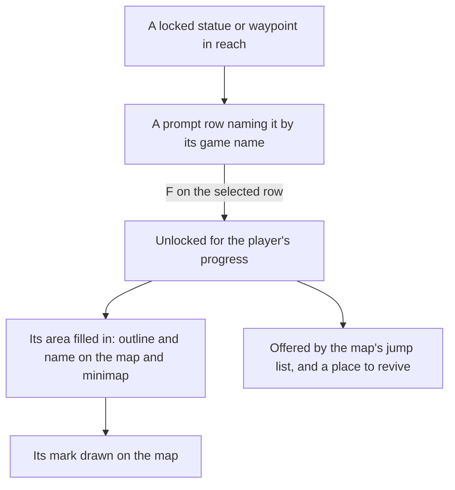

# Map unlocking

In the game the map is blank until a statue fills in its area, and a place is a jump only once it is unlocked. Here a Statue of The Seven or a Teleport Waypoint is unlocked by resonating with it on F, and until then its area is blank on the map and the minimap and the place is not offered as a jump. This page is what is built of [map unlocking](../../../changes/genshin-map-unlocking/design.md): Mondstadt's Teleport Waypoints, which [exploring](../exploring/design.md) places, and the domain entrances the region data places are landmarks of the world too, and resonating with one unlocks it the same way. An unlocked domain entrance is a jump target, landing at its own place until the domain's scene export gives its transfer point.

## How it works

- **Resonating is an interaction.** A locked jump landmark, a Statue of The Seven or a Teleport Waypoint, is an `Activate` row of the prompt list while it is in reach, named by its game name, and a locked domain entrance is a row named Domain Entrance. F on the selected row unlocks it, and an unlocked landmark has no row. The row's icon is the interaction kind's, so the list shows what acting on it does without a verb of its own: no text id for the game's resonating prompt is in the text dump under a known key.
- **Nothing is unlocked at the start.** A new player has unlocked no landmark, so the map is blank and no jump is offered. The wiki says the first activation lights the statue's surrounding area and reveals its nearby waypoints, and that whether Windrise's statue is already active depends on the player's progress through the opening quest. Here an unlock is the player's own F, and the waypoints the game hides are not yet kept out (task 2.2 of the change).
- **A quest step can finish on an unlock.** An unlock tells the quests the waypoint's transport point id as an Interact target, so a `QUEST_CONTENT_UNLOCK_TRANS_POINT` step that names the point finishes on it. The quest data has no step that unlocks a waypoint outright, so none is built.
- **Kept with the player's progress, as the bag and the wallet are.** The unlocked ids are a slice of the [save](../save-data/design.md), so they last across a reload.
- **An area is filled while a landmark in it is unlocked.** `computeFilledAreaIds` gives the areas unlocked landmarks stand in. The map's drawing outlines only filled areas, `computeAreaLabels` names only filled areas, and the marks drawn are the unlocked landmarks alone, so the minimap shows the same.
- **Only unlocked jump landmarks are jumps.** The jump list, the map's marks and the minimap receive the unlocked statues and waypoints, and a party that falls is jumped to the unlocked one nearest its body. With none unlocked it is left where it fell.
- **A first unlock pays its point's Adventure EXP and Primogems.** `pnpm -C scripts genshin:assets trans-points` builds the open world's transport point rewards and publishes them as `transPoints/scene3`, each point's Adventure EXP and Primogems joined from its reward row. A statue's point is its entry in `LandmarkIdStatuePointIdMap` (Windrise's is point 4), and a waypoint's is the number its id ends in. Windrise's first unlock adds five Primogems and fifty Adventure EXP, once, since only a locked landmark is offered to resonate with; the Adventure EXP goes to the adventure rank, as the chests and offerings do. Of Mondstadt's 43 waypoints, 32 have a row and the 11 without pay nothing.

## Key files

| File                                                                               | Role                                                                                                                            |
| :--------------------------------------------------------------------------------- | :------------------------------------------------------------------------------------------------------------------------------ |
| `packages/genshin-world/src/services/map/computeFilledAreaIds.ts`                  | The areas that unlocked landmarks stand in, which are the filled ones                                                           |
| `packages/genshin-world/src/services/map/computeAreaLabels.ts`                     | Names only the filled areas, at their outline or their unlocked landmarks                                                       |
| `packages/genshin-world/src/components/Map/Drawing/Index.vue`                      | Draws the outlines of filled areas and the marks of the unlocked landmarks                                                      |
| `packages/genshin-world/src/components/World/Session/Index.vue`                    | Holds the unlocked ids, offers the locked landmarks as rows, and unlocks on F                                                   |
| `packages/genshin-world/src/composables/useJumpLandmarks.ts`                       | Every region's jump landmarks, read once, before the unlocked ones are kept                                                     |
| `packages/genshin-world/src/composables/useWorldMap.ts`                            | Unlocks a landmark, pays its first unlock, tells the quests its scene point, and keeps a hidden waypoint out of the locked ones |
| `packages/genshin-world/src/services/transPoint/computeLandmarkPointId.ts`         | A landmark's scene point, by its statue or its waypoint id                                                                      |
| `packages/genshin-world/src/services/map/computeJumpLandmarkTextKey.ts`            | The game name a jump landmark's row and jump list entry carry                                                                   |
| `scripts/src/services/genshinAssets/transPoints/buildTransPointRewards.ts`         | Builds the open world's transport point rewards, for publishing                                                                 |
| `packages/genshin-world/src/services/transPoint/readOpenWorldTransPointRewards.ts` | Fetches the slice by its key, checking it against its shape as it arrives                                                       |
| `packages/genshin-world/src/services/transPoint/computeHiddenTransPointIds.ts`     | The listed points a step names and no step has reached, which the map keeps out                                                 |
| `packages/genshin-world/src/services/quest/computeQuestStepTargets.ts`             | The Interact targets the quests name, and those their reached steps name                                                        |
| `packages/genshin-world/src/services/transPoint/readOpenWorldTransPointUnlocks.ts` | Fetches the unlock record by its key, checking it against its shape                                                             |
| `scripts/src/services/genshinAssets/transPoints/buildTransPointUnlocks.ts`         | Builds the open world's unlock record, for publishing                                                                           |

## Notes

- **The unlock is not yet animated.** The game's resonating light and the time it holds the player are measured off a published clip ([roadmap](../../../changes/genshin-roadmap/tasks.md), References sought), so the unlock is instant here.
- **A waypoint's first unlock pays its point's reward, and a point with no row pays nothing.** A Teleport Waypoint is unlocked on F as a statue is, and the pointer marks it while it is locked. Its reward is the row of the point its id ends in (`computeLandmarkPointId`), read from the open world's `transPoints/scene3` record, and `LandmarkIdStatuePointIdMap` is not consulted, since it names only Windrise's statue. Of Mondstadt's 43 waypoints, 32 have a row, and the 11 with points 1865 to 2051 have none in the game's own table, so they pay nothing. The [wiki](https://genshin-impact.fandom.com/wiki/Teleport_Waypoint) says every waypoint's first unlock grants 50 Adventure EXP and 5 Primogems, which those eleven contradict; the build follows the game's table, and the difference is left for a decision.
- **A waypoint the game hides stays out until its step is reached.** A listed transport point that a quest step names is kept out of the map and the prompt list until that step is reached, from the `transPoints/unlock` record; a point no step names is shown. **One waypoint rule is not built:** no quest step unlocks a waypoint outright, since the one unlock step names point 7, a statue's point. A domain entrance's arrival is its own place until the domain's scene export gives its transfer point, as the [domains change](../../../changes/genshin-domains/design.md) decides.

## Sources

- [Galesong Hill](https://www.icy-veins.com/genshin-impact/galesong-hill), Icy Veins: the first activation of a Statue of The Seven lights the surrounding area and reveals the nearby teleport waypoints.
- [Let the Wind Lead](https://www.powerpyx.com/genshin-impact-let-the-wind-lead-walkthrough), PowerPyx: whether the Windrise statue is already active depends on the player's progress.
- [AnimeGameData](https://github.com/DimbreathBot/AnimeGameData), the community's per-patch dump: `TransPointRewardConfigData`, each transport point's reward, and `RewardExcelConfigData`, the Adventure EXP and Primogems each reward pays.
