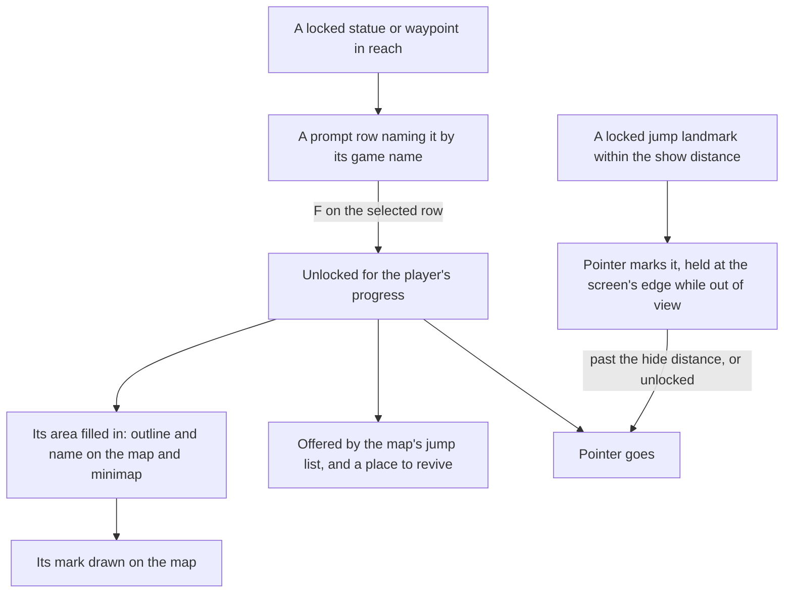

# Map unlocking

In the game the map is blank until a statue fills in its area, and a place is a jump only once it is unlocked. Here a Statue of The Seven or a Teleport Waypoint is unlocked by resonating with it on F, and until then its area is blank on the map and the minimap and the place is not offered as a jump (`packages/genshin-world/src/store/map.ts`, `packages/genshin-world/src/components/World/Session/Index.vue`). Mondstadt's Teleport Waypoints, which [exploring](../exploring/design.md) places, and the domain entrances the region data places are landmarks of the world too, and resonating with one unlocks it the same way (`packages/genshin-world/src/store/map.ts`, `packages/genshin-world/src/data/regions/mondstadt.json`). An unlocked domain entrance is a jump target, landing at its own place until the domain's scene export gives its transfer point, as the [domains](../../../changes/genshin-domains/design.md) change decides (`packages/genshin-world/src/services/map/computeJumpPose.ts`).

## How it works

- **Resonating is an interaction.** A locked jump landmark, a Statue of The Seven or a Teleport Waypoint, is an `Activate` row of the prompt list while it is in reach, named by its game name (`packages/genshin-world/src/services/map/computeJumpLandmarkTextKey.ts`), and a locked domain entrance is a row named by its domain's own title. F on the selected row unlocks it, and an unlocked landmark has no row (`packages/genshin-world/src/components/World/Session/Index.vue`, `packages/genshin-world/src/store/map.ts`). The row's icon is the interaction kind's, so the list shows what acting on it does without a verb of its own: no text id for the game's resonating prompt is in the text dump under a known key.
- **Nothing is unlocked at the start.** A new player has unlocked no landmark, so the map is blank and no jump is offered (`packages/genshin-world/src/services/save/constants.ts`). The first activation lights its area and reveals most of the locked waypoints in it (`{data-root}/cache/genshin-wiki/Page_Statue_of_The_Seven.json` wikitext lines 17 to 18), and Windrise's statue is contradicted in the Open list. Here an unlock is the player's own F (`packages/genshin-world/src/components/World/Session/Index.vue`).
- **A quest step can finish on an unlock.** An unlock tells the quests the waypoint's transport point id as an Interact target, so a `QUEST_CONTENT_UNLOCK_TRANS_POINT` step that names the point finishes on it (`packages/genshin-world/src/store/map.ts`, `scripts/src/services/genshinText/QuestContentObjectiveMap.ts`).
- **A waypoint the game hides stays out until its step is reached.** A listed transport point is kept out of the map and the prompt list while a quest step names it and no step has reached it. A step counts as reached once it is current or finished, so the step that reveals a point shows it before that step finishes. A point no step names is shown, and a failed read of the `transPoints/unlock` record shows every point (`packages/genshin-world/src/services/transPoint/computeHiddenTransPointIds.ts`, `packages/genshin-world/src/services/transPoint/readOpenWorldTransPointUnlocks.ts`, `packages/genshin-world/src/services/quest/computeQuestStepTargets.ts`).
- **Kept with the player's progress, as the bag and the wallet are.** The unlocked ids are a slice of the [save](../save-data/design.md), so they last across a reload (`packages/genshin-world/src/models/save/GenshinSaveState.ts`, `packages/genshin-world/src/services/save/readGenshinSave.ts`).
- **An area is filled while a landmark in it is unlocked.** `computeFilledAreaIds` gives the areas unlocked landmarks stand in. The map's drawing outlines only filled areas, `computeAreaLabels` names only filled areas, and the marks drawn are the unlocked landmarks alone, so the minimap shows the same (`packages/genshin-world/src/services/map/computeFilledAreaIds.ts`, `packages/genshin-world/src/services/map/computeAreaLabels.ts`, `packages/genshin-world/src/components/Map/Drawing/Index.vue`, `packages/genshin-world/src/components/Hud/Minimap/Index.vue`).
- **Only unlocked jump landmarks are jumps.** The jump list, the map's marks and the minimap receive the unlocked statues and waypoints (`packages/genshin-world/src/services/map/computeUnlockedJumpLandmarks.ts`), and a party that falls is jumped to the unlocked Teleport Waypoint nearest its body, a statue taking no revive (`packages/genshin-world/src/services/map/findNearestTeleportWaypoint.ts`, `packages/genshin-world/src/components/World/Session/Index.vue`). With none unlocked it is left where it fell (`packages/genshin-world/src/components/World/Session/Index.vue`).
- **The pointer marks the nearest locked jump landmark.** The HUD points to the nearest locked jump landmark within the show distance of the character, and keeps pointing to it until the character is past the hide distance from it or it is unlocked (`packages/genshin-world/src/services/map/findPointedLandmark.ts`, `packages/genshin-world/src/composables/useWorldPointedLandmark.ts`). The two distances are `NAVIGATION_POINTER_SHOW_DISTANCE` and `NAVIGATION_POINTER_HIDE_DISTANCE` (`packages/genshin-world/src/services/map/constants.ts`), and statues and waypoints alike are pointed to, since both are jump landmarks (`packages/genshin-world/src/models/world/JumpLandmark.ts`).
- **The pointer is the game's navigation mark.** It is drawn at the pointed landmark's place on the screen, and while that landmark is out of view it is held at the screen's edge with its arrow turned along the line toward it (`packages/genshin-world/src/services/map/computeNavigationMark.ts`, `packages/genshin-world/src/components/Hud/Navigation/Index.vue`).
- **A first unlock pays its point's Adventure EXP and Primogems.** `pnpm -C scripts genshin:assets trans-points` builds the open world's transport point rewards and publishes them as `transPoints/scene3`, each point's Adventure EXP and Primogems joined from its reward row (`scripts/src/services/genshinAssets/transPoints/buildTransPointRewards.ts`). A statue's point is its entry in `LandmarkIdStatuePointIdMap` (Windrise's is point 4, `{data-root}/genshin-parity/text/ExcelBinOutput/TransPointRewardConfigData.json`, sceneId 3 pointId 4), and a waypoint's is the number its id ends in. Windrise's first unlock adds five Primogems and fifty Adventure EXP (`{data-root}/genshin-parity/text/ExcelBinOutput/RewardExcelConfigData.json`, rewardId 220311), once, since only a locked landmark is offered to resonate with; the Adventure EXP goes to the adventure rank, as the chests and offerings do (`packages/genshin-world/src/store/chests.ts`, `packages/genshin-world/src/composables/useWorldOfferings.ts`). Most of Mondstadt's waypoints have a row and pay (`{data-root}/genshin-parity/text/ExcelBinOutput/TransPointRewardConfigData.json`); those with no row pay nothing.

## Key files

| File                                                                               | Role                                                                                                                                                                                              |
| :--------------------------------------------------------------------------------- | :------------------------------------------------------------------------------------------------------------------------------------------------------------------------------------------------ |
| `packages/genshin-world/src/services/map/computeFilledAreaIds.ts`                  | The areas that unlocked landmarks stand in, which are the filled ones                                                                                                                             |
| `packages/genshin-world/src/services/map/computeAreaLabels.ts`                     | Names only the filled areas, at their outline or their unlocked landmarks                                                                                                                         |
| `packages/genshin-world/src/components/Map/Drawing/Index.vue`                      | Draws the outlines of filled areas and the marks of the unlocked landmarks                                                                                                                        |
| `packages/genshin-world/src/components/World/Session/Index.vue`                    | Holds the unlocked ids, offers the locked landmarks as rows, and unlocks on F                                                                                                                     |
| `packages/genshin-world/src/store/map.ts`                                          | Unlocks a landmark, pays its first unlock, tells the quests its scene point, raises `domainEntryUnlocked` on a domain entrance's first unlock, and keeps a hidden waypoint out of the locked ones |
| `packages/genshin-world/src/services/transPoint/computeLandmarkPointId.ts`         | A landmark's scene point, by its statue or its waypoint id                                                                                                                                        |
| `packages/genshin-world/src/services/map/computeJumpLandmarkTextKey.ts`            | The game name a jump landmark's row and jump list entry carry                                                                                                                                     |
| `packages/genshin-world/src/services/map/findPointedLandmark.ts`                   | The locked jump landmark the pointer holds, by the show and hide distances                                                                                                                        |
| `packages/genshin-world/src/composables/useWorldPointedLandmark.ts`                | Re-reads the pointed landmark as the character moves and as a landmark unlocks                                                                                                                    |
| `packages/genshin-world/src/services/map/computeNavigationMark.ts`                 | Where the pointed mark stands on the screen, held inset at the edge with its arrow turned                                                                                                         |
| `packages/genshin-world/src/components/Hud/Navigation/Index.vue`                   | The HUD's navigation mark, placed from the camera's view of the pointed landmark                                                                                                                  |
| `packages/genshin-world/src/services/map/constants.ts`                             | The pointer's show and hide distances and the mark's inset from the edge                                                                                                                          |
| `scripts/src/services/genshinAssets/transPoints/buildTransPointRewards.ts`         | Builds the open world's transport point rewards, for publishing                                                                                                                                   |
| `packages/genshin-world/src/services/transPoint/readOpenWorldTransPointRewards.ts` | Fetches the slice by its key, checking it against its shape as it arrives                                                                                                                         |
| `packages/genshin-world/src/services/transPoint/computeHiddenTransPointIds.ts`     | The listed points a step names and no step has reached, which the map keeps out                                                                                                                   |
| `packages/genshin-world/src/services/quest/computeQuestStepTargets.ts`             | The Interact targets the quests name, and those their reached steps name                                                                                                                          |
| `packages/genshin-world/src/services/transPoint/readOpenWorldTransPointUnlocks.ts` | Fetches the unlock record by its key, checking it against its shape                                                                                                                               |
| `scripts/src/services/genshinAssets/transPoints/buildTransPointUnlocks.ts`         | Builds the open world's unlock record, for publishing                                                                                                                                             |

## Notes

- **The unlock is not yet animated.** The game's resonating light and the time it holds the player are not measured, since the published clip that would measure them is not yet held (the roadmap's References sought lists it), so the unlock is instant here.
- **The wiki's waypoint reward disagrees with the game's table.** The [wiki](https://genshin-impact.fandom.com/wiki/Teleport_Waypoint) says every waypoint's first unlock grants 50 Adventure EXP and 5 Primogems (`{data-root}/cache/genshin-wiki/Page_Teleport_Waypoint.json` wikitext line 9), which the waypoints with points 1865 to 2051 contradict, since the game's table has no row for them (`{data-root}/genshin-parity/text/ExcelBinOutput/TransPointRewardConfigData.json`, `packages/genshin-world/src/data/regions/mondstadt.json`). The build follows the game's table, so those pay nothing (`packages/genshin-world/src/store/map.ts`).
- **No quest step unlocks a waypoint outright.** The game's data has none: its one unlock step, quest 352's step 6, names scene point 7, which no region waypoint holds, so a waypoint unlocks only on the player's own F.

## Sources

- [AnimeGameData](https://github.com/DimbreathBot/AnimeGameData), the community's per-patch dump: `TransPointRewardConfigData`, each transport point's reward, and `RewardExcelConfigData`, the Adventure EXP and Primogems each reward pays.
- `{data-root}/genshin-parity/text/ExcelBinOutput/RewardExcelConfigData.json`, rewardId 220311, grounds the requirement "First unlock pays Primogems".
- `{data-root}/genshin-parity/text/ExcelBinOutput/TransPointRewardConfigData.json`, sceneId 3 pointId 4, grounds the requirement "First unlock pays Primogems".
- `{data-root}/genshin-parity/text/ExcelBinOutput/TransPointRewardConfigData.json` has no row for points 1865 to 2051, the points of some of Mondstadt's waypoints, grounding scenario "Waypoint whose point has no reward row pays nothing".
- [Teleport Waypoint](https://genshin-impact.fandom.com/wiki/Teleport_Waypoint), Genshin Impact Wiki: the distances at which the pointer starts and stops pointing to a locked waypoint.
- [A public clip of a waypoint being reached](https://www.youtube.com/watch?v=ay49p0gLFT8), the source of the pointer's look, held in `packages/genshin-world/parity/references/manifest.json` as `yt-ay49p0gLFT8-waypoint-pointer.mp4`.

## Open

- [ ] **No text id for the game's resonating prompt is in the text dump under a known key** — no source yet: the bare "Resonate" is key "1484006732" (`{data-root}/genshin-dump-backup-6.6/TextMap/TextMap_MediumEN.json` line 183398) or "3088685462" (line 380339), and no record on disk links the statue's gadget to either; the statue's gadget record would settle it.
- [ ] **A party that falls is jumped to the unlocked landmark nearest its body** — no source yet: the game's revive rule for a fallen party is not read from its text or a recording.
- [ ] **A domain entrance is a landmark that resonating unlocks the same way** — no source yet: no game text on disk says a domain entrance resonates like a statue, and the wiki's Domain page (`{data-root}/cache/genshin-wiki/Page_Domain.json` wikitext line 20) names no resonating; a recording of a domain entrance's first use would settle it.
- [ ] **Whether Windrise's statue is already active depends on the player's progress through the opening quest** — contradicted by `{data-root}/cache/genshin-wiki/Page_Statue_of_The_Seven.json` wikitext line 106: upon beginning the game, Galesong Hill (in Windrise) can be unlocked, with no quest named; Windrise's statue is Galesong Hill (`packages/genshin-world/src/components/World/Screen/Statue.reference.ts`'s `statueTopic` investigation of Windrise's scene point 4).
