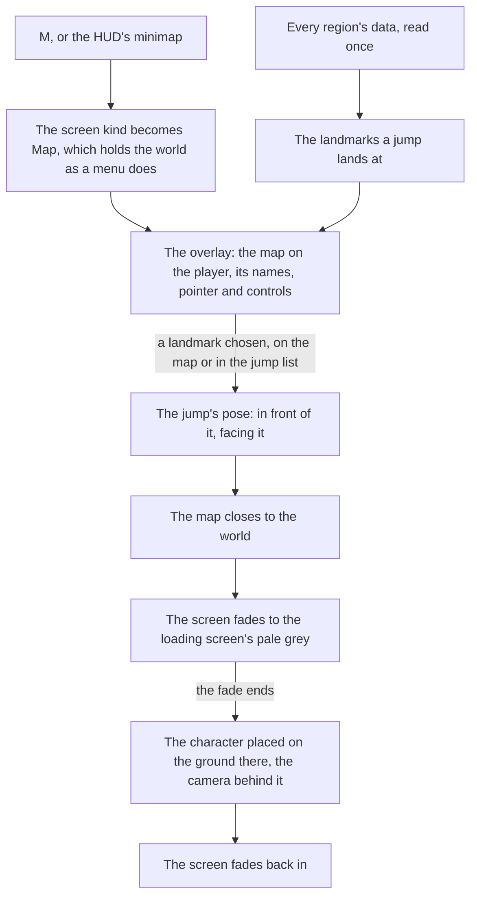

# Map

The game's map opens on M and is how a player crosses the continent: they choose a Teleport Waypoint or a Statue of The Seven and arrive there. The world's map is built the same way. It draws the [world map](../world-map/design.md)'s catalogue rather than any of the game's imagery, and a jump lands the [character](../character-controller/design.md) in front of the landmark chosen.

## How it works

- **One drawing, two views.** `Map/Drawing` draws the outlines of the filled areas and every unlocked landmark a jump lands at ([map unlocking](../map-unlocking/design.md)), in world metres with x east and z south, so north is up. The overlay places it relative to the player and the [minimap](../minimap/design.md) cuts it to a circle round the player, so the two never disagree about what the world holds. Both stand it on one ground, `MAP_GROUND`, where the game paints its terrain. A mark's radius is a share of the extent a view shows, so it is drawn one size at any scale.
- **The overlay is the open map at full screen.** It places the drawing on the player with `MAP_VIEW_METRES` metres across its width, the player's pointer at the place the reference shows it, and the screen's own aspect fills the rest. The view starts at that width and moves from it as the map is panned and zoomed. Each filled area's name sits at the middle of its outline, or of its unlocked landmarks where its outline is not drawn yet, and an area with neither has no name on the map; an area no unlocked statue stands in is blank. The name's size is a share of the same extent, so it reads one size at any scale.
- **The game's chrome sits where the reference puts it.** The close button stands at the top right and the zoom slider down the left, each at its place in the wiki's 1080 high screenshot and drawn in `--unit`. The slider's thumb sits at the zoom the map shows.
- **The map is a screen.** It is the `Map` screen kind, opened by M through the input's `OpenMap` action ([controls](../controls/design.md)) and closed by M, Escape or its own button, as every screen opens and closes ([screens](../screens/design.md)). It holds the world under it as the game's menus do, and the HUD is hidden while it is open.
- **The map pans and zooms.** A drag moves the view by the metres its pixels cover at the zoom shown, and a drag that travels more than `MAP_DRAG_THRESHOLD_PIXELS` is no choice of the landmark it ends on. The wheel zooms by `MAP_WHEEL_ZOOM_SHARE` of the slider's track per wheel unit, and a press or drag on the slider sets the zoom where the pointer is, a place past either end of the track taking that end. The zoom runs on a logarithm from `MAP_VIEW_METRES_MIN` to `MAP_VIEW_METRES_MAX` metres across the width, so each step along the track zooms by the same share of the view. The view is one viewBox from the pan and the zoom, so the names, the marks and the pointer keep their size at any scale.
- **The jump list is for the keyboard and a screen reader.** The game shows no list, so the jumps are a visually hidden list beside the map, each landmark a button carrying its area's name and its kind in the game's own words, grouped under its region's name. The drawing itself is hidden from a screen reader, since the list says everything it jumps to. Focus starts on the overlay's close button.
- **Every region, not only those in reach.** The map shows the whole continent, so `useJumpLandmarks` reads every region's data once, through the same `readRegionData` the world's reach uses, and keeps the landmarks whose kind a jump lands at. A region that fails is logged and left off the map.

## The jump

- **The landmarks a jump lands at.** `JUMP_LANDMARK_KINDS` holds the Statue of The Seven alone today, as the game teleports to its statues and waypoints and nowhere else; a tree is never a jump. Only the unlocked ones are offered, as the world's jump list, the map and a revive are given the unlocked landmarks alone ([map unlocking](../map-unlocking/design.md)). Teleport Waypoints join as a landmark kind of their own once the regions' data holds them.
- **A landmark's name is its area's.** Each statue lights one area, so its area's catalogue name is the name a jump goes by, with no name of its own written anywhere.
- **The pose lands in front, facing back.** `computeJumpPose` stands the arrival a fixed distance in front of the landmark, along the way it faces, at a yaw that looks back at it, so the view arrives on what was jumped to, clear of a statue's plinth. The body stands on the ground's height there, read when the jump lands.
- **The world screen jumps.** `WorldScreen` exposes `jumpTo(pose)` and `readCameraPosition()` to its host. A jump closes the map, fades a veil of the loading screen's pale grey over the screen, and once the fade ends asks `WorldCharacter` to `place` the body at the pose, facing its yaw with the [follow camera](../follow-camera/design.md) level behind it, then fades back in.
- **A near teleport within one region fades through the loading screen as a cross-region one does.** The cross-region clip `captures/yt-UVCdkuNpmf4-world-teleport.mp4` shows the fade through the pale-grey screen; a near teleport's fade is not yet read off a clip.

## Parity

The overlay is scored against two references, each over its interface alone, the terrain the game paints masked out.

- **`map-overlay-jueyun`**, the English client's map on M over Jueyun Karst at 1920 by 1080. The pointer, the close button and the zoom slider are scored as rectangles of the reference's own pixels (`ParityReference.mask`), and the seven area names over their glyphs' silhouettes (`ParityReference.silhouettes`), so the terrain between a name's strokes never counts ([comparison](../parity/compare/design.md)). It scores 56.51% because the names are not drawn: they are Jueyun Karst's subareas, which the catalogue holds no places for, so each silhouette is scored against the page's bare ground.
- **`map-overlay-galesong`**, the English client's map over Galesong Hill at 99% (the still at 4.6 seconds of `captures/yt-kgW2IgWKukg-exploration-steps.mp4`). The label, the name and its progress line, is scored over its glyphs' silhouettes, the mining mark over the name's "n" left out. The game places a label from map data the catalogue does not hold, so the reference's camera stands where Galesong Hill's outline puts the label on the still's. The sizes, the line's place and the white are the still's, and the label scores 7.76% against a bar of 2%: Signika's strokes are the difference left, the game's face being out of reach ([exploration progress](../exploration-progress/design.md)).

## Key files

| File                                                                  | Role                                                                                                                                             |
| :-------------------------------------------------------------------- | :----------------------------------------------------------------------------------------------------------------------------------------------- |
| `packages/genshin-world/src/components/Map/Drawing/Index.vue`         | The one drawing of the catalogue, which both views draw                                                                                          |
| `packages/genshin-world/src/components/Map/Overlay/Index.vue`         | The map on M: the drawing placed on the player, the names, the pointer, the close and zoom chrome, and the Original Resin counter on the top bar |
| `packages/genshin-world/src/components/Map/Overlay/Index.fixture.ts`  | The state the parity page shoots, the player in the Sea of Clouds                                                                                |
| `packages/genshin-world/src/components/Map/JumpList/Index.vue`        | Every jump, grouped by region, as buttons, visually hidden on the overlay                                                                        |
| `packages/genshin-world/src/components/Map/Pointer/Index.vue`         | The player on the map: a disc with a cap pointing the way the view faces                                                                         |
| `packages/genshin-world/src/composables/useJumpLandmarks.ts`          | Every region's landmarks a jump lands at, read once                                                                                              |
| `packages/genshin-world/src/services/map/computeJumpPose.ts`          | Where a jump to a landmark lands, and which way it faces                                                                                         |
| `packages/genshin-world/src/services/map/computeAreaLabels.ts`        | Where each area's name is written                                                                                                                |
| `packages/genshin-world/src/services/map/constants.ts`                | The kinds a jump lands at, the arrival's distance, the view's metres and zoom range, the marks' and names' sizes                                 |
| `packages/genshin-world/src/services/map/computeZoomShare.ts`         | Where a view's metres sit on the zoom slider's track, on a logarithm                                                                             |
| `packages/genshin-world/src/services/map/computeZoomMetresAtShare.ts` | The metres a place on the track shows, clamped at either end                                                                                     |
| `packages/genshin-world/src/services/map/computeWheelZoomMetres.ts`   | The metres after a wheel turn, along the same track                                                                                              |
| `packages/genshin-world/src/components/World/Session/Index.vue`       | Opens the map, fades and places on a jump, and exposes both to its host                                                                          |
| `packages/genshin-world/src/components/World/Character/Index.vue`     | Places the body at a pose, the follow camera level behind it                                                                                     |

## Notes

- **The fade goes through the loading screen, not black.** The game's teleport fades to its loading screen, whose background reads #e9ece9 on the clip's plateau (frame 130 of `yt-UVCdkuNpmf4-world-teleport.mp4`, the screen's emblem, tip and element row above it). The fade draws that background alone, since no component draws the teleport's loading screen yet. The clip is a cross-region teleport, and its durations are read from it: the fade out is 801 ms (48 frames at 60000/1001 a second, from the map's darkness of 176 to the screen's plateau of 21) and the fade in 200 ms (12 frames, from the plateau to the world's darkness of 84), with the plateau held 54 frames. A near teleport's fade is not measured yet ([roadmap](../../../changes/genshin-roadmap/tasks.md)).
- **Its looks are provisional.** The map's colours, the marks, the pointer and the list's look are each marked provisional in their file, until the map's recording is measured ([roadmap](../../../changes/genshin-roadmap/tasks.md)). The zoom's range and the wheel's rate are provisional too, until the `world-map.mkv` recording shows the game's levels at the slider's ends and one notch of its wheel.
- **The map's terrain is not drawn.** The game paints its map as art, and that art is kept out of the repository, so the overlay draws only the catalogue's outlines, each the game's own polygon of its area ([world map](../world-map/design.md)). Its masked score is in Parity above; the terrain and the missing names are the difference, while the chrome is placed from the reference's own pixels.
- **The pointer is off the screen's centre.** The reference shows the player's pointer 45 units right of and 50 under the centre at 1080 high, so the drawing is offset to that place rather than centred on the screen. Provisional until a second map's pointer is read.
- **Not built yet.** The region tag at the bottom right, its exploration progress, the UID line and the domains-only toggle are missing: their words are not in the text dump, so they wait on their text ids rather than being typed by hand. The top bar's floor counter belongs to a feature not yet built, and its resin counter is [Original Resin](../original-resin/design.md)'s, placed provisionally until its recording lands. No reference for the teleport panel has been found, so it is not drawn ([roadmap](../../../changes/genshin-roadmap/tasks.md)).
- **The jump list is hidden, not removed.** It is kept for the keyboard and a screen reader and is not drawn, because the reference shows no list. Whether it should be shown beside the map is a call for the user.
- **The pointer is the overlay's alone.** The minimap marks the character with the game's own arrow and the view with its fan, each placed by the HUD's tree ([minimap](../minimap/design.md)), so `Map/Pointer` is measured off the map's reference only.
- **The arrival is a fixed distance until the game's own arrival points are read.** The game sets a transport point for every statue and waypoint, which the text dump's scene points hold under obfuscated field names; until they are named and fitted, a jump lands a provisional distance in front of the landmark.
- **The fade does not wait on the ground.** A jump far from where the camera stood fades back in as soon as it is placed, and the terrain streams in round it as it does after any flight.

## Sources

- [Teleport Waypoint](https://genshin-impact.fandom.com/wiki/Teleport_Waypoint), Genshin Impact Wiki: fast travel by selecting a waypoint on the map, statues acting as waypoints too.
- [Map](https://genshin-impact.fandom.com/wiki/Map), Genshin Impact Wiki: the map on M, and teleporting from it.
- [Map Stardust in Jueyun](https://genshin-impact.fandom.com/wiki/File:Map_Stardust_in_Jueyun.png), Genshin Impact Wiki: the full-screen map at 1080 high, the reference the chrome and the names are placed against.
- [Game accessibility guidelines](https://gameaccessibilityguidelines.com/full-list/): menus reachable without the play itself.
- `world-teleport.mkv` — a teleport between two waypoints in one area, Teleport pressed at the third second. Found 2026-10-11, a near one: https://www.youtube.com/watch?v=UVCdkuNpmf4 at 0–36 s (`captures/yt-UVCdkuNpmf4-world-teleport.mp4`), the English PC client at 59.94 frames a second by day, no overlay, Teleport pressed at about 22.6 s; it crosses regions, from Mondstadt's map to Inazuma's Asase Shrine, rather than two waypoints of one area. The teleport passes through its loading screen, white by day and dark grey by night, within one area too (https://www.youtube.com/watch?v=pTJFD_rGG3I), so its fade never reaches black, which the fade durations' compute item needs a call on.
