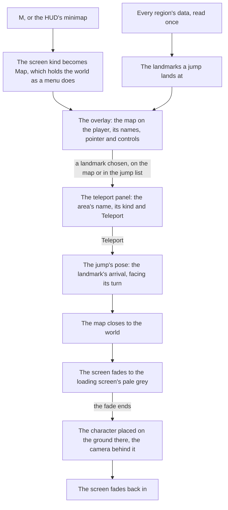

# Map

The game's map opens on M and is how a player crosses the continent: they choose a Teleport Waypoint or a Statue of The Seven and arrive there. The world's map is built the same way. It draws the [world map](../world-map/design.md)'s catalogue rather than any of the game's imagery `packages/genshin-world/src/components/Map/Drawing/Index.vue`, and a jump lands the [character](../character-controller/design.md) where the game lands it at the landmark chosen.

## How it works

- **One drawing, two views.** `Map/Drawing` draws the outlines of the filled areas and every unlocked landmark a jump lands at ([map unlocking](../map-unlocking/design.md)), in the catalogue's own metres. The overlay turns it into the map's frame (below) and places it relative to the player, and the [minimap](../minimap/design.md) cuts it to a circle round the player, so the two never disagree about what the world holds.
- **The frame.** `packages/genshin-world/src/services/map/projectMapPoint.ts` places a catalogue point on the open map: its screen x is its z less the view's centre z, and its screen y is the centre's x less its x, in metres, so the catalogue's x points up the map and its z to the right, a quarter turn with no mirror. `unprojectMapPoint` turns a drag back into the catalogue, and `computeMapFrameTransform` is the same frame as the SVG transform the drawing's own points are turned by. The frame was measured, not assumed: a quarter-turn fit of the six named areas' published positions to the centres of their labels in `map-overlay-jueyun` (Huaguang Stone Forest, Qingyun Peak, Jueyun Karst, Mt. Hulao, Nantianmen, Cuijue Slope) fits about 103 pixels a point, where every other of the eight turns and mirrors fits at 340 pixels or worse, at about 1.17 pixels a catalogue unit, which is 1636 metres across the reference's 1920 pixels. The default view keeps its calibrated 1512 metres until its own measure is taken, since the fit's scale sits within its uncertainty of that. The labels' published positions are provisional placements, so their part of the residual is the placement's, not the frame's. The reference's pointer cap points up at a yaw of none, as the pointer draws it, so its heading turns with the yaw from up. The overlay stands it on `MAP_GROUND` `packages/genshin-world/src/components/Map/Overlay/Index.vue`, where the game paints its terrain, and the [minimap](../minimap/design.md) stands its disc on the terrain's own measured mean colour instead. A mark's radius is a share of the extent a view shows, so it is drawn one size at any scale.
- **The overlay is the open map at full screen.** It places the drawing on the player with `MAP_VIEW_METRES` metres across its width `packages/genshin-world/src/components/Map/Overlay/Index.vue`, the player's pointer at the place the reference shows it, and the screen's own aspect fills the rest. The view starts at that width and moves from it as the map is panned and zoomed. Each filled area's name sits at the middle of its outline `packages/genshin-world/src/services/map/computeAreaLabels.ts`, or of its unlocked landmarks where its outline is not drawn yet, and an area with neither has no name on the map; an area no unlocked statue stands in is blank. The name's size is a share of the same extent, so it reads one size at any scale.
- **The game's chrome sits where the reference puts it.** The close button stands at the top right and the zoom slider down the left, each at its place in the wiki's 1080 high screenshot and drawn in `--unit` `{data-root}/genshin-parity/references/map-overlay-jueyun.png`. The slider's thumb sits at the zoom the map shows.
- **The map is a screen.** It is the `Map` screen kind, opened by M through the input's `OpenMap` action ([controls](../controls/design.md)) and closed by M, Escape or its own button, as every screen opens and closes ([screens](../screens/design.md)) `packages/genshin-world/src/components/World/Session/Index.vue`.
- **The map pans and zooms.** A drag moves the view by the metres its pixels cover at the zoom shown, and a drag that travels more than `MAP_DRAG_THRESHOLD_PIXELS` `packages/genshin-world/src/services/map/constants.ts` is no choice of the landmark it ends on. The wheel zooms by `MAP_WHEEL_ZOOM_SHARE` of the slider's track per wheel unit `packages/genshin-world/src/services/map/computeWheelZoomMetres.ts`, and a press or drag on the slider sets the zoom where the pointer is, a place past either end of the track taking that end. The zoom runs on a logarithm from `MAP_VIEW_METRES_MIN` to `MAP_VIEW_METRES_MAX` metres across the width `packages/genshin-world/src/services/map/computeZoomMetresAtShare.ts`, so each step along the track zooms by the same share of the view. The view is one viewBox from the pan and the zoom, so the names, the marks and the pointer keep their size at any scale.
- **The zoom slider is named by the game's own word.** Its track is a group labelled `Zoom` from the text dump (`GameTextKey.Zoom`) `packages/genshin-world/src/components/Map/Overlay/Index.vue`, so a screen reader names what the slider does, and the slider's ends are the widest and closest views `computeZoomMetresAtShare` `packages/genshin-world/src/services/map/computeZoomMetresAtShare.ts` clamps to. Its ends are not yet read off the English PC map: the captured clip's slider icons and this track's do not yet match, and that waits on a measure taken from `{data-root}/genshin-parity/captures/zoom-ends.mp4`, the English PC clip.
- **A chosen landmark opens its teleport panel, and only its Teleport button jumps.** The panel is the right-hand sidebar the PC clip shows: its header carries the landmark's kind in the game's words beside a close button, its place strip reads the area and its subregion as `{area} - {subregion}` (the dash stays when the subregion is empty, as Ungien's Circle's does in the clip), and Teleport sits full width at its foot `packages/genshin-world/src/components/Map/Overlay/Index.vue`. A drag or a stray click on the map never teleports. Its geometry is measured off `{data-root}/genshin-parity/captures/yt-Mhw53PsdhKI-waypoint.webm`, in the Indonesian client, and its colours are estimated.
- **The jump list is for the keyboard and a screen reader.** The game shows no list, so the jumps are a visually hidden list beside the map, each landmark a button carrying its area's name and its kind in the game's own words, grouped under its region's name `packages/genshin-world/src/components/Map/JumpList/Index.vue`. The drawing itself is hidden from a screen reader `packages/genshin-world/src/components/Map/Overlay/Index.vue`, since the list says everything it jumps to. Focus starts on the overlay's close button `packages/genshin-world/src/components/Map/Overlay/Index.vue`.
- **Every region, not only those in reach.** The map shows the whole continent, so `useJumpLandmarks` `packages/genshin-world/src/composables/useJumpLandmarks.ts` reads every region's data once, through the same `readRegionData` `packages/genshin-world/src/services/world/readLoadedRegion.ts` the world's reach uses, and keeps the landmarks whose kind a jump lands at. A region that fails is logged and left off the map.

## The jump

- **The landmarks a jump lands at.** `JUMP_LANDMARK_KINDS` `packages/genshin-world/src/services/map/constants.ts` holds the Domain Entrance, the Statue of The Seven and the Teleport Waypoint, as the game teleports to its statues, waypoints and domains; a tree is never a jump. Only the unlocked ones are offered, as the world's jump list, the map and a revive are given the unlocked landmarks alone ([map unlocking](../map-unlocking/design.md)). The waypoints are [exploring](../exploring/design.md)'s.
- **A landmark's name is its area's.** Each statue lights one area, so its area's catalogue name is the name a jump goes by, with no name of its own written anywhere.
- **The pose lands at the arrival.** `computeJumpPose` `packages/genshin-world/src/services/map/computeJumpPose.ts` puts the character at the landmark's arrival place, facing the turn the game gives it. The body stands on the ground's height there, read when the jump lands.
- **The world screen jumps.** `WorldScreen` exposes `jumpTo(pose)` and `readCameraPosition()` to its host `packages/genshin-world/src/components/World/Session/Index.vue`. A jump closes the map, fades a veil of the loading screen's pale grey over the screen, and once the fade ends asks `WorldCharacter` `packages/genshin-world/src/components/World/Character/Index.vue` to `place` the body at the pose, facing its yaw with the [follow camera](../follow-camera/design.md) level behind it, then fades back in.
- **A near teleport within one region fades through the loading screen as a cross-region one does.** The cross-region clip `{data-root}/genshin-parity/captures/yt-UVCdkuNpmf4-world-teleport.mp4` shows the fade through the pale-grey screen; a near teleport's fade is not yet read off a clip.

## Parity

The overlay is scored against two references, each over its interface alone, the terrain the game paints masked out.

- **`map-overlay-jueyun`**, the English client's map on M over Jueyun Karst at 1920 by 1080. The pointer, the close button and the zoom slider are scored as rectangles of the reference's own pixels (`ParityReference.mask`), and the seven area names over their glyphs' silhouettes (`ParityReference.silhouettes`), so the terrain between a name's strokes never counts ([comparison](../parity/compare/design.md)). It is scored in its row of `scripts/src/services/genshinParity/shared/ParityReferenceMap.snapshot.md`, because the names are not drawn: they are Jueyun Karst's subareas, which the catalogue holds no places for, so each silhouette is scored against the page's bare ground. The six subareas' published points are their outlines' means, which the reference sets up to 114 metres away, so each name's offset is measured against its reference ink centre (`MAP_SUBAREA_LABEL_OFFSETS` `packages/genshin-world/src/services/map/constants.ts`), a fit to these six by construction. Mt. Aozang has no published point, so it is not drawn. The zoom stays at 1512 metres: the names' placements carry the error the zoom would need to be read through.
- **`map-overlay-galesong`**, the English client's map over Galesong Hill at 99% (the still at 4.6 seconds of `{data-root}/genshin-parity/captures/yt-kgW2IgWKukg-exploration-steps.mp4`). The label, the name and its progress line, is scored over its glyphs' silhouettes, the mining mark over the name's "n" left out. The game places a label from map data the catalogue does not hold, so the reference's camera stands where Galesong Hill's outline puts the label on the still's, at 3024 metres across: the still draws none of the neighbouring subarea names, which the map draws only at 1512 metres and closer, so its view is further out. The one label does not fix that zoom, so 3024 is provisional. The sizes, the line's place and the white are the still's, and the label is scored in its row of `scripts/src/services/genshinParity/shared/ParityReferenceMap.snapshot.md` against the approval bar: Signika's strokes are the difference left, the game's face being out of reach ([exploration progress](../exploration-progress/design.md)).

## Key files

| File                                                                  | Role                                                                                                                                             |
| :-------------------------------------------------------------------- | :----------------------------------------------------------------------------------------------------------------------------------------------- |
| `packages/genshin-world/src/components/Map/Drawing/Index.vue`         | The one drawing of the catalogue, which both views draw                                                                                          |
| `packages/genshin-world/src/components/Map/Overlay/Index.vue`         | The map on M: the drawing placed on the player, the names, the pointer, the close and zoom chrome, and the Original Resin counter on the top bar |
| `packages/genshin-world/src/components/Map/Overlay/Index.fixture.ts`  | The state the parity page shoots, the player in the Sea of Clouds                                                                                |
| `packages/genshin-world/src/components/Map/JumpList/Index.vue`        | Every jump, grouped by region, as buttons, visually hidden on the overlay                                                                        |
| `packages/genshin-world/src/components/Map/Pointer/Index.vue`         | The player on the map: a disc with a cap pointing the way the view faces                                                                         |
| `packages/genshin-world/src/composables/useJumpLandmarks.ts`          | Every region's landmarks a jump lands at, read once                                                                                              |
| `packages/genshin-world/src/services/map/computeJumpPose.ts`          | Where a jump to a landmark lands, and which way it faces                                                                                         |
| `packages/genshin-world/src/services/map/computeAreaLabels.ts`        | Where each area's name is written                                                                                                                |
| `packages/genshin-world/src/services/map/constants.ts`                | The kinds a jump lands at, the view's metres and zoom range, the marks' and names' sizes                                                         |
| `packages/genshin-world/src/services/map/projectMapPoint.ts`          | The map's frame: where a catalogue point stands in the view, x up and z right                                                                    |
| `packages/genshin-world/src/services/map/unprojectMapPoint.ts`        | The frame's inverse, which turns a drag back into the catalogue                                                                                  |
| `packages/genshin-world/src/services/map/computeMapFrameTransform.ts` | The same frame as the SVG transform the drawing is turned by                                                                                     |
| `packages/genshin-world/src/services/map/computeZoomShare.ts`         | Where a view's metres sit on the zoom slider's track, on a logarithm                                                                             |
| `packages/genshin-world/src/services/map/computeZoomMetresAtShare.ts` | The metres a place on the track shows, clamped at either end                                                                                     |
| `packages/genshin-world/src/services/map/computeWheelZoomMetres.ts`   | The metres after a wheel turn, along the same track                                                                                              |
| `packages/genshin-world/src/components/World/Session/Index.vue`       | Opens the map, fades and places on a jump, and exposes both to its host                                                                          |
| `packages/genshin-world/src/components/World/Character/Index.vue`     | Places the body at a pose, the follow camera level behind it                                                                                     |

## Notes

- **The fade goes through the loading screen, not black.** The game's teleport fades to its loading screen, whose background is the pale grey of the clip's plateau (the screen's emblem, tip and element row above it). The fade draws that background alone, since no component draws the teleport's loading screen yet. It runs over `TELEPORT_FADE_OUT_MS` and `TELEPORT_FADE_IN_MS` `packages/genshin-world/src/components/World/Session/Index.vue`. The clip is a cross-region teleport, and its durations are read from it: the fade out is `TELEPORT_FADE_OUT_MS` and the fade in `TELEPORT_FADE_IN_MS`, both in `packages/genshin-world/src/services/map/constants.ts`, with the plateau held between them. A near teleport's fade is not measured yet ([roadmap](../../../changes/genshin-roadmap/tasks.md)).
- **Its looks are provisional.** The map's colours, the marks, the pointer and the list's look are each marked provisional in their file `packages/genshin-world/src/components/Map/Drawing/Index.vue` `packages/genshin-world/src/components/Map/JumpList/Index.vue` `packages/genshin-world/src/components/Map/Pointer/Index.vue` `packages/genshin-world/src/components/Map/Overlay/Index.vue`, until the map's recording is measured ([roadmap](../../../changes/genshin-roadmap/tasks.md)). The zoom's range and the wheel's rate are provisional too, until the `world-map.mkv` recording shows the game's levels at the slider's ends and one notch of its wheel.
- **The map's terrain is not drawn.** The game paints its map as art, and that art is kept out of the repository, so the overlay draws only the catalogue's outlines `packages/genshin-world/src/data/catalogue.json`, each the game's own polygon of its area ([world map](../world-map/design.md)).
- **The pointer is off the screen's centre.** The reference shows the player's pointer 45 units right of and 50 under the centre at 1080 high `packages/genshin-world/src/components/Map/Overlay/Index.vue`, so the drawing is offset to that place rather than centred on the screen. Provisional until a second map's pointer is read.
- **Not built yet.** The region tag at the bottom right is built, with its area's name and exploration progress `packages/genshin-world/src/components/Map/Overlay/Index.vue`, placed from the PC clip's frame. The teleport panel's body, the mark's description, is not built, and nor are the pin and F glyphs on its Teleport button. The UID line is missing, since its words are not yet found. The domains-only switch is drawn at the bottom left, off, from the reference's own place, with its words `GameTextKey.DomainsOnly` (`UI_ABYSSUS_MAP_INFO_SWITCH`), and its filter is not built yet. The top bar's floor counter belongs to a feature not yet built, and its resin counter, [Original Resin](../original-resin/design.md), reads through `regenerateOriginalResin` `packages/genshin-world/src/components/Map/Overlay/Index.vue`, placed provisionally until its recording lands. The panel's header, place strip and Teleport button are drawn from the Indonesian clip above, and its body waits on a reference that shows it ([roadmap](../../../changes/genshin-roadmap/tasks.md)).
- Whether the jump list should be shown beside the map is a call for the user.
- **The minimap still draws the catalogue unturned.** The overlay's frame turns the drawing a quarter turn, but `Hud/Minimap` draws the same `Drawing` as the catalogue holds it, with x to the right and z down. Until the minimap's own orientation is read off a recording, the two views disagree on which way x points.
- **The pointer is the overlay's alone.** The minimap marks the character with the game's own arrow at its centre and the view with its fan, each placed by the HUD's tree ([minimap](../minimap/design.md)) `packages/genshin-world/src/components/Hud/Minimap/Index.vue`, so `Map/Pointer` `packages/genshin-world/src/components/Map/Pointer/Index.vue` is measured off the map's reference only.
- **The fade does not wait on the ground.** A jump far from where the camera stood fades back in as soon as it is placed `packages/genshin-world/src/components/World/Session/Index.vue`, and the terrain streams in round it as it does after any flight.

## Sources

- [Teleport Waypoint](https://genshin-impact.fandom.com/wiki/Teleport_Waypoint), Genshin Impact Wiki: fast travel by selecting a waypoint on the map, statues acting as waypoints too.
- [Map](https://genshin-impact.fandom.com/wiki/Map), Genshin Impact Wiki: the map on M, and teleporting from it.
- [Map Stardust in Jueyun](https://genshin-impact.fandom.com/wiki/File:Map_Stardust_in_Jueyun.png), Genshin Impact Wiki: the full-screen map at 1080 high, the reference the chrome and the names are placed against.
- [Game accessibility guidelines](https://gameaccessibilityguidelines.com/full-list/): menus reachable without the play itself.
- `{data-root}/genshin-parity/captures/yt-UVCdkuNpmf4-world-teleport.mp4` — a teleport from Mondstadt's map to Inazuma's Asase Shrine: https://www.youtube.com/watch?v=UVCdkuNpmf4 at 0–36 s, the English PC client at 59.94 frames a second by day, no overlay, Teleport pressed at about 22.6 s. The teleport passes through its loading screen, white by day and dark grey by night, within one area too (https://www.youtube.com/watch?v=pTJFD_rGG3I), so its fade never reaches black, which the fade durations' compute item needs a call on.
- `{data-root}/genshin-parity/captures/yt-Mhw53PsdhKI-waypoint.webm` — the teleport panel of a chosen waypoint (https://www.youtube.com/watch?v=Mhw53PsdhKI, about 120–135 s): the PC client in Indonesian at 60 frames a second, with the panel's sidebar read off its frames. Its words are not English. The zoom slider's ends on the English PC map are found as `{data-root}/genshin-parity/captures/zoom-ends.mp4` (a near match), though they are not yet read off it.

## Open

- [ ] **Map: the zoom slider's icons in the English clip and on this track do not yet match** — no source yet: a measure of `{data-root}/genshin-parity/captures/zoom-ends.mp4` and of this track, neither read yet.
- [ ] **Map: the loading screen's background reads #e9ece9 on the clip's plateau at frame 130** — no source yet: a colour read of that frame, which no record holds.
- [ ] **Map: a near teleport within one region fades through the loading screen as a cross-region one does** — no source yet: a clip of a near teleport's fade on disk; the cited near clip is not in the captures.
- [ ] **Map: a landmark's jump goes by its area's catalogue name, with no name of its own written anywhere** — no source yet: a check that the jump list reads the area name, since `useJumpLandmarks` names no landmark.
- [ ] **The overlay stands the drawing on `MAP_GROUND`, where the game paints its terrain** — no source yet: the game's terrain on the Map, in `{data-root}/genshin-parity/references/map-overlay-jueyun.png`, not yet compared with the drawing's ground.
- [ ] **The map is the `Map` screen kind, holding the world under it as the game's menus do, with the HUD hidden while it is open** — no source yet: the wiki's Map page, not in the wiki cache, calls the map the Map Menu, opened from the minimap or the Paimon Menu, and says nothing of the world held under it or of the HUD; the HUD's hiding is not yet read against a recording.
- [ ] **The zoom slider's track reads `Zoom` in the game's text** — no source yet: the `Zoom` text id's string in `{data-root}/genshin-parity/text/TextMapEN.json`, not yet looked up.
- [ ] **The game teleports to nowhere else than its statues, waypoints and domains** — no source yet: the wiki's Map page, not in the wiki cache, lists Teleport Waypoints, Statues of The Seven, Domains and certain locations as the places teleported to, so the certain locations are what is left open; the Teleport Waypoint page, which names them under Significant Locations, is not in the wiki cache.
- [ ] **A jump faces the turn the game gives the arrival** — no source yet: the scene point of Mondstadt's waypoint 1865 (x 1987, z -739), since point 1865 of `{data-root}/genshin-parity/text/BinOutput/Scene/Point/scene3_point.json` sits at x 3877 and is not that point.
- [ ] **The veil is the loading screen's pale grey** — no source yet: a recording of the game's teleport fade, not yet captured, would name its colour.
- [ ] **Each outline is the game's own polygon of its area** — no source yet: the wiki's Map page, not in the wiki cache, describes its markers and its layers but no area's outline; the outlines in `packages/genshin-world/src/data/catalogue.json` are not yet checked against the game's polygons.
- [ ] **The reference shows the player's pointer 45 units right of and 50 under the centre at 1080 high** — no source yet: `{data-root}/genshin-parity/references/map-overlay-jueyun.png`, not yet measured at 1080 high.
- [ ] **The top bar's resin counter is placed where the game places it** — no source yet: a recording of the game's top bar, not yet captured, would settle its placement.
- [ ] **The arrow and the fan are the game's own** — no source yet: a recording of the game's minimap, not yet captured, would settle the arrow's and the fan's look.
- [ ] **The pointer's measures come from the map's reference alone** — no source yet: `{data-root}/genshin-parity/references/map-overlay-jueyun.png` is not yet checked against the pointer's other measures.
- [ ] **A jump far from where the camera stood fades back in as soon as it is placed** — no source yet: the teleport fade's `faded` binding to the jump pose in `packages/genshin-world/src/components/World/Session/Index.vue` is not yet read against the far-from-camera condition.
