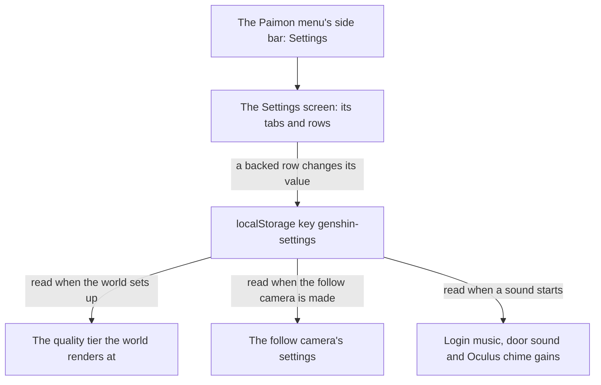

# Menu Settings screen

The Settings screen the [Paimon menu](../paimon-menu/design.md)'s side bar opens over the world. Its tabs and rows are drawn as the English PC client's settings draw them, from the recording `yt-5EmJX_RyuY8-menu-settings`. The rows the world backs change what the world does and are kept on the player's device; every other row is drawn disabled at the value the recording shows. The camera rows feed the [follow camera](../follow-camera/design.md), the quality tier feeds the [rendering style](../rendering-style/design.md), and the labels come from [game text](../game-text/design.md).

## How it works

- **The world holds the settings and gives the screen its slot.** The world keeps one reactive copy of the key, started from the host's defaults, and passes it to the screen as a model. The screen writes a new object on each change, and the copy writes it back to the key. The key is written on a change, not at start.
- **One list is open at a time.** The Graphics Quality and Game Language rows each open a list. Opening one replaces the other, and a change of tab closes it.

## Rows

- **Graphics Quality** opens a list of Low, Medium and High. The tier the host passes in is marked with the game's default wording, and the row shows the chosen tier.
- **Volume, Music Volume and SFX Volume** each run from 1 to 10 in whole levels. A pointer drag across the track snaps to the nearest level and stops at either end, and the arrow keys step one level. The Volume row is the overall level that scales the two channels.
- **Horizontal and Vertical Sensitivity** run from 1 to 5 in steps of 1. **Default Camera Distance** runs from 4.5 to 6.0 in steps of 0.1. All three are sliders with the same snapping as the volumes.
- **Camera Y-Axis Resets Automatically** is a switch that flips between On and Off on a click. It starts Off.
- **Game Language** opens a list of the game's languages, each under its own name, with the chosen one marked. Choosing one loads that language's game text and relabels the Settings screen only; the world keeps the reader's language.
- **Key Bindings** shows the Actions keys as key caps, with the mouse buttons written Left Click and Right Click. The action labels are game text and the keys are literal text. None can be rebound.
- **Disabled rows.** The Controls tab's aimed sensitivities, combat camera, boat camera correction and control type; the Audio tab's Dialogue Volume, drawn at 10, and its other options; the Graphics tab's display mode, brightness and other rows; and the Language tab's voice-over row. Each shows the value the recording shows and cannot be changed. The Messages, Account, Resources and Other tabs have no rows, so the side bar draws them disabled.

## Storage and reads

- One key, `genshin-settings`, holds one JSON object of the settings' fields: the language, the quality tier, the three volume levels, the two sensitivities, the default distance and the slope pitch.
- A read parses the text and checks the object against one schema, whose ranges are the constants' ranges. Text that does not parse is logged. An object the schema refuses is read as no stored settings, so the whole object falls back to the defaults. A missing field takes its own default.
- The defaults are the constants': the quality tier High, the three volumes at 10, English, and the follow camera's provisional camera values. The world starts from the host's language and tier instead.
- Systems that start outside the screen take a one-off read of the key with no listening for changes: the follow camera, the login's music and door sound, and the Oculus chime. They use the constants' defaults, not the host's.

## Decisions

- **Volumes are linear shares of the overall Volume, provisional.** A channel plays at its level's share of ten, times the overall level's share of ten. The wiki gives each range but not the curve between its levels. `getChannelGain` owns the rule.
- **A chosen tier applies from the next world start.** The world reads the tier once at setup, since its renderer and grass take it then. The row shows the chosen tier in the meantime.
- **The language changes the Settings screen's labels only.** Each language's text loads when it is chosen and is kept only while it is still the choice.
- **Sounds take their gains as they start.** The login's music bus is set at its mount, the door sound's bus likewise, and each Oculus chime reads the sound-effect gain when it plays. A change reaches the next sound that starts.
- **The follow camera is made once per character mount.** It reads the camera settings on the first followed frame and is not made again while that mount lasts. The character is mounted only while no witness holds it and locomotion is on, so a change reaches the camera when the character next mounts.
- **The Controls tab's defaults are the follow camera's values.** Distance 5, both sensitivities 3 and the Y-axis reset off, until the game's own Controls values replace them.

## Notes

- **Provisional values.** The volume curve, the distance's 0.1 step, the aimed sensitivities drawn at 3, the Dialogue Volume drawn at 10 and the anisotropic filtering written "8x" in every language are each marked provisional where they are set.
- **Defaults and recorded values are kept apart.** The backed camera rows start at the follow camera's values. The recording's values are drawn only on the disabled rows.

## Key files

| File                                                                   | Role                                                                   |
| :--------------------------------------------------------------------- | :--------------------------------------------------------------------- |
| `packages/genshin-world/src/components/Menu/Settings/Index.vue`        | The tabs, rows, lists and sliders, drawn and driven                    |
| `packages/genshin-world/src/services/menu/SettingsTabSectionsMap.ts`   | Each tab's rows, backed or drawn disabled, with the recording's values |
| `packages/genshin-world/src/services/menu/constants.ts`                | The tabs, ranges, storage key, defaults and the tiers the list offers  |
| `packages/genshin-world/src/services/menu/readGenshinSettings.ts`      | Reads the stored text over the defaults                                |
| `packages/genshin-world/src/services/menu/genshinSettingsSchema.ts`    | The schema the stored object is checked against                        |
| `packages/genshin-world/src/composables/useStoredGenshinSettings.ts`   | The reactive copy of the key, read through `readGenshinSettings`       |
| `packages/genshin-world/src/services/menu/getChannelGain.ts`           | The gain a music or sound-effect channel plays at                      |
| `packages/genshin-world/src/services/menu/getStoredChannelGain.ts`     | That gain read from the key, for sounds that start outside the screen  |
| `packages/genshin-world/src/services/menu/getStoredGenshinSettings.ts` | The settings read once from the key                                    |
| `packages/genshin-world/src/services/menu/getFollowCameraSettings.ts`  | The camera's four settings taken from the stored object                |
| `packages/genshin-world/src/services/menu/snapToRange.ts`              | Holds a slider's value to its range's steps and limits                 |
| `packages/genshin-world/src/models/menu/`                              | The row kinds, and the settings a row names by key                     |
| `packages/genshin-world/src/components/World/Session/Index.vue`        | The settings copy, the tier read at setup and the screen's slot        |
| `packages/genshin-world/src/components/World/Character/Index.vue`      | The follow camera, made from the stored camera settings                |
| `packages/genshin-world/src/components/Login/Music/Index.vue`          | The login's music and door sound, through the stored gains             |
| `packages/genshin-world/src/services/statue/playOculusSound.ts`        | The Oculus chime, through the stored sound-effect gain                 |
| `packages/genshin-engine/src/renderer/QualityTierSettingsMap.ts`       | The renderer's settings for each tier                                  |
| `packages/genshin-engine/src/camera/constants.ts`                      | The follow camera's default settings                                   |
| `packages/genshin-text/src/models/GameLanguage.ts`                     | The fifteen game languages                                             |

## Sources

- [Settings](https://genshin-impact.fandom.com/wiki/Settings), Genshin Impact Wiki: the graphics quality, the volumes from 1 to 10, the camera's ranges, the game's languages and settings kept per device.
- [Controls](https://genshin-impact.fandom.com/wiki/Controls), Genshin Impact Wiki: the Basic Settings' default keys for the Actions list, the PC column.
- [Genshin Impact PC Settings & Controls](https://www.youtube.com/watch?v=5EmJX_RyuY8), Magic Game World on YouTube (`{data-root}/genshin-parity/captures/yt-5EmJX_RyuY8-menu-settings.mp4`): the English PC client's settings, the rows' places and values, as the code's comments record them.
