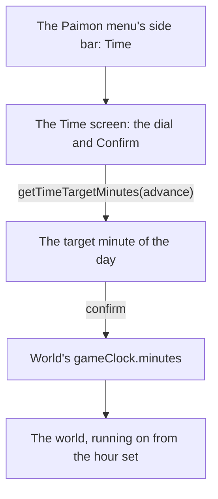

# Menu Time screen

The Time screen the Paimon menu's side bar opens (`packages/genshin-world/src/components/Menu/Time/Index.vue`), laid out as the English PC client's Time screen draws it in the `menu-time` reference: the frame at ten seconds of `yt-a4_J84iMqR0`, cut at 1920 by 1080 from a controller's capture. It builds on the [menu screens](../screens/design.md) shell, on the [sky and time](../sky-and-time/design.md) clock whose hour it sets, and on the [Paimon menu](../paimon-menu/design.md) that opens it.

## How it works

- **The advance is bounded to thirty minutes through two days, and never goes back.** `clampTimeAdvance` (`packages/genshin-world/src/services/menu/clampTimeAdvance.ts`) keeps it between `TIME_MINIMUM_ADVANCE_MINUTES` and `TIME_MAXIMUM_ADVANCE_MINUTES` (`packages/genshin-world/src/services/menu/constants.ts`). `getTimeTargetMinutes` (`packages/genshin-world/src/services/menu/getTimeTargetMinutes.ts`) returns the target's minute of the day from that advance, wrapping past midnight, and `getTimeTargetDaysAhead` (`packages/genshin-world/src/services/menu/getTimeTargetDaysAhead.ts`) counts the days the target falls past the clock's own day from the same clamped advance.
- **The dial counts whole turns as days, and keeps its advance within the bounds as the pointer turns it.** `stepTimeDialAdvance` adds the shorter turn the pointer makes, a full turn being a day, and clamps the result, so a drag back past thirty minutes moves the hand again as soon as the pointer comes forward (`packages/genshin-world/src/components/Menu/Time/Dial/Index.vue`).
- **Confirm sets the world's clock, and only Confirm does.** The screen emits `confirm` with the target. `World/Windrise` exposes `gameClock`, and `World/Session` sets its `minutes` and closes back to the world (`packages/genshin-world/src/components/World/Session/Index.vue`). Closing without confirming leaves the clock as it was, and `heldMinutes`, which holds the clock still for a reference's frame, is never written.
- **Its words are the game's own.** The clock's time sits under "Current Time" and the hour the dial points at under "Wait Until". The day beneath that hour is the game's word for how many days on it falls: "Today" while it falls on the clock's own day, "Tomorrow" once it passes midnight, and "Day After Tomorrow" two days on (`getTimeDayLabelKey` in `packages/genshin-world/src/services/menu/getTimeDayLabelKey.ts`, over `GameTextKey.TimeToday`, `TimeTomorrow` and `TimeDayAfterTomorrow`, the keys `UI_TIMECHANGE_TODAY`, `UI_TIMECHANGE_TOMORROW` and `UI_TIMECHANGE_AFTERTOMORROW`). Confirm is the English word the controller capture's hint also shows. The fixture draws the screen at `tomorrow` and `dayAfterTomorrow` as well, each shot as its own image; the references hold no game still of either, so their parity entries are pending.
- **The reference is scored over a mask that leaves out three controls.** The `menu-time` entry (`scripts/src/services/genshinParity/shared/ParityReferenceMap.ts`) is a backdrop, with the frame's dial and column of words filled from round them by `plate`, the dial seeded at 848 minutes by `props`, and a `mask` of ten rectangles that tile the rest of the frame exactly. Over that mask `compare menu-time` reads 0.70% against its 1% bar, with FLIP 0.0304 and shape 0.895 (`scripts/src/services/genshinParity/shared/ParityReferenceMap.snapshot.md`). The worst cells are the dial's right rim, column 4 of the six by six grid at rows 2 and 3, which the frame draws brighter than the flat disc the component draws.

## Deviations

The capture is a controller's. At seven to nine seconds the game draws its button hints at the bottom right ("L Time", "X Confirm", "O Return") while the hour turns; at ten seconds the hints are gone and the frame shows no title, close cross or Confirm pill. The screen draws three pointer controls the frame does not show, so the mask leaves them out of the score and they are listed here as input-mode deviations, not parity gaps:

1. **The Confirm pill**, a `GameButton` of the Pill kind at 810, 880, 300 by 72 units. A pointer has no other way to confirm at rest, so the pill stays; gating it to the dial's input would leave Confirm unreachable by pointer.
2. **The title**, "Time", drawn by `ScreenHeader` across the top left.
3. **The close cross**, the `ScreenHeader`'s close disc at 1814, 19, 58 by 58 units.

One gap is not a deviation and stays open: the dial's gear art is hand-drawn as a flat disc, since the install's extraction names no asset for the Time dial.

## Key files

| File                                                                 | Role                                                                             |
| :------------------------------------------------------------------- | :------------------------------------------------------------------------------- |
| `packages/genshin-world/src/components/Menu/Time/Index.vue`          | The screen: the dial, the hour, its day word and the Confirm pill                |
| `packages/genshin-world/src/services/menu/clampTimeAdvance.ts`       | The advance's bounds, shared by the target and the dial                          |
| `packages/genshin-world/src/services/menu/getTimeTargetMinutes.ts`   | The target minute of the day from the clock and the advance                      |
| `packages/genshin-world/src/services/menu/getTimeTargetDaysAhead.ts` | The days the target falls past the clock's day: today, tomorrow or the day after |
| `packages/genshin-world/src/components/World/Windrise/Index.vue`     | Exposes `gameClock`, the minute the Time screen sets                             |
| `scripts/src/services/genshinParity/shared/ParityReferenceMap.ts`    | The `menu-time` entry: its backdrop, plate, props and mask                       |

## Sources

- [Time](https://genshin-impact.fandom.com/wiki/Time), Genshin Impact Wiki: one in-game minute a second, the Time option advancing from half an hour to two days ahead, and the clock paused in the menu but not in photo mode.
