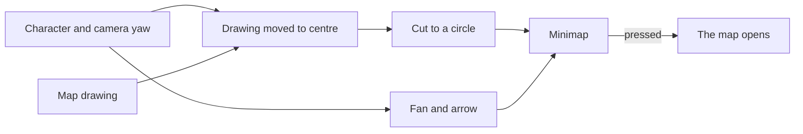

# Minimap

In the world, the game keeps a small round map in the top left of its heads-up display (`{data-root}/genshin-parity/references/hud-world-keys.png`), so they know where they stand without opening the full [map](../map/design.md). The world's minimap is that map's own drawing, viewed close round the character (`packages/genshin-world/src/components/Hud/Minimap/Index.vue`).

## How it works

- **The map's drawing, not a second one.** `packages/genshin-world/src/components/Hud/Minimap` draws `packages/genshin-world/src/components/Map/Drawing` with the unlocked landmarks the map holds (`packages/genshin-world/src/components/Hud/Minimap/Index.vue`), so a landmark the map gains, or an area a statue fills in, appears on the minimap with no change of its own ([map unlocking](../map-unlocking/design.md)).
- **North stays up.** The drawing is only moved, so the character's ground point sits at the centre, and never turned (`packages/genshin-world/src/components/Hud/Minimap/Index.vue`): on the English PC client's world HUD and the Chinese client's recording over open sea alike, the N holds the top of the rim while the fan and the arrow turn (`{data-root}/genshin-parity/references/hud-world-keys.png`, and that recording [as the character controller cites it](../character-controller/design.md) at 492 seconds). The circle shows `MINIMAP_RADIUS` metres each way (`packages/genshin-world/src/services/map/constants.ts`).
- **The tree places every piece.** The back fills `GrpBackMap`'s rect (`packages/genshin-world/src/models/hud/HudInterfaceRectName.ts`), and the marks stand in `GrpMap`'s, which the game scales by 0.6 (`{data-root}/genshin-parity/extracted/character/interface/json/GameObject/GrpMap.json`) about its corner: `MarkSouth`'s `ImgSouth`, which the game names its south and draws as an N, five units under the top of a circle 24 units in from the group's edge; `MarkSightFan`, scaled by 1.25 (`{data-root}/genshin-parity/extracted/character/interface/json/GameObject/MarkSightFan.json`) about its foot at the centre; and `MarkLocalAvatar` at the centre. The stills agree with the tree: the rim's ring stands 107 pixels from the centre at 1080 high, `GrpBackMap`'s half of 180 units at the 1.2 pixels a unit spans there.
- **The fan is the view, the arrow is the character.** The fan, a quarter turn wide, turns with the camera's yaw, and the cyan arrow at the centre with the way the character faces, so a character walking toward the camera points its arrow down (`packages/genshin-world/src/components/Hud/Minimap/Index.vue`).
- **Read once a frame, handed on when it moves.** The world screen reads the character's body's ground point in world metres, the camera's yaw and the body's facing once a frame, and hands the HUD a new reading only when one of them moved, so a still player re-renders nothing (`packages/genshin-world/src/components/World/Session/Index.vue`).
- **One button.** The minimap is a button named for the map in the game's words (`{data-root}/genshin-parity/text/TextMap/TextMap_MediumEN.json`, key `3866697167` reads "Map", and `{data-root}/genshin-parity/text/ExcelBinOutput/ManualTextMapConfigData.json`, `UI_STC_MAP_TITLE`); pressing it opens the map, as M does (`packages/genshin-engine/src/input/InputActionBindingMap.ts`, `OpenMap` on `KeyM`). The drawing inside it is hidden from a screen reader and takes no pointer of its own (`packages/genshin-world/src/components/Hud/Minimap/Index.vue`).

## Key files

| File                                                            | Role                                                                                 |
| :-------------------------------------------------------------- | :----------------------------------------------------------------------------------- |
| `packages/genshin-world/src/components/Hud/Minimap/Index.vue`   | The drawing cut to a circle round the character, north up, and its marks             |
| `packages/genshin-world/src/components/Map/Drawing/Index.vue`   | The one drawing it shares with the map                                               |
| `packages/genshin-world/src/models/hud/HudInterfaceRectName.ts` | The tree's rects its back and its marks stand in                                     |
| `packages/genshin-world/src/services/map/constants.ts`          | The metres it shows, and the marks' share of them                                    |
| `packages/genshin-world/src/components/World/Session/Index.vue` | Reads the character's ground point, the view's yaw and the character's facing for it |

## Notes

- **What is measured, and what stands in.** Its size and every mark's place are the tree's. Its thin light ring, the drawing's fade over the rim's outer sixth (`packages/genshin-world/src/components/Hud/Minimap/Index.vue`, the mask's 84% to 96%), the fan's white and the arrow's cyan are measured at 1080 high on the references below. The N's serif capital and the arrow's notched head are written from their measures (`packages/genshin-world/src/components/Hud/Minimap/Index.vue`), since the recordings draw them too small to trace, and the metres it shows are not yet read. The terrain is the game's painted art (`{data-root}/genshin-parity/extracted/maps/index.tsv`), kept out of the repository, so the disc stands on that terrain's mean colour, `rgb(111 135 94)`, while the overlay still stands on the map's own ground, `MAP_GROUND` (`packages/genshin-world/src/services/map/constants.ts`, `packages/genshin-world/src/components/Map/Overlay/Index.vue`). Each of these is marked provisional in its file.

## Sources

- [Map](https://genshin-impact.fandom.com/wiki/Map), Genshin Impact Wiki: the minimap in the top left of the HUD, opening the map.

## Reference

- `{data-root}/genshin-parity/references/hud-world-keys.png` and `{data-root}/genshin-parity/references/hud-stamina-climb.png` — the English PC client's world HUD at 1080 high, the [HUD](../hud/design.md)'s references, which show the ring over olive ground and over a flat sky.
- The Chinese client's play [as the character controller cites it](../character-controller/design.md), its minimap over open sea from 488 to 496 seconds, where the fan, the ring, the fill and the N are each read on a flat ground.
- `{data-root}/genshin-parity/captures/oculus-minimap.mkv` — walking in on an Anemoculus in Mondstadt from its far side until the minimap marks it, and the moment its sound plays, 30 seconds at most; the distance at which the mark shows and the sound's start are read from it. The sound's start is read by the [audio pass](../sound-effects/design.md). The distance at which the mark shows stays on the recording. On the wiki and YouTube, none found (searched 2026-10-11).

## Open

- [ ] **The marks' pivots, MarkSouth's inset and GrpBackMap's 180-unit half in the game's tree** — no source yet: the held records (`{data-root}/genshin-parity/extracted/character/interface/json/`) carry each mark's position and scale, but no pivot and no rect size.
- [ ] **The stills agree with the tree: the ring 107 pixels from the centre at 1080 high, 1.2 pixels a unit; and the thin light ring, the fan's white, the arrow's cyan, and the N's and arrow's measures at 1080 high** — no source yet: a pixel reading of the 1080-high still and references, which this pass did not take.
- [ ] **The fan a quarter turn wide** — no source yet: the game's sight-fan image width from the tree, which this machine does not hold; `packages/genshin-world/src/components/Hud/Minimap/Index.vue` calls it a quarter turn, but its clip-path cuts about 72 degrees from a square box.
- [ ] **The back stands where the game's tree places it** — no source yet: the fitted `GrpBackMap` rect, held only in the published game data, to set against the tree's `RectTransform#323865` (`RectTransform#323865.json` in the interface JSON [interface-layout](../interface-layout/design.md) reads, local 139.99997 by -104.000015 under its parent).
