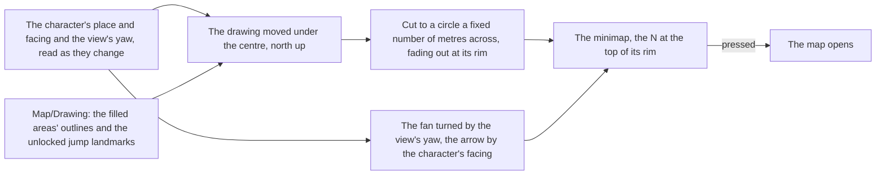

# Minimap

In the world, the game keeps a small round map in the top left of its heads-up display, so they know where they stand without opening the full [map](../map/design.md). The world's minimap is that map's own drawing, viewed close round the character.

## How it works

- **The map's drawing, not a second one.** `Hud/Minimap` draws `Map/Drawing` with the unlocked landmarks the map holds, so a landmark the map gains, or an area a statue fills in, appears on the minimap with no change of its own ([map unlocking](../map-unlocking/design.md)).
- **North stays up.** The drawing is only moved, so the character's ground point sits at the centre, and never turned: on the English PC client's world HUD and the Chinese client's recording over open sea alike, the N holds the top of the rim while the fan and the arrow turn. The circle shows `MINIMAP_RADIUS` metres each way.
- **The tree places every piece.** The back fills `GrpBackMap`'s rect, and the marks stand in `GrpMap`'s, which the game scales by 0.6 about its corner: `MarkSouth`'s `ImgSouth`, which the game names its south and draws as an N, five units under the top of a circle 24 units in from the group's edge; `MarkSightFan`, scaled by 1.25 about its foot at the centre; and `MarkLocalAvatar` at the centre. The stills agree with the tree: the rim's ring stands 107 pixels from the centre at 1080 high, `GrpBackMap`'s half of 180 units at the 1.2 pixels a unit spans there.
- **The fan is the view, the arrow is the character.** The fan, a quarter turn wide, turns with the camera's yaw, and the cyan arrow at the centre with the way the character faces, so a character walking toward the camera points its arrow down.
- **Read once a frame, handed on when it moves.** The world screen reads the character's body's ground point in world metres, the camera's yaw and the body's facing once a frame, and hands the HUD a new reading only when one of them moved, so a still player re-renders nothing.
- **One button.** The minimap is a button named for the map in the game's words; pressing it opens the map, as M does. The drawing inside it is hidden from a screen reader and takes no pointer of its own.

## Key files

| File                                                            | Role                                                                                 |
| :-------------------------------------------------------------- | :----------------------------------------------------------------------------------- |
| `packages/genshin-world/src/components/Hud/Minimap/Index.vue`   | The drawing cut to a circle round the character, north up, and its marks             |
| `packages/genshin-world/src/components/Map/Drawing/Index.vue`   | The one drawing it shares with the map                                               |
| `packages/genshin-world/src/models/hud/HudInterfaceRectName.ts` | The tree's rects its back and its marks stand in                                     |
| `packages/genshin-world/src/services/map/constants.ts`          | The metres it shows, and the marks' share of them                                    |
| `packages/genshin-world/src/components/World/Session/Index.vue` | Reads the character's ground point, the view's yaw and the character's facing for it |

## Notes

- **What is measured, and what stands in.** Its size and every mark's place are the tree's. Its thin light ring, the drawing's fade over the rim's outer sixth, the fan's white and the arrow's cyan are measured at 1080 high on the references below. The N's serif capital and the arrow's notched head are written from their measures, since the recordings draw them too small to trace, and the metres it shows are not yet read. The terrain is the game's painted art, kept out of the repository, so the drawing stands on the map's own ground, `MAP_GROUND`, as the overlay's does. Each of these is marked provisional in its file.

## Sources

- [Map](https://genshin-impact.fandom.com/wiki/Map), Genshin Impact Wiki: the minimap in the top left of the HUD, opening the map.

## Reference

- `hud-world-keys.png` and `hud-stamina-climb.png` — the English PC client's world HUD at 1080 high, the [HUD](../hud/design.md)'s references, which show the ring over olive ground and over a flat sky.
- `bili-av251752644-stamina.mp4` — the Chinese client's play, its minimap over open sea from 488 to 496 seconds, where the fan, the ring, the fill and the N are each read on a flat ground.
- `oculus-minimap.mkv` — walking in on an Anemoculus in Mondstadt from its far side until the minimap marks it, and the moment its sound plays, 30 seconds at most; the distance at which the mark shows and the sound's start are read from it. The sound's start is replaced by the audio pass. The distance at which the mark shows stays on the recording. On the wiki and YouTube, none found (searched 2026-10-11).
