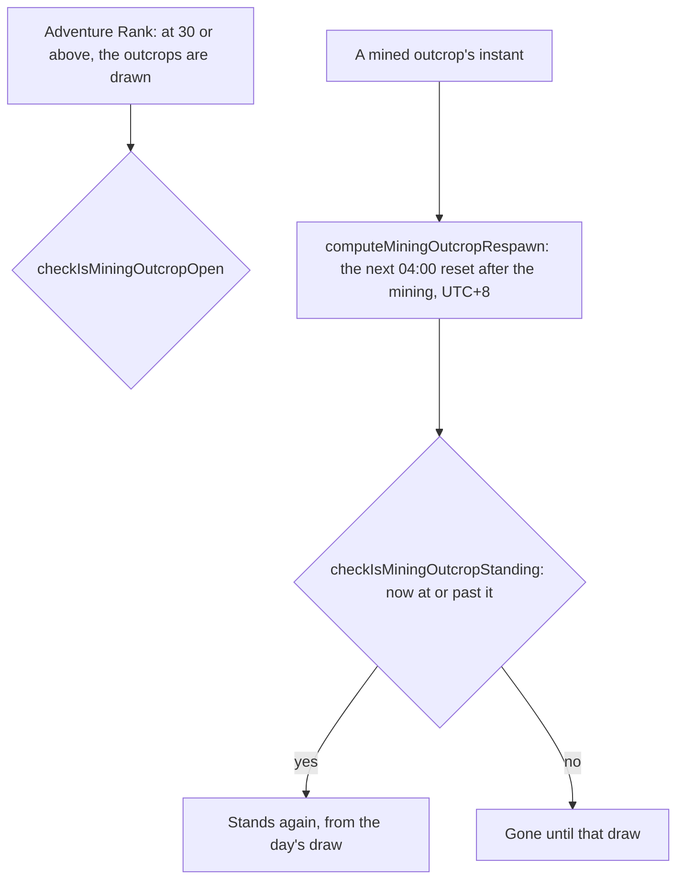

# Mining outcrops

The rules a region's mining outcrops follow, the Magical Crystal Chunks a player mines for: the Adventure Rank that opens them, and when a mined one comes back. A mining outcrop is drawn each day at the daily reset, 04:00 in the game's time zone, the reset the world's ley line outcrops are drawn at too, and a mined one stays gone until the day's next draw. Their places are built per region by `genshin:assets mining-outcrops`, which the main session publishes, the Magical Crystal Chunk points the fit places, but nothing draws them in the world yet, so none is drawn, mined or marked, and the [proposal](../../../changes/genshin-gathering/design.md) keeps the draw.

## How it works

## Rules

- **Opened at Adventure Rank 30.** `checkIsMiningOutcropOpen` compares the rank with the constant. The rank only opens the outcrops; Reputation's mining outcrop search, at level 2 of a nation, is what marks them.
- **A mined outcrop comes back at the next draw.** The respawn is the first 04:00 reset strictly after the mining, read in the game's time zone, UTC+8. A mining before a day's draw is back at that draw, and one at or after it at the next day's.
- **Standing once the respawn has come.** One never mined stands. A mined one stands from its respawn, and gone before it. The day's unmined outcrops are gone with the next day's draw: `computeStandingMiningOutcrops` stands a place only in the day's draw.
- **Struck as an ore.** A standing outcrop breaks as an ore does, and a break drops one to three Magical Crystal Chunks, provisional from the wiki, since the dump's gather rows give no counts. The break sets the outcrop's instant, so the respawn above applies.

## Key files

| File                                                                             | Role                                                                        |
| :------------------------------------------------------------------------------- | :-------------------------------------------------------------------------- |
| `packages/genshin-world/src/services/leyLine/constants.ts`                       | The opening rank                                                            |
| `packages/genshin-world/src/services/leyLine/checkIsMiningOutcropOpen.ts`        | Whether the outcrops are drawn at a rank                                    |
| `packages/genshin-world/src/services/leyLine/computeMiningOutcropRespawn.ts`     | The next 04:00 after a mining, in the game's time zone                      |
| `packages/genshin-world/src/services/leyLine/checkIsMiningOutcropStanding.ts`    | Whether a mined or unmined outcrop stands at an instant                     |
| `scripts/src/services/genshinAssets/miningOutcrops/buildMiningOutcropPlaces.ts`  | Each region's Magical Crystal Chunk points, fitted, as the outcrops' places |
| `packages/genshin-world/src/services/gathering/readMiningOutcropPlaces.ts`       | A region's places, fetched by its key once a publish has written it         |
| `packages/genshin-world/src/composables/useMiningOutcrops.ts`                    | Each loaded region's draw, the standing outcrops and the strike             |
| `packages/genshin-world/src/services/gathering/computeDailyMiningOutcrops.ts`    | A region's count drawn from its places, none below Adventure Rank 30        |
| `packages/genshin-world/src/services/gathering/computeStandingMiningOutcrops.ts` | The places standing at an instant: the day's draw, not mined since          |
| `packages/genshin-world/src/components/World/StandIns/Index.vue`                 | The stand-in at each standing place, shared with the Oculi                  |

## Notes

- **The respawn is the world's reset, not the wiki's.** The wiki gives the respawn at 06:00, two hours after the reset. The world's one daily reset is 04:00, the reset the shops and commissions use, read in UTC+8 as the [Original Resin](../original-resin/design.md) page reads the game's time zone. A recording of a mined outcrop coming back would confirm which reset it is.

## Sources

- [Mining Outcrop](https://genshin-impact.fandom.com/wiki/Mining_Outcrop), Genshin Impact Wiki: Magical Crystal Chunks from rank 30, and the respawn at 06:00, two hours after the reset.
- [Daily Reset](https://genshin-impact.fandom.com/wiki/Daily_Reset), Genshin Impact Wiki: what comes back at the daily reset and around it.
