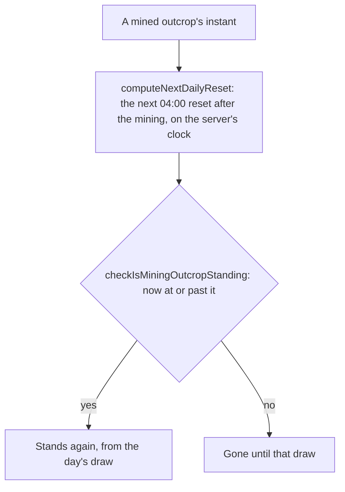

# Mining outcrops

The rules a region's mining outcrops follow, the Magical Crystal Chunks a player mines for: the Adventure Rank that opens them, and when a mined one comes back. A mining outcrop is drawn each day at the daily reset, hour `GAME_DAY_START_HOUR` on the server's clock (`{data-root}/genshin-parity/text/ExcelBinOutput/RefreshPolicyExcelConfigData.json`: its daily policies are "REFRESH_DAILY" at `14400` seconds from midnight), the reset the world's ley line outcrops are drawn at too, and a mined one stays gone until the day's next draw. Their places are built per region by `genshin:assets mining-outcrops`, which the main session publishes, the Magical Crystal Chunk points the fit places. Each standing place is drawn in the world as a rock, with `WorldStandIns` mounted on the standing places (`packages/genshin-world/src/components/World/Windrise/Index.vue`), and a standing one is struck as an ore by the `strike-ore` handler (`packages/genshin-world/src/components/World/Session/Index.vue`), as the [proposal](../../../changes/genshin-gathering/design.md) describes. The places are built by `scripts/src/services/genshinAssets/miningOutcrops/buildMiningOutcropPlaces.ts`.

## How it works

## Rules

- **Opened at `MINING_OUTCROP_ADVENTURE_RANK`.** `checkIsMiningOutcropOpen` compares the rank with the constant (`packages/genshin-world/src/services/leyLine/checkIsMiningOutcropOpen.ts`; the constant is in `packages/genshin-world/src/services/leyLine/constants.ts`). The rank only opens the outcrops; Reputation's mining outcrop search, at level 2 of a nation, is what marks them.
- **A mined outcrop comes back at the next draw.** The respawn is the first daily reset strictly after the mining, as the [reset clock](../reset-clock/design.md) defines it. A mining before a day's draw is back at that draw, and one at or after it at the next day's.
- **Standing once the respawn has come.** One never mined stands. A mined one stands from its respawn, and gone before it. The day's unmined outcrops are gone with the next day's draw: `computeStandingMiningOutcrops` stands a place only in the day's draw (`packages/genshin-world/src/services/leyLine/checkIsMiningOutcropStanding.ts`; `packages/genshin-world/src/services/gathering/computeStandingMiningOutcrops.ts`).
- **Mined outcrops are the save's.** A mined outcrop is saved as `minedOutcrops`, absent while none is mined, each by its place's id and the instant it was mined, so a reload keeps it gone until its respawn (`packages/genshin-world/src/models/save/GenshinSave.ts`). A mining drops the outcrops whose respawn has come, so the save holds the day's mined ones only ([save data](../save-data/design.md); `packages/genshin-world/src/composables/useMiningOutcrops.ts`).
- **Struck as an ore.** A standing outcrop breaks as an ore does, and a break drops one to three Magical Crystal Chunks, provisional from the wiki, since the dump's gather rows hold no count field (`{data-root}/genshin-parity/text/ExcelBinOutput/GatherExcelConfigData.json`); the code drops `ORE_CERTAIN_DROP_COUNT` for certain and rolls up to `ORE_EXTRA_DROP_DRAW_COUNT` more at `ORE_EXTRA_DROP_CHANCE` each (`packages/genshin-world/src/services/gathering/rollOreDropCount.ts`). The break sets the outcrop's instant, so the respawn above applies (`packages/genshin-world/src/composables/useMiningOutcrops.ts`, which strikes with `strikeOre` and records the mined instant).

## Key files

| File                                                                             | Role                                                                        |
| :------------------------------------------------------------------------------- | :-------------------------------------------------------------------------- |
| `packages/genshin-world/src/services/leyLine/constants.ts`                       | The opening rank                                                            |
| `packages/genshin-world/src/services/leyLine/checkIsMiningOutcropOpen.ts`        | Whether the outcrops are drawn at a rank                                    |
| `packages/genshin-world/src/services/time/computeNextDailyReset.ts`              | The next 04:00 after a mining, in the game's time zone                      |
| `packages/genshin-world/src/services/leyLine/checkIsMiningOutcropStanding.ts`    | Whether a mined or unmined outcrop stands at an instant                     |
| `scripts/src/services/genshinAssets/miningOutcrops/buildMiningOutcropPlaces.ts`  | Each region's Magical Crystal Chunk points, fitted, as the outcrops' places |
| `packages/genshin-world/src/services/gathering/readMiningOutcropPlaces.ts`       | A region's places, fetched by its key once a publish has written it         |
| `packages/genshin-world/src/composables/useMiningOutcrops.ts`                    | Each loaded region's draw, the standing outcrops and the strike             |
| `packages/genshin-world/src/services/gathering/computeDailyMiningOutcrops.ts`    | A region's count drawn from its places, none below the opening rank         |
| `packages/genshin-world/src/services/gathering/computeStandingMiningOutcrops.ts` | The places standing at an instant: the day's draw, not mined since          |
| `packages/genshin-world/src/components/World/StandIns/Index.vue`                 | The stand-in at each standing place, shared with the Oculi                  |

## Sources

- [Mining Outcrop](https://genshin-impact.fandom.com/wiki/Mining_Outcrop), Genshin Impact Wiki: Magical Crystal Chunks from rank 30, and the respawn at 06:00, two hours after the reset.
- [Daily Reset](https://genshin-impact.fandom.com/wiki/Daily_Reset), Genshin Impact Wiki: what comes back at the daily reset and around it.
- `{data-root}/genshin-parity/text/ExcelBinOutput/RefreshPolicyExcelConfigData.json`, policy 101000, the 04:00 as "REFRESH_DAILY" at `14400` seconds. Grounds the requirement "Mined outcrop returns at the next 04:00".

## Open

- [ ] **Adventure Rank 30 opens the outcrops** — no source: the wiki's Mining Outcrop page is not in `{data-root}/cache/genshin-wiki/`, and the rank is only the code's constant.
- [ ] **Reputation's mining outcrop search at level 2 of a nation marks them** — no source: no reputation source was checked for the search or its level.
- [ ] **The respawn is at 06:00 on the wiki, two hours after the reset** — no source: the wiki's Mining Outcrop page is not in the cache.
- [ ] **A break drops one to three Magical Crystal Chunks** — no source: the figure is the wiki's and provisional, its page is not cached, and the dump's gather rows hold no count.
- [ ] **The 04:00 reset is read in UTC+8, the server's clock** — no source: a game row that names the zone, since the dump's refresh row gives 14400 seconds with none; it is the question [Domains](../domains/design.md) also leaves open.
