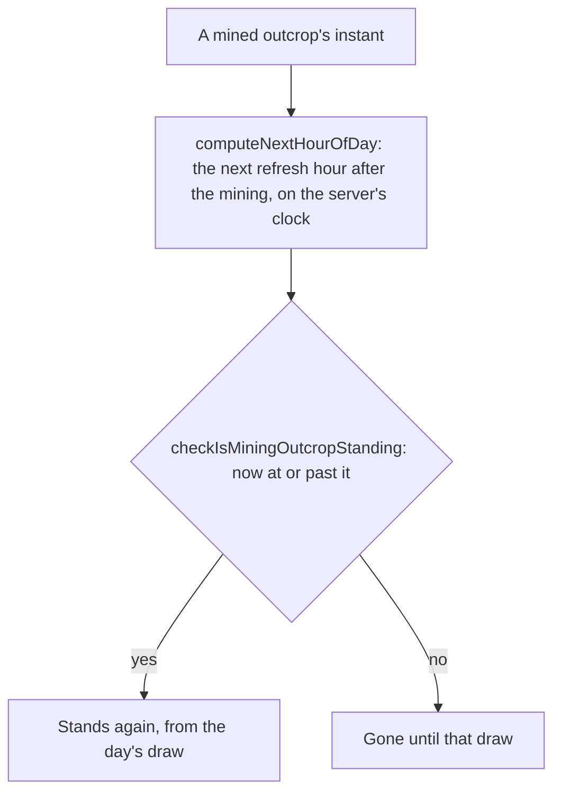

# Mining outcrops

The rules a region's mining outcrops follow, the Magical Crystal Chunks a player mines for: the Adventure Rank that opens them, and when a mined one comes back. A mining outcrop is drawn each day at the hour `MINING_OUTCROP_REFRESH_HOUR` names on the server's clock, two hours after the daily reset (`{data-root}/genshin-parity/text/ExcelBinOutput/RefreshPolicyExcelConfigData.json`: its daily policies are "REFRESH_DAILY" at `14400` seconds from midnight, the 04:00 that the world's ley line outcrops are drawn at), and a mined one stays gone until its respawn at that same hour. Their places are built per region by `genshin:assets mining-outcrops`, which the main session publishes, the Magical Crystal Chunk points the fit places. Each standing place is drawn in the world as a rock, with `WorldStandIns` mounted on the standing places (`packages/genshin-world/src/components/World/Windrise/Index.vue`), and a standing one is struck as an ore by the `strike-ore` handler (`packages/genshin-world/src/components/World/Session/Index.vue`), as the [proposal](../../../changes/genshin-gathering/design.md) describes. The places are built by `scripts/src/services/genshinAssets/miningOutcrops/buildMiningOutcropPlaces.ts`.

## How it works

## Rules

- **Opened at `MINING_OUTCROP_ADVENTURE_RANK`.** `checkIsMiningOutcropOpen` compares the rank with the constant (`packages/genshin-world/src/services/leyLine/checkIsMiningOutcropOpen.ts`; the constant is in `packages/genshin-world/src/services/leyLine/constants.ts`). The rank only opens the outcrops; Reputation's mining outcrop search, at level 2 of a nation, is what marks them: the wiki's search section says that level lets a nation's NPCs mark nearby outcrops on the map (`{data-root}/cache/genshin-wiki/Page_Mining_Outcrop.json`, wikitext line 108), and Mondstadt's level 2 row carries the search as "functionId" 1001 (`{data-root}/genshin-dump-backup-6.6/ExcelBinOutput/ReputationLevelExcelConfigData.json`, line 19).
- **A mined outcrop comes back at the refresh hour.** The respawn is the first `MINING_OUTCROP_REFRESH_HOUR` on the server's clock strictly after the mining (`packages/genshin-world/src/services/time/constants.ts`), the hour the day's draw is made at too (see the next rule). A mining before that hour is back at it the same day, and one at or after it at the next day's.
- **Drawn at the refresh hour, not the reset.** The hour and the draw's moment are the [reset clock](../reset-clock/design.md)'s: `useMiningOutcrops` redraws a region whose draw is from before the last one (`packages/genshin-world/src/composables/useMiningOutcrops.ts`), and `computeStandingMiningOutcrops` holds the previous day's draw until then (`packages/genshin-world/src/services/gathering/computeStandingMiningOutcrops.ts`), so a mined outcrop comes back at the draw and not at the reset.
- **Standing once the respawn has come.** One never mined stands. A mined one stands from its respawn, and gone before it. The day's unmined outcrops are gone with the next day's draw: `computeStandingMiningOutcrops` stands a place only in the day's draw (`packages/genshin-world/src/services/leyLine/checkIsMiningOutcropStanding.ts`; `packages/genshin-world/src/services/gathering/computeStandingMiningOutcrops.ts`).
- **Mined outcrops are the save's.** A mined outcrop is saved as `minedOutcrops`, absent while none is mined, each by its place's id and the instant it was mined, so a reload keeps it gone until its respawn (`packages/genshin-world/src/models/save/GenshinSave.ts`). A mining drops the outcrops whose respawn has come, so the save holds the day's mined ones only ([save data](../save-data/design.md); `packages/genshin-world/src/composables/useMiningOutcrops.ts`).
- **Struck as an ore.** A standing outcrop breaks as an ore does, and a break drops one to three Magical Crystal Chunks, the wiki's count (`{data-root}/cache/genshin-wiki/Page_Magical_Crystal_Chunk.json`, wikitext line 17), since the ore rows of the dump's gather table hold no count field (`{data-root}/genshin-parity/text/ExcelBinOutput/GatherExcelConfigData.json`); the code drops `ORE_CERTAIN_DROP_COUNT` for certain and rolls up to `ORE_EXTRA_DROP_DRAW_COUNT` more at `ORE_EXTRA_DROP_CHANCE` each, which its constants make one to three (`packages/genshin-world/src/services/gathering/constants.ts`, `ORE_CERTAIN_DROP_COUNT` through `ORE_EXTRA_DROP_CHANCE`; `packages/genshin-world/src/services/gathering/rollOreDropCount.ts`). The break sets the outcrop's instant, so the respawn above applies (`packages/genshin-world/src/composables/useMiningOutcrops.ts`, which strikes with `strikeOre` and records the mined instant).

## Key files

| File                                                                             | Role                                                                        |
| :------------------------------------------------------------------------------- | :-------------------------------------------------------------------------- |
| `packages/genshin-world/src/services/leyLine/constants.ts`                       | The opening rank                                                            |
| `packages/genshin-world/src/services/leyLine/checkIsMiningOutcropOpen.ts`        | Whether the outcrops are drawn at a rank                                    |
| `packages/genshin-world/src/services/time/computeNextHourOfDay.ts`               | The next refresh hour after a mining, in the game's time zone               |
| `packages/genshin-world/src/services/leyLine/computeLastMiningOutcropDraw.ts`    | The last refresh hour at or before a moment, the day's draw                 |
| `packages/genshin-world/src/services/leyLine/computeMiningOutcropRespawn.ts`     | When an outcrop mined at an instant stands again                            |
| `packages/genshin-world/src/services/leyLine/computeNextMiningOutcropRespawn.ts` | The first respawn still to come, when the standing list is worked out again |
| `packages/genshin-world/src/services/leyLine/checkIsMiningOutcropStanding.ts`    | Whether a mined or unmined outcrop stands at an instant                     |
| `scripts/src/services/genshinAssets/miningOutcrops/buildMiningOutcropPlaces.ts`  | Each region's Magical Crystal Chunk points, fitted, as the outcrops' places |
| `packages/genshin-world/src/services/gathering/readMiningOutcropPlaces.ts`       | A region's places, fetched by its key once a publish has written it         |
| `packages/genshin-world/src/composables/useMiningOutcrops.ts`                    | Each loaded region's draw, the standing outcrops and the strike             |
| `packages/genshin-world/src/services/gathering/computeDailyMiningOutcrops.ts`    | A region's count drawn from its places, none below the opening rank         |
| `packages/genshin-world/src/services/gathering/computeStandingMiningOutcrops.ts` | The places standing at an instant: the day's draw, not mined since          |
| `packages/genshin-world/src/components/World/StandIns/Index.vue`                 | The stand-in at each standing place, shared with the Oculi                  |

## Sources

- [Mining Outcrop](https://genshin-impact.fandom.com/wiki/Mining_Outcrop), Genshin Impact Wiki: Magical Crystal Chunks from rank 30 (`{data-root}/cache/genshin-wiki/Page_Mining_Outcrop.json`, wikitext line 17), and the respawn at 06:00, two hours after the reset (the same page, line 23), which the rules above take, and the draw takes the same hour, as the Reset page puts the locations' randomizing at 06:00 too (see the [reset clock](../reset-clock/design.md)).
- [Daily Reset](https://genshin-impact.fandom.com/wiki/Daily_Reset), Genshin Impact Wiki: what comes back at the daily reset and around it. Its cached copy is `{data-root}/cache/genshin-wiki/Page_Reset.json`, wikitext line 18, which gives the outcrops' locations randomizing at 06:00 too.
- `{data-root}/genshin-parity/text/ExcelBinOutput/RefreshPolicyExcelConfigData.json`, policy 101000, the 04:00 as "REFRESH_DAILY" at `14400` seconds. Grounds the 04:00 daily reset that the world's ley line outcrops are drawn at.

## Open

The rank that opens them is open on the [spec](spec.md).

- [ ] **The 04:00 reset is read in UTC+8, the server's clock** — no source: a game row that names the zone, since the dump's refresh row gives 14400 seconds with none; the reset text names only "{TIMEZONE}" (`{data-root}/genshin-dump-backup-6.6/TextMap/TextMap_MediumEN.json`, line 131856), so a capture of that Wish count line with the zone filled in would settle it. It is the question [Domains](../domains/design.md) also leaves open.
