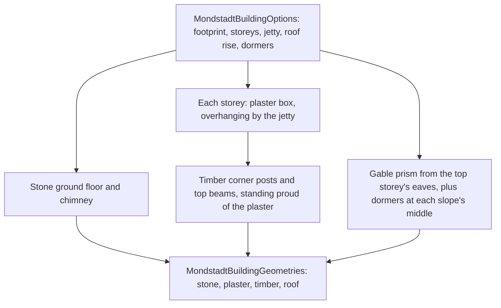

# Mondstadt buildings

A Mondstadt house is generated from its parameters by `createMondstadtBuildingGeometries`, one of the world's region kits, built on the engine's [kit](../engine-architecture/design.md) primitives (`packages/genshin-world/src/services/mondstadt/createMondstadtBuildingGeometries.ts`). It returns one merged geometry per material, so a building is one draw for each of its four materials (`packages/genshin-engine/src/kits/mergeGeometryParts.ts`). Nothing is read from the game: every part is a box or an extruded gable, placed by the parameters alone (`packages/genshin-world/src/services/mondstadt/createMondstadtBuildingGeometries.ts`). Mondstadt City's first house stands in the region's data as a [building landmark](../region-buildings/design.md) (`packages/genshin-world/src/data/regions/mondstadt.json`, the `mondstadt-city` landmark's `Mondstadt` building kit and its options).

The house is what stands in for Mondstadt City's own buildings when the [parity](../parity/README.md) inventory claims the city's export: the export's buildings family is `Area_MdBuild_` and `Area_Mdbuild_`, with its terrain tiles as its ground (`packages/genshin-world/src/services/mondstadt/MondstadtPartFamilyMeshRegexMap.ts`, the `BigWorldTerrain_` ground family). The export's other meshes are claimed undrawn by kind (`packages/genshin-world/src/services/mondstadt/MondstadtUndrawnMeshRegexMap.ts`).

## Parameters

- **Footprint.** The width runs along the gable walls and the depth along the front and back walls, in metres (`packages/genshin-world/src/services/mondstadt/createMondstadtBuildingGeometries.ts`).
- **Ground floor.** A stone box of the given height, the footprint's full size (`packages/genshin-world/src/services/mondstadt/createMondstadtBuildingGeometries.ts`).
- **Storeys.** Each storey is a plaster box. The front and back walls of each storey extend the jetty beyond the storey beneath it, so the overhang accumulates by one jetty per storey. The gable walls do not overhang (`packages/genshin-world/src/services/mondstadt/createMondstadtBuildingGeometries.ts`).
- **Timber frame.** Each storey has a timber post at each corner and a beam along the top of each wall. A timber member's outer face stands a few centimetres proud of the plaster so it reads as a frame (`packages/genshin-world/src/services/mondstadt/constants.ts`, `MONDSTADT_TIMBER_PROUD` of 0.05 m).
- **Roof.** A gable whose ridge runs along the width, with eaves overhanging the top storey by a fixed amount. Its rise is a parameter (`packages/genshin-world/src/services/mondstadt/constants.ts`, `MONDSTADT_EAVE_OVERHANG` of 0.4 m).
- **Dormers.** A count per slope, spaced evenly along the width and set at each slope's middle, with their bases sunk slightly into the roof (`packages/genshin-world/src/services/mondstadt/constants.ts`, `MONDSTADT_DORMER_SINK` of 0.2 m and the dormer size constants).
- **Chimney.** A stone column a quarter of the way along the width, rising past the ridge (`packages/genshin-world/src/services/mondstadt/createMondstadtBuildingGeometries.ts`, with `MONDSTADT_CHIMNEY_SIZE` and `MONDSTADT_CHIMNEY_RISE` in `constants.ts`).

## Key files

| File                                                                                 | Role                                                                        |
| :----------------------------------------------------------------------------------- | :-------------------------------------------------------------------------- |
| `packages/genshin-world/src/services/mondstadt/createMondstadtBuildingGeometries.ts` | The house from its parameters: four materials, one geometry each            |
| `packages/genshin-world/src/services/mondstadt/constants.ts`                         | The eave, timber, dormer and chimney dimensions                             |
| `packages/genshin-world/src/models/mondstadt/MondstadtBuildingOptions.ts`            | The parameters a house takes                                                |
| `packages/genshin-world/src/models/mondstadt/MondstadtBuildingGeometries.ts`         | The four geometries a house returns, one per material                       |
| `packages/genshin-engine/src/kits/mergeGeometryParts.ts`                             | Merges each material's parts into its one geometry                          |
| `packages/genshin-world/src/services/mondstadt/MondstadtPartFamilyMeshRegexMap.ts`   | The game's meshes standing in for Mondstadt's ground and buildings families |
| `packages/genshin-world/src/services/mondstadt/MondstadtUndrawnMeshRegexMap.ts`      | The rest of the city's export, claimed as not drawn yet, by kind            |

Not built yet: the house's dressing (window boxes, shutters, lanterns and banners), the windmill, and the city wall, gate bridge and cathedral. The windmill, the walls and the cathedral are landmark-tier pieces that need their reference poses.

## Open

- [ ] **The house stands in for Mondstadt City's buildings, whose export family is Area_MdBuild_ and Area_Mdbuild_** — no source yet: `packages/genshin-world/src/services/mondstadt/MondstadtPartFamilyMeshRegexMap.ts:6` holds the family pattern, not yet checked against Mondstadt City's buildings.
