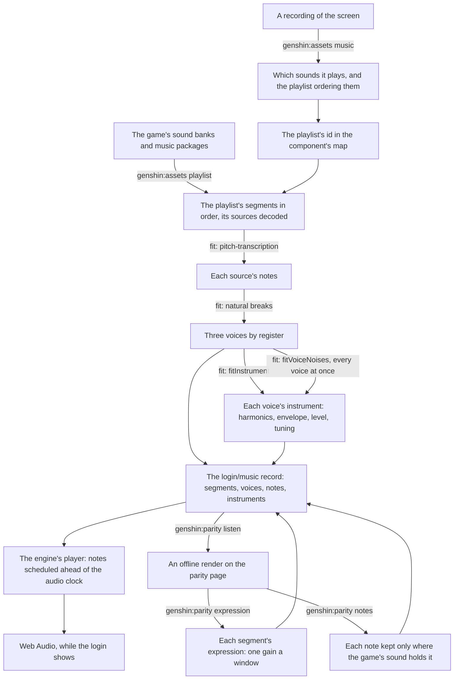

# Music

The login plays its music, and so does ours. The game's audio is a reference, read locally from the installed game and never shipped. What ships is ours: the playlist's structure, the notes, each voice's measured instrument, and a synthesizer that plays them, with recordings of real instruments layered over the voices where they bring a piece nearer the game ([sampled instruments](../sampled-instruments/design.md)). The login is the first piece, and every other piece of the game's music goes through the same steps.

## How it works

## The playlist

- **The structure is exact.** The login's playlist is a continuous sequence that loops forever: a first piece of 104 seconds, a silent segment of about ten seconds, a second piece of 92.75 seconds (its source's last 2.25 seconds trimmed), and the rest again. Every length, trim and the order come from the sound banks (`genshin:assets playlist`), so the handoffs land where the game's do. A recording only found which playlist it is.
- **It plays as loud as the game's mix plays it.** A segment's volume is read from the banks, through its track, every node above it and every bus to the master, with each game parameter at its default (`readGameMixVolumes`). The first piece plays 5 decibels under its source and the second 16, so the second sounds about 11 decibels quieter than the first, as it does in a public recording of the login. The live player applies it on each segment's gain. The fits, the expression and every score work at the source's own level, so a render scored against the source leaves it out.
- **It starts as soon as the browser lets it.** `LoginMusic` renders nothing. It starts the player as the login screen mounts and stops it when the screen goes. The browser's autoplay policy decides whether a new audio context runs or starts suspended, so when it starts suspended the music waits for the first pointer press or key press anywhere on the window, usually the title's own click, and starts there from its beginning. The autoplay rule is MDN's, in [Sources](#sources).

## The fit

The fit turns each source into the record the player reads. Its parts are on their own pages:

- [Voices](voices/design.md) — the notes transcribed from the decoded sound, the notes the game's sound does not hold dropped, the registers, and each voice's measured instrument.
- [Synthesizer](synthesizer/design.md) — the engine's oscillator and noise per note, and the player that schedules them.
- [Expression](expression/design.md) — the swell each segment carries over its voices.
- [Scoring](scoring/design.md) — the listening score that judges a render against the game's sound, and what its numbers are worth.

The score's numbers are not kept on these pages: they are the committed snapshot `scripts/src/services/genshinParity/shared/ParityMusicScores.snapshot.md`, which the `listen` command rewrites.

## Recreating another piece

The order, and the rules each step keeps, are the `genshin-parity` skill's `references/music.md`:

1. Find the sound with `genshin:assets music <recording>` over a recording of the screen.
2. Name its playlist in the component's map (`musicPlaylistId`).
3. Export it with `genshin:assets playlist <component>`.
4. Fit it through the component's fit, after `fitLoginMusic`.
5. Fit its expression with `genshin:parity expression`.
6. Prune its notes with `genshin:parity notes`, then refit its expression.
7. Layer its recordings with `genshin:parity instruments`, then refit its expression with `genshin:parity expression`.
8. Play it from a component that renders nothing, after `Login/Music`, with an `isMotionOnly` fixture.
9. Score it with `listen`.
10. The user listens.

## Not yet

- **Each note's own noise.** Every note reads its instrument's noise buffer from where the clock stands in the loop, and every buffer's phases depend only on the band, so the notes sounding at once play one noise in step: their amplitudes add, where the noise solve adds their powers. `genshin:parity noise` shows it, reading our render's noise back two to four times what ships. Zeroing the first piece's lowest-band noise alone takes that band's bias from about seven decibels to about one, and the bass voice's level is not the excess. A start in the loop that each note's time and pitch scatter fixes it, and the start must land on a whole sample frame: on the parity page's browser a source started between two frames reads its loop between samples, and that interpolation halves the top band at the listening score's rate. Scattered on whole frames, the first piece's noise reads back within about a fifth of what ships, its distance improves and its lowest band's overfill halves. The second piece's noise reads back whole, yet its top two bands fall four to eight decibels short and pitch agreement drops by a few ten-thousandths, so the scatter waits. That points at the solve's median: it reads off-partial content that is not noise-like, such as sparse partials of the game's own, as too little ([roadmap](../../../changes/genshin-roadmap/tasks.md)).
- **The second piece's top voice.** The decay fitted to the median curve cost the second piece about two hundredths of pitch agreement for a tenth of a decibel of distance, and all of it through its top voice: with that one voice's old envelope put back, the agreement returns. Its notes now ring as long as the game's notes heard alone do, so the envelope is not what is wrong. Most of that voice's notes sit on a harmonic of a lower note sounding with them, and a transcription hears a loud overtone as a note of its own, which we then play with overtones the game's never had, for longer than before. [Voices](voices/design.md)' note pass tells such a note from a melody doubled an octave up, by whether the game's sound at its fundamental stands over our render with it silenced: nearly all of the second piece's notes on a lower note's overtone stand well over it, so they are doubled lines, and the agreement this voice lost is not theirs. Three remedies do not ship:
  - Joining a note to the one before it at its pitch, wherever the game's fundamental does not rise at its start. About a fifth to a quarter of the notes join. The bands jump no less often, and pitch agreement falls by up to two hundredths in the second piece with the registers held where they were, four where the fewer notes move them.
  - Reading a note's level and decay from the frame its voice's attack lands on, rather than from its own loudest frame. The first piece's voices then barely decay: its bands jump several times less often than the game's and its pitch agreement falls by over a hundredth.
  - A decay per octave of overtones, each harmonic dying faster than the fundamental by its number to a fitted power, as additive synthesis gives a plucked string. The fit reads the second piece's top and bass overtones dying faster, as they do in the game's sound, yet playing them so moves neither score by more than a tenth of a decibel, for an oscillator an octave of overtones on every note.

## Key files

| File                                                                   | Role                                                            |
| :--------------------------------------------------------------------- | :-------------------------------------------------------------- |
| `scripts/src/services/genshinAssets/music/extractComponentPlaylist.ts` | A component's playlist resolved from the banks, sources decoded |
| `scripts/src/services/genshinAssets/music/readGameMixVolumes.ts`       | Each segment's volume in the game's mix, from the banks         |
| `scripts/src/services/genshinAssets/fit/fitLoginMusic.ts`              | The login's notes, voices and instruments                       |
| `packages/genshin-world/src/components/Login/Music/Index.vue`          | Where the login's music plays                                   |

## Sources

- [bnnm/wwiser](https://github.com/bnnm/wwiser), the reference parser for Wwise's banks, read to confirm the track's clips and the playlist's items at the banks' version.
- [vgmstream](https://github.com/vgmstream/vgmstream), the decoder for Wwise's Vorbis, pinned in the tool cache under `~/Esposter/cache/vgmstream`.
- [Autoplay guide for media and Web Audio APIs](https://developer.mozilla.org/en-US/docs/Web/Media/Guides/Autoplay), MDN: when a browser starts an audio context suspended until the page's first click or key.
