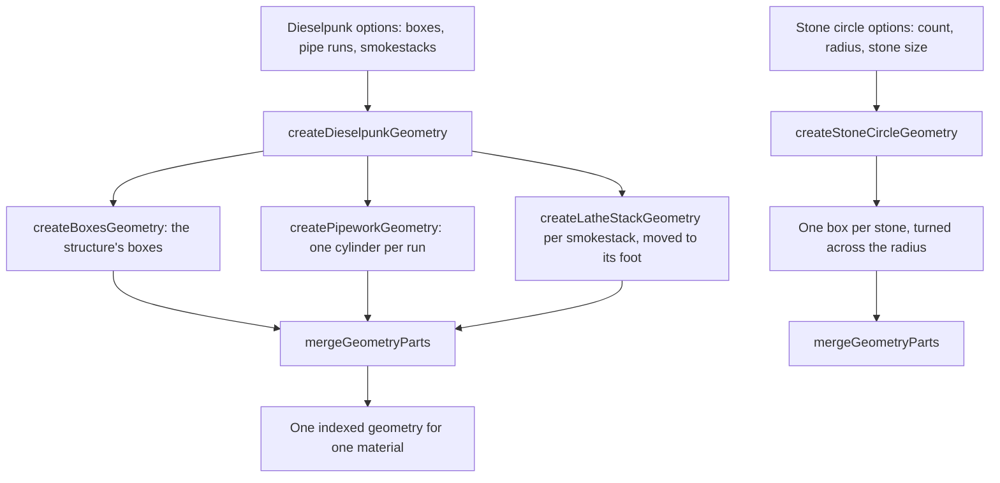

# Nod-Krai's kits

Nod-Krai's structures are not Mondstadt's or Inazuma's, so each of its two kits is a generator of its own, built over the engine's shared architecture parts rather than over any region's kit (`packages/genshin-world/src/services/nod-krai/createDieselpunkGeometry.ts`). Both live in the world package, beside the region's data, since the engine knows no place; they take their numbers as options, so the region's fitted values are supplied as data.

## How it works

- **The dieselpunk kit merges three kinds of part.** `createDieselpunkGeometry` takes a structure's boxes, which `createBoxesGeometry` merges (`packages/genshin-engine/src/kits/architecture/createBoxesGeometry.ts`, which knows no sheds, plates or cranes), its pipe runs and its smokestacks. Each smokestack is a stack of sections from `createLatheStackGeometry`, moved to its foot. Every part is indexed so that `mergeGeometryParts` can join them into one geometry for one material; a faceted stack is not indexed and would drop out of the merge, so the kit builds them round (`packages/genshin-world/src/services/nod-krai/createDieselpunkGeometry.ts`, `packages/genshin-engine/src/kits/architecture/createLatheStackGeometry.ts`).
- **Pipework is a cylinder per run.** `createPipeworkGeometry` stands one cylinder of the given radius between each run's two ends. Each cylinder is turned from the vertical onto its run and moved to the run's midpoint, so a run may point in any direction (`packages/genshin-world/src/services/nod-krai/createPipeworkGeometry.ts`).
- **The Frostmoon kit stands a ring of stones.** `createStoneCircleGeometry` places each stone at an even angle about the origin, its height standing on the ground and its thickness lying across the radius, so every stone faces the ring's centre (`packages/genshin-world/src/services/nod-krai/createStoneCircleGeometry.ts`).
- **The dieselpunk works stand in for Nasha Town's own.** In the town's witness they take the meshes named "Area_Ndkl_Build_", its halls, cranes and pipes, and the terrain tiles take its ground, as the [parity](../parity/README.md) inventory groups them (`packages/genshin-world/src/services/nod-krai/NodKraiPartFamilyMeshRegexMap.ts`, `packages/genshin-world/src/services/world/WorldSceneExportFamilyMeshRegexMap.ts`); `NodKraiUndrawnMeshRegexMap` holds each other kind, Natlan's borrowed buildings included, as undrawn (`packages/genshin-world/src/services/nod-krai/NodKraiUndrawnMeshRegexMap.ts`).

## Key files

| File                                                                            | Role                                                              |
| :------------------------------------------------------------------------------ | :---------------------------------------------------------------- |
| `packages/genshin-world/src/services/nod-krai/createDieselpunkGeometry.ts`      | The dieselpunk structure, merged from its boxes, pipes and stacks |
| `packages/genshin-world/src/services/nod-krai/createPipeworkGeometry.ts`        | Pipework as one cylinder per run                                  |
| `packages/genshin-world/src/services/nod-krai/createStoneCircleGeometry.ts`     | The Frostmoon Scions' ring of standing stones                     |
| `packages/genshin-world/src/models/nod-krai/DieselpunkOptions.ts`               | The dieselpunk structure's options                                |
| `packages/genshin-world/src/data/regions/nod-krai.json`                         | Nasha Town's dieselpunk works, at a provisional place             |
| `packages/genshin-world/src/services/nod-krai/NodKraiPartFamilyMeshRegexMap.ts` | Nasha Town's works and ground, by the game's mesh names           |
| `packages/genshin-world/src/services/nod-krai/NodKraiUndrawnMeshRegexMap.ts`    | The rest of Nasha Town's export, held undrawn kind by kind        |

## Open

- [ ] **`createBoxesGeometry` builds sheds, plates and cranes** — contradicted by `packages/genshin-engine/src/kits/architecture/createBoxesGeometry.ts`: it merges the boxes it is given and knows no sheds, plates or cranes.
- [ ] **Nasha Town's halls, cranes and pipes are drawn by the dieselpunk works** — no source yet: the `Area_Ndkl_Build_` pattern was found, but the names of the halls, cranes and pipes were not checked against the export.
