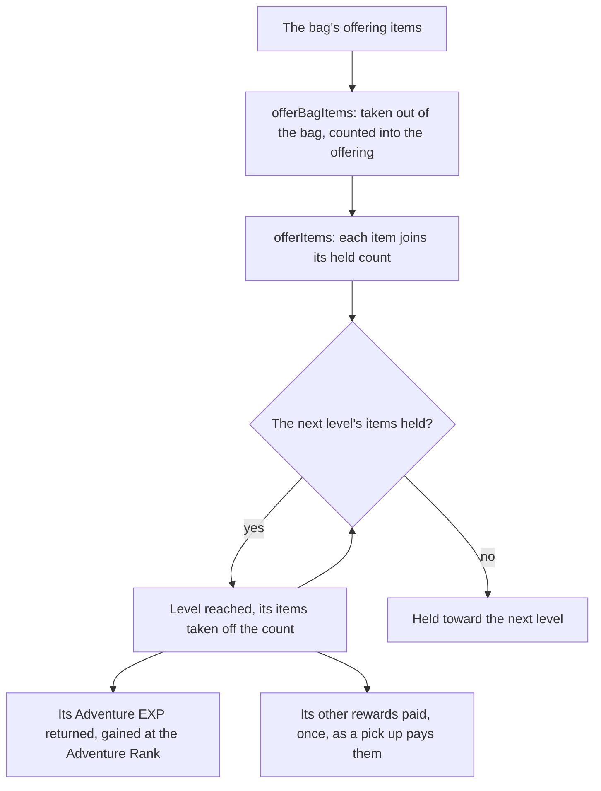

# Offering systems

In the game a sacred tree, fountain or shrine takes the items of its kind the bag holds, all at once, and rises a level for each threshold its offerings pass. This page is what is built of [Offering systems](../../../changes/genshin-offering-systems/design.md): the rule, the same one a statue's Oculi follow, the bag's offer that takes the items out of the bag, and the Frostbearing Tree in Dragonspine as the first offering published. The rules are pure functions with their own tests.

## How it works

- **The tree's levels come from the game's table.** `pnpm -C scripts genshin:assets offerings` publishes the Frostbearing Tree's levels from the offering level-up table, one row a level holding the items it takes, each with its count, and the rewards its reward row pays. Offering 1 is the tree, the one its open state names. The offering table is not in the dump, so the [game data formats](../game-data-formats/design.md) page records how it is fetched. `readFrostbearingTreeLevels` fetches the levels by their key from the hosted game data and checks them against its schema as they arrive. The world reads them as an offer is made rather than before it opens, since no frame draws them, and the offer reads the bag once they have arrived, so an item picked up while they arrive is offered too.
- **The tree's place comes from the official map.** The same command publishes the Frostbearing Tree's place: the map's one point for the tree, which lies in Mondstadt's area, carried through the [spawned places](../spawned-places/design.md) fit into the game's coordinates and then into Mondstadt's region axes. It is one slice per region in the `frostbearingTreePlaces` dataset, and the tree stands in Mondstadt's axes, not yet placed on the ground.
- **Every item the bag holds is offered at once.** `offerBagItems` takes every item an offering's levels take that the bag holds out of the bag and counts each kind into the offering through `offerItems`. That takes the count offered of each item, adds it to that item's held count, then reaches each next level whose every item its count now covers, taking each of those items off its own count and returning the levels reached in order. For each item, a level's threshold is the running sum of that item's counts through the level.
- **Each reached level's rewards are paid in.** `offerBagItems` returns the Adventure EXP of the levels reached, as a forge order returns its own, and `useWorldOfferings` gains it at the Adventure Rank, so the EXP past rank 60 is paid in Mora as any gain's is. It pays every other reward through the [pick up](../interaction/design.md) a dropped item takes, so the Fates the levels pay are wallet grants as Mora is and the rest goes into the bag. What the bag has no room for is returned with its count left over (`OfferingOffer.overflowItems`) and dropped at the tree, each a pick up lying at its place (`placeWorldDrops`), as what a pick up has no room for stays on the ground.
- **The first offer starts the tree.** Level 1 takes no items, so offering none reaches it, whatever the bag holds, and its reward is paid once, as a statue's first resonance does. This is settled from the table.
- **Items past the last level are held.** Past the tree's last level the items stay on the held count with no level to reach, as a statue's Oculi do past its last level.

## Key files

| File                                                                          | Role                                                                                                                |
| :---------------------------------------------------------------------------- | :------------------------------------------------------------------------------------------------------------------ |
| `packages/genshin-world/src/services/offering/offerItems.ts`                  | Offers items and reaches each level they cover, the rule statues share                                              |
| `packages/genshin-world/src/services/offering/offerBagItems.ts`               | Takes the bag's offering items out, offers them and pays the rewards                                                |
| `packages/genshin-world/src/services/offering/readFrostbearingTreeLevels.ts`  | Fetches the tree's levels by key and checks them against its schema                                                 |
| `packages/genshin-world/src/models/offering/OfferingLevel.ts`                 | One level: the items it takes, each with its count, and its rewards                                                 |
| `packages/genshin-world/src/models/offering/OfferingProgress.ts`              | The count held of each item, the level reached and the levels, shared with the statues                              |
| `packages/genshin-world/src/models/offering/OfferingProgressSave.ts`          | The count held of each item and the level the save holds for an offering                                            |
| `packages/genshin-world/src/services/offering/countHeldItems.ts`              | The count of items an offering holds across every kind, which its progress is compared by                           |
| `packages/genshin-world/src/services/statue/statueRegionProgress.ts`          | A statue region's saved progress as the rule holds it, its Oculi held against its one Oculus                        |
| `packages/genshin-world/src/composables/useWorldOfferings.ts`                 | Reads the tree's levels as the bag is offered to it, keeps its progress and drops the rewards left over at the tree |
| `packages/genshin-world/src/components/World/FrostbearingTree/Index.vue`      | The tree's stand-in at its place                                                                                    |
| `packages/genshin-world/src/models/offering/OfferingOffer.ts`                 | What an offer leaves: the bag, the wallet, the progress and the rewards left over                                   |
| `packages/genshin-world/src/models/offering/OfferingReward.ts`                | One item a level pays                                                                                               |
| `scripts/src/services/genshinAssets/offerings/buildFrostbearingTreeLevels.ts` | Builds the tree's levels, each reward joined from the reward table                                                  |
| `scripts/src/services/genshinAssets/offerings/buildFrostbearingTreePlaces.ts` | Builds the tree's place from the official map's point and the fit                                                   |
| `scripts/src/services/genshinAssets/offerings/toOfferingLevelRow.ts`          | One level's row: the item and count it takes, its rewards                                                           |
| `scripts/src/services/genshinAssets/rewards/readRewardMap.ts`                 | The reward table keyed by reward id, shared by the level builders                                                   |

## Notes

- **Stood in, not modelled.** The tree is drawn as one capsule of one instanced draw with one shared material, at its place in the `frostbearingTreePlaces/mondstadt` record, the way the animals and the drops are stood in until their models land. Its model and landmark wait on Mondstadt's region page.
- **The offer is on F.** Its prompt row is an `Activate` named by `GameTextKey.FrostbearingTree` while the character is in reach, and pressing F offers the bag through `offerBagItems`.
- **The save holds its progress.** Its count held of each item and level are the `offerings.frostbearingTree` slice of the save, `{ heldCounts, level }` with `heldCounts` keyed by item id, and no default: a save holding the older `{ heldCount, level }` is refused until it is backfilled as `{ heldCounts: { "107010": heldCount }, level }`, the tree's one item. A guest's save keeps the further level, and between two copies on one level the one holding more items, when it merges into an account.
- **One rule with the statues.** The statues use `offerItems` through the same level shape, `items` holding each item with its count. Each region takes one Oculus, and its save keeps `{ heldCount, level }` per region: `statueRegionProgress.ts` converts that to the rule's progress at the boundary and back, so the statues' save is unchanged.
- **Reading the wiki.** The [Offering System](https://genshin-impact.fandom.com/wiki/Offering_System) page's wording matches the rule, and the offerings it lists match the published list one for one (task 3.1 of the change).

## Sources

- [AnimeGameData](https://github.com/DimbreathBot/AnimeGameData), the community's per-patch dump: the offering level-up table with each offering's items and rewards, the offering open-state table, and the reward table the rewards are joined from.
- [Teyvat Interactive Map](https://act.hoyolab.com/ys/app/interactive-map/index.html), HoYoLAB: the map's point for the Frostbearing Tree, read into the references folder and carried through the fit.
