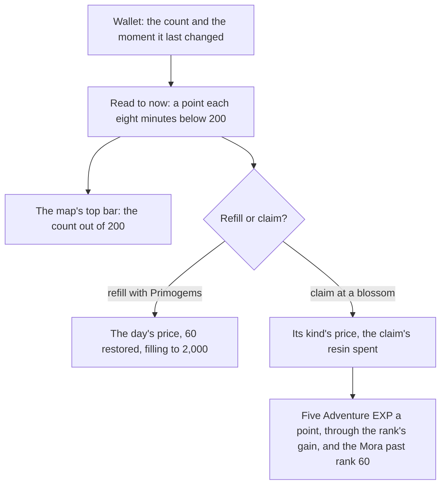

# Original Resin

The game keeps its energy for claiming challenge rewards as Original Resin. The wallet holds it as a count and the moment it last changed, so its regeneration is read to the present rather than run on a timer, and the page can be closed for a day and still show the resin filled. The map's top bar counts it. The claim's price, its Adventure EXP and the Primogem refill are pure services in `genshin-world`, read off the rules the [proposal](../../../changes/archive/2026-10-18-genshin-original-resin/design.md) settled.

Pressing F at a cleared challenge's blossom offers its claims, the ones the held resin affords, and choosing one spends its resin and grants its rewards into the bag and the wallet. The challenges that leave a blossom are the [ley line outcrops](../ley-line-outcrops/design.md), the [domains](../domains/design.md)' Petrified Tree and the [bosses](../bosses/design.md)' Trounce Blossom, each calling the one claim service with its own cost and reward list.

## How it works

## Decisions

- **One every eight minutes, to 200.** `regenerateOriginalResin` adds a point for each eight minutes since the moment the resin last changed, up to 200. It moves that moment on by the points it gives, so the time to the next point keeps its place. At 200 regeneration stops and the moment is now, so a spend that takes the resin below 200 starts the next point from there.
- **A refill passes the cap, to 2,000.** `refillOriginalResin` reads the regeneration to now, then adds to the count, filling to 2,000. Above 200 the resin does not regenerate.
- **Primogem refills, six a game day.** Each restores 60 at its price, paid in the world's own Primogems, which are never sold. `refillOriginalResinWithPrimogems` refuses a refill short of its price, at the 2,000 cap, or once the day's six are used (`PRIMOGEM_RESIN_REFILL_PRICES`). The game's day starts at 04:00 in UTC+8, the game's server time, so the count restarts at that hour and not at midnight (`GAME_DAY_START_HOUR` and `GAME_TIME_ZONE`).
- **A claim's price by its kind.** `computeBlossomClaimResin` prices a claim by its blossom kind, and a weekly boss's by how many claims it has had that week.
- **A claim's offers.** `computeBlossomClaimOffers` lists how a blossom's claim is paid: one claim at its price; at a ley line or a domain also two claims at twice the price, and a Condensed Resin for three claims. A boss offers its one claim only.
- **Condensed Resin's claim.** `claimResinReward` takes its cost's Condensed Resin out of the bag, one for a ley line's or a domain's three claims. `computeBlossomClaimOffers` offers that cost only at a ley line or a domain, so a boss is refused it. It spends no Original Resin, so it gives no Adventure EXP.
- **Five Adventure EXP a point.** `claimOriginalResin` spends the resin, then gives five Adventure EXP a point through `gainAdventureExp`, so the EXP past rank 60 is paid into the wallet as Mora. A claim the resin does not cover returns undefined and spends nothing (`ADVENTURE_EXP_PER_RESIN`).
- **The claim's offer on F.** `useWorldOutcrops` opens the prompt at a cleared outcrop's blossom from `computeBlossomClaimPrompt`, which lists the offers the holdings pay. A blossom whose offers the holdings cannot pay, and that no Fragile Resin can restore, opens no prompt. A challenge cleared but not claimed gives nothing.
- **A short Original Resin restores first.** Where the Original Resin covers no resin claim and the bag holds a Fragile Resin, the prompt's restore row spends one for sixty Original Resin through `refillOriginalResinWithFragileResin`, then offers the claims again from the restored holdings. The row reads the game's own "Can use Fragile Resin to restore" (`GameTextKey.FragileResinRestore`). Its place among the rows is provisional until a recording measures it.
- **Settled calls.** A new player holds the full 200. The resin's rarity is 3, the game's material table's `rankLevel` (`~/Esposter.noindex/genshin-parity/text/ExcelBinOutput/MaterialExcelConfigData.json`, row `106`, `rankLevel` 3). Its name is the game's own text, `GameTextKey.OriginalResin`. Both the starting amount and the 04:00 reset are settled from the game's own design rather than checked against the wiki.

## Data

- **The item's row.** Original Resin is item 106 in the game's material table, with the rarity above. Its name's text id is the one `GameTextKey.OriginalResin` holds (`packages/genshin-text/src/models/GameTextKey.ts`, and row `106`'s `nameTextMapHash` 3246419172 in `~/Esposter.noindex/genshin-parity/text/ExcelBinOutput/MaterialExcelConfigData.json`).
- **The other resins' rows.** Fragile Resin is item 107009 in the published material table (`items/materials`), whose use adds 60 of item 106, the restore the refill uses, and whose use the bag reaches through `useInventoryEntry` (`~/Esposter.noindex/genshin-parity/text/ExcelBinOutput/MaterialExcelConfigData.json`, row `107009`, whose `itemUse` adds `106` by `60`). Condensed Resin is item 220007, whose stack limit no source in this change or its specs records, so none is built (`~/Esposter.noindex/genshin-parity/text/ExcelBinOutput/MaterialExcelConfigData.json`, row `220007`).

## Not built yet

- **The top bar's refill.** The plus on the top bar that opens a refill is unbuilt. The top bar shows the count only.

The top bar's place and type are provisional until a recording measures them. The line is on the [roadmap](../../../changes/genshin-roadmap/tasks.md)'s References sought list.

## Key files

| File                                                                                       | Role                                                                                           |
| :----------------------------------------------------------------------------------------- | :--------------------------------------------------------------------------------------------- |
| `packages/genshin-world/src/services/originalResin/constants.ts`                           | The cap, the refill cap, the regeneration interval, the Primogem prices and the game's day     |
| `packages/genshin-world/src/services/originalResin/regenerateOriginalResin.ts`             | The count and its moment read to now, a point each interval below the cap                      |
| `packages/genshin-world/src/services/originalResin/spendOriginalResin.ts`                  | A spend read to now, undefined where the resin is not held                                     |
| `packages/genshin-world/src/services/originalResin/refillOriginalResin.ts`                 | A refill added to the count, filling to the refill cap                                         |
| `packages/genshin-world/src/services/originalResin/refillOriginalResinWithPrimogems.ts`    | A refill for the day's next price, the day's count restarting at the game's day                |
| `packages/genshin-world/src/services/originalResin/refillOriginalResinWithFragileResin.ts` | A Fragile Resin used from the bag: sixty restored, one taken out, undefined where none is held |
| `packages/genshin-world/src/services/originalResin/computeBlossomClaimResin.ts`            | A claim's price by its blossom kind and the weekly boss's claims that week                     |
| `packages/genshin-world/src/services/originalResin/computeBlossomClaimPrompt.ts`           | The F prompt's offers from the holdings, and whether a Fragile Resin restores                  |
| `packages/genshin-world/src/composables/useWorldOutcrops.ts`                               | The prompt at a cleared outcrop's blossom: opened, restored and chosen                         |
| `packages/genshin-world/src/components/Interaction/OfferChoice/Index.vue`                  | The claim's rows on F: one per offer, the restore row and the row that leaves it               |
| `packages/genshin-world/src/services/originalResin/claimOriginalResin.ts`                  | A claim: the resin spent, the Adventure EXP gained and the Mora past rank 60                   |
| `packages/genshin-world/src/services/originalResin/claimResinReward.ts`                    | The one resin claim: a cost paid in Original or Condensed Resin, the reward list taken in      |
| `packages/genshin-world/src/services/reward/drawRewardItems.ts`                            | A reward's items drawn to a count in their range, shared by commissions and expeditions        |
| `packages/genshin-world/src/services/originalResin/computeBlossomClaimOffers.ts`           | The ways a blossom's claim is paid: one, two at twice the price, or a Condensed Resin          |
| `packages/genshin-world/src/services/originalResin/checkIsMultiClaimBlossom.ts`            | A ley line or a domain, the blossoms that can be doubled or paid in Condensed Resin            |
| `packages/genshin-world/src/models/originalResin/BlossomClaimOffer.ts`                     | One way to pay a claim: its claim count, its resin and its Condensed Resin                     |
| `packages/genshin-world/src/models/inventory/Wallet.ts`                                    | The count of each currency, the moment Original Resin last changed, and the day's refills      |
| `packages/genshin-world/src/services/inventory/constants.ts`                               | A new player's wallet, holding Original Resin at the cap                                       |
| `packages/genshin-world/src/components/Map/Overlay/Index.vue`                              | The count on the map's top bar, read when the map opens                                        |
| `packages/genshin-text/src/models/GameTextKey.ts`                                          | `OriginalResin`, the item's name in the game's text                                            |

## Notes

- **The map reads its count once.** The count is taken when the map opens, so it holds still while the map is up, which is the moment a player reads it.
- **A claim's Companionship EXP is a rule of its own.** The claim gives no Companionship EXP itself; a blossom's amount goes to the deployed team through the [companionship](../companionship/design.md) grant, its amounts provisional until recorded.

## Sources

- [Original Resin](https://genshin-impact.fandom.com/wiki/Original_Resin), Genshin Impact Wiki: the claims' prices, five Adventure EXP a point, one point every eight minutes to 200, the Fragile and Primogem refills, and the 2,000 cap.
- [AnimeGameData](https://github.com/DimbreathBot/AnimeGameData), the community's per-patch dump: the material rows of items 106, 107009 and 220007, and the reward table.

## Open

- [ ] **one Original Resin regenerates every eight minutes, up to 200** — no source yet: the wiki's Original Resin page, which the cache does not hold.
- [ ] **a refill fills to 2,000, and six Primogem refills a game day restore 60 each** — no source yet: the wiki's Original Resin page, which the cache does not hold.
- [ ] **a claim's price by blossom kind, and a weekly boss's 30 then 60 Original Resin** — no source yet: the wiki's Original Resin page, which the cache does not hold.
- [ ] **a ley line or a domain offers two claims at twice the price, or a Condensed Resin for three claims** — no source yet: the wiki's Original Resin page, which the cache does not hold.
- [ ] **a claim gives five Adventure EXP a point of resin** — no source yet: the wiki's Original Resin page, which the cache does not hold.
- [ ] **a new player holds 200 Original Resin, and the game day starts at 04:00 in UTC+8** — no source yet: the game's own design, which the dump does not hold; the page marks both settled, not checked.
- [ ] **Original Resin's regeneration is read to the present, not run on a timer** — no source yet: game data or a snapshot that holds this behaviour
- [ ] **The map's top bar counts Original Resin** — no source yet: game data or a snapshot that holds this behaviour
- [ ] **Pressing F at a cleared challenge's blossom offers the claims the held resin affords** — no source yet: game data or a snapshot that holds this behaviour
- [ ] **Regeneration keeps the time to the next point, and at 200 stops with the moment set to now** — no source yet: game data or a snapshot that holds this behaviour
- [ ] **A refill reads the regeneration to now, then adds to the count** — no source yet: game data or a snapshot that holds this behaviour
- [ ] **Above 200 Original Resin does not regenerate** — no source yet: game data or a snapshot that holds this behaviour
- [ ] **A Primogem refill is refused short of its price, at the 2,000 cap, or once the day's six are used** — no source yet: game data or a snapshot that holds this behaviour
- [ ] **A boss offers its one claim only** — no source yet: game data or a snapshot that holds this behaviour
- [ ] **A Condensed Resin claim takes one Condensed Resin from the bag for three claims, and gives no Adventure EXP** — no source yet: game data or a snapshot that holds this behaviour
- [ ] **A boss is refused the Condensed Resin cost** — no source yet: game data or a snapshot that holds this behaviour
- [ ] **A claim the resin does not cover spends nothing** — no source yet: game data or a snapshot that holds this behaviour
- [ ] **The Adventure EXP past rank 60 is paid into the wallet as Mora** — no source yet: game data or a snapshot that holds this behaviour
- [ ] **A short Original Resin restores first, from a Fragile Resin's sixty** — no source yet: game data or a snapshot that holds this behaviour
- [ ] **The map reads Original Resin's count once, when it opens** — no source yet: game data or a snapshot that holds this behaviour
- [ ] **the ley line outcrops, the Petrified Tree and the Trounce Blossom are the blossoms that leave a claim** — no source yet: a read of the dump's blossom tables for the rows that leave a claim.
- [ ] **the restore row reads "Can use Fragile Resin to restore"** — no source yet: the English text of `UI_GUIDE_FRAGILE_RESIN`, which the dump's English text map does not hold under that phrase.
- [ ] **Fragile Resin is in the published `items/materials` table** — no source yet: the hosted game data in Blob, which this pass does not read.
