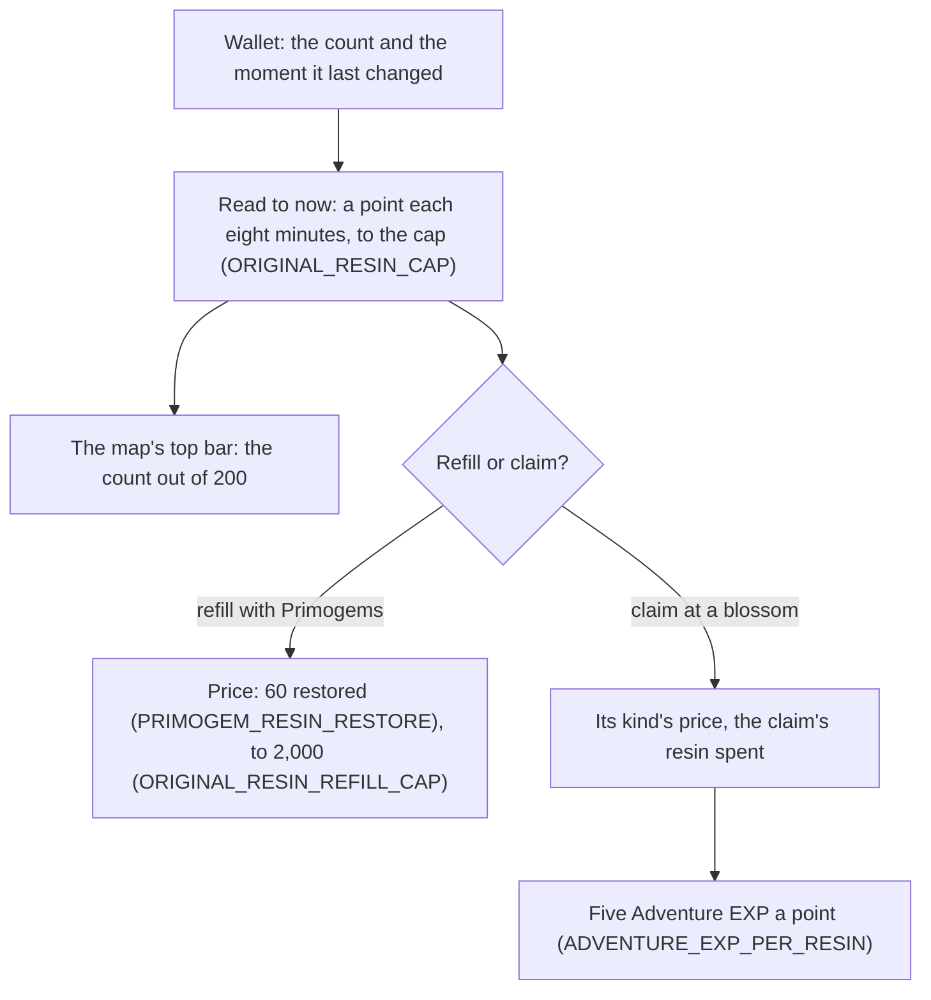

# Original Resin

The game keeps its energy for claiming challenge rewards as Original Resin. The wallet holds it as a count and the moment it last changed, so its regeneration is read to the present rather than run on a timer (`packages/genshin-world/src/services/originalResin/regenerateOriginalResin.ts`), and the page can be closed for a day and still show the resin filled. The map's top bar counts it (`packages/genshin-world/src/components/Map/Overlay/Index.vue`). The claim's price, its Adventure EXP and the Primogem refill are pure services in `genshin-world`, read off the rules the original-resin proposal settled.

Pressing F at a cleared challenge's blossom offers its claims, the ones the held resin affords, and choosing one spends its resin and grants its rewards into the bag and the wallet (`packages/genshin-world/src/composables/useWorldOutcrops.ts`, `packages/genshin-world/src/services/originalResin/computeBlossomClaimPrompt.ts`). The challenges that leave a blossom are the [ley line outcrops](../ley-line-outcrops/design.md), the [domains](../domains/design.md)' Petrified Tree and the [bosses](../bosses/design.md)' Trounce Blossom, each calling the one claim service with its own cost and reward list.

## How it works

## Decisions

- **One every `ORIGINAL_RESIN_REGEN_MINUTES` minutes, to `ORIGINAL_RESIN_CAP`.** `regenerateOriginalResin` adds a point for each `ORIGINAL_RESIN_REGEN_MINUTES` minutes since the moment the resin last changed, up to `ORIGINAL_RESIN_CAP`. It moves that moment on by the points it gives, so the time to the next point keeps its place. At `ORIGINAL_RESIN_CAP` regeneration stops and the moment is now, so a spend that takes the resin below `ORIGINAL_RESIN_CAP` starts the next point from there (`packages/genshin-world/src/services/originalResin/regenerateOriginalResin.ts`, `packages/genshin-world/src/services/originalResin/constants.ts`).
- **A refill passes the cap, to `ORIGINAL_RESIN_REFILL_CAP`.** `refillOriginalResin` reads the regeneration to now, then adds to the count, filling to `ORIGINAL_RESIN_REFILL_CAP`. Above `ORIGINAL_RESIN_CAP` the resin does not regenerate (`packages/genshin-world/src/services/originalResin/refillOriginalResin.ts`).
- **Primogem refills, one per price in `PRIMOGEM_RESIN_REFILL_PRICES` a game day.** Each restores `PRIMOGEM_RESIN_RESTORE` at its price in `packages/genshin-world/src/services/originalResin/constants.ts`, paid in the world's own Primogems, which are never sold. `refillOriginalResinWithPrimogems` refuses a refill short of its price, at the 2,000 cap, or once the day's refills are used (`packages/genshin-world/src/services/originalResin/refillOriginalResinWithPrimogems.ts`, `PRIMOGEM_RESIN_REFILL_PRICES` in `packages/genshin-world/src/services/originalResin/constants.ts`). The game's day turns at the daily reset that the [reset clock](../reset-clock/design.md) defines (`GAME_DAY_START_HOUR` in `GAME_TIME_ZONE`, the game's server time), so the count restarts at that hour and not at midnight (`packages/genshin-world/src/services/time/constants.ts`).
- **A claim's price by its kind.** `computeBlossomClaimResin` prices a claim by its blossom kind, and a weekly boss's by how many claims it has had that week (`packages/genshin-world/src/services/originalResin/computeBlossomClaimResin.ts`).
- **A claim's offers.** `computeBlossomClaimOffers` lists how a blossom's claim is paid: one claim at its price; at a ley line or a domain also two claims at twice the price, and a Condensed Resin for `CONDENSED_RESIN_CLAIM_COUNT` claims. A boss offers its one claim only (`packages/genshin-world/src/services/originalResin/computeBlossomClaimOffers.ts`).
- **Condensed Resin's claim.** `claimResinReward` takes its cost's Condensed Resin out of the bag, one for a ley line's or a domain's `CONDENSED_RESIN_CLAIM_COUNT` claims (`packages/genshin-world/src/services/originalResin/claimResinReward.ts`). `computeBlossomClaimOffers` offers that cost only at a ley line or a domain, so a boss is refused it. It spends no Original Resin, so it gives no Adventure EXP.
- **`ADVENTURE_EXP_PER_RESIN` Adventure EXP a point.** `claimOriginalResin` spends the resin, then gives `ADVENTURE_EXP_PER_RESIN` Adventure EXP a point through `gainAdventureExp`, so the EXP past rank 60 is paid out the way [forging](../forging/design.md) describes. A claim the resin does not cover returns undefined and spends nothing (`packages/genshin-world/src/services/originalResin/claimOriginalResin.ts`, `ADVENTURE_EXP_PER_RESIN` in `packages/genshin-world/src/services/originalResin/constants.ts`).
- **The claim's offer on F.** `useWorldOutcrops` opens the prompt at a cleared outcrop's blossom from `computeBlossomClaimPrompt`, which lists the offers the holdings pay. A blossom whose offers the holdings cannot pay, and that no Fragile Resin can restore, opens no prompt. A challenge cleared but not claimed gives nothing.
- **A short Original Resin restores first.** Where the Original Resin covers no resin claim and the bag holds a Fragile Resin, the prompt's restore row spends one for `FRAGILE_RESIN_RESTORE` Original Resin through `refillOriginalResinWithFragileResin`, then offers the claims again from the restored holdings (`packages/genshin-world/src/services/originalResin/refillOriginalResinWithFragileResin.ts`). The row reads the game's own "Can use Fragile Resin to restore" (`GameTextKey.FragileResinRestore` in `packages/genshin-text/src/models/GameTextKey.ts`). Its place among the rows is provisional until a recording measures it.
- **Settled calls.** A new player holds the full `ORIGINAL_RESIN_CAP` (`packages/genshin-world/src/services/inventory/constants.ts`). The resin's rarity is 3, the game's material table's `rankLevel` (`{data-root}/genshin-parity/text/ExcelBinOutput/MaterialExcelConfigData.json`, row `106`, `rankLevel` 3). Its name is the game's own text, `GameTextKey.OriginalResin`. Both the starting amount and the `GAME_DAY_START_HOUR` reset are settled from the game's own design rather than checked against the wiki.

## Data

- **The item's row.** Original Resin is item 106 in the game's material table, with the rarity above. Its name's text id is the one `GameTextKey.OriginalResin` holds (`packages/genshin-text/src/models/GameTextKey.ts`, and row `106`'s `nameTextMapHash` 3246419172 in `{data-root}/genshin-parity/text/ExcelBinOutput/MaterialExcelConfigData.json`).
- **The other resins' rows.** Fragile Resin is item 107009 in the published material table (the cached copy `{data-root}/cache/content/33a86f139a7f5a88c3216e47e4d12762bc220cab50d476cab2e2bd07e482c246`, row 107009 with name text 3056266748, "Fragile Resin" in `{data-root}/genshin-dump-backup-6.6/TextMap/TextMap_MediumEN.json`), whose use adds 60 of item 106, the restore the refill uses, and whose use the bag reaches through `useInventoryEntry` (`{data-root}/genshin-parity/text/ExcelBinOutput/MaterialExcelConfigData.json`, row `107009`, whose `itemUse` adds `106` by `60`). Condensed Resin is item 220007, whose stack limit is 5 (`{data-root}/genshin-parity/text/ExcelBinOutput/MaterialExcelConfigData.json`, row `220007`, `stackLimit` 5).

## Not built

- **The top bar's refill.** The plus on the top bar that opens a refill is unbuilt. The top bar shows the count only.

The top bar's place and type are provisional until a recording measures them. The line is on the [roadmap](../../../changes/genshin-roadmap/tasks.md)'s References sought list.

## Key files

| File                                                                                       | Role                                                                                                                     |
| :----------------------------------------------------------------------------------------- | :----------------------------------------------------------------------------------------------------------------------- |
| `packages/genshin-world/src/services/originalResin/constants.ts`                           | The cap, the refill cap, the regeneration interval, the Primogem prices and the game's day                               |
| `packages/genshin-world/src/services/originalResin/regenerateOriginalResin.ts`             | The count and its moment read to now, a point each interval below the cap                                                |
| `packages/genshin-world/src/services/originalResin/spendOriginalResin.ts`                  | A spend read to now, undefined where the resin is not held                                                               |
| `packages/genshin-world/src/services/originalResin/refillOriginalResin.ts`                 | A refill added to the count, filling to the refill cap                                                                   |
| `packages/genshin-world/src/services/originalResin/refillOriginalResinWithPrimogems.ts`    | A refill for the day's next price, the day's count restarting at the game's day                                          |
| `packages/genshin-world/src/services/originalResin/refillOriginalResinWithFragileResin.ts` | A Fragile Resin used from the bag: sixty restored (`FRAGILE_RESIN_RESTORE`), one taken out, undefined where none is held |
| `packages/genshin-world/src/services/originalResin/computeBlossomClaimResin.ts`            | A claim's price by its blossom kind and the weekly boss's claims that week                                               |
| `packages/genshin-world/src/services/originalResin/computeBlossomClaimPrompt.ts`           | The F prompt's offers from the holdings, and whether a Fragile Resin restores                                            |
| `packages/genshin-world/src/composables/useWorldOutcrops.ts`                               | The prompt at a cleared outcrop's blossom: opened, restored and chosen                                                   |
| `packages/genshin-world/src/components/Interaction/OfferChoice/Index.vue`                  | The claim's rows on F: one per offer, the restore row and the row that leaves it                                         |
| `packages/genshin-world/src/services/originalResin/claimOriginalResin.ts`                  | A claim: the resin spent, the Adventure EXP gained and the Mora past rank 60                                             |
| `packages/genshin-world/src/services/originalResin/claimResinReward.ts`                    | The one resin claim: a cost paid in Original or Condensed Resin, the reward list taken in                                |
| `packages/genshin-world/src/services/reward/drawRewardItems.ts`                            | A reward's items drawn to a count in their range, shared by commissions and expeditions                                  |
| `packages/genshin-world/src/services/originalResin/computeBlossomClaimOffers.ts`           | The ways a blossom's claim is paid: one, two at twice the price, or a Condensed Resin                                    |
| `packages/genshin-world/src/services/originalResin/checkIsMultiClaimBlossom.ts`            | A ley line or a domain, the blossoms that can be doubled or paid in Condensed Resin                                      |
| `packages/genshin-world/src/models/originalResin/BlossomClaimOffer.ts`                     | One way to pay a claim: its claim count, its resin and its Condensed Resin                                               |
| `packages/genshin-world/src/models/inventory/Wallet.ts`                                    | The count of each currency, the moment Original Resin last changed, and the day's refills                                |
| `packages/genshin-world/src/services/inventory/constants.ts`                               | A new player's wallet, holding Original Resin at the cap                                                                 |
| `packages/genshin-world/src/components/Map/Overlay/Index.vue`                              | The count on the map's top bar, read when the map opens                                                                  |
| `packages/genshin-text/src/models/GameTextKey.ts`                                          | `OriginalResin`, the item's name in the game's text                                                                      |

## Notes

- **The map reads its count once.** The count is taken when the map opens, so it holds still while the map is up, which is the moment a player reads it (`packages/genshin-world/src/components/Map/Overlay/Index.vue`).
- **A claim's Companionship EXP is a rule of its own.** The claim gives no Companionship EXP itself; a blossom's amount goes to the deployed team through the [companionship](../companionship/design.md) grant, its amounts provisional until recorded.

## Sources

- [Original Resin](https://genshin-impact.fandom.com/wiki/Original_Resin), Genshin Impact Wiki: the claims' prices, five Adventure EXP a point, one point every eight minutes to 200, the Fragile and Primogem refills, and the 2,000 cap.
- [AnimeGameData](https://github.com/DimbreathBot/AnimeGameData), the community's per-patch dump: the material rows of items 106, 107009 and 220007, and the reward table.
- `{data-root}/genshin-parity/text/ExcelBinOutput/MaterialExcelConfigData.json`, row `107009`, whose `itemUse` adds `106` by `60`, grounds the requirement "Fragile Resin restores sixty Original Resin".

## Open

- [ ] **one Original Resin regenerates every eight minutes, up to 200** — no source: the wiki's Original Resin page, which the cache does not hold.
- [ ] **a refill fills to 2,000, and six Primogem refills a game day restore 60 each** — no source: the wiki's Original Resin page, which the cache does not hold.
- [ ] **a claim's price by blossom kind, and a weekly boss's 30 then 60 Original Resin** — no source: the wiki's Original Resin page, which the cache does not hold.
- [ ] **a ley line or a domain offers two claims at twice the price, or a Condensed Resin for three claims** — no source: the wiki's Original Resin page, which the cache does not hold.
- [ ] **a claim gives five Adventure EXP a point of resin** — no source: the wiki's Original Resin page, which the cache does not hold.
- [ ] **a new player holds 200 Original Resin, and the game day starts at 04:00 in UTC+8** — no source: the game's own design for the UTC+8 offset, since the dump's RefreshPolicy row gives a daily refresh of 14400 seconds with no time zone (`{data-root}/genshin-dump-backup-6.6/ExcelBinOutput/RefreshPolicyExcelConfigData.json`).
- [ ] **the ley line outcrops, the Petrified Tree and the Trounce Blossom are the blossoms that leave a claim** — no source: a read of the dump's blossom tables for the rows that leave a claim.
- [ ] **the restore row reads "Can use Fragile Resin to restore"** — no source: the English text of `UI_GUIDE_FRAGILE_RESIN`, which the dump's English text map does not hold under that phrase.
