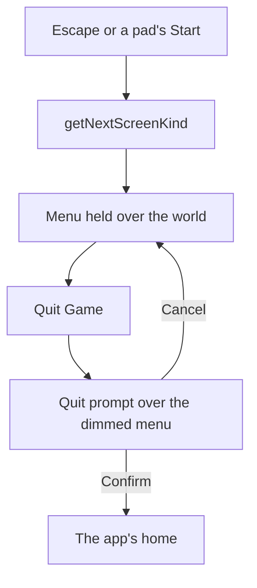

# Paimon menu

The game's pause menu, laid out as the English PC client's current build draws it in the `paimon-menu` reference: the frame at 25 seconds of `yt-jHr2bERjkYc`, cut at 1920 by 1080 with the game's window pillarboxed inside it. Its side bar runs down the left from Back to Quit Game, and its contents stand beside it in the game's own order, each labelled in the game's own text: Party Setup, Friends, Achievements, Archive, Character Archive, Character, Inventory, Quests and Map, then the links out to web pages, drawn disabled, Community, Version Highlights, Feedback and Survey (`packages/genshin-world/src/services/menu/constants.ts`). Every icon is traced from the game's own captures into a path of our own, and an icon it draws in more than one tone into a layer for each, its paler tones laid under its white in their share of it. The frame draws nine of the fifteen contents: the menu also holds Shop, Wish, Battle Pass, Co-Op Mode, Events and Adventurer Handbook, each drawn only once its system is open (see the open-state bullet below). The Training Guide is not in the menu, since no still of it shows one.

## How it works

- **The menu opens from Escape or a pad's Start, and holds the world in single-player.** The screen the world opens for Escape and Start is chosen in `packages/genshin-world/src/services/screen/getNextScreenKind.ts`, and the hold is `MENU_SCREEN_BEHAVIOUR` in `packages/genshin-world/src/services/screen/constants.ts`: the simulation and the clock held and the HUD hidden, while the music plays on.
- **A content shows once its system is open, and an open one whose screen is not built is drawn disabled.** An entry opens its screen once that screen is built, which is whether `MenuScreen` has a slot for it; until then, while its system is open, it is drawn disabled (`packages/genshin-world/src/components/Menu/Paimon/Index.vue`). A disabled entry says the game has the screen and this world does not yet, while a missing one would say the game has no such screen. Whether a system is open is `checkIsSystemOpen` (`packages/genshin-world/src/services/adventureRank/checkIsSystemOpen.ts`): it holds the system to the rank it opens at (`ScreenKindOpenRankMap`: Friends 2, Co-Op Mode 16, Battle Pass 20) and to the main quests it opens after (`ScreenKindOpenQuestMap`). The gates are read from the install's `OpenStateConfigData` (`{data-root}/genshin-parity/text/ExcelBinOutput/OpenStateConfigData.json`, rows 31, 49 and 900): the Wish (Gacha, id 31) and the Shop (Mall, id 900) open after quest 2010001, and Co-Op Mode after quest 35001 as well as its rank (id 49). Two gates are estimates, since no open state names them: the Adventurer Handbook after quest 20505, which its text ties it to, and the Events after quest 2010001, as the Wish opens. A system not open is not drawn at all, so a player at Adventure Rank 2 with none of those quests finished sees the frame's nine contents. **That a system not open is hidden, rather than drawn disabled as an unbuilt one is, is unverified against a locked account:** the install's data has no field that says hidden or drawn, and the frame is the only witness for it.
- **Back closes it, Quit Game asks first.** Quit Game opens the quit prompt over the menu, which stays visible behind it dimmed and inert while it shows. Cancel closes the prompt back to the menu, and Confirm leaves the world for the app's home, since leaving the page is the browser's closing of the game (`packages/genshin-world/src/components/Menu/Exit/Index.vue`, `packages/genshin-world/src/components/Menu/Paimon/Index.vue`, and `apps/web/app/components/Genshin/World.vue` for the leaving).
- **It opens and closes on the timing that `PAIMON_MENU_FADE_MS` and `PAIMON_MENU_PANEL_DELAY_MS` hold in `packages/genshin-world/src/services/menu/constants.ts`.** The side bar fades in and the panel follows its delay, on the same curve, and Back closes the menu in reverse, the panel first. The clip the timing is read from (`yt-IegFADn-Lmk-menu-paimon`, `{data-root}/genshin-parity/captures/yt-IegFADn-Lmk-menu-paimon.mp4`, the English PC client at 60 frames a second) puts the opening's side bar at half at 35.83 seconds, from 35.75 to 35.91, and its panel done by 36.02; the closing's panel is gone by 110.02 and the side bar's half at 110.07, from 109.98 to 110.15. The fade's curve is a smoothstep, which fits the side bar's alpha with an RMS error of 0.011 opening and 0.006 closing (`packages/genshin-world/src/services/menu/constants.ts`, which records the readings off the clip), and its CSS form is the nearest cubic bezier (`packages/genshin-interface/src/services/constants.ts`, `GAME_SMOOTHSTEP_EASING`). The HUD vanishes in about 0.05 seconds at 35.43 and returns over 110.07 to 110.48 (readings recorded in `packages/genshin-world/src/services/menu/constants.ts`). Quit Game is not animated: its prompt opens over the menu at once (`packages/genshin-world/src/components/Menu/Paimon/Index.vue`).
- **Its side bar lights under the pointer.** Each side bar button is a Disc (`packages/genshin-world/src/components/Menu/Paimon/Index.vue`) ([interface library](../interface-library/design.md)): its gold icon turns cream and grows on a navy disc, its name shown beside it over the panel, and pressed the disc turns cream under an ink icon at its resting size. The info icon has no state of its own, as the game draws it. Its panel's entries are Rows, tinted under the pointer by the provisional tints of the [interface library](../interface-library/design.md).
- **Its layout is in the frame's own pixels.** A place is written in units, a unit being a pixel of the 1080 high frame, and a glyph's box in the still's pixels, which `--reference-pixel` scales to 0.79 of a unit, so each icon is placed as the game draws it (`packages/genshin-world/src/components/Menu/Paimon/Index.vue`). The menu stands 150 pixels in from its window's left edge, where the frame's pillarbox leaves it. Quit Game is anchored from the bottom edge, 36 of the 1440 high still's pixels up from its bottom, since the frame centres it 55 units above the bottom (`quitStyle` in the same file), while the five side bar icons above it stay where the 16:9 map places them. Scored over the side bar and the panel above their translucent feet, it is held to its `paimon-menu` row (`scripts/src/services/genshinParity/shared/ParityReferenceMap.snapshot.md`). What is left is the typeface where Signika stands in, the translucent foot of the panel where the world shows through, the Traveler's avatar, which is the game's art and so drawn as a plain disc, and the words and numbers the page holds no key or value for: the frame's signature, its UID and its Adventure EXP figures. The name is the Traveler's default, since the recording's player is not in the repository.
- **The quit prompt is the current build's two choices over the dimmed menu (`packages/genshin-world/src/components/Menu/Exit/Index.vue`).** A dialog over the menu, which stays visible behind it under a 66% backdrop solved from the frame's margin round the panel: the cream panel is 910 by 576 reference pixels, centred, with the question across its top and two slate pills, 370 by 63 pixels, Cancel 66 pixels in from the panel's left and Confirm 475 in. Cancel carries a blue cross and Confirm a yellow ring, each at its pill's left with its label centred in the rest (`packages/genshin-world/src/components/Menu/Exit/Index.vue`, the cross's and the ring's rules). The colours are sampled from the recording at 29 seconds (`yt-kIDee7nyD0w`), and the icons are drawn as shapes, since their paths are not traced. The gold brackets at the panel's corners are drawn as shapes too, but the ornament inside the panel is not. The rest state is scored over the panel's region in `yt-kIDee7nyD0w` at 26.75 seconds, where the dialog has settled and no button is lit; the hovered and pressed states are scored from the same clip at 29 and 30.6 seconds (`menu-exit-hover`, `menu-exit-pressed`), and the longer `menu-quit-prompt.mkv` re-measure still waits. Hovered and pressed are the dialog's own rules in `Exit/Index.vue`, a gold rim under the pointer and a pale fill when pressed, on Plain buttons rather than the interface library's Row kind.
- **The Settings screen is scored whole over the world.** Its tabs run down the left in the game's order, and the Graphics and Audio tabs draw their rows under their headings, each label the game's own words, laid out from a public recording of the English PC client at 1920 wide (`yt-5EmJX_RyuY8-menu-settings`, [the settings recording](../interface-library/design.md); the 1920 wide reference in `scripts/src/services/genshinParity/shared/ParityReferenceMap.ts`), where a unit is a pixel. A reference's `plate` fills each of the game's pieces from the blurred world around it ([clean plate](../parity/clean-plate/design.md)), so the frame is scored whole and every piece over what lies behind it: the Graphics tab at its top is held to its `settings-graphics-rows` row (144.5 seconds, `scripts/src/services/genshinParity/shared/ParityReferenceMap.ts` and the snapshot's row), and the Audio tab to its `settings-audio-rows` row (178 seconds, `scripts/src/services/genshinParity/shared/ParityReferenceMap.ts` and the snapshot's row, shot with the pointer resting on Output Settings as the recording's does). Both are approved by their mean difference under 2% (`scripts/src/services/genshinParity/shared/ParityReferenceMap.ts`, the `approval` bar of `MENU_SETTINGS_REFERENCE`), since FLIP reads the typeface's every edge. The wiki's 1680-wide still, scored over its header band, is held to its `settings-graphics` row (its entry in `scripts/src/services/genshinParity/shared/ParityReferenceMap.ts` and the snapshot's row). What is left is the game's typeface where Signika stands in and the sparkles drifting along the open tab's light. Only the graphics quality is the world's, its words marking the device's own tier as the default as the game's do (the Graphics frame at 144.5 seconds of [the settings recording](../interface-library/design.md) reads High (Default)); every other row draws the value the recording shows, disabled, as this menu draws an entry whose screen is not built, and so do the tabs past Graphics and Audio (`packages/genshin-world/src/services/menu/SettingsTabSectionsMap.ts`). Its close is a Disc and its tabs are Rows (`packages/genshin-world/src/components/Menu/Settings/Index.vue`), so they light as the [interface library](../interface-library/design.md) sets out. A row lights with a white rim round its edge under the pointer or while it holds the keyboard's focus, as the recording's rows light one at a time from 176 to 179 seconds. The world does not yet open the screen.
- **Its profile card shows the rank and the World Level.** Each value stands right-aligned beside its row's end, where the current client draws it, and the info icon beside the World Level opens the World Level dialog over the dimmed menu (`packages/genshin-world/src/components/Menu/Paimon/Index.vue`; [Adventure Rank](../adventure-rank/design.md)). Birthday stands over the dash `-/-` the frame draws until the birthday is set, and the dash is a plain button with no drawn face, so the frame shows no button, named Set Birthday for assistive technology (`packages/genshin-world/src/components/Menu/Paimon/Index.vue`); the [menu screens](../../../changes/genshin-menu-paimon/design.md) proposal builds it.
- **The World Level dialog is measured off a public recording.** Its frame, 1078 by 716 and centred, its band, line and fill, the title, the cross, the dividers, the scroll track, the body's lines 32 units apart at a cap height of 20 and spaced out to the game's line widths, and the cream button with its red arrow are read from a tutorial recorded at 1080 high, at 5 seconds (`world-level-dialog`, `scripts/src/services/genshinParity/shared/ParityReferenceMap.ts`, from `{data-root}/genshin-parity/captures/yt-P13s7kSmVOE-world-level-dialog-2024.mkv`), its glyphs traced from the 2025 tutorial's 4K recording. Scored over its frame, it is held to its `world-level-dialog` row (`scripts/src/services/genshinParity/shared/ParityReferenceMap.snapshot.md`). What is left is the build's wording and the game's typeface: the recording's help text reads World Level 5, and "reduce" in its second sentence where the current text map (key 2955635938 in `{data-root}/genshin-parity/text/TextMap/TextMap_MediumEN.json`) reads 3 and "decrease", which wraps one line more and moves every line above it.

## Decisions

- **The Settings screen's looks are provisional.** They are read through the world blurred behind them at 144.5 and 178 seconds of [the settings recording](../interface-library/design.md), each solved from the two worlds the stills show it over: the header's dark veil and how it fades, the light trailing the open tab's name, the faint second star behind each value, the rows' faint shadow and their lit rim, the scroll track's and thumb's alphas, and the Audio tab's speaker, number box and slider. Anisotropic Filtering's 8x is written as a number, since no text id holds it: `{data-root}/genshin-parity/text/TextMap/TextMap_MediumEN.json` holds the label "Anisotropic Filtering" at id 3817395328 and no entry with an 8x value (`packages/genshin-world/src/services/menu/SettingsTabSectionsMap.ts`). They stand if the screen reads the same beside those frames in English and 8x stands alike in every language, and any look or that value differing would change it.

- **Back has no state of its own, provisionally.** No recording shows Back under the pointer, so it is drawn as the game draws the info icon, the same in every state, and a keyboard's focus rings it in white (`packages/genshin-world/src/components/Menu/Paimon/Index.vue`). A recording of Back hovered and pressed settles it.

## Key files

| File                                                                          | Its role                                                                                             |
| :---------------------------------------------------------------------------- | :--------------------------------------------------------------------------------------------------- |
| `packages/genshin-world/src/services/menu/constants.ts`                       | the Paimon menu's contents, links and side bar, in the game's order, each with its icon              |
| `packages/genshin-world/src/services/adventureRank/checkIsSystemOpen.ts`      | whether a content is open, at the rank held and with the main quests it opens after finished         |
| `packages/genshin-world/src/services/adventureRank/ScreenKindOpenRankMap.ts`  | the rank each content opens at, from the install's open-state table                                  |
| `packages/genshin-world/src/services/adventureRank/ScreenKindOpenQuestMap.ts` | the main quests each content opens after, from the install's open-state table, two of them estimated |
| `packages/genshin-world/src/services/menu/MenuEntryGlyphMap.ts`               | each contents entry's icon, traced, placed in its tile                                               |
| `packages/genshin-world/src/services/menu/MenuFrameGlyphMap.ts`               | the side bar's, Back's, the card's and the settings header's icons, traced, placed in the reference  |
| `packages/genshin-world/src/components/Menu/Glyph/Index.vue`                  | one traced icon, placed in the reference's pixels from its parent                                    |
| `packages/genshin-world/src/components/Menu/Paimon/Index.vue`                 | the Paimon menu, laid out in the frame's pixels, its icons placed and its card drawn                 |
| `packages/genshin-world/src/components/Menu/Exit/Index.vue`                   | the quit prompt Quit Game opens: Cancel and Confirm, over the dimmed menu                            |
| `packages/genshin-world/src/components/Menu/Settings/Index.vue`               | the Settings screen: its tabs, and the open tab's headings and rows over the world                   |
| `packages/genshin-world/src/services/menu/SettingsTabSectionsMap.ts`          | the Graphics and Audio tabs' headings and rows in the game's order, each with its value              |
| `packages/genshin-world/src/components/Menu/WorldLevelDialog/Index.vue`       | the World Level dialog the card's info icon opens: its help text and lowering button                 |
| `packages/genshin-world/src/services/menu/MenuPromptGlyphMap.ts`              | the prompts' button icons, traced, placed on their discs in the button's pixels                      |
| `packages/genshin-world/src/models/menu/MenuPromptIcon.ts`                    | the prompts' button icons, one per button                                                            |
| `packages/genshin-world/src/services/menu/MenuDialogGlyphMap.ts`              | a menu dialog's cross and corner ornament, traced, placed from its frame's top left                  |
| `packages/genshin-world/src/models/menu/MenuDialogIcon.ts`                    | a menu dialog's icons                                                                                |
| `apps/web/app/components/Genshin/World.vue`                                   | hands the world its game text, and leaves for the app's home on Quit Game                            |

## Sources

- `menu-paimon.mkv` — the Paimon menu opened and closed. Found: https://www.youtube.com/watch?v=IegFADn-Lmk at 0–141 s (`{data-root}/genshin-parity/captures/yt-IegFADn-Lmk-menu-paimon.mp4`), the English PC client at 60 frames a second, the menu opening at about 35.3–36.3 s and closing at about 109.5–110.5 s; a caption runs along the bottom, the uploader's black box covers the name card, and a comment overlay covers the grid from about 85 to 107 s. The opening alone is also in https://www.youtube.com/watch?v=igW050DMb4A at 0–40 s (`{data-root}/genshin-parity/captures/yt-igW050DMb4A-0-40.mp4`).
- `menu-time.mkv` — the Time screen opened from the Paimon menu's side bar, an hour chosen on it and confirmed, 30 seconds at most, at 60 frames a second. Found: https://www.youtube.com/watch?v=igW050DMb4A at 0–40 s (`{data-root}/genshin-parity/captures/yt-igW050DMb4A-0-40.mp4`).
- **Graphics tab open** (requirement _The Settings screen shows the game's tabs and rows_): the frame at 144.5 seconds of [the settings recording](../interface-library/design.md) reads 'High (Default)', and text id 1676673275 in `{data-root}/genshin-parity/text/TextMap/TextMap_MediumEN.json` reads '{0} (Default)'.

## Open

- [ ] **The rest frame's panel is 958 by 606 reference pixels, about 1.05 of the 910 by 576 the prompt draws** — whether the rest state keeps the hover and pressed scale is not decided: `packages/genshin-world/src/components/Menu/Exit/Index.vue` (~79-86) draws the hover and pressed frames' 910 by 576, and the rest state is scored over that panel's region, while `{data-root}/genshin-parity/references/menu-quit-prompt/exit-prompt-current.png` measures 958 by 606.
- [ ] **The Audio reference's pointer rests on Output Settings** — no source yet: the reference's pointer at (1000, 663) is not matched to its row in this page's sources.
- [ ] **The settings rows light one at a time from 176 to 179 seconds** — no source yet: the frames of [the settings recording](../interface-library/design.md) from 176 to 179 seconds are not read here.
- [ ] **The World Level glyphs are traced from the 4K tutorial recording** — no source yet: the 4K tutorial clip is the one [Adventure Rank](../adventure-rank/design.md) cites, but no file records the glyph trace as read from it.
- [ ] **The frame draws nine of the fifteen contents** — no source yet: the count is the page's own reading of the frame, not checked against a reference file here.
- [ ] **The Training Guide is not in the menu** — no source yet: no still of the menu is named here to show its absence.
- [ ] **The agent console's world answers Escape through the Paimon menu too** — no source yet: the console's mount of the world is not in the files this page cites.
- [ ] **The HUD vanishes at 35.43 and returns over 110.07 to 110.48** — no source yet: this page does not re-read the clip's frames at those seconds (`{data-root}/genshin-parity/captures/yt-IegFADn-Lmk-menu-paimon.mp4`); its readings are recorded in `packages/genshin-world/src/services/menu/constants.ts`.
- [ ] **Quit Game is not animated, and its prompt opens over the menu at once** — no source yet: a frame reading of the Quit Game row, from `{data-root}/genshin-parity/captures/yt-IegFADn-Lmk-menu-paimon.mp4` and `{data-root}/genshin-parity/captures/yt-kIDee7nyD0w-menu-quit-prompt.mp4`.
- [ ] **The side bar's buttons light under the pointer, turning their icon cream and growing on a navy disc** — no source yet: a reading of the side bar's highlight frames from `{data-root}/genshin-parity/captures/yt-IegFADn-Lmk-menu-paimon.mp4`.
- [ ] **Cancel carries a blue cross and Confirm a yellow ring, each at its pill's left** — the cross's blue and the ring's gold are sampled from the frame at 29 seconds (`Exit/Index.vue`); the quit prompt's stills in `{data-root}/genshin-parity/references/menu-quit-prompt` are not yet checked for the Cancel and Confirm buttons.
- [ ] **The Settings close is a Disc and its tabs are Rows, lit as the interface library sets out** — no source yet: a frame reading of the Settings close and tabs, from [the settings recording](../interface-library/design.md).
- [ ] **Only the graphics quality is the world's, and every other row draws the recording's value, disabled** — no source yet: a reading of the rows' values, from [the settings recording](../interface-library/design.md).
- [ ] **The menu opens by Escape and a pad's Start, and its pause stops everything but particles and music in single-player** — no source yet, as [Paimon's compute page](../compute/paimon/design.md) records (`{data-root}/cache/genshin-wiki/` holds only the talent categories and the cached talent pages).
- [ ] **Each profile value stands right-aligned beside its row's end, and the info icon opens the World Level dialog** — no source yet: a reading of the profile's layout and info icon, from [the settings recording](../interface-library/design.md).
- [ ] **The live Paimon menu draws no red dots** — no decision yet: the menu draws a dot beside each icon in its `alertedIcons` (`packages/genshin-world/src/components/Menu/Paimon/Index.vue`), and the live world session passes an empty list (`:alerted-icons="[]"`, `packages/genshin-world/src/components/World/Session/Index.vue`, ~2189). The frame shows a dot on Achievements, the Community, Version Highlights and Survey links, the notices and mail icons and the profile's pencil. Which news feeds the host's list, and whether the live menu should show the frame's dots until it has one, is not decided.
- [ ] **A locked account's menu hides the systems not open** — no source yet: a recording of a locked account's Paimon menu. The frame is the only witness, and the install's `OpenStateConfigData` has no field that says hidden or drawn.
- [ ] **The Adventurer Handbook opens after quest 20505, and the Events after quest 2010001** — no source yet: an open-state row naming either system. Both are estimates until one is found (`packages/genshin-world/src/services/adventureRank/ScreenKindOpenQuestMap.ts`).
