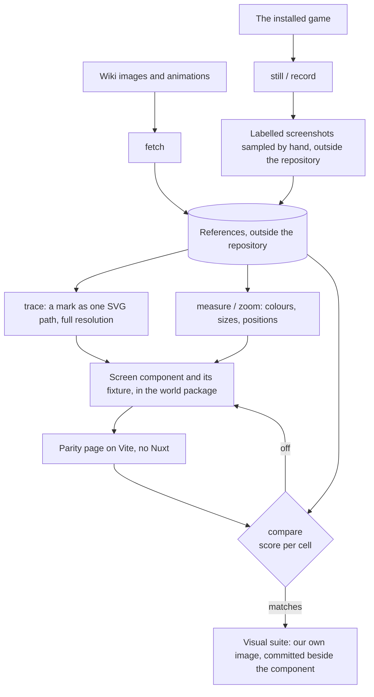

# Parity

The Genshin area recreates the game's own screens, so "does it look right" has an exact answer: the game. Parity is the loop that asks it. It is built for an agent, which reads images but drives no browser of its own: every step is one command that prints numbers and writes an image the agent reads (`scripts/src/services/genshinParity/commands/genshinParityCommand.ts`, `scripts/package.json` `genshin:parity`). The user's eye stays the final check. The loop is fast enough that nobody has to wait on that check (see Open).

## How it works

The steps are the commands of `scripts/src/services/genshinParity/commands/` (`genshin:parity` in `scripts/package.json`).

## The pieces

- [References](references/design.md): where a screen's images and recordings come from, and how the game is recorded.
- [Tracing](tracing/design.md): a mark traced into the SVG path a component draws.
- [Screens](screens/design.md): a component folder with its fixture, on the parity page and in the suite.
- [Witness](witness/design.md): the game's exports drawn through our scene and priced against the reference.
- [Clean plate](clean-plate/design.md): a reference behind an interface, compared over its scene.
- [Comparison](compare/design.md): the scores, FLIP and the committed report.
- [Light](light/design.md): the stone light solved from a reference.
- [Passes](passes/design.md): a new screen derived in passes, each with its measure.
- [Motion](motion/design.md): motion matched at sampled moments, never by recording.
- [Visual suite](visual-suite/design.md): approved screens held by the browser suite.
- [Costs](costs/design.md): the loop's cost, the benches and the GPU reduction.
- [Commands](commands/design.md): every `genshin:parity` command.

## Shapes come from the game's assets

The interface is rebuilt from screenshots, which its overlay compare holds exactly (`scripts/src/services/genshinParity/commands/overlayCommand.ts`, see Open); a scene's towers, doors and profiles come from the installed game's files. AnimeStudio exports them with the game closed into the references folder, outside the repository like every other reference (`scripts/src/services/genshinAssets/namecards/exportNamecards.ts`, `{data-root}/genshin-parity/extracted/`), and a transform fits our own kits' parameters to them (`scripts/src/services/genshinAssets/fit/fitLoginTowers.ts`, `scripts/src/services/genshinAssets/fit/fitLoginDoor.ts` and `scripts/src/services/genshinAssets/fit/fitLatheProfile.ts`), so only numbers of ours ship ([derived assets](../derived-assets/design.md)).

## Open

- [ ] **The loop is fast enough that nobody has to wait on the user's check** — no source yet: no timing of a loop run is recorded in the parity folder or in its benches.
- [ ] **The overlay compare holds the rebuilt interface exactly** — no source yet: no overlay compare result is cited, and `scripts/src/services/genshinParity/commands/overlayCommand.ts` is the command, not a score.
